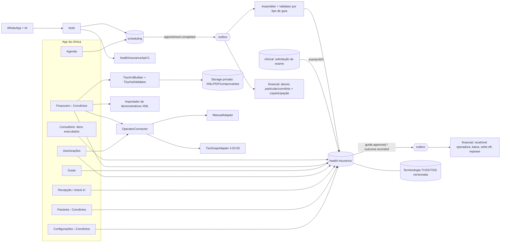

# QORO_TISS_MASTER_PLAN — Convênios e Guias TISS (produção)

> **Fonte única de verdade** do módulo Qoro Convênios — Guias TISS Inteligentes.
> Comece pela seção [ESTADO ATUAL](#estado-atual-da-implementação) e siga o
> [Protocolo de Retomada](#protocolo-de-retomada). O status escrito não basta:
> confira o repositório e as evidências.

| Campo | Valor |
| --- | --- |
| Revisão | **rev.2: plano de produção** (10/11/2026). A rev.1 (MVP) está no commit `62b53f4e`. |
| Objetivo | **Production Ready.** Não é MVP nem prova de conceito. |
| Repositório | `joaomarcos-techia/Project_OS` |
| Worktree | `C:/dev/Qoro_convenios_tiss_20261110` |
| Branch | `feat/convenios-tiss-20261110` (de `origin/main` `5620a098`); no GitHub desde 11/11 como backup, com **PR draft [#55](https://github.com/joaomarcos-techia/Project_OS/pull/55)** (não mergear) |
| Versão TISS de referência | Padrão TISS **setembro/2026**; Comunicação **4.03.00**; TUSS **202609** |

**Legenda**

- **[VERIFICADO]**: lido no código ou em fonte oficial, com caminho citado.
- **[HIPÓTESE]**: falta comprovar.
- **[DECISÃO]**: ver seção L.1.

**Estados de maturidade** (não confundir; cada capacidade avança por eles em ordem, ver A.5):

| Estado | Significa |
| --- | --- |
| **Implementado** | o código existe |
| **Testado** | os testes rodaram e o resultado está registrado |
| **Validado** | os critérios funcionais e técnicos foram aprovados |
| **Homologado** | o fluxo foi aceito no ambiente externo exigido (operadora) |
| **Pronto para produção** | os requisitos técnicos, operacionais, de segurança e de liberação estão satisfeitos |
| **Publicado** | implantado e habilitado, com autorização |

---

## ESTADO ATUAL DA IMPLEMENTAÇÃO

> Seção permanente. Atualize a cada tarefa concluída, bloqueada ou interrompida.

| Campo | Valor |
| --- | --- |
| Data da última atualização | 15/11/2026, manhã (até ~09h55: 0161 aplicada no DEV com a autorização específica do fundador; P4.6 concluída e validada no Preview; P14.2 validada na tela) |
| Fase atual | **P1 concluída**; P9 (lotes, XMLs, recurso) e P12 (armazenamento) validadas; ponte financeira (P1.10/P10.2/P10.3) pronta como candidata 0153; interface (P7.7/P9.9) implementada e testada; P9.5, P8.7/P6.2, P10.4 e P10.5 pendentes |
| Tarefa em andamento | **R51** variante rara aberta (sem ocorrência na jornada de 14/11, sem causa atribuída); **P2.5** parte externa bloqueada por operadora real; menu Convênios: a branch de UI ganhou commits (`12ab24f6`), divisão dos 18 arquivos em comum proposta (docs/convenios/handoff-ui.md §8); **R54** no Sandbox pronto para autorização |
| Última tarefa concluída | **P4.6** (15/11, manhã): 0161 aplicada no DEV (pré-voo, backup, ensaio por restauração 8/8, compatibilidade com o código publicado 26/26, pós-voo 13/13); jornada no Preview **25/25** no `2273f96d` (padrões, ajuste por teclado, persistência, celular, recepção e médica, duas aprovações simultâneas, devolução e revisão 2, valores emitidos no XML do lote) e histórico legível no `c5fce3fa`; **P14.2** validada na tela. Antes: **P3.2** validada no Preview (`4078a474`; etapas da ficha 2/2 no Preview `e552a692` (teclado, outra clínica 404, vazio, duas carteirinhas com uma vencida, rótulo "Guia de consulta nº", trial, suspensa; desktop, celular, médica sem a aba), depois da jornada r4 com 21 etapas verdes no `1291e8fc`; jornada completa no SHA final pendente (o encaixe é recusado depois das 23h30 pela agenda)); **P14.2** concorrência G.7 (harness 5/5; lote de harnesses 27/27); pré-voo só leitura do ledger de produção pronto para autorização; cauda TISS 0143–0158 fixada no guarda |
| Progresso | **69 de 117 tarefas concluídas (59,0%)**: P0.1–P0.9, P1.1–P1.10, P4.5, P6.2, P7.1, P7.2, P7.3, P7.4, P7.6, P7.7, P8.1, P8.2, P8.3, P8.5, P8.7, P9.1, P9.2, P9.3, P9.5, P9.6, P9.7, P10.1, P10.2, P10.3, P10.4, P10.5, P12.7, P12.14, P13.1, P13.2, P13.3, P13.4, P13.7, P14.1, P15.7, P2.1, P2.3, P2.4, P2.6, P3.1, P4.1, P4.4, P9.8, P9.9, P2.2, P4.3, P2.7, P5.3, P12.1, P3.2, P14.2, P4.6. P10.5 **homologada no alcance do Asaas Sandbox** (13/11). P4.3, P2.7, P3.2 e P4.6 **validadas no Preview DEV**. R54 provado em banco descartável com o Asaas simulado; **homologação de estorno no Sandbox não executada** (procedimento em docs/convenios/homologacao-r54-sandbox.md). P12.5 implementada e testada no alcance sem operadora (não contada: o acesso pelo adaptador depende da P6.4). Nada em produção; nenhuma homologação com operadora real. |
| CI oficial (GitHub Actions) | **Liberada em 14/11** (GitHub Pro; o job voltou a iniciar). `0d2aa4f3` reexecutado: **CI e ADR advisory verdes** (run 43591045113, 15 min 28 s, 25 passos). SHA final do ciclo: ver o registro M de 14/11 (noite). Até `1b09267e` verde; `e6e91139`…`a77e0aea` não iniciaram por cobrança (não reexecutados: a CI do HEAD cobre a mesma árvore e mais) **Fim da noite de 14/11:** CI 43672065842 verde no `4078a474`, com o passo novo da P12.1 em Postgres temporário (5/5); também verdes `2d3c79e6` (43667255805) e `e552a692` (43669520460). **15/11 (manhã):** CI 43711988363 verde no `2273f96d` e CI 43714907677 verde no `c5fce3fa` (todos os passos, inclusive isolamento entre clínicas e de todas as tabelas de Convênios em Postgres temporário, build e E2E público). |
| Capacidades em produção | nenhuma (ver A.5) |
| Testes aprovados | Ver o registro de 12/11 (tarde): suíte completa com cobertura e harnesses (bloqueio comercial 11/11, cadeia unida 10/10, ponte 18/18, glosas 16/16, lotes 16/16, bucket real 13/13, leituras da interface 6/6, XML do recurso 6/6, demais Convênios verdes) |
| Bloqueios ativos | B4 (integração: #53 primeiro, depois reconciliar o #55, D22; **colisão de migrations**: ver o aviso abaixo), B5 (operadora e clínica piloto), B6 (retenção legal), B7 (Validador TISS para Windows: **instalação não autorizada**), **B10** (segurança ANS: direção do fundador para S1–S10 em 11/11; **nada ligado para usuários reais**), **B11** (AbacatePay: com o agente do #53; Asaas: sandbox ok) |
| Decisões | D1–D12 aprovadas ou adotadas; D13–D17 adotadas no escopo delegado; D18 aprovada; D19 adotada e mantida, **com o ensaio no DEV substituído pela D23**; **D20 aprovada em direção técnica em 11/11** (arquivos cifrados em armazenamento privado; o alcance do requisito 56 segue em consulta formal); **D21** adotada; **D22 corrigida em 11/11** (L.1); **D23 do fundador em 11/11 (noite):** nenhum ensaio de DDL no DEV compartilhado sem aprovação específica |
| Arquivos alterados | este documento; `docs/adr/072-convenios-e-tiss.md` (era 067); `src/contexts/health-insurance/**`; `src/lib/xlsx/**`; `src/lib/validation/cnpj.ts`, `document.ts`; `src/lib/masks.ts`; campos de CNPJ do perfil, fornecedores e `/join`; `scripts/tiss/**`; `data/tiss/**`; `evidence/tiss-validadores-2026-11-10/**`; `docs/architecture/*` |
| Próxima ação exata | P12.2 depois da P1.12 (bundles da matriz I.2); P6.4 depois da P6.1; P10.6 coordenada com a UI (Caixa e financeiro são arquivos em comum). Com a UI: janela de testes pesados, menu e rebase dos 18 arquivos (handoff-ui.md §8). Com o fundador: autorizar o R54 no Sandbox (homologacao-r54-sandbox.md); conferir o backup no painel (coordenacao-migrations.md §14); decidir o pré-voo do ledger de produção (§16) |

> **⚠ Risco de colisão de migrations (registrado em 11/11; leia antes de criar qualquer migration).**
> - **Ledger real** (DEV, só leitura, conferido por SHA-256): 144 linhas. 0000–0135 da `main`; 0136–0142 do #53 (**aplicadas**); 0143 `tiss_catalog` do #55 (**aplicada**, última linha, `when` 1794330000000).
> - **Não aplicadas, todas do #55:** 0144–0150 (a 0149 e a 0150 entraram em 11/11 à noite, depois de reconferir o ledger e o #53 em `b6965447`). Nenhum número fica "reservado" enquanto não for aplicado no DEV. **Nenhum ensaio de DDL no DEV sem aprovação (D23).**
> - O gate do #53 (`assertMigrationJournalOrder`) exige `idx` contíguo. Por isso, **qualquer migration nova do #53 antes do merge colide com a faixa do convênio**: 0143 já está aplicada, e 0144+ deixa buraco no branch dele.
> - **A orientação de 11/11 de "começar em 0146 ou acima" estava errada e foi retirada.**
> - Estratégia única e mensagem ao agente do #53: `docs/convenios/coordenacao-migrations.md`.
> - Prova offline de que a união `main` + #53 + #55 passa no gate do #53: `src/contexts/health-insurance/migration-ledger.test.ts`.
> - Nenhuma aplicação persistente no DEV até a ordem ser resolvida (D19, D22).

---

### Checkpoint de 14/11/2026 (noite)

| Item | Estado |
| --- | --- |
| HEAD | commit da P12.1 sobre `8bc331e8` (`feat/convenios-tiss-20261110`) |
| PR | #55 **draft**; sem merge; #53 também draft (`f94248ef`) |
| GitHub Actions | liberado (GitHub Pro, 14/11); o token local não lê a cobrança (falta escopo `user`), por isso a prova é a execução |
| Última CI aprovada | `8bc331e8`: CI 43652860044 e ADR advisory verdes; `2dbe2359`: CI 43648393690 verde (17 min); `0d2aa4f3` reexecutado verde (43591045113). O SHA seguinte (P12.1) tem a CI acompanhada no PR |
| Migrations | DEV 161 linhas (0159 do #53 e 0160 do #55 aplicadas); **0161 (P4.6) candidata, só local e descartável** (coordenacao-migrations.md §17); guarda de composição nos migradores; produção intocada, ledger de produção não lido |
| Progresso | ver "Progresso" acima (contagem só de tarefas Concluídas) |
| Jornada E2E | P3.2 no Preview pendente (ver o registro M de 14/11, noite) |
| Dependências de outros agentes | UI: menu (entrada pronta), moldura das telas, causa do R51 no shell; AbacatePay: composição da 0159 no lançamento e D24 em Asaas/IA (P12.15) |
| Riscos ativos | R51 (hidratação rara), R56 (composição até o lançamento), R57 (deriva histórica de hash), B5 (operadora), B6 (retenção), B7, B10 |
| Próximo passo exato | P12.2 → P14.2 → P6.4 (classe A abaixo), em paralelo com a UI no menu |

**Classificação das tarefas abertas (14/11, noite).**

- **A. Implementáveis agora (sem operadora, pagamento, produção, credencial de terceiro ou aprovação):**
  - fundação e segurança: P1.12, P1.13 (interruptor por clínica, sem ligar para clínica real), P1.14, P12.2, P12.4,
    P12.6;
  - fluxos começados: P7.5, P8.6, P13.6, P12.13 (parte técnica);
  - regras e financeiro: P4.2, P4.6, P4.7, P5.1, P8.4, P9.10, P10.6;
  - autorizações sem conector: P6.1, P6.4 (porta + adaptador manual; fecha a P12.5), P6.6;
  - IA: P11.1 e P11.2, com a decisão D24 do #53 para IA;
  - qualidade e documentação: P14.2, P14.3, P14.4, P14.5, P15.1, P15.2 (homologação interna no Preview), P15.5.
- **B. Dependentes da UI** (contrato pronto em docs/convenios/handoff-ui.md): entrada do menu (R39), P3.3 (selo na
  agenda), P5.2, P6.3, P12.11.
- **C. Dependentes de homologação externa:** P2.5 (parte externa: C1–C10), P6.5, P9.4 (webservice), P15.3, P15.4.
- **D. Dependentes de decisão humana:**
  - P12.3 (B6), P12.8/P12.9 (S1–S4), P12.10 (S5), P12.12 (S8), P13.5 (B7), P15.6 (revisão financeira), P15.8,
    P15.9;
  - homologação do R54 no Sandbox (autorizar o pagamento de teste e o estorno);
  - leitura só leitura do ledger de produção e confirmação do backup gerenciado;
  - P12.15 é do dono do #53.

**Ordem dentro da classe A** (critério do ciclo: risco financeiro, inconsistência clínica, segurança):

1. P12.2, matriz de permissão por action (a P12.1 foi concluída em 14/11, noite);
2. P14.2, concorrência;
3. P6.4, porta do conector, que fecha a P12.5;
4. P4.6 (retorno contratual) e P10.6 (Caixa separa paciente × operadora);
5. P7.5, P8.6 e P13.6;
6. P12.6, observabilidade.

### Checkpoint de 15/11/2026 (madrugada)

| Item | Estado |
| --- | --- |
| HEAD | `4078a474` (`feat/convenios-tiss-20261110`); PR #55 **draft**, sem merge; #53 draft (`10e5d43b`) |
| CI | CI 43672065842 verde no `4078a474`, com o passo novo da P12.1 em Postgres temporário (5/5); também verdes `2d3c79e6` (43667255805) e `e552a692` (43669520460) |
| Migrations | DEV 161; 0161 candidata (P4.6), não aplicada no DEV; produção intocada; cauda 0143–0158 fixada; pré-voo do ledger de produção pronto (só leitura provada), não executado; com a 0161, o pré-voo espera `pending=26` |
| Backup | ativado (informado); garantias técnicas a verificar no painel (§14) |
| Jornada E2E | etapas da ficha 2/2 no Preview `e552a692` (teclado, outra clínica 404, vazio, duas carteirinhas com uma vencida, rótulo "Guia de consulta nº", trial, suspensa; desktop, celular, médica sem a aba), depois da jornada r4 com 21 etapas verdes no `1291e8fc`; jornada completa no SHA final pendente (o encaixe é recusado depois das 23h30 pela agenda) |
| P14.2 | harness 5/5; lote de harnesses 27/27; mensagem da ação corrigida em 15/11 (local) |
| P4.6 | implementada; 0161 candidata provada em descartável (9/9); lote de harnesses 27/28 na primeira rodada (o de composição contava 161 fixo), 14/14 depois do ajuste; commits locais até a 0161 estar no DEV |
| Progresso | **68 de 117 (58,1%)** |
| Coordenação | UI: janela de testes pesados aceita e usada (23:33–00:10); terminologia de guias decidida pela UI e aplicada; títulos de página nas 13 telas; divisão de arquivos (handoff-ui.md §8). #53: release congela a cauda TISS do `4d0ed1d5` |
| Próximo passo exato | ver "Próxima ação exata" acima |

### Checkpoint de 15/11/2026 (manhã)

| Item | Estado |
| --- | --- |
| HEAD | `c5fce3fa` (`feat/convenios-tiss-20261110`); PR #55 **draft**, sem merge |
| CI | 43711988363 verde no `2273f96d`; 43714907677 verde no `c5fce3fa` |
| Migrations | DEV **162** linhas: a 0161 foi aplicada às 08h46 só no DEV, com a autorização específica do fundador (coordenacao-migrations.md §18) e fixada no manifesto. Produção intocada; o pré-voo do ledger de produção espera `pending=26` e não foi executado. Próxima migration TISS: 0162 (`when` > 1795209773857) |
| Backup | DEV: `pg_dump` (estrutura, 41 tabelas `hi_*` + `clinics`, ledger) com restauração ensaiada. Gerenciado do Supabase: ativado (informado), garantias técnicas a verificar no painel (§14) |
| Jornada E2E | **25/25** no Preview `2273f96d` (16,7 min, clínica zerada `e2e-hi-config-mwhsfwe1`, marca `SJG1Z`) + etapa do histórico 1/1 no `c5fce3fa` |
| P4.6 | **concluída**: DEV, serviço, tela, emissão (XML do lote), concorrência, permissões, auditoria, E2E e evidência |
| P14.2 | validada na tela: duas aprovações no mesmo instante no Preview → uma emite, a outra lê "Esta guia já foi aprovada e emitida (etapa: Aprovada). Atualize a página…"; um único "Conferida → Aprovada" |
| Progresso | **69 de 117 (59,0%)** |
| Coordenação | UI: janela de 15 min às 08h00 (sonda do Caixa), máquina devolvida às 08h07; handoff-ui.md §4.2 com rotas, estados × papéis, mensagens e testes. A sessão da UI encerrou antes do aviso final: as referências ficam no handoff |
| Próximo passo exato | ver "Próxima ação exata" acima |

## Protocolo de Retomada

1. Ler este documento inteiro, em especial ESTADO ATUAL, L e o fim de M.
2. Conferir o repositório:
   ```bash
   git -C C:/dev/Qoro_convenios_tiss_20261110 --literal-pathspecs status --short
   git -C C:/dev/Qoro_convenios_tiss_20261110 --literal-pathspecs log --oneline -15
   git -C C:/dev/Qoro_convenios_tiss_20261110 --literal-pathspecs fetch -q origin
   gh pr view 53 --json state,mergedAt
   ```
3. Para cada tarefa **Concluído**, reabrir a evidência (arquivo, teste e saída) e rodar o teste. Se não bater, rebaixar a tarefa para **Em execução** e registrar no Registro.
4. Conferir os bloqueios de L.2 e as decisões de L.1.
5. Conferir a numeração de migrations (E.5) antes de criar qualquer uma.
6. Escolher a próxima tarefa (E.6) e anotá-la em ESTADO ATUAL antes de começar.

---

## A. Visão geral, escopo e definição de pronto

### A.1 Problema e objetivo

Clínicas que atendem por plano de saúde precisam faturar às operadoras no Padrão TISS da ANS, acompanhar autorizações, glosas e pagamentos, e conciliar o que receberam. Hoje o Qoro não faz nada disso.

**Objetivo:** um módulo de convênios **definitivo**. A clínica atende por convênio, gera as guias corretas automaticamente, fatura, acompanha recebimentos e glosas e opera o financeiro com segurança e o mínimo de retrabalho.

**Princípio:** o médico atende, o Qoro organiza, a recepção confere, o financeiro fatura. A guia é consequência do atendimento.

### A.2 O que mudou da rev.1 para a rev.2

| rev.1 (MVP) | rev.2 (produção) |
| --- | --- |
| só Guia de Consulta | Consulta **e SP/SADT** (solicitação e execução, vários itens, autorização e senha) |
| autorização só "informada" na cobertura | **processo de autorização completo**: solicitação, número, senha, validade, comprovantes, vínculo com itens e guias, porta para conector de operadora |
| glosa e pagamento só registrados à mão | **ciclo de glosa com 6 estados**, recurso de glosa (XML oficial), **importação de demonstrativos XML**, pagamentos parciais e integrais, conciliação |
| coparticipação só configurável | **ciclo completo**: estimar, conferir, confirmar, cobrar (Asaas quando autorizado), pagar, estornar e ajustar |
| repasse "investigar depois" | investigação feita (B.9) e **elegibilidade de repasse por recebimento da operadora** |
| validação só por XSD interno | **validação em três camadas**: ANS, validador interno e três validadores externos independentes, com matriz e evidência |
| homologação como pendência solta | **fase própria de homologação e publicação**, com estados de maturidade |
| 58 tarefas | **109 tarefas** (P0–P15) com mapa para os IDs antigos (D.0) |

### A.3 Matriz de escopo de guias e mensagens TISS (D13)

Avaliada contra o que o Qoro atende hoje: clínica ambulatorial (consultas, sessões, procedimentos de consultório, solicitação de exames). **Não há internação nem odontologia no produto.**

| Guia ou mensagem TISS 4.03.00 | Uso no Padrão | Decisão | Justificativa |
| --- | --- | --- | --- |
| **Guia de Consulta** (`ctm_consultaGuia`) | cobrança de consulta eletiva (item 62.1) | **Suportada integralmente** | núcleo do atendimento |
| **Guia SP/SADT, cobrança** (`ctm_sp-sadtGuia`) | cobrança de procedimentos, exames e terapias em paciente não internado (62.6–62.8) | **Suportada integralmente para itens da tabela 22** (procedimentos e eventos): vários itens, quantidades, valores, solicitante, executante, autorização e senha, guia principal | sessões (psicoterapia e outras terapias), procedimentos de consultório e exames feitos na clínica |
| **Guia SP/SADT, solicitação** (impressa; eletrônica via `solicitacaoProcedimento`) | solicitação de autorização de exames e procedimentos (62.3–62.4) | **Suportada:** PDF oficial, solicitação manual rastreável e mensagem eletrônica só via conector (P6.5) | o médico pede exames, e o paciente ou a clínica precisam da guia |
| SP/SADT **Outras despesas** (`ct_outrasDespesas`, tabelas 18/19/20) | materiais, medicamentos, taxas e gases | **Fora desta versão, declarado na UI e na documentação** | o público atual (psiquiatria e consultório) não fatura materiais; a tabela 19 tem mais de 200 MB. Reavaliar com demanda real (D13) |
| Guia de Honorários (`ctm_honorarioIndividualGuia`) | honorários vinculados a internação | **Não se aplica** | o Qoro não tem internação |
| Resumo de Internação, Solicitação de Internação, Prorrogação, Comunicação de Internação | internação | **Não se aplica** | idem |
| Guia Odontológica e anexos odonto | odontologia | **Não se aplica** | sem módulo odontológico |
| Anexos de Quimioterapia, Radioterapia e OPME | oncologia, cirurgia | **Não se aplica** | fora do público |
| **Lote de guias** (`loteGuias`) | envio de cobrança | **Suportado** (Consulta e SP/SADT) | — |
| **Recurso de glosa** (`recursoGlosa`, `ct_guiaRecursoLote`) | contestação | **Suportado** (XML validado + registro manual) | requisito de glosa |
| **Demonstrativos** (`demonstrativoAnaliseConta`, `demonstrativoPagamento`) | retorno da operadora | **Suportado: importação de arquivo XML** | a clínica baixa do portal da operadora |
| Elegibilidade, solicitação e status de autorização, envio de lote, status de protocolo e cancelamento de guia por **webservice** | troca eletrônica | **Porta implementada; conector genérico SOAP 4.03.00 testado contra stub. Homologado só com operadora real** (B5) | sem credencial de operadora não há homologação |

**Declaração de suporte:** o Qoro suporta **Guia de Consulta e Guia SP/SADT (procedimentos da tabela 22)**, lotes, recurso de glosa e importação de demonstrativos no Padrão TISS 4.03.00. **Não declarar suporte universal ao TISS.**

### A.4 Escopo funcional de produção

1. **Gestão de convênios:**
   - operadoras e registro ANS;
   - planos e categorias;
   - credenciamento da clínica e por profissional;
   - procedimentos aceitos e códigos TUSS;
   - tabelas contratuais com vigência, inclusive importação por planilha;
   - valores negociados;
   - regras de retorno;
   - coparticipação;
   - exigência de autorização;
   - identificação do prestador;
   - configurações por operadora;
   - histórico sem efeito retroativo.
2. **Pacientes:** várias carteirinhas por paciente, protegidas, com validade, histórico e preferencial, e pendências visíveis antes da consulta.
3. **Agendamento e WhatsApp:** particular ou convênio, respeitando:
   - profissional credenciado, plano e procedimento contratado;
   - agenda real;
   - carteirinha;
   - autorização;
   - coparticipação.

   A IA só usa convênios cadastrados e nunca promete cobertura, elegibilidade ou autorização.
4. **Prontuário integrado:** sem dado administrativo novo para o médico; CID nunca exigido nem enviado para faturamento; guias preparadas na conclusão, com conferência e aprovação.
5. **Guias:** Consulta e SP/SADT conforme A.3, cada uma com geração automática, validação, conferência, PDF no modelo oficial, XML e faturamento.
6. **Autorizações:**
   - solicitação administrativa;
   - número, senha, data e validade;
   - status, pendências, comprovantes e histórico;
   - vínculo com itens e guias;
   - conferência humana;
   - conector quando houver.

   Nunca simulada.
7. **Faturamento:**
   - guias, aprovação, lotes, XML, histórico de arquivos;
   - envio e protocolo;
   - retornos e demonstrativos;
   - glosas, recurso e contestação;
   - pagamentos parciais e integrais, ajustes, conciliação;
   - relatórios por operadora e período; indicadores de faturamento e inadimplência.
8. **Financeiro:**
   - recebível da operadora ligado à guia, criado na aprovação;
   - recebível do paciente preservado;
   - particular separado de convênio;
   - coparticipação com controle próprio;
   - nenhuma cobrança Asaas pelo valor cheio a paciente de convênio;
   - valores previsto, aprovado, faturado, glosado, recebido e pendente, separados.
9. **Coparticipação:** configuração contratual, estimativa, conferência, confirmação, cobrança pelo Asaas (quando autorizada e aplicável), pagamento, estorno e ajuste. Nunca cobra automaticamente valor que dependa de confirmação externa.
10. **Glosas:** informada, em análise, contestada, recurso apresentado, revertida e definitiva. Só a definitiva baixa no ledger. Tudo rastreável.
11. **Repasses:** calculado, elegível, autorizado, realizado e ajustes, respeitando a política configurada, sem antecipação indevida e sem mudar silenciosamente as regras atuais.
12. **Operação:**
   - feature flag por clínica e controle de plataforma;
   - disponibilidade comercial configurável, sem amarrar a plano;
   - observabilidade, alertas, reconciliação e recuperação;
   - documentação operacional.

### A.5 Rastreador de maturidade por capacidade

| Capacidade | Implementado | Testado | Validado | Homologado | Pronto | Publicado |
| --- | :-: | :-: | :-: | :-: | :-: | :-: |
| Cadastro de convênios | — | — | — | n/a | — | — |
| Carteirinhas | — | — | — | n/a | — | — |
| Agendamento por convênio (recepção) | — | — | — | n/a | — | — |
| Agendamento por convênio (WhatsApp) | — | — | — | n/a | — | — |
| Autorizações (manual) | — | — | — | n/a | — | — |
| Autorizações (conector) | — | — | — | — | — | — |
| Guia de Consulta | parcial: modelo, XML e validador (sem montador, tela, PDF nem persistência) | parcial: unitários + corpus | parcial: XSD oficial, A e B (G.6) | — | — | — |
| Guia SP/SADT | parcial: modelo, XML e validador (idem) | parcial: unitários + corpus | parcial: XSD oficial, A e B (G.6) | — | — | — |
| Lotes e XML | parcial: lote, hash, verificação independente, codificação, regras de lote (sem numeração, persistência nem exportação) | parcial: unitários + corpus | parcial: XSD oficial, A e B (G.6) | — | — | — |
| Demonstrativos (importação) | — | — | — | — | — | — |
| Glosas e recurso | — | — | — | — | — | — |
| Coparticipação | — | — | — | n/a | — | — |
| Recebíveis e conciliação | — | — | — | n/a | — | — |
| Repasses de convênio | — | — | — | n/a | — | — |
| Observabilidade | — | — | — | n/a | — | — |

"Parcial" quer dizer: só o que está escrito na célula. Nenhuma capacidade passou de Validado parcial; "Homologado" e "Pronto" seguem vazios porque dependem de operadora (B5) e das demais camadas.

`n/a` em Homologado: não depende de operadora. Essas capacidades passam por homologação interna (P15.2).

### A.6 Premissas e restrições

- Reaproveitar a stack, os contextos, os chokepoints, a outbox, a auditoria, a criptografia, o PDF e o design system existentes (B).
- Migrations aditivas. Mudança de constraint só com teste rigoroso e registro (D3).
- Escrita em banco só em DEV/Preview. **Produção nunca sem autorização explícita.**
- CID nunca é pré-requisito nem alimenta guia.
- Versões TISS e TUSS em dados versionados, nunca em constantes espalhadas.
- O Qoro gera e valida os próprios XMLs **sem depender** de site de terceiros. Os validadores externos são só verificação cruzada.
- Dados de teste sempre sintéticos. Nada real vai a serviço externo.
- Clínicas sem convênio e fluxos particulares ficam idênticos.

### A.7 Definição de Pronto para Produção

Ver a [seção K](#k-definition-of-done-production-ready). Restrição de deploy não justifica entrega incompleta: tudo que puder ser implementado e comprovado nos ambientes autorizados deve ser concluído.

---

## B. Auditoria real do projeto

Feita em 10/11/2026 sobre `origin/main` `5620a098`. Atualizada na rev.2 (B.9 e B.11).

### B.1 Stack [VERIFICADO em `package.json`]

| Camada | Tecnologia |
| --- | --- |
| Runtime | Node 22.x, pnpm 11.17.0 |
| Aplicação | Next.js 15.5.28, React 19.2.6 |
| Banco | `drizzle-orm` 0.45.2 + `postgres` 3.4.5 (Supabase Postgres) |
| Autenticação | Supabase Auth (`@supabase/ssr` 0.10.3) |
| Validação | Zod ^4.6.6 |
| PDF | `@react-pdf/renderer` 4.5.1 |
| Interface | Tailwind v4, Radix, `lucide-react` |
| Observabilidade | Sentry |
| Rate limit | Upstash |
| Testes | Vitest 2.1 + happy-dom, Playwright |
| Arquitetura | `eslint-plugin-boundaries`, `madge` |
| `pdfjs-dist` | devDependency, útil para testar PDF |

### B.2 Organização [VERIFICADO]

Bounded contexts em `src/contexts/*`: `ai-agent`, `billing`, `clinical`, `feedback`, `financial`, `identity`, `messaging`, `onboarding`, `patient`, `payments`, `platform-admin`, `scheduling` e `tenancy`. Cada um tem `schema.ts`, `index.ts`/`api.ts` públicos e `internal/` privado. A infraestrutura fica em `src/lib`, as telas em `src/app/(app)/(shell)/…` e a documentação canônica em `docs/`, com ADRs até o 066.

### B.3 Banco e multi-tenancy [VERIFICADO em `docs/database/schema.md`, `src/lib/db`]

- RLS `ENABLE`+`FORCE` em toda tabela tenant-scoped.
- `withTenant(clinicId, fn, actorUserId?)` com `SET LOCAL ROLE authenticated` e GUCs.
- Pools `db`, `dbAdmin` e `dbWorker`.
- Dinheiro em `numeric(12,2)`, cálculo em centavos.
- Migrations append-only.
- **Numeração em 10/11/2026:**

  | Ref. | Última migration | Estado |
  | --- | --- | --- |
  | `origin/main` | 0135 | — |
  | PR #53 (billing) | 0142 | **aberto** |
  | branch de UI | 0136 | — |

  Primeiro número livre: **0143**, a reconferir a cada migration.

### B.4 Autenticação e autorização [VERIFICADO]

- Papéis: `owner`, `gestor`, `doctor`, `attendant`, `financial` e `super_admin`.
- Catálogo de permissões em `src/lib/auth/permissions.ts`.
- `effective_permissions_v` (migration 0133): bundle por papel mais overrides nos planos granulares.
- Permissão nova exige seed, bundles e incremento de `claims_version` (script `bump-role-claims`).
- Mutação via `idempotentMutation` (padrão) ou `auditedMutation` (exceção), em `src/lib/audit/mutation.ts`.

### B.5 Entidades reaproveitadas [VERIFICADO]

| Entidade | Arquivo | Campos relevantes |
| --- | --- | --- |
| `clinics` | `tenancy/schema.ts` | `cnpj_encrypted` (**não normalizado nem validado**), `cnes` nullable, `endereco`, `telefone`, `timezone` |
| `profiles` | `identity/schema.ts` | `nome`, `crm`, `crm_uf`, `especialidade`. **Sem CBO e sem conselho além de CRM.** |
| `patients` | `patient/schema.ts` | `nome`, `cpf_encrypted`/`cpf_hash`, `data_nascimento`. Sem nome social. |
| `procedures` | `scheduling/schema.ts` | catálogo da clínica com `codigo` em texto livre e `valor_padrao` |
| `appointments` | `scheduling/schema.ts` | um `procedure_id` por atendimento, `valor`, snapshots imutáveis, `deposit_status`, `pricing_policy_mode`, `commercial_*`, `recurrence_series_id` |
| `lancamentos` | `financial/schema.ts` | **UNIQUE parcial `appointment_id`**; CHECK `lancamentos_auto_origin_chk` |
| `payment_transactions` | `financial/schema.ts` | ledger append-only com `kind` em `payment` e `refund` |
| `payment_methods.convenio` | `financial/schema.ts` | desde a migration 0079 |
| `faturamento_pendencias` | `financial/schema.ts` | — |
| `professional_payouts` | `financial/schema.ts` | status `pending_economics`, `calculated`, `cancelled` e `reviewed`; base `gross` ou `net` por política versionada |
| prontuário | `clinical` | versionado e cifrado; `cid` opcional em `clinical/types.ts` |
| solicitação de exame | `src/lib/pdf/exame.tsx` | documento médico com PDF próprio [HIPÓTESE: sem código TUSS estruturado; confirmar em P6.2] |
| `ai_clinic_config.convenios` | `ai-agent` | lista de nomes em texto livre |

### B.6 Fluxos atuais [VERIFICADO]

- **Agenda:** `agendado → confirmado → chegou → em_atendimento → atendido`, mais `cancelado` e `faltou`. Criação em `scheduling/internal/appointment-core.ts`, com `CreateAppointmentSchema`.
- **Conclusão:** publica `scheduling.appointment.completed`, com payload sem modalidade.
- **Financeiro:** `financial/internal/handlers/appointment-completed.ts` cria o **recebível do paciente pelo valor cheio**, abate créditos e cria o snapshot de repasse.
- **Reconciliação:** `/api/cron/financial-reconcile` (a cada 15 min) abre pendência para atendido sem lançamento.
- **Cobrança ao paciente:**
  - sinal: `scheduling/deposit-candidates.ts`, `payments/policy.ts`;
  - saldo: `payments/internal/remainder-charge.ts` gera link Asaas do saldo calculado por `financialApiV1.getAppointmentBalance`;
  - régua: `financial/dunning-candidates.ts` pega todo recebível vencido com `patient_id`.
- **IA:** tools em `ai-agent/tools` (`list_slots`, `prepare_appointment`, `provide_clinic_info` e outras).
- **PDF:** `src/lib/pdf` e rotas autenticadas (`app/(app)/_lib/clinical-pdf-route.ts`).
- **Criptografia:** `src/lib/crypto` (`encryptForTenant` e companhia).
- **Crons:** outbox a cada minuto; reconcile, sinal e proativos a cada 15 min.
- **Outbox:** retentativa com backoff; `PoisonPillError` leva a `status='failed'`; janitor e circuit breaker em `src/lib/outbox`.

### B.7 Convênio existente [VERIFICADO]

| O que existe | Situação |
| --- | --- |
| `payment_methods.convenio` | forma de pagamento manual, sem operadora |
| `ai_clinic_config.convenios` | nomes livres |
| Consentimento LGPD | menciona convênios |
| Worktree `ClinicaOS_V2_ai_convenios` | main antiga, sem trabalho |

Não existe cadastro de operadora, plano, carteirinha, TUSS, guia, lote nem glosa.

### B.8 Arquivos que serão modificados

| Área | Arquivos |
| --- | --- |
| scheduling | `schema.ts`, `types.ts`, `events.ts`, `internal/appointment-core.ts`, `deposit-candidates.ts`, `actions.ts`, `recurrence` (séries) |
| financial | `schema.ts`, `internal/handlers/appointment-completed.ts`, `internal/professional-payout.ts`, `api.ts`/`queries.ts`, `dunning-candidates.ts` |
| cron | `financial-reconcile/route.ts` |
| payments | `policy.ts`, `internal/remainder-charge.ts` |
| clinical | integração da solicitação de exame com a guia de solicitação SP/SADT, só pela API pública |
| ai-agent | `tools/*`, `prompts/system.ts` |
| auth | `src/lib/auth/permissions.ts` |
| PDF | `src/lib/pdf/guia-consulta.tsx` e `guia-sp-sadt.tsx` (novos) |
| UI | configurações, agenda, paciente, consultório, financeiro |
| arquitetura e segurança | `eslint.config.mjs`, `scripts/security/*`, `docs/*` |
| contexto novo | `src/contexts/health-insurance/**` |

### B.9 Achados críticos e investigação de repasse

1. **Um lançamento por atendimento** (UNIQUE `appointment_id`): operadora e paciente não cabem no mesmo atendimento. Resolvido por D3: recebível da operadora ligado à guia.
2. **Cobrança automática ao paciente** (sinal, link do saldo, régua) dispararia em consulta de convênio. Guardas em P4.5 e P10.1, com testes de caracterização antes (P14.1).
3. **Repasse** [VERIFICADO em `financial/internal/professional-payout.ts`]:
   - o snapshot nasce na conclusão com `grossAmount = valor do atendimento`;
   - **GROSS:** calcula na hora. Para convênio, isso pagaria o profissional antes de a operadora pagar, uma antecipação.
   - **NET:** espera o recebível **do atendimento** ficar `pago` (`receivable?.status !== 'pago' → not_paid`). Para convênio sem recebível de paciente, **ficaria preso para sempre**.
   - **Conclusão:** o repasse de convênio precisa de uma regra de elegibilidade própria (D16, P10.4), sem mudar o comportamento particular.
4. **Dados obrigatórios ausentes no Qoro:** CBO, conselho, código do prestador na operadora, CNES (nullable) e UF no código da tabela 59. Viram pendência e configuração guiada, nunca invenção.
5. **CNPJ não normalizado.** O XSD exige `[A-Z0-9]{12}[0-9]{2}`. Normalizar antes do uso (P2.4).
6. **Ledger só tem `payment` e `refund`.** A glosa definitiva precisa de `write_off` (enum aditivo, P1.10).
7. **Agendamento com um procedimento só.** A SP/SADT com vários itens precisa de itens executados adicionais ligados ao atendimento (P8.4).
8. **Concorrência com o billing (#53) e a UI** (redesign não mergeado): numeração e primitivos compartilhados.
9. **Agente de IA (Gemini):** o PR #28 está aberto. Conferir antes de P11.

### B.10 Referência regulatória verificada

Fontes baixadas em 10/11/2026, com SHA-256:

| Componente | Versão | Arquivo | SHA-256 |
| --- | --- | --- | --- |
| Competência | **Setembro/2026**: publicação 30/09/2026, vigência 01/10/2026, implantação até 31/12/2026 (página de histórico) | `…/padrao-tiss-setembro-2026` | — |
| Organizacional | 202609 | `PadroTISS_ComponenteOrganizacional_202609.pdf` | `fc973a683f772143d3355604e6e0566491756c49c657e1b12b0b33564d63d2d3` |
| Conteúdo e Estrutura | 202511 | `PadroTISS_ComponentedeContedoeEstrutura_202511.zip` | `6a720ed27da8397fef584e30d794aa56f18906d253ccdf460c30b1019a3a4d3b` |
| Comunicação | **4.03.00** + monitoramento 1.06.00 | `PadroTISSComunicao_202511.zip` | `db8640e1c3b87085892f54f838bfcea9934439ff365798c8428559f88c13d62d` |
| TUSS | 202609 | `Padrao_TISS_Representacao_de_Conceitos_em_Saude_202609.zip` | `7f3d7a9794a8929fddd6f13af26dd9496087bf8b8670f275bd7ecd9a2f64172d` |

URL base: `https://www.gov.br/ans/pt-br/assuntos/prestadores/padrao-para-troca-de-informacao-de-saude-suplementar-2013-tiss/`. O arquivo TUSS vem de `https://www.ans.gov.br/arquivos/extras/tiss/`.

**Fatos confirmados:**

1. **CID vedado** (item 28 do Organizacional). Os campos de CID só existem em Resumo de Internação (item 271). **Consulta e SP/SADT 4.03.00 não têm CID.** A SP/SADT tem `indicacaoClinica` (texto até 500, **opcional**): o Qoro **não** preenche automaticamente a partir do prontuário (D17).
2. **Guia de Consulta:** cobrança de consulta eletiva, sem vínculo (62.1). Estrutura `ctm_consultaGuia`:
   - `cabecalhoConsulta`: `registroANS` e `numeroGuiaPrestador`;
   - `numeroGuiaOperadora`?, `ausenciaCodValidacao`? e `codValidacao`?;
   - `dadosBeneficiario`: `numeroCarteira` até 20, `atendimentoRN`, `tipoIdent`? e `identificadorBeneficiario`?;
   - `contratadoExecutante`: código na operadora, CPF ou CNPJ, mais `CNES`;
   - `profissionalExecutante`: `nomeProfissional`?, `conselhoProfissional`, `numeroConselhoProfissional`, `UF` e `CBOS`;
   - `indicacaoAcidente`;
   - `dadosAtendimento`: `coberturaEspecial`?, `regimeAtendimento`, `saudeOcupacional`?, `dataAtendimento`, `tipoConsulta` e `procedimento` (tabela, código até 10, valor 10,2);
   - `observacao`? e `assinaturaDigitalGuia`?.

   Nome e CNS do beneficiário saíram na 4.00.00.
3. **Guia SP/SADT** (`ctm_sp-sadtGuia`):
   - `cabecalhoGuia`, com `guiaPrincipal`?;
   - `dadosAutorizacao`? (`ct_autorizacaoSADT`: `numeroGuiaOperadora`?, `dataAutorizacao`, `senha`?, `dataValidadeSenha`? e código de validação);
   - `dadosBeneficiario`;
   - `dadosSolicitante`: contratado, nome e profissional;
   - `dadosSolicitacao`: data?, `caraterAtendimento` (1 eletivo, 2 urgência), `indicacaoClinica`? e `indCobEspecial`?;
   - `dadosExecutante`: contratado e CNES;
   - `dadosAtendimento`: `tipoAtendimento` (domínio com 9 valores), `indicacaoAcidente`, `tipoConsulta`?, `motivoEncerramento`?, `regimeAtendimento` e `saudeOcupacional`?;
   - `procedimentosExecutados`? (`ct_procedimentoExecutadoSadt`: sequencial, data, horas?, procedimento com tabela, código e descrição, quantidade, via?, técnica?, `reducaoAcrescimo`, valor unitário, valor total e equipe?);
   - `outrasDespesas`?, `observacao`?, `valorTotal` (`ct_guiaValorTotal`, com `valorTotalGeral` obrigatório) e assinatura?.

   A solicitação eletrônica é `ctm_sp-sadtSolicitacaoGuia`, com `tipoEtapaAutorizacao` e `procedimentosSolicitados`.
4. **Lote** (`ctm_guiaLote`): `numeroLote` até 12; **um tipo de guia por lote, até 100 guias**.
5. **Mensagem** (`mensagemTISS`):
   - `cabecalho`: `ENVIO_LOTE_GUIAS`, sequencial até 12, data, hora, `origem/identificacaoPrestador`, `destino/registroANS` e `Padrao` = `4.03.00`;
   - corpo `prestadorParaOperadora`, com `loteGuias`, `recursoGlosa`, `solicitacaoProcedimento`, `verificaElegibilidade`, `cancelaGuia` e outros;
   - `epilogo/hash`;
   - `ds:Signature`?.

   A operadora responde com `operadoraParaPrestador`: `recebimentoLote`, `demonstrativosRetorno` (`demonstrativoAnaliseConta` até 30, `demonstrativoPagamento`), `respostaRecursoGlosa`, `situacaoAutorizacao` e outros.
6. **Hash** (Organizacional, p. 49): MD5 em hexadecimal da concatenação literal do conteúdo das tags, sem nomes de elementos nem atributos, em **ISO-8859-1**.
7. **Domínios:**

   | Tabela | Conteúdo | Exemplos |
   | --- | --- | --- |
   | 26 | conselho | `06` = CRM |
   | 59 | UF | numérico, `35` = SP |
   | 24 | CBO | 172 no XSD; `225133` psiquiatra, `225125` clínico |
   | 36 | indicação de acidente | `0`, `1`, `2`, `9` |
   | 52 | tipo de consulta | 1–4 |
   | 76 | regime de atendimento | `01`–`05` |
   | 87 | tabela de referência | `22` = procedimentos |
   | 23 | caráter do atendimento | — |
   | 38 / `dm_tipoGlosa` | glosas | 769 códigos no XSD |
   | 72, 74, 75, 77 | — | — |

   `dm_tipoAtendimento`: 9 valores. `dm_objetoRecurso`: 1–2.
8. **TUSS 22** `10101012` = "Consulta em consultório (no horário normal ou preestabelecido)". A tabela 22 tem cerca de 5.960 termos com vigência.
9. **Regras de preenchimento** (planilha 202511, aba `loteGuias`):
   - CNES obrigatório, "9999999" se o prestador não tiver;
   - nome do profissional obrigatório quando o contratado é PJ;
   - valor zero quando não definível por contrato;
   - `numeroGuiaOperadora` só se a operadora atribuir;
   - código de validação só se for usado;
   - **a Guia de Consulta não tem senha nem autorização; a SP/SADT tem.**
10. **Modelos impressos** (PDF do Conteúdo e Estrutura): Guia de Consulta na p. 469, com campos 1–29 e legenda na p. 470–473. Inclui nome do beneficiário (obrigatório no papel), nome social, validade da carteira (só na contingência) e assinaturas. **O modelo da SP/SADT está no mesmo PDF; mapear em P8.5.**
11. **CNPJ alfanumérico:** `st_CNPJ = [A-Z0-9]{12}[0-9]{2}`.
12. **Conceitos:** TISS é o padrão de troca; TUSS é a terminologia; CID é diagnóstico clínico, fica só no prontuário e nunca vai para guia.
13. **Cruzamento TUSS 202609 × XSD 4.03.00** (P0.9, `artifacts.test.ts`):
    - 15 domínios batem exatamente: caráter (23), conselho (26), acidente (36), motivo de encerramento (39), técnica (48), tipo de atendimento (50), tipo de consulta (52), UF (59), via de acesso (61), tipo de identificação (72), ausência de código de validação (74), cobertura especial (75), regime (76), saúde ocupacional (77) e código da despesa (25);
    - `dm_tabela` (7 valores) está contido na tabela 87 (68);
    - **CBO:** o XSD lista 172 valores, 170 únicos; `225190` e `225245` existem só no XSD. A referência de vigência é a tabela 24;
    - **glosas:** 323 códigos antigos só no XSD e **24 códigos da tabela 38 (5063–5086) ausentes do XSD**. Um demonstrativo com esses códigos falha no XSD; o importador (P9.5) trata isso como aviso, com a tabela 38 como referência;
    - **CBO `999999`** existe na tabela 24 como "CBO do prestador **solicitante** desconhecido ou não informado". O XSD aceita, mas o validador interno o recusa para o **executante** (P7.3/P8.3).

### B.11 Validadores externos [VERIFICADO nas páginas públicas em 10/11/2026]

O que segue é declaração das próprias páginas. Ainda **não** foi verificado contra o software.

| Validador | Tipo | Versões TISS declaradas | O que declara validar | Processamento | Custo e limites | API |
| --- | --- | --- | --- | --- | --- | --- |
| **A — Paniquar** (`paniquar.com/validador-tiss/`) | web | 4.03.00 | "schemas oficiais da ANS", estrutura, valores, hash e versão; avisa sobre guia repetida e data futura | **local no navegador** ("Seu arquivo não sai do seu computador") | gratuito, sem cadastro, sem limite declarado | não |
| **B — TISS Manager** (`tissmanager.com.br/validador-tiss-online`) | web | 2.02.03 a 4.03.00 (15 versões) | XSD oficial com libxml2; **presença** do hash MD5; somatórios; tipo único de guia por lote; CPF/CNS/CNPJ; limites de guias por lote | **plano grátis envia ao servidor** ("descartado em seguida", não verificado); o app logado valida no navegador | grátis mostra só a contagem de erros; detalhe exige conta (7 dias grátis); 3 MB por arquivo | não |
| **C — Validador TISS** (`validadortiss.com.br`) | programa **Windows** (`ValidadorTISS_Instalador-4.30.0.exe`, 30 MB), v4.30 de 13/10/2026 ("versões até Setembro/2026") | 4.03.00 (desde a v4.28) | histórico cita TUSS inativo ou fora de vigência, lote com mais de 100 guias e valores unitário e total; XSD e MD5 não citados | local | versões grátis e comercial, com licença e ativação por conta | não |

**Consequências para o plano** (P13):

- Nenhum oferece API. A validação externa é **manual e reproduzível**, com roteiro e registro.
- B envia o arquivo ao servidor no plano grátis: **só arquivos sintéticos**.
- C exige instalar software de terceiros na máquina do fundador: **precisa de autorização (B7).**
- Divergência entre validadores é resolvida pelo XSD e pelas regras oficiais da ANS (B.10).

**Verificado na execução (10–11/11/2026), além do que as páginas declaram:**

- **A (Paniquar)** roda `xmllint.wasm` (libxml2) no navegador. Durante os 38 envios só houve GETs dos XSDs e do `.wasm`, sem nenhuma requisição com corpo: a promessa de processamento local foi confirmada na prática.
- **B (TISS Manager)** recebe o arquivo por `POST /api/public/tiss/validar-express` e também declara libxml2. **A e B usam o mesmo motor de XSD que a nossa camada interna**, então o XSD deles não é verificação independente da nossa; o valor deles está nas regras próprias.
- **B tem três defeitos comprovados** (G.6): exige `xsi:schemaLocation` sem base no XSD nem no Componente Organizacional 202609 (B1); conta zero guias de Consulta sem o `numeroGuiaOperadora`, opcional no XSD (B2); recalcula o hash lendo o arquivo ISO-8859-1 como UTF-8, trocando acentos por "?" (B3, reproduzido em 11 de 11 arquivos). Por causa do B3, ele acusa hash errado em arquivo correto e não acusa o arquivo de fato gravado em UTF-8 (M17). Também declarou "vigente" o TUSS inexistente `99999999` e o TUSS vencido do N11, e não confere o DV do CNPJ, embora declare.
- **C (Validador TISS)** tem também um **app web** (`app.validadortiss.com.br`), SaaS com "hospedagem do software e banco de dados". Os termos (11/11) dizem que o programa registra, de cada arquivo validado, caminho completo, tamanho, versão, nome, CPF/CNPJ e CNES do prestador e registro ANS da operadora, além de atributos do aparelho (UUID, usuário do sistema operacional, número de série do disco, geolocalização), com possível armazenamento fora do Brasil. A licença proíbe usar o aplicativo "para qualquer empreendimento de geração de receita, empresa comercial": o uso do plano grátis no desenvolvimento do Qoro precisa de decisão (plano pago ou autorização do fornecedor). Instalador conferido sem executar: `ValidadorTISS_Instalador-4.30.0.exe`, 38.020.192 bytes, SHA-256 `aca9952fa6dce7fbaf463ff11176d497d5e9d7a130c5c355c83d0cce067966ce`, assinatura Authenticode **válida** de "Plataforma Tecnologia em Sistemas Ltda" (DigiCert, válida até 03/04/2027, com carimbo de tempo), `Last-Modified` 13/10/2026, igual à data da v4.30. Esta máquina tem Windows 11 Home, sem Windows Sandbox nem Hyper-V: isolar exige outra máquina, VM com hipervisor instalado à parte ou VM Windows na nuvem (B7).

---

## C. Arquitetura

### C.1 Contexto `health-insurance` (D2, confirmado)

O contexto novo é dono de:

- operadoras, planos, credenciamento, perfil TISS do profissional e contratos;
- carteirinhas, coberturas por atendimento, coparticipação e autorizações;
- guias e itens, lotes e arquivos, demonstrativos, glosas, recursos e conectores;
- terminologia.

Os contextos existentes mantêm o que é deles:

- `scheduling`: `billing_mode`;
- `financial`: recebíveis, ledger e repasse;
- `payments`: cobrança Asaas;
- `clinical`: prontuário e solicitação de exame.

A expansão de escopo **cabe** nesse desenho: as fronteiras são as mesmas, só aumenta o interior do contexto.

### C.2 Diagrama



### C.3 Fluxos de ponta a ponta

1. **Configuração.**
   - Operadora, com registro ANS, identificação do prestador e configurações (versão TISS, código de validação, prazos, regras).
   - Planos e categorias.
   - Credenciamento da clínica e dos profissionais, por plano e vigência.
   - Perfil TISS do profissional: conselho, número, UF e CBO.
   - Contratos por procedimento: tipo de guia (Consulta ou SP/SADT), TUSS, valor, vigência, autorização, coparticipação e regra de retorno. Importação por planilha opcional.
2. **Paciente.** Carteirinhas cifradas, preferencial e histórico. Pendências pré-consulta (vencida, ausente).
3. **Agendamento** (recepção ou IA).
   - Particular continua como hoje.
   - Convênio passa pelo filtro de elegibilidade cadastral (profissional × plano × procedimento × data). O valor é o contratado; não há sinal. Grava cobertura, coparticipação estimada e autorização exigida.
   - Séries de sessões podem ficar sob uma mesma autorização.
4. **Autorização** (quando o contrato exige).
   - Pedido administrativo com itens e quantidades.
   - Manual: PDF da SP/SADT de solicitação, registro de número, senha, validade e comprovante.
   - Eletrônica: só por conector homologado.
   - O status nunca vira "autorizada" sem registro humano ou resposta real do conector.
5. **Check-in.** Resumo administrativo, pendências, coparticipação conferida e confirmada. Nada bloqueia o atendimento clínico.
6. **Atendimento.** Prontuário igual. Itens executados adicionais só quando o procedimento os tiver, registrados pelo médico ou pela recepção sem campo clínico.
7. **Conclusão.** `appointment.completed` com `billingMode`.
   - `health-insurance` monta a guia do tipo do contrato (Consulta ou SP/SADT, agrupando sessões quando a regra mandar), valida e cria a guia como "pronta para conferência" ou "com pendências", de forma idempotente.
   - `financial` não cria o recebível cheio do paciente; cria só a coparticipação **confirmada**.
8. **Conferência e aprovação.** A aprovação gera o recebível da operadora.
9. **Lote.** Mesma operadora, tipo e versão, até 100 guias. XML em ISO-8859-1 com MD5, validado no XSD e guardado com SHA. "Exportado" não é "enviado".
10. **Envio.** Registro manual (data, quem, protocolo) ou pelo conector, com recibo real.
11. **Retorno.**
    - Importação de demonstrativo XML (análise de conta, pagamento) ou registro manual.
    - Glosas por item com código da tabela 38 e ciclo de 6 estados.
    - Recurso em XML.
    - Pagamentos parciais e integrais com conciliação.
12. **Financeiro.**
    - Baixas no recebível da operadora.
    - `write_off` só para glosa **definitiva**.
    - Repasse fica elegível conforme a política de convênio (D16).
    - Indicadores e relatórios.

### C.4 Serviços

| Serviço | Natureza | Responsabilidade |
| --- | --- | --- |
| `InsurerCatalogService` | mutações | operadoras, planos, categorias, credenciamento, perfil TISS, contratos (append-only por vigência), importação de tabela, configurações por operadora |
| `MembershipService` | mutações | carteirinhas (cifra, hash, últimos 4, preferencial, histórico) |
| `EligibilityFilter` | puro | opções aceitas e contrato vigente por profissional × procedimento × data × plano; **cadastral, não elegibilidade da operadora** |
| `CoverageService` | mutações | cobertura por atendimento, estados administrativos, pendências |
| `CopayService` | mutações | ciclo da coparticipação |
| `AuthorizationService` | mutações | pedidos, itens, estados, senha e validade, comprovantes, consumo por sessão |
| `OperatorConnector` (porta) | infraestrutura | `ManualAdapter` (padrão) e `TissSoapAdapter` (WSDL 4.03.00, por operadora e com credencial) |
| `GuideAssembler` (Consulta, SP/SADT) | puro | snapshot a partir das fontes; **nunca lê prontuário nem CID** |
| `GuideValidator` (Consulta, SP/SADT) | puro | estrutura, domínio, obrigatoriedade, vigência TUSS e regras semânticas, com pendências explicadas |
| `GuideLifecycle` | mutações | estados, edição controlada, substituição, cancelamento, histórico |
| `GuideNumbering` | domínio | guia, lote, transação, recurso; contadores por clínica |
| `GuidePdfRenderer` | puro | modelos oficiais de Consulta e SP/SADT (solicitação e cobrança) |
| `TissXmlBuilder` | puro | lote, recurso de glosa e solicitação de procedimento; ISO-8859-1; MD5 |
| `TissXsdValidator` | infraestrutura | XSD 4.03.00 versionado (D7) |
| `TissReturnImporter` | puro + mutação | parse e validação de demonstrativos XML, conciliando por guia e item |
| `BatchService` | mutações | lotes, arquivos, envio, protocolo |
| `GlossService` | mutações | ciclo de glosa, recurso, reversão, definitiva |
| `InsuranceReconciliation` | mutações + cron | conciliação de pagamentos, divergências, reconciliação de eventos perdidos |
| `TerminologyCatalog` | leitura | termos por versão e vigência |
| Handlers de outbox | assíncrono | conclusão → guia; aprovação → recebível; desfecho → ledger e repasse; correção e cancelamento → reprocessamento seguro |

### C.5 Modelo de dados (rev.2)

**Global** (sem `clinic_id`, só leitura para `authenticated`):

| Tabela | Conteúdo |
| --- | --- |
| `tiss_terminology_versions` | uma linha por pacote TUSS importado |
| `tiss_terms` | termos por tabela, código e vigência; UNIQUE (`version_id`, `table_code`, `code`) |
| `tiss_schema_versions` | versões de comunicação suportadas |

**Tenant** (RLS FORCE, índices liderados por `clinic_id` e pelas FKs):

| Tabela | Campos e regras principais |
| --- | --- |
| `hi_clinic_settings` | `enabled` (feature flag), `provider_kind`, `contractor_name`, `cnes_status` (`has`/`none_declared`) |
| `hi_counters` | contadores de guia, lote, transação e recurso |
| `hi_insurers` | registro ANS, status, identificação do prestador, versão TISS, configurações validadas por Zod, `connector_kind` (`manual`/`soap`) |
| `hi_insurer_credentials` | credenciais de webservice **cifradas**, rotação, `last_used_at`; acesso só pelo adapter |
| `hi_plans` | planos, com `category` |
| `hi_professional_profiles` | conselho, número, UF e CBO |
| `hi_credentials` | credenciamento da clínica (`professional_id` nulo) ou do profissional, por plano e vigência |
| `hi_procedure_contracts` | `guide_type` (`consulta`/`sp_sadt`), TUSS, valor, vigência, autorização, coparticipação (tipo e valor), retorno (dias e se é faturável); **append-only** |
| `hi_contract_imports` | auditoria das importações de tabela |
| `hi_memberships` | número cifrado + hash + últimos 4, validade, titular ou dependente, preferencial, status, `replaced_by_id` |
| `hi_appointment_coverages` | 1 por atendimento; plano, carteirinha, contrato, estado administrativo, pendências |
| `hi_copayments` | `coverage_id`, valor estimado, conferido e confirmado, status, quem confirmou, `charge_ref` opaco |
| `hi_authorizations` | operadora, plano, carteirinha, tipo (`consulta`/`sp_sadt`), status, `operator_guide_number`, `password`, `authorized_on`, `valid_until`, origem (`manual`/`connector`), `connector_receipt` |
| `hi_authorization_items` | TUSS, quantidade solicitada, autorizada e consumida |
| `hi_authorization_attachments` | comprovantes em Storage privado: caminho, SHA, tipo |
| `hi_authorization_events` | histórico |
| `hi_guides` | `guide_type`, `number`, `status`, `revision`, `replaces_guide_id`, `main_guide_id`, `authorization_id`, `tiss_version`, `terminology_version`, `snapshot_encrypted` + hash, `validation` (sem PII), valores (previsto, aprovado, faturado) |
| `hi_guide_items` | `sequence`, data e hora, tabela e código TUSS, descrição, quantidade, redução e acréscimo, valores unitário e total, `appointment_id` de origem, `authorization_item_id`; uma linha por sessão em guias agrupadas |
| `hi_guide_events` | transições e nomes dos campos alterados |
| `hi_batches` | operadora, número, tipo, versão, status, timestamps de envio e protocolo |
| `hi_batch_guides` | uma guia em um lote ativo |
| `hi_files` | todo XML ou PDF gerado ou importado: tipo, Storage privado, SHA-256, hash do epílogo, resultado da validação, quem e quando |
| `hi_return_imports` | demonstrativo importado: arquivo, tipo, protocolo, status, divergências |
| `hi_glosses` | item ou guia, código da tabela 38, valor, **estado** (`informada`, `em_analise`, `contestada`, `recurso_apresentado`, `revertida`, `definitiva`), origem (manual/demonstrativo) |
| `hi_gloss_appeals` | recurso: guias e itens, justificativa, arquivo XML, protocolo, resposta |
| `hi_payments` | pagamento da operadora por guia ou item (parcial ou integral), data, origem, conciliado ou não |

**Contextos existentes:**

| Mudança | Contexto | Natureza |
| --- | --- | --- |
| `appointments.billing_mode` | scheduling | aditiva |
| `AppointmentCompletedSchema.billingMode` | scheduling | opcional e aditivo |
| `lancamentos.tiss_guide_id`, `health_insurer_id` + UNIQUE parcial + troca do CHECK `lancamentos_auto_origin_chk` | financial | **constraint: testes rigorosos antes (D3)** |
| `payment_transaction_kind` + `write_off` | financial | ADD VALUE, aditivo |
| política de repasse para convênio (`insurance_payout_eligibility`) em `clinic_financial_policies`/versões | financial | aditiva; default sem antecipação (D16) |

### C.6 APIs e contratos

- **Actions:** uma por operação de A.4, sempre com `idempotentMutation`, permissão no backend e auditoria.
- **`healthInsuranceApiV1`:** `listAcceptedInsurers`, `getPreferredMembership`, `getCoverageSummary`, `quoteContractValue`, `getAuthorizationStatus`.
- **Rotas de arquivo** (PDF da guia, PDF de solicitação, XML de lote e recurso, comprovante): runtime Node, `no-store`, rate limit, RBAC e acesso por id do tenant.
- **Eventos** (Zod, versionados, no registry), sem PII:
  - `health_insurance.guide.prepared`, `.guide.approved`, `.guide.cancelled`, `.guide.replaced`;
  - `.batch.exported`, `.batch.sent`;
  - `.outcome.recorded` (pagamento ou glosa definitiva ou reversão);
  - `.authorization.updated`;
  - `.copay.confirmed`.

### C.7 Gatilhos

| Gatilho | Reação |
| --- | --- |
| `appointment.completed` com `billingMode=convenio` | criar ou atualizar a guia (Consulta, ou item em SP/SADT agrupada), idempotente |
| `appointment.completed` particular ou sem modalidade | nada no `health-insurance` |
| `appointment.corrected` / reabertura | guia não exportada: nova revisão; exportada: pendência de substituição |
| `appointment.cancelled` / `no_show` | cobertura inativa; autorização não consumida |
| `guide.approved` | recebível da operadora |
| `guide.cancelled` / `replaced` | cancelar o recebível sem baixa; com baixa, pendência |
| `outcome.recorded` | `payment` vira baixa; glosa definitiva vira `write_off`; reversão volta o saldo; repasse reavaliado |
| `copay.confirmed` | recebível do paciente com o valor confirmado; link Asaas só se a política da clínica permitir |
| Cron `financial-reconcile` | ignora convênio sem coparticipação confirmada; abre pendência para convênio sem guia |
| Cron novo `insurance-reconcile` | guias aprovadas sem recebível, lotes exportados sem envio após prazo, senhas vencendo, divergência de pagamento |

### C.8 Máquinas de estado

| Entidade | Estados |
| --- | --- |
| **Guia** | `com_pendencias` ⇄ `pronta_para_conferencia` → `conferida` → `aprovada_para_faturamento` → `em_lote` → `exportada` → `enviada` (só com registro manual ou recibo de conector) → `em_analise_operadora` → `paga` / `paga_parcialmente` / `glosada_parcial` / `glosada_total` → `encerrada`. Também `cancelada` (antes de enviada) e `substituida`. |
| **Autorização** | `rascunho` → `solicitada` (manual ou conector) → `em_analise` → `autorizada` (registro humano com número ou recibo real) / `autorizada_parcial` / `negada` → `vencida`, `consumida` ou `cancelada` |
| **Glosa** | `informada` → `em_analise` → `contestada` → `recurso_apresentado` → `revertida` / `definitiva`; `informada` → `definitiva` (aceita pela clínica) |
| **Coparticipação** | `estimada` → `conferida` → `confirmada` → `cobrada` → `paga`, mais `dispensada`, `estornada` e `ajustada` |
| **Cobertura** | `dados_incompletos`, `pendente_autorizacao`, `autorizacao_informada`, `conferido`. Nunca bloqueia o atendimento clínico. |
| **Repasse de convênio** | `calculado` → `elegivel` (conforme D16) → `autorizado` (revisão humana existente) → `realizado` → `ajustado`. Mapeado nos status atuais de `professional_payouts` e na revisão existente; status novo só com prova de necessidade (P10.4). |

### C.9 Versionamento TISS

Versões de comunicação e terminologia ficam nas tabelas globais. Os XSDs ficam no repositório com `MANIFEST.json` (SHA-256). Cada guia, arquivo e lote grava a versão usada. Lote só com uma versão. Versão nova entra como builder e XSD novos, com corpus de validação próprio (P13). Assinatura digital continua opcional e fora deste escopo; o campo é opcional no XSD.

### C.10 Isolamento, segurança e LGPD

- RLS em tudo.
- `withTenant` em toda operação.
- Ids opacos resolvidos no mesmo tenant.
- Carteirinha, snapshot e credencial de operadora cifrados.
- Arquivos em Storage privado com acesso por rota autenticada.
- Logs sem PII.
- Visualização do número completo da carteirinha auditada.

### C.11 Integração financeira (D3, D4, D16 — aprovadas como direção)

| Valor | Momento | Regra |
| --- | --- | --- |
| Previsto | agendamento | contrato vigente |
| Aprovado | guia aprovada | **cria o recebível da operadora**: `lancamentos` com `tipo=receber`, `patient_id`/`appointment_id` NULL, `tiss_guide_id`, `payment_method=convenio` |
| Faturado | guia enviada | registro de envio |
| Recebido | `payment_transactions.kind=payment` | por pagamento registrado ou importado |
| Glosado | glosa **definitiva** | `payment_transactions.kind=write_off` |
| Pendente | — | aprovado − recebido − write_off |

- **Coparticipação:** recebível do paciente ligado ao atendimento (UNIQUE atual respeitado), **só depois de confirmada**. O link Asaas do saldo cobre só esse recebível. Nunca o valor cheio.
- **Reversão de glosa:** `write_off` nunca é apagado. Reverter cria lançamento compensatório auditado (padrão de estorno existente) e reabre o saldo.
- **Trava de cobrança indevida:** teste e métrica `insurance.patient_charge_blocked` sempre que um caminho de cobrança ao paciente for barrado por convênio.

### C.12 Idempotência e concorrência

- UNIQUE parciais: guia viva por (atendimento, tipo); recebível por guia; lote ativo por guia; item por (guia, sequencial).
- Contadores com `UPDATE … RETURNING` sob lock de linha.
- Aprovação concorrente: `UPDATE … WHERE status = 'conferida'`; o perdedor recebe conflito legível.
- Montagem de lote: `SELECT … FOR UPDATE SKIP LOCKED` nas guias aprovadas.
- Handlers idempotentes por `eventId`.
- Importação de demonstrativo idempotente por SHA do arquivo.

### C.13 Erros e resiliência

| Tipo de erro | Tratamento |
| --- | --- |
| Negócio | pendência explicada, nunca exceção |
| Transitório | retentativa da outbox; reconcile cobre a perda |
| Contrato violado | `PoisonPillError` → `failed` (dead letter existente) com alerta |
| XML inválido | exportação recusada com os erros |
| Caractere fora de latin1 | recusado por campo |
| Conector fora do ar | circuito aberto, fallback manual, nenhum estado falso |

### C.14 Observabilidade

Métricas pelos mecanismos atuais (`src/lib/observability`, nomes registrados em `check:observability`):

- `insurance.guide.created{type,status}`, `insurance.guide.failed`, `insurance.pending{kind}`;
- `insurance.xml.validation_failed`, `insurance.pdf.failed`, `insurance.batch.rejected`;
- `insurance.financial.divergence`, `insurance.patient_charge_blocked`;
- `insurance.gloss.recorded{code}`, `insurance.duplicate_prevented`;
- `insurance.authorization.expiring`, `insurance.connector.error`;
- latência da conclusão até a guia.

Logs estruturados sem PII. Alertas: handler `failed`, convênio sem guia após 30 min, guia aprovada sem recebível, lote exportado sem envio após o prazo da operadora, divergência financeira, conector com erro.

---

## D. Plano de implementação

**Fases P0–P15:** marcos de execução, **não entregas MVP**. Todas as tarefas compõem o escopo de produção.

**Formato de cada tarefa:** ID (ID antigo) · Objetivo · Contexto · Dependências · Arquivos · Procedimento · Aceite · Testes · Resultado · Evidência · Status.

**Status:** Pendente / Em execução / Bloqueado / Concluído (só com evidência).

### D.0 Mapa dos IDs antigos (rev.1 → rev.2)

| rev.1 | rev.2 |
| --- | --- |
| T0.1, T0.2, T0.3 | P0.1, P0.2, P0.3 |
| T0.4 | P0.5 |
| T0.5 | P0.6 |
| T0.6 | P0.7 |
| T0.7 | P0.9 (artefatos) + P1.3 (carga no banco). Corrige a dependência invertida da rev.1 com T1.2. |
| T1.1 | P1.1 |
| T1.2 | P1.2 |
| T1.3 | P1.4 |
| T1.4 | P1.5 |
| T1.5 | P1.6 + P1.7 |
| T1.6 | P1.8 + P1.9 |
| T1.7 | P1.10 |
| T1.8 | P1.12 |
| T1.9 | P1.14 |
| T2.1–T2.5 | P2.1, P2.2, P2.3, P2.4, P2.6 |
| T3.1–T3.2 | P3.1–P3.2 |
| T4.1–T4.5 | P4.1–P4.5 |
| T5.1–T5.2 | P5.1–P5.2 |
| T6.1–T6.7 | P7.1–P7.7 |
| T7.1 | P9.1 |
| T7.2 | P9.2 |
| T7.3 | P9.3 |
| T7.4 | P9.6 + P9.8 |
| T7.5 | P9.9 |
| T8.1 | P10.1 |
| T8.2 | P10.2 |
| T8.3 | P10.4 |
| T8.4 | P9.10 |
| T9.1–T9.2 | P11.1–P11.2 |
| T10.1–T10.4 | P12.1–P12.4 |
| T10.5 | P1.13 |
| T11.1 | P14.3 |
| T11.2 | P13.2 |
| T11.3 | P14.5 |
| T11.4 | P15.1 |
| T11.5 | P14.4 |
| T11.6 | P15.3 |
| F12.1 | P8.* |
| F12.2 | P6.* |
| F12.3 | P8.1 |
| F12.4 | A.3 (matriz de escopo) |
| F12.5 | P9.10 |
| F12.6 | P9.6–P9.7 |
| F13.1–F13.4 | P6.4–P6.5 + P9.4 |
| F13.5 | P9.5 |
| F13.6 | P9.8 |
| F13.7 | P9.10 |

### P0 — Preparação

**P0.1 · Auditoria do código** (T0.1)
- **Objetivo:** levantar a arquitetura real.
- **Contexto:** pré-requisito do plano.
- **Dependências:** —
- **Arquivos:** seção B.
- **Procedimento:** leitura do código e da documentação.
- **Aceite:** seção B com caminhos.
- **Testes:** —
- **Resultado:** mapa de impacto.
- **Evidência:** M, 10/11.
- **Status:** **Concluído**.

**P0.2 · Verificação regulatória** (T0.2)
- **Objetivo:** confirmar versão, XSD, regras e TUSS.
- **Contexto:** conformidade.
- **Dependências:** —
- **Arquivos:** B.10.
- **Procedimento:** download oficial e extração.
- **Aceite:** fatos com fonte e SHA.
- **Testes:** —
- **Resultado:** base regulatória.
- **Evidência:** B.10; M, 10/11.
- **Status:** **Concluído**.

**P0.3 · Plano rev.1** (T0.3)
- **Objetivo:** primeira versão deste documento.
- **Contexto:** §19 do pedido original.
- **Dependências:** P0.1, P0.2.
- **Arquivos:** este arquivo.
- **Procedimento:** —
- **Aceite:** seções A–M.
- **Testes:** —
- **Resultado:** plano MVP.
- **Evidência:** commit `62b53f4e`.
- **Status:** **Concluído**.

**P0.4 · Plano rev.2 (produção)**
- **Objetivo:** reescrever para production-ready, com validação cruzada e harness completo.
- **Contexto:** diretriz de 10/11 ("não é MVP").
- **Dependências:** P0.3.
- **Arquivos:** este arquivo.
- **Procedimento:** etapas A–H da diretriz.
- **Aceite:**
  - toda funcionalidade de A.4 tem tarefa, teste e aceite (H.3);
  - ids antigos mapeados (D.0);
  - commit específico.
- **Testes:** revisão de consistência (H.3).
- **Resultado:** plano de produção.
- **Evidência:** commit `54e10039`.
- **Status:** **Concluído**.

**P0.5 · Base e numeração** (T0.4)
- **Objetivo:** fixar a base e o primeiro número de migration.
- **Contexto:** PR #53 e UI.
- **Dependências:** D1.
- **Arquivos:** —
- **Procedimento:** fetch; maior número por branch remota; estado do #53.
- **Aceite:** registrado em B.3 sem colisão.
- **Testes:** comando de E.5.
- **Resultado:** 0143 livre.
- **Evidência:** M, 10/11 (rev.2): max 0142 (#53 aberto, head `4e120afe`).
- **Status:** **Concluído**. A reconferência a cada migration é gate permanente (E.5).

**P0.6 · ADR-072 "Convênios e TISS"** (T0.5)
- **Objetivo:** registrar D1–D17.
- **Contexto:** `docs/CONVENTIONS.md`.
- **Dependências:** P0.4.
- **Arquivos:** `docs/adr/072-convenios-e-tiss.md`, `docs/adr/README.md`.
- **Procedimento:** escrever a partir de L.1.
- **Aceite:** ADR com contexto, decisão, consequências e alternativas.
- **Testes:** links.
- **Resultado:** decisão rastreável.
- **Evidência:** commit `f03e449b` (ADR-072 e índice).
- **Status:** **Concluído**.

**P0.7 · XSDs no repositório** (T0.6)
- **Objetivo:** XSDs 4.03.00 oficiais com manifesto.
- **Contexto:** validação reproduzível.
- **Dependências:** P0.2.
- **Arquivos:** `src/contexts/health-insurance/tiss/schemas/4.03.00/*.xsd`, `MANIFEST.json`, teste do manifesto.
- **Procedimento:** copiar do zip oficial (SHA em B.10) os XSDs de que `tissV4_03_00.xsd` depende; manifesto com SHA de cada arquivo e do zip.
- **Aceite:** o teste recalcula e confere; os imports e includes resolvem localmente.
- **Testes:** unitário do manifesto.
- **Resultado:** schemas íntegros.
- **Evidência:** commit `dfb9a054`; `manifest.test.ts` 6/6; converter um XSD de CRLF para LF faz o teste falhar (prova da trava); `.gitattributes` local (`-text`) mantém os bytes, conferidos no índice do Git.
- **Status:** **Concluído**.

**P0.8 · Avaliação do `xmllint-wasm` (D7)**
- **Objetivo:** provar a compatibilidade antes de adicionar a dependência.
- **Contexto:** autorização condicionada.
- **Dependências:** P0.7.
- **Arquivos:** relatório no Registro; protótipo fora do repositório (scratchpad).
- **Procedimento:**
  1. Instalar a versão fixada em diretório isolado.
  2. Validar com os XSDs oficiais e seus imports.
  3. Medir: XML de 1, 100 e 1.000 guias (tempo e memória); XML ISO-8859-1; erros (quantidade e formato); Node 22. A execução numa função Next/Vercel passou a ser critério de P9.2, porque depende de integrar o pacote ao app.
  4. Comparar com `xmllint` nativo (libxml2), se disponível, nos mesmos arquivos.
- **Aceite:** todos os critérios de D7 aprovados com números; senão, registrar a alternativa.
- **Testes:** protótipo.
- **Resultado:** dependência aprovada ou rejeitada com dados.
- **Evidência:** Registro de 10/11 (P0.6–P0.9), com tempos, memória e os 16 casos.
- **Status:** **Concluído** (avaliação local aprovada; o runtime da Vercel é gate de P9.2).

**P0.9 · Artefatos de terminologia** (parte de T0.7)
- **Objetivo:** gerar dados TUSS normalizados a partir das planilhas oficiais.
- **Contexto:** sem constantes.
- **Dependências:** P0.2.
- **Arquivos:** `scripts/tiss/terminology/*.ts`, `data/tiss/terminologia/202609/*.json`, `MANIFEST.json`.
- **Procedimento:**
  1. Leitor de xlsx (zip + XML) sem dependência nova.
  2. Normalizar código, termo e datas (serial Excel → ISO).
  3. Todas as tabelas das duas planilhas: 61, da 22 à 87.
- **Aceite:**
  - contagens iguais às planilhas;
  - `10101012` presente com vigência;
  - reprodutível (mesmo SHA ao reexecutar).
- **Testes:** unitários do parser; teste de contagem.
- **Resultado:** terminologia versionada.
- **Evidência:** commit `62956289`; 61 tabelas (5.969 termos na 22); manifesto `b50b6a4e…` idêntico em duas execuções; `artifacts.test.ts` 22/22 cruzando com o XSD.
- **Status:** **Concluído**.

**P0.10 · Infraestrutura do corpus de validação**
- **Objetivo:** estrutura para gerar o corpus sintético a partir do código real, com manifesto.
- **Contexto:** P13.
- **Dependências:** P9.1 e P9.2 (corrigido em 10/11: sem o gerador e o validador, a estrutura seria vazia e não provaria nada).
- **Arquivos:** `src/contexts/health-insurance/tiss/__corpus__/` (definições de cenário), `scripts/tiss/corpus.ts`.
- **Procedimento:** cenário = dados sintéticos + expectativa; o script gera o XML com o builder real, valida e grava o SHA.
- **Aceite:** um cenário vazio roda ponta a ponta.
- **Testes:** unitário.
- **Resultado:** base do P13.
- **Evidência:** saída.
- **Status:** Pendente.

### P1 — Fundação de dados

Todas dependem de P0.5 e D1–D3. Cada migration segue E.5: numeração, `check:migrations`, `arch:db-check`, aplicação no DEV, testes de grants e RLS, plano de rollback no cabeçalho do SQL.

| ID (antigo) | Objetivo | Dependências | Arquivos | Aceite | Testes | Status |
| --- | --- | --- | --- | --- | --- | --- |
| **P1.1** (T1.1) | contexto `health-insurance`: README, `index`/`api`, `schema`, `errors`, `events`, `types`; boundaries | P0.6 | `src/contexts/health-insurance/*`, `eslint.config.mjs`, `docs/architecture/context-map.md` | `arch:check` e `lint` verdes; `internal` bloqueado de fora | gates | **Concluído** (README, `index.ts`, `schema.ts` e agregador `src/lib/db/schema`; `errors`/`events`/`api` nascem com o primeiro uso, sem superfície vazia; mapa de contextos atualizado) |
| **P1.2** (T1.2) | catálogo global (`tiss_terminology_versions`, `tiss_terms`, `tiss_schema_versions`) | P1.1 | migration 0143*, `schema.ts` | gates; aplicada no DEV; grants só SELECT | migration + grants | **Concluído** (0143 aplicada no DEV, 144 migrations; RLS FORCE nas 3 tabelas; `authenticated` lê e tem INSERT/DELETE recusados com 42501; `anon` recusado) |
| **P1.3** (T0.7) | carga da terminologia no banco por script idempotente | P1.2, P0.9 | `scripts/tiss/terminology/load.ts` | contagens no DEV iguais ao artefato; reexecução sem duplicar | integração no DEV | **Concluído**: carga no DEV com 61 tabelas e 7.331 termos conferidos no banco, versão TISS 4.03.00 registrada; a reexecução terminou com as mesmas contagens (idempotente). Correção do `sql.json` confirmada no banco |
| **P1.4** (T1.3) | `hi_clinic_settings`, `hi_counters`, `hi_insurers`, `hi_insurer_credentials`, `hi_plans`, `hi_professional_profiles`, `hi_credentials`, `hi_procedure_contracts`, `hi_contract_imports` | P1.2 | migration 0144 | RLS FORCE; CHECKs (ANS 6 dígitos, valores ≥ 0, vigência coerente); contratos append-only por trigger | migration, isolamento | **Concluído** (`807f9035`): 9 tabelas com a política literal do `defaultTenantPolicy` v2, FKs compostas `(clinic_id, id)`, profissional da mesma clínica por gatilho, vigências ativas sem sobreposição (`EXCLUDE`), contratos imutáveis. Provas: teste estático (25), **ensaio transacional no DEV com ROLLBACK, 26/26** (Postgres 17.6; nada ficou no banco) e **harness local com todas as migrations reais, 9/9** (`scripts/security/health-insurance-clinic-db.ts`). **Não aplicada no DEV** (D19): a aplicação persistente fica para a integração depois do merge do #53 (B4) |
| **P1.5** (T1.4) | `hi_memberships` | P1.4 | 0145 | número só cifrado; preferencial único | migration, cifra | **Concluído** (`9e702b27`): número só como ciphertext por clínica + HMAC de busca sobre clínica + operadora + número (D21) + últimos 4; paciente da mesma clínica (gatilho); operadora, plano e substituição por FK composta; um número ativo por operadora; uma preferencial por paciente; número, paciente e operadora imutáveis; substituição só para frente; runtime sem DELETE; exclusão definitiva do paciente leva o número. Provas: estático (7), **harness local 6 provas**, **ensaio no DEV com ROLLBACK 16/16** (com a 0144). Não aplicada no DEV (D19) |
| **P1.6** (T1.5) | `appointments.billing_mode`, `hi_appointment_coverages`, `hi_copayments` | P1.5 | 0148 | atendimentos existentes `particular`; trigger de snapshot respeitado | migration, trigger | **Concluído** (`bcead678`). **Modalidade:** coluna `particular` por padrão, sem reescrever a agenda (ADD COLUMN com DEFAULT constante; CHECK NOT VALID + VALIDATE); `convenio` só com o módulo ligado na clínica e só até a chegada (gatilho). **Cobertura:** validada no servidor (carteirinha do paciente e da operadora, contrato vigente do procedimento, exigência e situação da autorização: concedida, negada ou pendente), congelada quando o atendimento começa, e sai com o paciente. **Coparticipação:** previsto, calculado, conferido, confirmado, cobrável e recebido separados; nada cobrável antes da confirmação. **Rede de segurança em `lancamentos`:** recebível de atendimento de convênio só até o cobrável confirmado, por qualquer caminho. Provas: estático (8), **ponta a ponta 13/13**, **DEV com ROLLBACK 13/13** (atendimentos reais todos `particular`). Não aplicada no DEV (D19) |
| **P1.7** (T1.5) | `hi_authorizations`, `hi_authorization_items`, `hi_authorization_attachments`, `hi_authorization_events` | P1.6 | 0146 | gates | migration | **Concluído** (`10d153b8`): autorização só com evidência da operadora (CHECK); senha só cifrada; consumo append-only com trava, idempotência antes do saldo, exceção explícita e estorno único; o runtime não reescreve o consumido (privilégio por coluna) nem o histórico; versão a cada mudança; comprovante só como referência + SHA-256 (D20 revisada). Provas: estático (12), **harness local 29/29** (30 consumos simultâneos contra saldo 10 → 10), **ensaio no DEV com ROLLBACK 25/25**. Não aplicada no DEV (D19). Dependência formal de P1.6 dispensada: a autorização liga à carteirinha, não ao atendimento |
| **P1.8** (T1.6) | `hi_guides`, `hi_guide_items`, `hi_guide_snapshots`, `hi_guide_events` e `hi_files` (este último antecipado da P1.9 por causa do "vínculo com arquivos gerados") | P1.7 | 0147 | UNIQUEs de C.12 sem impedir a SP/SADT agrupada | migration, UNIQUE | **Concluído** (`71365f20`): guia de Consulta e SP/SADT. **Vínculos:** carteirinha, plano e autorização da mesma operadora; autorização do mesmo tipo (FKs compostas com `insurer_id` e `guide_type`); paciente, atendimento, profissional e guia principal coerentes (gatilhos). **Item:** só de contrato vigente, não substituído e com o valor do contrato; total pela conta do builder. **Sem cobrança dupla:** um procedimento por atendimento entre guias vivas e uma Consulta viva por atendimento; a SP/SADT agrupada continua permitida. **Número e idempotência:** número do prestador único por operadora; idempotência por chave de origem. **Estado:** o runtime só faz as transições editoriais; lote, envio, retorno e substituição ficam com o código do banco com dono. Conteúdo congela na conferência; reabertura gera nova revisão; a substituição encerra a original quando a substituta é aprovada; snapshot cifrado com SHA-256; histórico gravado pelo banco, só com nomes de campos; arquivos append-only em cadeia de versões; paciente com guia não é excluído. **Provas:** estático (14), harness local **24/24** (40 guias em paralelo → números 2..41; 20 tentativas no mesmo atendimento → 1 guia, contador +1), ensaio no DEV com ROLLBACK **26/26**. Não aplicada no DEV (D19). Achado corrigido na 0146: CHECK de motivo aceitava NULL |
| **P1.9** (T1.6) | `hi_batches`, `hi_batch_guides`, `hi_batch_events`, `hi_batch_returns`, `hi_glosses`, `hi_gloss_appeals`, `hi_payments` (o `hi_files` entrou na 0147); funções SECURITY DEFINER das transições de lote, envio e retorno da guia; FK de lote e recurso em `hi_files` | P1.8 | 0150, 0151* | gates; "enviada" só com registro manual ou recibo | migration | **Concluída** (12/11): 0150 (lotes, guias do lote, histórico, protocolo, retornos, 10 funções) + **0152** (`hi_glosses` com 6 estados, `hi_gloss_appeals` e itens, `hi_payments`, `hi_payment_allocations`, `hi_account_events`, visões `hi_guide_accounts` e `hi_payment_balances`, 10 funções SECURITY DEFINER presas à clínica da sessão; runtime só lê). Provas: lotes 16/16 e glosas/pagamentos 16/16 em Postgres descartável; cadeia unida com o #53 9/9. O conector com operadora é a P6.5/P9.4 |
| **P1.10** (T1.7) | `lancamentos.tiss_guide_id`/`health_insurer_id` + UNIQUE + troca do CHECK; `payment_transaction_kind += write_off`; política de repasse de convênio | P1.8, D3, D16 | 0152*, `financial/schema.ts` | **testes rigorosos antes de aplicar**: os lançamentos existentes continuam válidos (`VALIDATE` no DEV com dados reais de DEV); recebível de operadora aceito; órfão recusado; ADD VALUE não quebra código atual | migration tests do financeiro + DEV | **Concluída em ambiente isolado** (candidata 0153, não aplicada): `source_hi_guide_id`, `valor_glosado`, CHECKs, índice único e guardas |
| **P1.11** | reservado (sem tarefa; mantém a numeração estável) | — | — | — | — | — |
| **P1.12** (T1.8) | permissões e bundles (I.2) + incremento de claims | P1.4 | 0151*, `permissions.ts` | matriz de I.2 no `effective_permissions_v` do DEV | matriz, `security:inventory` | Pendente |
| **P1.13** (T10.5) | feature flag por clínica + interruptor e disponibilidade comercial na plataforma (sem plano fixo, D8); nada ligado por padrão | P1.4 | `hi_clinic_settings`, `src/lib/platform-settings`, painel de plataforma | desligado: nada aparece e o agendamento é só particular; ligar para uma clínica não afeta outras | unitários + e2e | Pendente |
| **P1.14** (T1.9) | inventário de segurança das superfícies novas (contínuo) | P2+ | `scripts/security/inventory-lib.ts` | `security:inventory --check` verde | gate | Pendente |

Os números marcados com `*` são provisórios e devem ser reconferidos (E.5). P1.11 é só reserva: **não conta** nas 109 tarefas.

### P2 — Configuração de convênios

| ID (antigo) | Objetivo | Dependências | Arquivos | Aceite | Testes | Status |
| --- | --- | --- | --- | --- | --- | --- |
| **P2.1** (T2.1) | operadoras, planos e categorias: criar, editar, ativar e desativar | P1.4, P1.12 | `health-insurance/actions.ts`, `internal/insurers.ts` | auditado; sem acesso cross-tenant; desativada some do agendamento | unitários, integração | **Concluída (validada no Preview DEV)** (13/11, `67c2dee6`): operadora rascunho → ativa → suspensa → arquivada → reativada (nada apagado), registro ANS só no rascunho, ANS/CNPJ alfanumérico/CPF conferidos, planos com arquivamento; harness `health-insurance-config-db.ts` 13/13; E2E `convenios-config-preview.spec.ts` |
| **P2.2** (T2.2) | credenciamento da clínica e do profissional por plano e vigência; perfil TISS | P2.1 | `internal/credentials.ts`, `internal/professional-profile.ts` | sem perfil TISS vira pendência, não erro; sugestão a partir do CRM sempre confirmada | U1 | **Concluída (validada no Preview DEV)** (13/11, `061e9ad9`): credenciamento da clínica e habilitação do profissional por plano (ou "todos os planos" só de propósito) e vigência; encerrar/suspender/reativar/nova vigência com motivo e histórico; regra única na agenda (cobertura), guia (montagem e atualização), sessão SP/SADT e conferência da solicitação; harness 7/7, unitários, 8 harnesses ajustados; jornada E2E registra pela tela |
| **P2.3** (T2.3) | contratos por procedimento: tipo de guia, TUSS vigente, valor, vigência, autorização, coparticipação e retorno | P2.1, P1.3 | `internal/procedure-contracts.ts` | TUSS inexistente ou fora de vigência recusado; alteração cria versão; histórico intacto | U2 | **Concluída (validada no Preview DEV)** (13/11): itens de contrato com TUSS da tabela 22 oficial vigente, valor, coparticipação (fixa ≤ valor; percentual 2 casas), autorização e retorno; append-only: reajuste a partir de uma data encerra a versão anterior na véspera (o passado mantém o preço — seleção real `selectEffectiveContract`), corrigir e encerrar criam versão; revisões simultâneas → uma vence; histórico |
| **P2.4** (T2.4) | identificação do prestador; normalização de CNPJ alfanumérico; CNES ou declaração de ausência (9999999) | P2.1 | `internal/clinic-settings.ts` | CNPJ inválido vira pendência; 9999999 só com declaração; decidir com o fundador a troca do validador compartilhado (R16) | unitários | **Concluída (validada no Preview DEV)** (13/11): PJ/PF, nome do contratado (≤ 70), CNES de 7 dígitos ou declaração de ausência (9999999 só pela declaração); salvar nunca liga o módulo (habilitação é do Qoro) |
| **P2.5** | configurações por operadora: versão TISS, código de validação, prazo de envio, tipo de identificação, conector, credenciais cifradas | P2.1 | `internal/insurer-settings.ts` | Zod; credencial nunca volta ao cliente | unitários, segurança | **Em execução (engenharia independente feita)** (14/11, `7782f55c`; testes da ação em 14/11 noite): regras contratuais usadas pelos serviços; credenciais cifradas com rotação e revogação (harness 5/5, ações 7/7); contrato do conector (resultado, limite de tempo com aborto, retentativa só idempotente, circuito por operadora; transporte padrão recusa sempre — 5 unitários); painel "Conexão com a operadora". **Bloqueado por operadora real**: checklist da conexão (C1–C10) em docs/convenios/homologacao-operadora.md §2.1 |
| **P2.6** (T2.5) | telas Configurações › Convênios no design system: lista, detalhe, gavetas, estados vazio, carregando e erro, histórico, confirmação de ação irreversível, termos explicados | P2.1–P2.5 | `configuracoes/convenios/*`, `settings-navigation.ts` | 375/768/1024/1440 sem rolagem lateral; acessível; só com permissão | componente, e2e, capturas | **Concluída (validada no Preview DEV)** (13/11): `/convenios/configuracao` (prontidão, prestador, operadoras, perfil TISS) e `/convenios/configuracao/operadoras/:id` (dados, situação, planos, contratos, versões, histórico); desktop e celular sem rolagem lateral (o E2E achou e corrigiu o transbordo do `sr-only`, `bf59cbc3`); só com permissão. Item de menu e atalho em Configurações dependem da branch de UI |
| **P2.7** | importação de tabela contratual por planilha (CSV/XLSX), com pré-visualização, validação por linha e confirmação | P2.3 | `internal/contract-import.ts`, tela | linha inválida não entra; tudo auditado em `hi_contract_imports` | unitários, e2e | **Concluída (validada no Preview DEV)** (14/11, `c5841aa1`): CSV/XLSX (leitor próprio, fórmula nunca executada), prévia pela MESMA regra da tela numa transação desfeita, resultado por linha, política atômica mostrada antes, aplicação revalidada (efeito diferente da prévia desfaz), sha256 não aplica duas vezes, histórico; o item importado é usado pela cobertura; harness 9/9, unitários 7, E2E pela tela |

### P3 — Pacientes

| ID (antigo) | Objetivo | Dependências | Arquivos | Aceite | Testes | Status |
| --- | --- | --- | --- | --- | --- | --- |
| **P3.1** (T3.1) | carteirinhas: vincular, editar (nova versão), desativar, preferencial | P1.5, P2.1 | `internal/memberships.ts` | edição não muda guia antiga; um preferencial | U9, integração | **Concluída (validada no Preview DEV)** (13/11): `/convenios/carteirinhas` — cadastro com número só cifrado + HMAC D21 (clínica:ANS:número) + final 4; substituição encadeada; validade/plano/titularidade; desativar/reativar; uma preferencial; número completo só pela leitura auditada (finalidade atendimento); trial recusado pelo D24 |
| **P3.2** (T3.2) | aba "Convênios" na ficha | P3.1 | `pacientes/[id]/*` | número mascarado; completo só com `operate:convenios` e auditado | componente, e2e | **Concluída (validada no Preview DEV)** (14/11, `4078a474`): `/pacientes/[id]?tab=convenios` só com ver o financeiro (a mesma regra de todo o módulo; a guia mostra valor), deep-link sem permissão cai na visão geral; carteirinhas mascaradas (vencida destacada), cobertura dos próximos atendimentos, autorizações sem a senha, histórico de guias com o rótulo da lista ("Consulta 1"); estados pela mesma decisão do banco (D24); único atalho leva a Carteirinhas. Provas: harness 14/14, unitários 8 + página 6, E2E no Preview (etapas da ficha 2/2 no Preview `e552a692` (teclado, outra clínica 404, vazio, duas carteirinhas com uma vencida, rótulo "Guia de consulta nº", trial, suspensa; desktop, celular, médica sem a aba), depois da jornada r4 com 21 etapas verdes no `1291e8fc`; jornada completa no SHA final pendente (o encaixe é recusado depois das 23h30 pela agenda)). Separar uma consulta assistencial sem valores é decisão pendente (handoff-ui.md §4) |
| **P3.3** | pendências pré-consulta na agenda do dia (carteirinha ausente ou vencida, autorização faltando, perfil TISS incompleto) | P3.1, P4.1 | agenda | lista de pendências com ação para resolver | componente, e2e | **Implementada e validada em parte** (13/11): `/convenios/atendimentos` lista os próximos atendimentos de convênio com a situação da cobertura e o que falta, e registra/corrige a cobertura (inclusive remarcado); o selo na própria agenda depende da branch de UI |

### P4 — Agendamento

| ID (antigo) | Objetivo | Dependências | Arquivos | Aceite | Testes | Status |
| --- | --- | --- | --- | --- | --- | --- |
| **P4.1** (T4.1) | `billingMode` na criação; filtro de elegibilidade; cobertura e coparticipação estimada gravadas | P1.6, P2.2, P2.3, P3.1, P14.1 | `scheduling/types.ts`, `internal/appointment-core.ts`, `actions.ts`, `healthInsuranceApiV1` | particular idêntico; combinação não aceita recusada no backend | unitários, integração, regressão | **Concluída (validada no Preview DEV)** (13/11): `billingMode` no INSERT do Scheduling (agendar, encaixe, recorrência; padrão particular); escolha conferida antes de criar; cobertura e coparticipação estimada gravadas logo depois; convênio sem preço por meio de pagamento nem valor ajustado; remarcação mantém a modalidade (antes virava particular — corrigido) |
| **P4.2** (T4.2) | valor do contrato; política `absorb_fees`; sem método comercial | P4.1 | `appointment-core.ts` | CHECK de preço satisfeito | unitários | Pendente |
| **P4.3** (T4.3) | troca de modalidade até `chegou`; depois, só pelo fluxo de correção | P4.1 | `scheduling/actions.ts`, `internal/coverage.ts` | histórico; troca pós-atendido recusada com orientação | unitários | **Concluída (validada no Preview DEV)** (14/11, `e6e91139`): troca particular ↔ convênio pela linha da agenda até a chegada, com motivo; uma transação faz pré-condições (guia viva, coparticipação além da estimativa, pagamento do paciente recebido, recebível), troca (Scheduling, `changeBillingModeTx`), cobertura (ou cancelamento sem apagar) e evento; o Payments anula o link particular aberto; remarcação leva a cobertura (R50); harness 9/9, unitários, E2E pela tela |
| **P4.4** (T4.4) | tela de agendamento: "Forma de atendimento", opções filtradas, carteirinha preferencial, alertas | P4.1 | `agenda/new-appointment-drawer.tsx` | nada muda sem convênio; acessível | componente, e2e | **Concluída (validada no Preview DEV)** (13/11): "Forma de atendimento" no Novo atendimento (só com o módulo habilitado): operadora, plano, carteirinha mascarada (preferencial pré-escolhida), tipo de guia; nada muda sem convênio |
| **P4.5** (T4.5) | guardas: sem sinal, sem link do saldo cheio, sem régua para convênio; métrica `patient_charge_blocked` | P4.1, P10.1, P14.1 | `deposit-candidates.ts`, `payments/policy.ts`, `remainder-charge.ts`, `dunning-candidates.ts` | zero cobrança indevida; particular inalterado | caracterização + novos | **Concluído** (`bcead678`). Sinal (inclusive o pedido pela IA) e link do saldo só para atendimento `particular` (filtro nos candidatos do Scheduling, dono da modalidade); régua não persegue recebível de atendimento de convênio; reconcile do financeiro só para particular. Prova ponta a ponta: o convênio não aparece nos candidatos e `patient_charges` fica vazio; o particular continua aparecendo. Métrica `insurance.patient_charge_blocked` no desvio do financeiro (os filtros de candidatos não emitem métrica). A dependência formal da P4.1 (tela) não impede as guardas, que valem para qualquer origem da modalidade |
| **P4.6** | regras de retorno contratual (prazo; tipo de consulta 2; faturável ou não) aplicadas na cobertura e na guia | P2.3, P4.1 | `internal/coverage.ts`, `guide-assembler` | retorno dentro do prazo marcado conforme o contrato; editável antes da aprovação | unitários | **Concluída (validada no Preview)** (15/11, manhã; implementada na madrugada): prazo e "faturável" no contrato (configuração e importação, 1–365 dias); o montador marca retorno pela data do atendimento anterior: não faturável → sem guia nem número (`skipped_return`); faturável → tipo de consulta 2. **Edição antes da aprovação (D11):** migration **0161 candidata** (`hi_guides.consulta_overrides` com CHECK de forma, gatilho que congela depois da conferência, UPDATE só nessa coluna); serviço `consulta-overrides-service.ts` (só Consulta em edição, versão otimista com trava, códigos conferidos na terminologia da guia e vigentes na data); a emissão usa o ajuste; ação `updateConsultaFieldsAction` com auditoria; painel "Dados da consulta" no detalhe da guia. Provas: `health-insurance-consulta-overrides-db.ts` 9/9 (CHECK, RLS, concorrência 3×, gatilho até para superusuário, emissão com e sem ajuste, reabertura com revisão 2), unitários (5 do módulo puro, 4 de ação, 1 de página). **Fechamento (15/11, manhã):** 0161 aplicada no DEV com a autorização específica do fundador (coordenacao-migrations §18; ensaio por restauração 8/8, 26 harnesses do código publicado com a 0161, pós-voo 13/13). Harness 10/10: a 10ª prova recusa o ajuste em trial e com a clínica suspensa. Jornada no Preview 25/25 no `2273f96d`: padrões da D11 sem obrigar mudança; ajuste por teclado que persiste ao recarregar; celular sem rolagem lateral; recepção vê sem botão e a médica não abre a guia; conferida congela; duas aprovações simultâneas dão uma emissão só; devolvida, ajustada de novo e reemitida como revisão 2, com a 1 no histórico; o XML do lote leva tipo 1, regime 01, acidente 9 e a observação. Histórico legível ("Dados da consulta ajustados (etapa: …)") no `c5fce3fa`. Usuário desativado é barrado pelo portão comum (`requireUser` → `USER_DISABLED`, tenant-context.test.ts). Evidência em `evidence/tiss-ciclo-2026-11-15-0161-dev/` |
| **P4.7** | séries recorrentes e importação de agenda com convênio; sessões ligadas à mesma autorização | P4.1, P6.1 | `scheduling/recurrence*`, `appointment-import` | cada ocorrência com cobertura; consumo da autorização correto | unitários, integração | Pendente |

### P5 — Recepção, check-in e coparticipação

| ID (antigo) | Objetivo | Dependências | Arquivos | Aceite | Testes | Status |
| --- | --- | --- | --- | --- | --- | --- |
| **P5.1** (T5.1) | estados administrativos da cobertura e pendências | P1.6, P4.1 | `internal/coverage.ts` | nenhum estado bloqueia o atendimento clínico | unitários, integração | Pendente |
| **P5.2** (T5.2) | resumo administrativo na agenda e no consultório | P5.1 | telas | conforme o perfil; carteirinha mascarada | componente, e2e | Pendente |
| **P5.3** | ciclo da coparticipação: estimar, conferir, confirmar, cobrar (Asaas se a política permitir), pagar, estornar, ajustar | P5.1, P10.5 | `internal/copay-service.ts`, telas | nada é cobrado sem confirmação; estorno pelo fluxo existente | unitários, integração, e2e | **Concluída (testada; pagamento homologado no Sandbox)** (14/11): estimar, conferir, confirmar, cobrar e pagar (P10.5, Sandbox); estornar pelo livro ou direto no Asaas (R54: coparticipação "estornada" pela 0158; parcial mantém "paga" com recebível parcial — `health-insurance-copay-charge-db.ts` §10); dispensar/cancelar com motivo. Estorno no Sandbox não homologado (a única fixture paga não foi estornada) |

### P6 — Autorizações

| ID | Objetivo | Dependências | Arquivos | Aceite | Testes | Status |
| --- | --- | --- | --- | --- | --- | --- |
| **P6.1** | domínio: pedido, itens, estados (C.8), número, senha, validade, comprovantes (Storage privado), histórico, consumo por sessão, vínculo com itens de guia | P1.7 | `internal/authorizations.ts` | "autorizada" só com número ou recibo real e autor; consumo nunca passa do autorizado | unitários (estado, consumo), integração | Pendente |
| **P6.2** | SP/SADT de **solicitação**: gerada a partir da solicitação de exame do prontuário (API pública do `clinical`) ou do plano de sessões; itens TUSS escolhidos pela recepção (busca), sem redigitar dado clínico | P6.1, P8.5 | `internal/sadt-request.ts`, integração com `clinical` | sem `indicacaoClinica` automática (D17); PDF oficial | unitários, e2e | **Concluída (validada no Preview DEV)** (12/11): solicitação persistida (0156) + documento oficial do pedido à operadora (`sadt-request-document.ts`: XML SOLICITACAO_PROCEDIMENTOS validado no XSD + PDF do modelo oficial, congelados e cifrados em `hi_files`, idempotente) + rota autenticada `/financeiro/convenios/solicitacoes/:id/pdf` (lê o arquivo guardado, SHA-256, auditoria, 404/409/429); harness 11/11; E2E no Preview: registrar → conferir → documento → PDF 200 → autorização parcial → sessão ligada |
| **P6.3** | telas: fila de pendentes, vencimentos, registro, comprovantes | P6.1 | `convenios/autorizacoes/*` | acessível e responsiva | componente, e2e | Pendente |
| **P6.4** | porta `OperatorConnector` + `ManualAdapter` (padrão) | P6.1 | `internal/connectors/*` | o manual é o comportamento padrão e completo | unitários | Pendente (depende da P6.1, pendente) |
| **P6.5** | `TissSoapAdapter` genérico (WSDL 4.03.00: lote, solicitação e status de autorização, elegibilidade, status de protocolo, demonstrativo, recurso), credenciais cifradas, circuito, timeouts | P6.4, P9.1, P12.5 | `internal/connectors/tiss-soap/*` | testado contra stub que valida o envelope pelo XSD; **sem operadora, estado máximo "Testado"** | contrato + stub | Pendente (homologação depende de B5) |
| **P6.6** | alertas de senha vencendo e de sessões autorizadas acabando | P6.1, P12.6 | cron `insurance-reconcile` | alerta antes do vencimento | unitários | Pendente |

### P7 — Guia de Consulta

| ID (antigo) | Objetivo | Dependências | Arquivos | Aceite | Testes | Status |
| --- | --- | --- | --- | --- | --- | --- |
| **P7.1** (T6.1) | numeração de guia, lote, transação e recurso | P1.4, P1.8 | `hi_next_counter` (0144), `tiss/numbering.ts`, `internal/numbering.ts` | 100 chamadas concorrentes dão números únicos | concorrência | **Concluído** (`9e702b27`): alocação atômica no banco (`INSERT … ON CONFLICT DO UPDATE … RETURNING`, SECURITY INVOKER) na transação do documento; formato com limites do XSD, sem truncar; ordem canônica contra deadlock. Provas no harness local: **400 alocações concorrentes em 24 conexões = 1..400**, independência por clínica/tipo/escopo, rollback devolve o número, retentativa da transação inteira não pula, RLS, limite 999999999999 recusado; no DEV com ROLLBACK: sequência, independência, RLS e `anon` sem EXECUTE |
| **P7.2** (T6.2) | `GuideAssembler` Consulta | P2.x, P3.1, P4.1 | `tiss/assembly/consulta-assembler.ts` | puro; teste prova a ausência de CID; padrões D11 | U3 | **Concluído** (`80236869`): montador puro e escolha do contrato vigente (plano específico antes do geral, versão substituída ignorada, ambiguidade apontada); retorno dentro da janela vira tipo 2 ou não gera guia; pendências com responsável; a guia montada passa no validador com a terminologia real e gera lote com hash conferido. 12 testes. A ligação com os cadastros reais é da P7.4 |
| **P7.3** (T6.3) | `GuideValidator` Consulta: regras de B.10.9 e B.10.13 (CBO `999999` recusado no executante) | P7.2, P1.3 | `…/consulta/validator.ts` | cada regra com teste positivo e negativo | U4 | **Concluído** (`71dc5b46`): 36 regras negativas + positivos com a terminologia real 202609; a ordem P7.2 → P7.3 era só sequência, o validador recebe os dados prontos |
| **P7.4** (T6.4) | handler de conclusão (genérico por tipo) + reconcile "convênio sem guia" | P7.1–P7.3, P1.6 | `internal/billing-recovery.ts`, `billing-gap-policy.ts`, `billing-reconcile.ts`, `billing-gap-candidates.ts`, `billing-gap-actions.ts`, `handlers/insurance-completed.ts`, 0149 | reentrega não duplica; particular não cria guia | U10, E8, E9 | **Concluído** (`b450a560`). Um caminho só para o evento, o reconcile (no cron `financial-reconcile`, sem cron novo) e a correção administrativa: todo convênio concluído termina com guia pronta para conferência ou com **pendência persistente** (0149) com motivo exato, responsável, recuperação automática ou humana, estado do evento de conclusão e tentativas. Fechar exige prova no banco (guia viva pronta, retorno não faturável, atendimento não concluído, ou decisão humana com motivo). Guia automática em edição é reavaliada (mesma guia, mesmo número) quando chegam contrato, carteirinha ou autorização da operadora; guia mexida por usuário nunca é sobrescrita. Cobertura depois do atendimento só por correção com pendência aberta, nota e autor. Falha técnica: savepoint, espera crescente, suporte depois de 8 tentativas. Prova **19/19**: evento perdido, duplicado, fora de ordem; worker interrompido; falha temporária e persistente; cobertura cadastrada depois; contrato corrigido; autorização depois da consulta; duas reconciliações simultâneas; particular; cancelado; guia emitida; guia substituída; prova no banco; RLS; nenhuma cobrança; LGPD. A SP/SADT automática é a P8.7 |
| **P7.5** (T6.5) | ciclo de vida genérico: estados, edição controlada, aprovação, cancelamento, substituição, histórico | P7.4 | `internal/guide-lifecycle.ts`, `internal/guide-issuance.ts` | transições inválidas recusadas; "enviada" só com registro | U6 | **Em execução.** No banco (0147): estados, edição controlada, reabertura, cancelamento, substituição e histórico. **Emissão (este ciclo):** `approveConsultaGuide` faz permissão fresca, leitura auditada da carteirinha da guia e uma transação que monta o conteúdo a partir do conferido, valida com a terminologia da versão da guia, cifra e aprova. Prova **6/6**: corrida deixa um snapshot; reprovação não emite; revisão 2 preserva a 1; adulteração recusada e auditada. Falta: ações das demais transições e a tela (P7.7) |
| **P7.6** (T6.6) | PDF oficial da Consulta (campos 1–29) | P7.2 | `src/lib/pdf/guia-consulta.tsx`, rota | 29 rótulos no PDF; comparação visual com o modelo oficial (P13.7) | `pdfjs` + captura | **Concluída** (12/11, `88858789`): `tiss/print/` (layout extraído do PDF oficial, 28 campos), bloco do impresso congelado no snapshot na emissão, `renderIssuedGuidePdf` pela leitura auditada `guide_pdf`; testes de conformidade (22) e verificação visual (P13.7). A rota de download e a persistência do PDF são da P12.7 |
| **P7.7** (T6.7) | tela da guia (todos os tipos): pendências no topo com ação, edição, PDF, aprovação, histórico | P7.5, P7.6 | `financeiro/convenios/guias/[id]/*` | médico vê só os próprios atendimentos | componente, e2e | **Concluída (validada no Preview DEV)** (12/11): E2E de navegador (`e2e/convenios-preview.spec.ts`) — guia de Consulta conferida → aprovada/emitida → PDF oficial 200 do snapshot; recepção vê sem ações; médica sem acesso; dois cliques = uma transição; desktop e celular sem erro nem rolagem horizontal |

### P8 — Guia SP/SADT

| ID | Objetivo | Dependências | Arquivos | Aceite | Testes | Status |
| --- | --- | --- | --- | --- | --- | --- |
| **P8.1** | modelo SP/SADT: itens, solicitante e executante, equipe, autorização, valores, guia principal | P1.8 | `internal/guides/sp-sadt/types.ts` | cobre `ctm_sp-sadtGuia` (B.10.3), sem outras despesas (D13) | tipos + testes | **Concluído** (`06377f7a`): modelo e elemento XML na ordem do XSD; valores em centavos com fator e arredondamento testados; 6 XMLs aprovados no XSD oficial |
| **P8.2** | `GuideAssembler` SP/SADT: a partir de atendimentos, autorização e contrato; **agrupamento de sessões** sob a mesma autorização conforme regra da operadora | P8.1, P6.1, P4.7 | `tiss/assembly/sp-sadt-assembler.ts` | soma dos itens = valor total; sequenciais corretos | unitários | **Concluído** (`a0858182`): o chamador decide o agrupamento (regra da operadora, P2.5) e o montador gera uma linha por sessão em ordem de data, com o contrato vigente na data de cada sessão; autorização só se concedida pela operadora (sem ela, bloqueio); saldo autorizado e validade da senha conferidos; indicação clínica só se o médico informou; equipe por item configurável; consumo por procedimento devolvido para P8.7. 11 testes; a guia passa no validador com a terminologia real |
| **P8.3** | `GuideValidator` SP/SADT (regras da aba `loteGuias` SP/SADT) | P8.2 | `…/sp-sadt/validator.ts` | uma regra por teste | unitários | **Concluído** (`c28b927c`): 36 regras negativas, positivos com a terminologia real, conferência das quantidades autorizadas e indicação clínica direcionada ao médico |
| **P8.4** | itens executados adicionais: registro opcional no consultório (só itens de contrato, sem campo clínico) e na conferência | P8.1, P2.3 | consultório e tela da guia | o médico não é obrigado; a recepção completa | componente, e2e | Pendente |
| **P8.5** | PDF oficial SP/SADT (solicitação e cobrança), conforme o modelo do Conteúdo e Estrutura | P8.2 | `src/lib/pdf/guia-sp-sadt.tsx` | campos e numeração do modelo oficial (mapeamento registrado) | `pdfjs` + captura | **Concluída (gerador)** (12/11, `88858789`): um modelo para cobrança e solicitação (71 campos, mapeamento em `docs/convenios/pdf-guias-mapeamento.md`), paginação 5/5/4 linhas, folha de continuação. Nenhuma SP/SADT real é impressa ainda: a emissão da SP/SADT é da P8.7 e a solicitação persistida, da P6.2 |
| **P8.6** | XML SP/SADT no builder | P8.2, P9.1 | `tiss/xml-builder` | corpus SP/SADT de P13 aprovado | P13 | **Em execução.** Implementado: SP/SADT no gerador do lote (`06377f7a`). Validação interna: 6 válidos e 3 negativos de SP/SADT no corpus `c1` como esperado no XSD oficial e nas regras. Externa: A aceitou os 6 válidos; B não apontou erro próprio além dos defeitos B1–B3 (G.6). Falta: P8.2 (montador) e o arquivo vir do fluxo real, não do corpus |
| **P8.7** | automação na conclusão (handler P7.4 com tipo SP/SADT, agrupamento e consumo da autorização) | P8.2, P7.4 | handler | idempotente; consumo correto | E2 SP/SADT | **Concluída (testada)** (12/11, `233d225e`): sessão concluída que executa um item da solicitação vira item da guia SP/SADT pelo caminho real (Scheduling → outbox → handler); consumo da autorização uma vez por sessão (chave + gatilho 0146 sob trava); contrato da data da sessão; agrupamento da operadora (por sessão ou por solicitação, separado por executante); pendências específicas (sem solicitação, aguardando, negada, senha vencida, saldo esgotado, contrato); emissão com snapshot cifrado e XML validado no XSD; 10/10 |

### P9 — Faturamento, lotes, retornos e glosas

| ID (antigo) | Objetivo | Dependências | Arquivos | Aceite | Testes | Status |
| --- | --- | --- | --- | --- | --- | --- |
| **P9.1** (T7.1) | `TissXmlBuilder`: lote (Consulta e SP/SADT), recurso de glosa, solicitação de procedimento; ISO-8859-1; MD5 | P7.2, P0.7 | `tiss/xml-builder/*` | hash recalculado de forma independente; não-latin1 recusado | golden files | **Concluído.** Lote, Consulta e SP/SADT (`dc56b5d4`, `06377f7a`, `d29ddc44`); **solicitação de procedimento SP/SADT** (`tiss/messages/solicitacao-procedimento.ts`: indicação clínica só a escrita pelo profissional, sem CID, nada copiado do prontuário) e **recurso de glosa** (`tiss/messages/recurso-glosa.ts`: protocolo, guia completa ou itens; justificativa sempre humana), com o mesmo cabeçalho e hash (`prestador-message.ts`) e validadores semânticos próprios (`message-validators.ts`). Corpus **c2** com 14 cenários (5 válidos, 9 negativos): **14/14** no libxml2 e no .NET estrito; a prova pegou um erro meu (`nomeContratado` saiu do `ct_contratadoDados` na 4.00.00) antes de qualquer uso |
| **P9.2** (T7.2) | `TissXsdValidator` | P0.8 | `tiss/xsd-validator.ts` | C.13; `xmllint-wasm` em `serverExternalPackages`; validação numa rota Node **na Preview da Vercel** (worker_threads e `.wasm` incluídos no bundle), com memória e tempo medidos; checagem própria de codificação (o XSD não detecta UTF-8 declarado como ISO-8859-1) | P13.2 | **Concluída e validada na Preview** (12/11, `61494392`): 401/200, válido/inválido/hostil, namespace, lote de 2,96 MiB em 631 ms, timeout, teto de memória e fila no runtime da Vercel |
| **P9.3** (T7.3) | lotes: regras (operadora, tipo, versão, até 100), numeração, exportação só se o XSD aprovar, `hi_files` com SHA | P9.1, P9.2, P7.5 | `internal/batch-service.ts`, 0150 | 101 recusado; guia em dois lotes recusada; concorrência segura | unitários, concorrência | **Concluído** (serviço; a rota de download é da P12.7). O XML sai dos SNAPSHOTS aprovados que entraram no lote (leitura auditada), passa nas quatro camadas (XSD oficial, regras, hash recalculado, codificação) e é gravado cifrado por clínica no armazenamento privado, com `hi_files` e a transição na mesma transação e compensação se ela não confirmar. Sem validador XSD, a exportação é recusada. Prova **13/13**: 1, 3 e 100 guias (100 em ~2 s, válido no XSD); 101 recusado; operadora, tipo e versão misturados recusados; guia repetida e em lote ativo recusadas; exportação concorrente gera 1 arquivo; falhas (XSD, validador ausente, gravação, banco depois da gravação, compensação falhando) nunca deixam "exportado" sem arquivo; reprocessamento encadeia a versão nova; cancelamento e lote substituto; arquivo adulterado recusado na leitura; RLS; nenhum lançamento financeiro |
| **P9.4** | envio: registro manual (data, quem, protocolo, comprovante) e envio pelo conector (P6.5) com recibo real | P9.3, P6.4 | `internal/batch-service.ts`, 0150 | nenhum "enviado" sem registro ou recibo | unitários | **Em execução.** Manual feito na 0150: "enviado" só com canal, data, autor e evidência; reenvio rastreado (contagem e histórico); "recebido" só com protocolo, idempotente e único por operadora; "processado" só com retorno ou conferência registrados, idempotentes por SHA-256. Falta o conector (P6.5) |
| **P9.5** (F13.5) | importação de demonstrativos XML (análise de conta, pagamento): validação no XSD, conciliação por guia e item, divergências | P9.2, P1.9 | `internal/return-importer.ts`, tela | idempotente por SHA; divergência listada, nunca aplicada em silêncio; códigos de glosa da tabela 38 fora do XSD (B.10.13) aceitos com aviso | corpus de retorno sintético | **Concluída (testada)**: importação de análise de conta e de pagamento com envelope, hash, XSD e leitor estrito antes de qualquer efeito; operadora, clínica, lote, protocolo, guia e item conferidos; divergências preservadas; idempotente; 9/9 |
| **P9.6** (T7.4) | ciclo de glosa (6 estados), registro manual ou importado | P1.9 | `internal/glosses.ts` | só "definitiva" gera `write_off` (P10.3) | unitários | **Concluída** (12/11, 0152 + `internal/insurance-account-service.ts`): 6 estados com transições fechadas; registro manual (de uma pessoa) ou do demonstrativo (idempotente pela chave do retorno); só a glosa **definitiva** reduz o que a operadora deve; aceitar e reverter exigem pessoa e motivo; decidida não volta. O `write_off` no livro financeiro é a P10.3; a importação do XML do demonstrativo, a P9.5 |
| **P9.7** (F12.6) | recurso de glosa: XML oficial (`recursoGlosa`), PDF ou registro, protocolo, resposta | P9.6, P9.1 | `internal/gloss-appeals.ts` | XML no XSD; estados coerentes | corpus | **Concluída (testada)**: XML do recurso gerado do registro, XSD no motor do app, cifrado, `hi_files`, anexado na apresentação; 6/6 |
| **P9.8** (T7.4/F13.6) | pagamentos parciais e integrais; conciliação com divergência; ajustes | P10.2 | `internal/payments.ts`, `insurance-reconcile` | faturado = recebido + glosado definitivo + pendente | unitários, integração | **Concluída (validada no Preview DEV)** (13/11): pagamento parcial, alocação por guia, estorno (lançamento compensatório) e realocação, demonstrativo repetido recusado, pelo navegador; carga financeira com glosa/estorno/repasse íntegra (livro = conta) |
| **P9.9** (T7.5) | telas Financeiro › Convênios: guias (filtros, busca, paginação), lotes, arquivos, retornos, glosas, recursos | P9.3–P9.8 | `financeiro/convenios/*` | ações de correção; estados claros; responsivo; acessível | componente, e2e | **Concluída (validada no Preview DEV)** (13/11): 19 de 19 testes numa ÚNICA execução (12,7 min, clínica sintética zerada `e2e-hi-config-mwf3d1lt`, evidência `e2e-jornada-completa-19-de-19.log`), jornada inteira pelo navegador na clínica configurada pela interface —consulta encerrada → guia automática → conferir/emitir → lote → XML no XSD na Vercel → enviado → protocolo → análise → glosa → análise → contestação → recurso (XML no XSD) → envio → resposta → pagamento parcial → estorno → realocação → repasse → coparticipação. Menu depois da branch de UI |
| **P9.10** (T8.4/F12.5) | relatórios por operadora e período; indicadores de faturamento, glosa, prazo médio e inadimplência; exportação CSV | P9.8 | queries + tela | somas conferem com o ledger | unitários de query | Pendente |

### P10 — Financeiro existente

| ID (antigo) | Objetivo | Dependências | Arquivos | Aceite | Testes | Status |
| --- | --- | --- | --- | --- | --- | --- |
| **P10.1** (T8.1) | desvio no handler de conclusão por `billingMode`; reconcile coerente | P1.10, P14.1 | `financial/internal/handlers/appointment-completed.ts`, `financial-reconcile` | testes atuais verdes; convênio sem recebível cheio | caracterização + novos | **Concluído** (`bcead678`): convênio não cria recebível do paciente nem snapshot de repasse na conclusão (D16); evento anterior à 0148 (sem a chave) segue como particular; testes atuais verdes mais 4 novos; reconcile só para particular. A troca do CHECK de `lancamentos` (D3) continua na P1.10, porque o recebível da operadora ligado à guia ainda não existe |
| **P10.2** (T8.2) | recebível da operadora na aprovação; cancelamento na cancelada sem baixa | P1.10, P7.5 | `financial/internal/handlers/guide-approved.ts` | idempotente por guia | unitários, integração, falha no meio | **Concluída em ambiente isolado** (0153): recebível da operadora no ENVIO da guia (faturado = enviado), cancelado na guia substituída sem valores |
| **P10.3** | `write_off` para glosa definitiva; reversão por lançamento compensatório auditado | P10.2, P9.6 | handler de desfecho | `write_off` nunca apagado | unitários | **Concluída em ambiente isolado** (0153): baixa sem caixa por glosa DEFINITIVA (`valor_glosado`); estorno = reembolso compensatório ligado ao pagamento |
| **P10.4** (T8.3) | repasse de convênio: testes de caracterização do atual (feito na leitura, B.9) + elegibilidade por política (D16), mapeada nos status e revisão atuais | P10.2, P14.1 | `financial/internal/professional-payout.ts` | particular inalterado; convênio sem antecipação; ajustes rastreáveis | caracterização + novos | **Concluída (testada)** (12/11, `63e55f9d`, 0157): regras reais de `professional_payout_rules`, política D16 em `hi_clinic_settings` (padrão no recebimento); previsto/elegível/autorizado/devido/repassado/pendente ao vivo da conta da guia; tetos, idempotência e trava no banco; regra fixa com glosa parcial vira decisão humana; criação automática com a guia pronta (isolada em ponto de salvamento); tela `/convenios/repasses`; 12/12; particular inalterado |
| **P10.5** | coparticipação no financeiro: recebível do paciente com valor confirmado; link Asaas só desse recebível e só se a política permitir | P5.3, P10.1 | handlers, `payments/policy.ts` | sem cobrança automática não confirmada | unitários, integração | **Concluída e homologada no alcance do Asaas Sandbox** (13/11, `164a2af0`/`695b1859`): checkout real de R$ 45,00; pagamento por cartão de teste feito pelo fundador; webhooks PAYMENT_CONFIRMED e CHECKOUT_PAID → UMA baixa; outbox processado logo depois do webhook (sem cron); coparticipação paga sem ação manual e auditada (`health_insurance.copay.synced_from_payment`); reentrega do mesmo evento `ignored`, evento novo do mesmo pagamento `already_paid`, token errado 401 (evidence/tiss-p105-coparticipacao-sandbox-2026-11-13). Fora do alcance: estorno feito direto no Asaas (R54) e produção |
| **P10.6** | Caixa e relatórios existentes separam paciente × operadora | P10.2 | `financeiro/*`, `caixa/*` | totais e filtros coerentes | componente | Pendente (Caixa e financeiro são arquivos em comum com a branch de UI: coordenar, handoff-ui.md §8) |

### P11 — WhatsApp e IA

| ID (antigo) | Objetivo | Dependências | Arquivos | Aceite | Testes | Status |
| --- | --- | --- | --- | --- | --- | --- |
| **P11.1** (T9.1) | `list_insurance_options` + `prepare_appointment` com modalidade; prompt; handoff; fallback D12 | P4.1; estado do PR #28 | `ai-agent/tools/*`, `prompts/system.ts` | só dados cadastrados; nunca afirma cobertura, elegibilidade ou autorização; sem dado clínico | unitários, guardas | Pendente |
| **P11.2** (T9.2) | jornadas (particular, convênio, não aceito, dúvida, autorização exigida) | P11.1 | `scripts/smoke-agent-journeys.ts` | particulares intactas | smoke | Pendente |

### P12 — Segurança, LGPD, auditoria e observabilidade

| ID (antigo) | Objetivo | Dependências | Aceite | Testes | Status |
| --- | --- | --- | --- | --- | --- |
| **P12.1** (T10.1) | isolamento de todas as tabelas `hi_*` | P1.x | zero linhas cruzadas | `security:tenant` | **Concluída (testada)** (14/11, noite): gate estático no CI (`tenant-isolation-gate.test.ts`: toda `hi_*` e `patient_external_refunds` com RLS habilitada e forçada e toda política, inclusive WITH CHECK, pelo predicado da clínica); catálogo real com a cadeia do DEV (`health-insurance-tenant-isolation-db.ts` 5/5: 41 tabelas, 42 políticas, `anon` sem privilégio, sem TRUNCATE, inserção com a clínica B pela sessão da A recusada em 41/41 sem nenhuma linha nascer — 20 pela RLS, 13 sem privilégio, 8 pelos gatilhos de guarda antes da RLS —, leitura da B invisível); leituras por fluxo nos harnesses de cada tabela |
| **P12.2** (T10.2) | matriz de permissões por action e rota; negativos | P1.12 | financeiro sem anamnese; médico só os próprios | unitários, integração | Pendente (depende da P1.12, também pendente: bundles da matriz I.2 com migration; aplicar no DEV exige autorização) |
| **P12.3** (T10.3) | LGPD: exportação, anonimização e retenção (B6) | P3, P7 | decisão aprovada | testes LGPD | Pendente |
| **P12.4** (T10.4) | auditoria completa | P2–P10 | 100% das actions | inventário | Pendente |
| **P12.5** | credenciais de operadora: cifra, rotação, acesso só pelo adapter, nunca em log | P2.5 | teste de vazamento | segurança | **Implementada e testada no alcance sem operadora** (14/11): cifra por clínica, rotação que revoga, revogação, leitura sem segredo, isolamento (harness 5/5); ação exige gerenciar o financeiro, auditoria sem o segredo, segredo nunca em log, resultado ou mensagem de erro (unitários 7); gate estático: só o módulo de credenciais toca a coluna e nenhum código decifra. Falta o acesso pelo adaptador homologado (P6.4/P6.5, B5) |
| **P12.6** | observabilidade (C.14): métricas, logs, alertas, `insurance-reconcile`, dead letters | P7.4, P10.2 | métricas no `check:observability`; alerta disparando em teste | unitários + ensaio | Pendente |
| **P12.7** | arquivos XML, PDF e comprovantes **em armazenamento privado** (D20 aprovada em 11/11), cifrados por clínica, gerados em memória, acesso só por rota autenticada e auditada, sem URL pública; metadados, SHA-256 e versão TISS no banco | P9.3, P6.1 | IDOR negativo; nenhum arquivo identificado fora de proteção; sem sobrescrita; retenção e descarte controlados (B6) | segurança | **Concluída; validada no DEV**: bucket privado `tiss-files` criado só no DEV (API de Storage, sem SQL/DDL, sem política pública) e aceite 13/13 contra ele; produção pendente de autorização |
| **P12.8** | aderência ao **Componente de Segurança e Privacidade** da ANS (202511): análise transversal na **seção N** (fonte, matriz dos 53 requisitos vigentes, detalhamento de 81–85, 67, 41, 36, 42, 43, 69 e 77, arquitetura do "perfil de segurança TISS" e decisões S1–S9) | — | decisões S1–S9 aprovadas e cada obrigatório atendido ou com exceção decidida | testes por requisito (N.3) | **Em execução**: análise e matriz concluídas em 11/11 (`data/tiss/seguranca/202511/requisitos.json`); implementação global aguardando aprovação (B10) |
| **P12.9** | perfil de segurança TISS ligado: inatividade no servidor (R83), prazo e histórico de senha (R81, R82), símbolo (R67), por clínica com convênio (S1–S4) | P12.8, aprovação | sessão bloqueada recusa action com token válido; E2E de N.9 | unitários (já), integração, E2E | Preparado (políticas em `security-profile`), aguardando S1–S4 |
| **P12.10** | auditoria compartilhada imutável por 180 dias e retenção de acesso (R84, R85, S5): N.9 | aprovação S5 | adulteração bloqueada e detectável; DETACH < 180 d recusado | integração | Pendente (S5) |
| **P12.11** | identificação do software (R36, S7): fornecedor, software e versão do build nas telas e PDFs | branch de UI | valor vem do build, nunca manual | componente, PDF | Pendente (aguarda a UI) |
| **P12.14** | **bloqueio comercial do trial em Convênios (D24)**: decisão central no banco (`qoro_premium_denial`, 0151), primitiva `src/lib/premium-access`, gatilhos em todas as operações novas, worker e reconcile com pendência automática `subscription_inactive`, leitura e fatos da operadora preservados | 0150 | trial (1º e 14º dia), expirado, sem assinatura, pendente, cancelada, vencida, plano sem recurso, API direta, worker, reprocesso, trial → paga, nada apagado | `premium-gate` 9/9; cadeia unida com o #53 8/8; lotes 14/14; unitários | **Concluída** (12/11): `docs/convenios/bloqueio-comercial-trial.md` |
| **P12.15** | D24 em cobrança de pacientes (Asaas) e Agentes de IA: usar a decisão central nos fluxos do #53 e do núcleo (checkout, conta, crons proativos, webhook do agente) e fechar as brechas de trial legado e de assinatura cancelada | P12.12, #53 | trial e assinatura cancelada não cobram nem acionam o agente | testes nos fluxos do #53 | **Em execução no #53** (12/11, `9ddc432a`): o #53 criou a central `src/lib/entitlements` (consulta a `qoro_premium_denial` do #55 quando existe) e fechou entrada do Agente de IA, jobs proativos, ferramenta do agente (revalidada na transação), checkout de cobrança e o prazo único de trial. A decisão do banco e a do #53 concordam em 8 estados (cadeia unida 9/9). Falta conferir, no #53, a conexão da conta Asaas e do WhatsApp com assinatura paga que caiu (nota na seção 6 de `docs/convenios/bloqueio-comercial-trial.md`) |
| **P12.12** | login (S8): último acesso (R42), fail-safe do limite de tentativas sem Upstash (R69), interpretação do R43 | aprovação S8 | ≤ 5 tentativas mesmo sem Upstash; recuperação disponível | unitários, disponibilidade | Pendente (S8) |
| **P12.13** | exclusão definitiva (LGPD) de paciente com guia | P1.8, B6 | `docs/convenios/retencao-lgpd.md`, `patient/internal/hard-delete.ts` (reuso) | sem exclusão indevida nem bloqueio silencioso; resultado explicado e auditado | integração, LGPD | **Em execução.** Técnico feito: o expurgo existente anonimiza o paciente com guia e preserva a guia, a carteirinha e a autorização ligadas; paciente só com cobertura é excluído por inteiro (a cobertura sai em cascata pela 0148). Prova no ponta a ponta. **Depende de B6:** prazo, descarte, restrição de acesso e texto ao titular |

### P13 — Validação TISS em múltiplas camadas

| ID | Objetivo | Dependências | Aceite | Status |
| --- | --- | --- | --- | --- |
| **P13.1** | corpus sintético (G.4) gerado pelo código real: um cenário por linha da matriz, todos os tipos suportados | P0.10, P9.1, P8.6 | manifesto com SHA de cada arquivo; dados 100% fictícios | **Concluído** (`d29ddc44`): `data/tiss/corpus/4.03.00/c1`, 39 cenários e 38 arquivos, oráculo nos dois sentidos por camada; regenerado byte a byte pelo teste. Ficam para o corpus `c2`: V25 (recurso de glosa) e V26 (demonstrativo), que dependem de P9.7 e P9.5 |
| **P13.2** (T11.2) | camada interna no CI: XSD + regras; válidos passam, inválidos falham com o erro esperado | P9.2, P13.1 | 100% / 100% | **Concluída** (12/11): o corpus c1 e c2 inteiro passa pelo motor XSD do app dentro do `vitest` (`xsd-engine.test.ts`), portanto no CI; válidos passam, inválidos falham na camada esperada (a versão antiga no cabeçalho é recusada antes do XSD, de propósito) |
| **P13.3** | Validador A (Paniquar), roteiro manual de G.5 | P13.1 | resultado registrado por arquivo | **Concluído** (`6dd862e3`): 38 arquivos em 10/11; resultado, captura e SHA por arquivo em `evidence/tiss-validadores-2026-11-10/paniquar/` |
| **P13.4** | Validador B (TISS Manager), roteiro de G.5, **só sintéticos** (envio ao servidor) | P13.1 | idem | **Concluído** (`6dd862e3`): 37 de 38 arquivos com resultado (M21 sem resposta em 60 s); defeitos B1–B3 do validador classificados (B.11) |
| **P13.5** | Validador C (Validador TISS, Windows) | P13.1, **B7** | idem | **Bloqueado (B7). Instalação na máquina principal não autorizada** (fundador, 11/11): telemetria do aparelho e dos arquivos e licença grátis que veda uso comercial. Candidato pendente; alternativas em B7. **Substituto da independência de motor:** XSD validado também com o motor .NET `System.Xml.Schema` da Microsoft, que já vem no Windows (`validate-xsd-dotnet.ps1`, 38/38), sem software de terceiros |
| **P13.6** | análise de divergências e ciclo de correção (G.5 passos 5–10) | P13.2–P13.5 | toda divergência classificada pela ANS; correção no código, nunca no XML | **Em execução**: todas as divergências de A e B classificadas (G.6); nenhuma exige mudança no gerador. Pendentes: B1 (`schemaLocation`) a confirmar com a operadora piloto (P15.4) e a camada C |
| **P13.7** | conformidade dos PDFs com os modelos oficiais (Consulta, SP/SADT solicitação e cobrança), comparação lado a lado | P7.6, P8.5 | relatório com capturas | **Concluída** (12/11): `scripts/tiss/print/visual-check.ts` (PNG ao lado das p. 469 e 520 da ANS, `report.json`): 5 casos, desvio 0 pt, 0 rótulo faltando, 0 valor fora da caixa. Evidência em `evidence/tiss-ciclo-d24-pdf-2026-11-12/pdf-visual/` |

### P14 — Qualidade

| ID (antigo) | Objetivo | Dependências | Aceite | Status |
| --- | --- | --- | --- | --- |
| **P14.1** | testes de caracterização **antes** de mexer em agenda, financeiro, payments e IA: sinal, saldo, régua, reconcile, repasse, Caixa, jornadas | — | linha de base verde registrada | **Concluído**: inventário dos testes existentes por comportamento (sinal, saldo, régua, reconcile, repasse NET/GROSS) + 1.233 testes verdes + caracterização nova da régua (`76ceff59`) |
| **P14.2** | concorrência (G.7) | P7.4, P9.3, P10.2 | sem duplicata nem inconsistência | **Concluída (testada)** (14/11, fim da noite): G.7 inteira com prova executada neste ciclo — `health-insurance-concurrency-db.ts` (harness 5/5; lote de harnesses 27/27: mesma consulta finalizada 4× ao mesmo tempo → 1 guia; 3 aprovações simultâneas → 1 vence, as outras com conflito legível; lotes com guia em comum ao mesmo tempo → nenhuma guia em dois lotes; o mesmo pedido de lote 3× → 1 lote) e os harnesses dos outros cenários (evento N vezes e worker interrompido em billing-reconcile; correção só por substituição e exportação concorrente em batches; falha no recebível em ledger-bridge; demonstrativo simultâneo em statement-import). **Três defeitos corrigidos** (a integridade já estava garantida pelo banco; o que falhava era a resposta): (1) aprovação simultânea → a perdedora recebia "Este registro já existe." (23505 do snapshot); a emissão da Consulta e da SP/SADT trava a linha da guia e responde "só se emite guia conferida"; (2) guia já em lote ativo (também no caso sequencial) → a função do banco levanta 23505 com mensagem clara, que a ação trocava por "Este registro já existe."; o serviço entrega a regra GUIDE_IN_ACTIVE_BATCH com o que fazer; (3) o mesmo pedido de lote em paralelo (duplo clique) → as gêmeas falhavam; com savepoint, devolvem o lote já gravado pela chave. **Correção de 15/11 (madrugada):** a camada de ações não reconhecia o `GuideIssuanceError`, então na tela a aprovação concorrente ainda caía na mensagem genérica ("Não foi possível concluir agora…"); o harness só provava o serviço. Agora a ação mostra "Esta guia já foi aprovada e emitida (etapa: Aprovada); atualize a tela" e, em validação reprovada, a primeira pendência (actions.test.ts). **Validada na tela em 15/11 (manhã):** publicada com a P4.6. A mensagem foi reescrita para "Esta guia já foi aprovada e emitida (etapa: Aprovada). Atualize a página para ver a situação mais recente". No Preview, duas abas aprovaram no mesmo instante: uma emitiu, a outra recebeu essa mensagem, e o histórico tem um único "Conferida → Aprovada" |
| **P14.3** (T11.1) | E2E na Preview (G.3) | P2–P11 | todos verdes | Pendente |
| **P14.4** (T11.5) | desempenho (H.2) com números reais | P7–P10 | metas cumpridas ou desvio registrado | Pendente |
| **P14.5** (T11.3) | gates completos | tudo | verdes ou preexistentes provados | Pendente |

### P15 — Documentação, homologação e publicação

| ID (antigo) | Objetivo | Dependências | Aceite | Status |
| --- | --- | --- | --- | --- |
| **P15.1** (T11.4) | documentação: domínios, schema, `known-limitations` (declaração de suporte de A.3), central de ajuda, **runbooks operacionais** (faturar, corrigir guia, reprocessar, rollback, incidente) | tudo | links válidos; revisão | Pendente |
| **P15.2** | homologação interna na Preview com clínica de teste e fluxos reais de clínica (dados sintéticos), roteiro por perfil | P14.3 | roteiro executado com evidência | Pendente |
| **P15.3** (T11.6) | homologação com operadora: Guia de Consulta | P13, B5 | protocolo de aceite real | **Bloqueado (B5).** Roteiro, perguntas para a operadora, cenários H1–H12 e modelo de registro prontos em [`docs/convenios/homologacao-operadora.md`](docs/convenios/homologacao-operadora.md) (11/11). Nenhum cenário executado |
| **P15.4** | homologação com operadora: SP/SADT | P13, B5 | idem | **Bloqueado (B5).** Mesmo roteiro (H5, H6, H9–H12) |
| **P15.5** | revisão de segurança (checklist + `/security-review`) | P12 | sem achado crítico aberto | Pendente |
| **P15.6** | revisão financeira (conciliação ponta a ponta com o fundador) | P10 | aprovada | Pendente |
| **P15.7** | ensaio de migrations e rollback em banco descartável ou branch de DB | P1 | ensaio registrado | **Concluída (testada e executada no DEV)** (12/11): `hi-dev-migrator-rehearsal.ts` (migrador REAL, ledger e dados do backup da janela: 0144–0158 exatas, segunda execução sem efeito, dados intocados, reversão `reversao-cauda-0144-0158.sql` byte a byte, candidata do #53 como 0159); aplicação no DEV em 108,9 s, pós-voo 16/16 (`aplicacao-0153.md` §11) |
| **P15.8** | prontidão de release + aprovação humana + ativação controlada por flag numa clínica piloto | P15.1–P15.7 | aprovação registrada | Bloqueado (humano) |
| **P15.9** | monitoramento pós-implantação (7 dias) | P15.8 | sem alerta crítico sem tratamento | Bloqueado (depende de P15.8) |

**Contagem:**

| Fase | Tarefas | Quantidade |
| --- | --- | ---: |
| P0 | P0.1–P0.10 | 10 |
| P1 | P1.1–P1.14, sem P1.11 | 13 |
| P2 | P2.1–P2.7 | 7 |
| P3 | P3.1–P3.3 | 3 |
| P4 | P4.1–P4.7 | 7 |
| P5 | P5.1–P5.3 | 3 |
| P6 | P6.1–P6.6 | 6 |
| P7 | P7.1–P7.7 | 7 |
| P8 | P8.1–P8.7 | 7 |
| P9 | P9.1–P9.10 | 10 |
| P10 | P10.1–P10.6 | 6 |
| P11 | P11.1–P11.2 | 2 |
| P12 | P12.1–P12.7 | 7 |
| P13 | P13.1–P13.7 | 7 |
| P14 | P14.1–P14.5 | 5 |
| P15 | P15.1–P15.9 | 9 |
| | **Total** | **109** |

Fórmula do percentual: `Concluído ÷ 109`.

As tarefas que dependem de terceiros ou de humanos entram no total, mas aparecem em L.2. São 7: P6.5 (homologação), P13.5, P15.3, P15.4, P15.8, P15.9 e P15.2 (só a parte de clínica real).

---

## E. Harness de desenvolvimento

Instruções específicas deste repositório, nas 20 rubricas pedidas.

### E.1 Preparar o ambiente

- Worktree `C:/dev/Qoro_convenios_tiss_20261110`. Nunca a `main`, nunca o checkout `C:/dev/ClinicaOS_V2` (snapshot com alterações locais), nunca worktrees de outros agentes (billing, UI).
- Dependências:
  - crie a junction `node_modules → C:\dev\ClinicaOS_V2_pricing_depcheck_20261027\node_modules` (`cmd /c mklink /J node_modules <destino>`). **Não use o `node_modules` do checkout principal**: ele está desatualizado (zod 3 e next 15.5.24, contra zod 4 e next 15.5.28 da `main`). Antes de criar, confira as versões do destino contra o `package.json` da branch;
  - **remova só com `cmd /c rmdir node_modules`**, porque `rm -rf` apaga o `node_modules` compartilhado;
  - **nunca rode `pnpm <script>` aqui**, porque ele tenta purgar o compartilhado. Use `npx`, `node` ou `tsx` direto.
- Variáveis de ambiente: `.env.local` do checkout principal (lido por scripts). Nunca imprimir segredos.
- Banco: só DEV/Preview (`pqhkirrszzpwezdaqrai`). Produção (`shlcbxawrxuaebazuiue`) é proibida sem autorização. Leitura de produção só com `BEGIN READ ONLY`, nunca `SET SESSION` (pooler).
- Fontes ANS: ver B.10. Cópias de trabalho no scratchpad da sessão; no repositório entram só XSDs e artefatos de terminologia com manifesto.

### E.2 Carregar o contexto

1. Este documento.
2. `docs/CONVENTIONS.md`, `docs/architecture/context-map.md`, `docs/database/schema.md`, `docs/domains/scheduling-financial.md`.
3. README do contexto tocado.
4. ADRs 049, 051, 059 e 067 (quando existir).

### E.3 Identificar a branch correta

`git -C <worktree> branch --show-current` precisa mostrar `feat/convenios-tiss-20261110`. Se o #53 tiver sido mergeado, rebase na `origin/main` antes de criar migration, sem force push de branch alheia. Divergência de base vai para o Registro.

### E.4 Verificar a arquitetura

```bash
npx madge --circular --extensions ts,tsx --ts-config tsconfig.json src
npx eslint <arquivos>
npx tsx scripts/arch-graphs.ts --check
```

Rode também `npx tsx scripts/arch-db-check.ts`. Nenhum import de `internal/*` entre contextos.

### E.5 Verificar migrations

1. `git fetch -q origin`.
2. Listar o maior número em todas as branches remotas:
   ```bash
   for b in $(git branch -r --format='%(refname:short)' | grep -v HEAD); do
     git ls-tree --name-only $b drizzle/migrations/ | grep -o '/0[0-9]\{3\}' | sort | tail -1 | sed "s#^#$b #"
   done | sort -k2 -r | head
   ```
3. Usar o próximo número livre global e conferir `meta/_journal.json`.
4. `npx tsx scripts/check-migration-safety.ts` e `arch-db-check`.
5. Aplicar só no DEV pelo script oficial (`scripts/db-migrate-dev.ts`), **depois de conferir quais migrations o DEV já tem** (consulta só de leitura em `drizzle.__drizzle_migrations`). O DEV é compartilhado com outras branches. Regras (refinadas em 10/11, depois de ler o script):
   - o `drizzle-kit migrate` aplica as entradas do journal com `when` maior que o da última aplicada no DEV. Em 10/11 a última era a 0142 do billing, com `when` = `1794326400000` (16:00 UTC, valor redondo no futuro). A nova entrada precisa de `when` maior: a 0143 usa `1794330000000`;
   - migration **só aditiva** com `when` posterior pode ser aplicada no DEV;
   - **troca de constraint, mudança de dado ou qualquer coisa que altere o comportamento de outras branches no DEV exige coordenação explícita** (registrar em L.2 antes);
   - o `idx` do journal **é o prefixo do arquivo** (regra de `src/lib/db/migration-journal.test.ts`): 0143 = `idx` 143, 0144 = `idx` 144. A rev. anterior deste item dizia "sequencial, 136", o que quebrava esse teste desde `a5faadda`; corrigido em 11/11 sem tocar no SQL aplicado. O migrator usa a `tag` e o `when`, não o `idx`;
   - **método de prova sem tocar no DEV:** além do ensaio transacional, `scripts/security/health-insurance-clinic-db.ts` sobe um Postgres 17 descartável local com **todas** as migrations reais (`scripts/security/scratch-schema.ts`) e roda as provas como o runtime. Cada migration nova ganha um harness assim;
   - o worktree não tem `.env.local`, e segredo não é copiado para ele. O invólucro lê o `.env.local` do checkout principal, confirma o projeto DEV (`pqhkirrszzpwezdaqrai`) e recusa o de produção antes de passar as variáveis ao processo;
   - **estratégia desde 11/11 (D19):** enquanto o PR #53 estiver aberto, migration nova **não** é aplicada de forma persistente. Ela é validada por ensaio transacional: abrir transação, executar o SQL, rodar as sondas (RLS por clínica, `authenticated`, `anon`, `service_role`), conferir e dar `ROLLBACK`. O ensaio não grava em `drizzle.__drizzle_migrations` e não muda o estado visto pelas outras branches;
   - **`when` do journal = relógio real** no momento da criação. Valor no futuro faz o DEV pular, em silêncio, migrations de outras branches criadas depois com `when` menor (R19);
   - antes de criar: ler `drizzle.__drizzle_migrations` (só leitura) e o journal de `origin/feat/billing-abacatepay-20261107` e `origin/ui/refactor-qoro-20261108`. Em 11/11: DEV com **144 registros** (o maior `id` é 161), o último é a nossa 0143 (`1794330000000`); o billing segue até a 0142 (três commits novos em 11/11, sem migration); a UI carrega só a 0136 do billing. **Desde 11/11:**
     - rodar o ledger por hash (`evidence/tiss-migrations-2026-11-11/drizzle-ledger.mjs`, só leitura) e conferir `docs/convenios/coordenacao-migrations.md`;
     - o gate do #53 exige `idx` contíguo, então a faixa e a ordem são combinadas antes de criar (aviso no topo deste documento);
   - **latência:** o pooler do DEV (`us-west-1`) leva cerca de 10 s para aceitar conexão daqui, e o pool do app tem `connect_timeout` 10 s. Espere `CONNECT_TIMEOUT` intermitente. Rode em segundo plano, com log em arquivo, e confira o estado por consulta só de leitura antes de repetir. Matar o processo desfaz a transação (verificado).

- **Desde 11/11 à noite (D23): nenhum ensaio de DDL no DEV compartilhado sem aprovação específica.** O passo de "ensaio transacional" acima fica suspenso. A prova de cada migration nova é: Postgres 17 descartável com todas as migrations reais (`scripts/security/*-db.ts`), a **cadeia unida** com as do #53 na ordem do DEV (`health-insurance-union-chain-db.ts`), dados representativos e concorrência. Leitura pura do DEV (ledger por hash) continua permitida.

### E.6 Escolher a próxima tarefa

A de menor ID com status Pendente, dependências Concluído e decisões aprovadas. Bloqueio externo não para tarefas independentes: escolha a próxima disponível.

### E.7 Identificar dependências

Leia a coluna de dependências. Para cada uma, confira o status **e** reexecute o teste da evidência. Falhou: a dependência volta a Em execução e a tarefa fica Bloqueado.

### E.8 Executar modificações

Só os arquivos da tarefa, com os padrões existentes:

- `withTenant`;
- `idempotentMutation`;
- outbox com `publishEvent`;
- `encryptForTenant`;
- Zod na borda;
- dinheiro em centavos.

Nada de `any`, `@ts-ignore` ou cast sem prova. Commit com caminhos explícitos e `git --literal-pathspecs`. Nunca `add -A` (há `.webm` de evidência apagados no disco).

### E.9 Validar o código

Cada comando com seu próprio código de saída. Não encadeie com pipe.

```bash
npx prettier --check <arquivos>
npx eslint <arquivos>
npx tsc --noEmit
```

### E.10 Testes unitários

`npx vitest run <caminhos>`. Suíte completa antes de cada PR: `npx vitest run` (cerca de 5 min).

### E.11 Testes de integração

Contra o DEV, com scripts `tsx --conditions=react-server` no padrão de `scripts/smoke-*`. Dados sintéticos com prefixo identificável (`TISS-TESTE`). Limpeza só dos próprios ids, nunca em lote.

### E.12 Testes E2E

Playwright contra a Preview da branch, com `E2E_AUTH_REUSE=1` e a conta de teste autorizada. **Nunca specs `production-*`.** Nunca em paralelo com outra automação logada.

### E.13 Validar arquivos TISS

1. `npx tsx scripts/tiss/corpus.ts` gera o corpus com o código real e valida internamente (XSD + regras), gravando o SHA.
2. Validadores externos: roteiro de G.5.
3. Registro na tabela de G.6.

**Nunca editar XML à mão para passar.**

### E.14 Registrar resultados

Entrada no Registro (M) com:

- data, tarefa e arquivos;
- comandos e resultado resumido (contagens);
- capturas (caminho) e SHA de arquivos;
- commit.

Sem segredo, PII ou dado real.

### E.15 Registrar falhas

Mesmo formato, com sintoma, causa raiz, correção e teste que prova. Falha preexistente é provada na `origin/main`.

### E.16 Resolver bloqueios

Entrada em L.2 com dono e o que destrava. Siga com tarefas independentes. Bloqueio externo nunca vira Concluído.

### E.17 Executar rollback

| Alteração | Procedimento |
| --- | --- |
| Código | revert do commit ou deploy |
| Migration | migration nova compensatória; nunca reescrever a aplicada |
| Dado financeiro | estorno ou lançamento compensatório auditado, nunca DELETE |
| Guia e XML | cancelar ou substituir, nunca apagar |
| Módulo | flag por clínica e interruptor de plataforma (P1.13) |

Detalhes em J.

### E.18 Retomar uma sessão interrompida

Protocolo de Retomada + `git status`/`diff` + testes da tarefa "Em execução". Reverter só o que é seu.

### E.19 Verificar a Definition of Done

Percorrer K item por item, com o link da evidência de cada um. Faltando uma, **não é Pronto para produção**.

### E.20 Preparar e homologar uma versão

1. P14.5 (gates).
2. P13 (validação).
3. P15.2 (homologação interna).
4. P15.3–P15.4 (operadora, quando houver).
5. P15.5–P15.7 (revisões e ensaio).
6. P15.8: aprovação humana e flag numa clínica piloto.
7. P15.9: monitoramento.

**Deploy de produção e ativação são do fundador.**

### E.21 Quando parar (risco)

Pare e registre quando a tarefa:

- trocar constraint ou dado existente fora do previsto;
- afetar cobrança real;
- quebrar teste de financeiro ou Payments sem explicação;
- esbarrar em dúvida regulatória sem fonte oficial;
- precisar de produção;
- precisar de dependência nova não aprovada;
- conflitar com billing ou UI;
- precisar instalar software de terceiros.

### E.22 O que exige aprovação humana

- Decisões novas materiais.
- Dependência npm nova além do `xmllint-wasm` (D7).
- Migration destrutiva.
- Produção: escrita, migration ou deploy.
- Merge de PR.
- Habilitar cliente.
- Contato com operadora real.
- Instalar o Validador C (B7).
- Uso de credencial de super admin.

---

## F. Ciclo de execução

`ANALISAR → IMPLEMENTAR → TESTAR → VALIDAR → DOCUMENTAR → REVISAR → AVANÇAR`

| Etapa | Neste projeto |
| --- | --- |
| ANALISAR | E.2, E.7 e E.21; ler os arquivos; linha de base dos testes vizinhos; planejar no Registro |
| IMPLEMENTAR | E.8 |
| TESTAR | E.9–E.12 + regressão (P14.1) |
| VALIDAR | aceite da tarefa + B.10 + G.4 quando houver TISS |
| DOCUMENTAR | E.14 e ESTADO ATUAL |
| REVISAR | diff contém só o objetivo; tipos, nulos e erros tratados; sem PII em log; autoavaliação contra K |
| AVANÇAR | E.6 |

---

## G. Estratégia de testes

Formato de cada cenário: **entrada · pré-condições · passos · esperado · obtido · evidência**. "Obtido" só com resultado real.

### G.1 Funcionais (unitários e de componente)

| ID | Alvo | Cenários mínimos |
| --- | --- | --- |
| U1 | elegibilidade cadastral | credenciado, não credenciado, plano específico × todos, vencido, contrato fora de vigência |
| U2 | contratos | TUSS inexistente, fora de vigência, valor negativo, nova versão preserva a antiga, importação com linha inválida |
| U3 | assembler Consulta e SP/SADT | snapshot completo; **sem CID mesmo com CID no prontuário de entrada**; sem `indicacaoClinica` automática; PF/PJ; CNES nulo com e sem declaração; agrupamento de sessões |
| U4 | validators | uma regra por teste, positivo e negativo |
| U5 | valores | centavos; coparticipação fixa e percentual; arredondamento; zero contratual; redução e acréscimo SP/SADT; soma = total |
| U6 | máquinas de estado | guia, autorização, glosa, coparticipação, cobertura: válidas e inválidas |
| U7 | numeração | formatos e limites (20, 12) |
| U8 | XML | golden files por tipo; escape; ordem; latin1; MD5 independente |
| U9 | carteirinha | cifra, hash, últimos 4, preferencial |
| U10 | handlers | idempotência; modalidade ausente = particular |
| U11 | glosa → ledger | só definitiva gera `write_off`; reversão compensatória |
| U12 | repasse de convênio | elegibilidade conforme D16; particular inalterado |
| U13 | importador de demonstrativo | arquivo válido, inválido, repetido (SHA), divergente |
| U14 | autorizações | consumo, vencimento, parcial, negada |

### G.2 Integração (banco DEV, outbox real)

Eventos entre contextos: conclusão → guia; aprovação → recebível; desfecho → ledger e repasse. Reconcile (financeiro e `insurance-reconcile`). Proteções contra cobrança indevida (sinal, saldo, régua). Rotas de PDF e XML. Importação de demonstrativo.

### G.3 Ponta a ponta (Playwright, Preview)

| ID | Cenário | Esperado |
| --- | --- | --- |
| E1 | particular completo | igual a hoje |
| E2 | Consulta por convênio completa | guia pronta, PDF, aprovação, lote, XML válido, recebível da operadora, sem cobrança ao paciente |
| E3 | SP/SADT com autorização e sessões | solicitação, autorização registrada, sessões, guia agrupada, lote, XML válido |
| E4 | convênio não aceito pelo profissional | opção ausente; backend recusa a submissão forjada |
| E5 | carteirinha incompleta | agenda; guia com pendências |
| E6 | autorização pendente | atendimento não bloqueado |
| E7 | guia com dados faltantes (CBO) | pendência com link para resolver |
| E8 | duplicidade (reentrega) | uma guia |
| E9 | reprocessamento após falha | guia criada, sem duplicata |
| E10 | correção depois da exportação | só substituição |
| E11 | coparticipação | estimada → confirmada → cobrada → paga; estorno |
| E12 | glosa | informada → recurso (XML) → revertida e definitiva → ledger coerente |
| E13 | demonstrativo importado | pagamentos e glosas conciliados; divergência listada |
| E14 | WhatsApp convênio | lista só cadastrados; handoff na dúvida |
| E15 | flag desligada | nada aparece; particular normal |

### G.4 Matriz de validação TISS (corpus sintético)

Cada linha é gerada pelo código real, para Consulta e SP/SADT quando aplicável.

| # | Cenário | Esperado |
| --- | --- | --- |
| V1 | Consulta válida (PF, PJ, CNES real, 9999999, tipos 1–4, regimes 01–05) | válido |
| V2 | SP/SADT válida (1 item; vários itens; sessões agrupadas; com e sem autorização; com redução e acréscimo) | válido |
| V3 | lote com 1 guia | válido |
| V4 | lote com 100 guias | válido |
| V5 | lote com 101 guias | inválido (XSD) |
| V6 | registro ANS com 5 dígitos ou não numérico | inválido |
| V7 | carteira com 21 caracteres ou vazia | inválido |
| V8 | CBO fora do domínio | inválido |
| V9 | conselho fora do domínio | inválido |
| V10 | TUSS inexistente | inválido (regra interna; XSD aceita texto). Esperado: rejeição pelo validador interno e possivelmente pelos externos com TUSS |
| V11 | TUSS fora de vigência na data | inválido (regra interna) |
| V12 | CNES ausente ou com 8 dígitos | inválido |
| V13 | CNPJ em formato incorreto | inválido |
| V14 | campo obrigatório ausente (um por obrigatório principal) | inválido |
| V15 | datas inconsistentes (atendimento futuro; validade da senha antes da autorização) | inválido (regra) |
| V16 | valor com 3 casas ou negativo | inválido |
| V17 | arquivo em UTF-8 com acento declarando ISO-8859-1 | inválido |
| V18 | caracteres especiais válidos em latin1 (acentos, `&`, `<`) | válido, com escape |
| V19 | namespace incorreto | inválido |
| V20 | hash MD5 incorreto | inválido (hash) |
| V21 | XML corrompido (truncado) | inválido |
| V22 | guias duplicadas no lote (mesmo número) | inválido (regra) |
| V23 | tipos de guia misturados no lote | inválido (XSD `choice`) |
| V24 | versão `Padrao` incompatível (ex.: 4.02.00 com estrutura 4.03.00) | inválido |
| V25 | recurso de glosa válido e inválido | conforme |
| V26 | demonstrativo de retorno válido e inválido (entrada do importador) | conforme |

**Ciclo por cenário:**

1. Gerar com o código.
2. Validar internamente.
3. Submeter a pelo menos dois validadores externos acessíveis.
4. Registrar.
5. Investigar divergências.
6. Corrigir o código.
7. Regerar.
8. Repetir.
9. Guardar a evidência.
10. Atualizar este documento.

### G.5 Roteiro dos validadores externos (manual e reproduzível)

**Regras comuns:**

- Só arquivos do corpus sintético, nunca dado real.
- Registrar o SHA-256 do arquivo **antes** da submissão.
- Captura da tela de resultado.
- Data e hora.
- Versão do validador declarada na página.

| Validador | Procedimento |
| --- | --- |
| **A — Paniquar** | abrir `https://www.paniquar.com/validador-tiss/` num navegador limpo; arrastar o arquivo; anotar o resultado e as mensagens. Processamento local declarado pela página. |
| **B — TISS Manager** | abrir `https://tissmanager.com.br/validador-tiss-online` (plano grátis: **o arquivo vai ao servidor deles**, por isso só sintético); arrastar; anotar a contagem de erros. O detalhe exige conta: **não criar conta sem autorização**. Arquivo até 3 MB, então lotes grandes ficam só nas camadas A e C. |
| **C — Validador TISS (Windows)** | só após autorização B7: instalar `ValidadorTISS_Instalador-4.30.0.exe` (versão gratuita); abrir o arquivo; anotar o resultado. Registrar a licença usada. |

**Automação:** nenhuma das três tem API. Não automatizar envio a sites de terceiros. O próprio agente pode operar A e B pelo navegador controlado, se o fundador autorizar a sessão de navegador, **somente com o corpus sintético**.

### G.6 Registro de validação cruzada

| Arquivo | SHA-256 | Esperado | Interno | A (versão, data) | B (versão, data) | C (versão, data) | Divergência | Classificação ANS | Correção | Evidência |
| --- | --- | --- | --- | --- | --- | --- | --- | --- | --- | --- |
| Corpus `c1`: 13 válidos (Consulta e SP/SADT, inclusive lotes de 100) | no `MANIFEST.json` | válido | XSD 13/13; regras, hash e codificação sem pendência | **aceito 13/13** (10/11, página "4.03.00") | **sem erro próprio 13/13**; só B1, B2 e B3 (10/11) | não executado (B7) | B1–B3 | defeitos do validador B, sem base na ANS (B.11) | nenhuma | `evidence/tiss-validadores-2026-11-10/` |
| 12 negativos de XSD (N05–N16a, N23, M19, M21) | idem | inválido | XSD recusa 12/12 | **recusa 12/12** | recusa 11/11 executados (M21 sem resposta) | — | nenhuma | coerente | nenhuma | idem |
| M20 (hash zerado) | idem | inválido | hash recusa | **recusa** (hash não confere) | **recusa** | — | nenhuma | coerente | nenhuma | idem |
| M17 (UTF-8 declarado ISO-8859-1) | idem | inválido | codificação e hash recusam; XSD aceita | **recusa** (pelo hash) | **não detecta** | — | B não detecta | consequência do defeito B3 | nenhuma no Qoro | idem |
| N22, N24, N15a, N11 (guia repetida, versão 4.02.00, data futura) | idem | inválido | regras recusam | **atenção ou aviso** em todos | **recusa** em todos | — | A só avisa | A trata como alerta; coerente | nenhuma | idem |
| N-cpf-dígito-errado | idem | inválido | regras recusam | aceita | **recusa** | — | A não confere DV | limite de A | nenhuma | idem |
| N16b, N10, N15b, N-sadt-sem-indicação, N-operadora-diferente, N-cnpj-dígito-errado; e a vigência TUSS do N11 | idem | inválido | **só as regras internas recusam** | aceita | aceita | — | nenhum externo cobre | regras de negócio fora do escopo dos dois; B declara TUSS "vigente" sem conferir | nenhuma | idem |

Consolidação por arquivo, com SHA-256 e veredito de cada camada: [`evidence/tiss-validadores-2026-11-10/cross-validation.json`](evidence/tiss-validadores-2026-11-10/cross-validation.json).

**Critério de aprovação:**

- válidos aprovados em todos os validadores aplicáveis;
- inválidos rejeitados de forma coerente com o erro introduzido;
- divergência sem explicação bloqueia P13.6.

**Nunca registrar resultado não executado.**

### G.7 Concorrência

| Cenário | Esperado |
| --- | --- |
| finalizações simultâneas da mesma consulta | uma guia |
| evento entregue N vezes | sem efeito duplicado |
| aprovação concorrente | uma vence, a outra recebe conflito |
| dois usuários montando lote | guias não repetidas |
| correção após exportação | só substituição |
| falha no meio da criação do recebível | rollback, retentativa e um recebível |
| retentativa do worker; processo interrompido | consistência transacional |
| importação concorrente do mesmo demonstrativo | uma aplicação |

### G.8 Segurança

- Isolamento e RLS.
- Papéis, com testes negativos por action e rota.
- IDOR nas rotas de arquivo.
- Carteirinha e snapshot cifrados no banco (consulta direta não mostra o claro).
- Auditoria presente.
- Exportação protegida.
- Credencial de operadora nunca devolvida nem logada.
- Logs sem PII (teste de sanitização).
- `security:inventory`.

### G.9 Regressão

Caracterização (P14.1) antes das mudanças, cobrindo:

- agendamento particular;
- sinal, saldo, Asaas e régua;
- prontuário;
- Caixa;
- repasses;
- jornadas da IA.

As suítes atuais de scheduling, financial, payments e ai-agent ficam verdes.

### G.10 Desempenho

Ver H.2. Os números entram só depois de medidos (P14.4).

---

## H. Resultados mensuráveis

### H.1 Indicadores de aprovação

| Indicador | Meta |
| --- | --- |
| guias de aceite com vínculos corretos | 100% |
| duplicatas em reprocessamento e concorrência | 0 |
| acesso entre clínicas | 0 |
| corpus válido aprovado, interno e externo | 100% |
| corpus inválido rejeitado com erro coerente | 100% |
| guia "enviada" sem registro ou recibo | 0 |
| CID exigido ou enviado | 0 |
| cobrança Asaas indevida a paciente de convênio em testes | 0, com métrica de bloqueio > 0 nos cenários de convênio |
| `write_off` sem glosa definitiva | 0 |

### H.2 Desempenho (metas a confirmar com medição real em P14.4)

| Operação | Meta | Justificativa |
| --- | --- | --- |
| conclusão → guia (p95) | ≤ 2 min | outbox a cada minuto (`vercel.json`) |
| PDF de guia | ≤ 2 s | comparável aos PDFs clínicos atuais |
| XML de lote com 100 guias, gerado e validado | ≤ 5 s, memória < 256 MB | função Vercel com `maxDuration` 60 s |
| validação de XML com 1.000 guias (importação de retorno grande) | ≤ 15 s | medir no P0.8 |
| consultas de faturamento (lista de 10 mil guias, filtros) | p95 ≤ 800 ms | índices por status e operadora |
| import da TUSS 22 (cerca de 6 mil termos) | ≤ 30 s | script em lote |
| pico: 50 conclusões por minuto numa clínica | sem atraso acumulado > 5 min | outbox em paralelo |

### H.3 Matriz de consistência (Etapa G): funcionalidade → tarefa → teste

| Funcionalidade (A.4) | Tarefas | Testes |
| --- | --- | --- |
| operadoras, planos, categorias | P2.1, P2.6 | U1, E2 |
| credenciamento da clínica e do profissional | P2.2 | U1, E4 |
| contratos, TUSS, vigência, valores, importação | P2.3, P2.7 | U2 |
| regras de retorno | P4.6 | U3, U5 |
| coparticipação | P5.3, P10.5 | U5, E11 |
| autorização (manual e conector) | P6.1–P6.6 | U14, E3 |
| identificação do prestador e configurações por operadora | P2.4, P2.5 | U4, G.8 |
| carteirinhas e pendências pré-consulta | P3.1–P3.3 | U9, E5 |
| agendamento (recepção) | P4.1–P4.5, P4.7 | E1, E2, E4 |
| WhatsApp | P11.1–P11.2 | E14 |
| check-in e resumo | P5.1–P5.2 | E6 |
| prontuário integrado sem CID | P7.2, P8.2, P8.4 | U3, V-matriz |
| Guia de Consulta | P7.x, P9.x | E2, V1 |
| Guia SP/SADT | P8.x, P9.x | E3, V2 |
| lotes, XML, histórico de arquivos | P9.1–P9.3 | V3–V24 |
| envio e protocolo | P9.4 | U6 |
| demonstrativos | P9.5 | U13, E13, V26 |
| glosas e recurso | P9.6, P9.7, P10.3 | U11, E12, V25 |
| pagamentos e conciliação | P9.8 | G.2 |
| relatórios e indicadores | P9.10 | queries |
| recebíveis paciente × operadora | P10.1, P10.2, P10.6 | E2, G.2 |
| repasse de convênio | P10.4 | U12 |
| proteção contra cobrança indevida | P4.5, P10.1, P10.5 | G.2, H.1 |
| flag, disponibilidade e plataforma | P1.13 | E15 |
| permissões | P1.12, P12.2 | G.8 |
| segurança, LGPD e auditoria | P12.x | G.8 |
| observabilidade | P12.6 | ensaio |
| validação multicamadas | P13.x | G.4–G.6 |
| homologação e publicação | P15.x | K |

Resultado da revisão: **todas as funcionalidades de A.4 têm tarefa, dependência, aceite e teste.**

---

## I. Governança e permissões

### I.1 Regras

O agente não faz nada disso sem aprovação:

- marcar tarefa sem validação;
- inventar resultado;
- afirmar conformidade ou homologação sem evidência;
- usar mock em produção;
- esconder erro;
- remover funcionalidade;
- migration destrutiva;
- produção;
- dado crítico sem backup e rollback;
- decisão sem registro;
- avançar com bloqueio de segurança ou regulatório.

### I.2 Matriz de permissões (direção aprovada; validar com os papéis em P1.12)

| Permissão | owner | gestor | attendant | financial | doctor |
| --- | :-: | :-: | :-: | :-: | :-: |
| `view:convenios` | ✔ | ✔ | ✔ | ✔ | ✔ (só o necessário ao próprio atendimento) |
| `manage:convenios` | ✔ | ✔ | — | — | — |
| `operate:convenios` | ✔ | ✔ | ✔ | — | — |
| `view:faturamento_convenio` | ✔ | ✔ | — | ✔ | só as guias dos próprios atendimentos |
| `manage:faturamento_convenio` | ✔ | ✔ | — | ✔ | — |

O financeiro não ganha `view:prontuario`. O escopo "próprios" do médico é filtro no backend. Sem vínculo a plano comercial por enquanto (D8). O controle é pela flag da clínica e pelo interruptor de plataforma (P1.13).

---

## J. Publicação, rollback e recuperação

### J.1 Caminho até produção

1. desenvolvimento;
2. testes automatizados;
3. validação XSD oficial;
4. validação cruzada externa;
5. homologação interna na Preview;
6. fluxos reais de clínica com dados sintéticos;
7. homologação com operadora (B5);
8. revisão de segurança;
9. revisão financeira;
10. verificação e ensaio de migrations;
11. preparação da release;
12. **aprovação humana**;
13. ativação por flag numa clínica piloto;
14. monitoramento;
15. critérios de rollback (J.4).

### J.2 Migrations

0143–0151 (provisório), em ordem de dependência. Todas aditivas, salvo a troca do CHECK (P1.10), testada antes. Cada uma compatível com o código anterior.

### J.3 Ativação

Flag por clínica, desligada por padrão. Interruptor de plataforma. **Nunca ligar para a base inteira.**

### J.4 Critérios de rollback

| Gatilho | Ação |
| --- | --- |
| cobrança indevida detectada | desligar a flag da clínica e corrigir; estornar pelo fluxo existente |
| divergência financeira > 0 sem explicação | idem |
| handler `failed` recorrente | desligar a geração automática (interruptor) e manter o manual |
| XML rejeitado em massa pela operadora | suspender lotes daquela operadora |

### J.5 Reversibilidade

| Alteração | Como reverter |
| --- | --- |
| código | revert; dados novos ficam inertes |
| tabelas novas | ficam (sem uso) ou saem por migration nova aprovada |
| `billing_mode` | ignorada pelo código antigo |
| CHECK (P1.10) | migration nova, depois de conferir que não há recebível de operadora; exige aprovação |
| recebíveis, `write_off`, guias, XML | **exigem recuperação de dados**: estorno ou compensação, cancelamento ou substituição; **nunca DELETE** |

### J.6 Versões TISS

Guias antigas mantêm a versão. Lote com uma versão só. Versão nova = builder + XSD + corpus novos.

### J.7 Recuperação

| Falha | Recuperação |
| --- | --- |
| handler parado | reconcile abre pendência; reentrega cria a guia |
| XML perdido | regenerar do snapshot cifrado (o hash precisa bater) |
| demonstrativo aplicado errado | reverter por lançamentos compensatórios |
| conector fora do ar | fallback manual |

---

## K. Definition of Done (Production Ready)

O módulo só é **Pronto para produção** quando todos os itens tiverem evidência:

1. escopo de A.4 implementado conforme a matriz A.3;
2. jornadas de G.3 aprovadas;
3. fluxos financeiros consistentes (H.1);
4. zero cobrança indevida conhecida;
5. guias suportadas geradas corretamente;
6. PDFs conforme os modelos oficiais (P13.7);
7. XMLs aprovados na validação oficial (P13.2);
8. validação externa executada e divergências resolvidas (P13.3–P13.6), com P13.5 dependente de B7;
9. arquivos versionados com SHA;
10. regras TISS e TUSS respeitadas;
11. geração idempotente (G.7);
12. multi-tenant validado (P12.1);
13. testes críticos aprovados;
14. nenhum bug crítico ou bloqueante aberto;
15. observabilidade funcionando (P12.6);
16. rollback documentado e ensaiado (P15.7);
17. este documento atualizado;
18. documentação operacional completa (P15.1);
19. homologações exigidas comprovadas (P15.3–P15.4) para os tipos de guia liberados.

**Estado "Publicado":** P15.8 e P15.9, com autorização. Aprovação técnica não equivale a aceite por todas as operadoras.

---

## L. Decisões, bloqueios e riscos

### L.1 Registro de decisões

| ID | Decisão | Status |
| --- | --- | --- |
| D1 | base `origin/main`; migrations a partir de 0143 com reconferência; rebase depois do #53; telas só com primitivos compartilhados | **Aprovada** (diretriz de 10/11, com reconferência obrigatória) |
| D2 | contexto `health-insurance` | **Aprovada** (auditoria rev.2 confirma, C.1) |
| D3 | recebível da operadora ligado à guia; troca do CHECK `lancamentos_auto_origin_chk` | **Aprovada como direção**; a troca só é aplicada depois dos testes rigorosos de P1.10 |
| D3b | ~~glosa como `write_off` direto~~ → **só glosa definitiva gera `write_off`**; os demais estados não mexem no ledger; reversão compensatória | **Aprovada** (diretriz §3.10) |
| D4 | recebível da operadora na aprovação para faturamento | **Aprovada** |
| D5 | ~~coparticipação simples~~ → **ciclo completo** (C.8), cobrança só depois de confirmada e se a política permitir | **Aprovada** (diretriz §3.9) |
| D6 | terminologia em tabelas globais importadas do oficial com SHA | **Adotada**: decorre do requisito "versões e códigos configuráveis"; pode ser vetada |
| D7 | `xmllint-wasm` 5.3.0 (MIT, libxml2 2.13.8, 892 KB, sem dependência de runtime; `@types/node` é peer `>=16`) | **Aprovada para adoção** depois da avaliação local de P0.8; o runtime na Vercel é critério de aceite de P9.2. A dependência só entra no `package.json` em P9.2. |
| D8 | matriz I.2; **sem vínculo a plano comercial**; flag por clínica + controle de plataforma; nada ligado por padrão | **Aprovada** |
| D9 | carteirinha cifrada + hash + últimos 4 | **Adotada**: requisito de proteção (§7.5) |
| D10 | snapshot da guia cifrado com hash | **Adotada**: idem |
| D11 | valores padrão da Consulta (regime 01, acidente 9, tipo 1, ou 2 em retorno contratual), editáveis antes da aprovação | **Adotada** |
| D12 | `ai_clinic_config.convenios` só como fallback sem o módulo | **Adotada** |
| D13 | matriz de escopo A.3: Consulta e SP/SADT (tabela 22) integrais; outras despesas fora desta versão e declarado; internação, honorários, odonto e anexos n/a | **Adotada** pelo agente (escopo delegado pela diretriz §3.5); reavaliar outras despesas com demanda |
| D14 | validação externa manual, só com corpus sintético; sem automação contra sites de terceiros | **Adotada** (diretriz §4.3 e §4.6) |
| D15 | conectores de operadora: porta + adapter manual + adapter SOAP genérico testado contra stub; "Homologado" só com operadora real | **Adotada** (diretriz §3.6) |
| D16 | repasse de convênio: elegibilidade configurável por clínica (`na_conclusao` / `na_aprovacao` / `no_recebimento`), **padrão `no_recebimento`** (sem antecipação); fluxo particular inalterado | **Adotada** (diretriz §3.11); a clínica muda a política conscientemente |
| D17 | `indicacaoClinica` da SP/SADT (opcional) nunca preenchida automaticamente a partir do prontuário; só com ação explícita do médico, quando a operadora exigir | **Adotada** (finalidade limitada, LGPD) |
| D18 | CNPJ alfanumérico aceito no validador compartilhado (`src/lib/validation/cnpj.ts`), com forma canônica idêntica para CNPJ numérico (hash e dados existentes inalterados) e `/join` normalizando como o perfil; o documento do **titular da cobrança** continua só numérico até cada gateway provar suporte (B11), mas as letras deixaram de ser descartadas | **Aprovada** pelo fundador em 11/11 (correção transversal autorizada); commit isolado `fcfaa449` |
| D19 | DEV compartilhado: nenhuma migration nova é aplicada de forma persistente enquanto o PR #53 estiver aberto; cada migration nova é validada por **ensaio transacional no DEV** (`BEGIN` → SQL → sondas de RLS e privilégio → `ROLLBACK`), sem tocar em `drizzle.__drizzle_migrations`; o `when` do journal é o relógio real do momento da criação, nunca um valor no futuro | **Adotada** pelo agente (diretriz de 11/11: "evitar interferências entre os agentes") |
| D20 | ~~arquivos do convênio no banco~~ **revisada (N.7) e aprovada em direção técnica pelo fundador em 11/11 (S10).** No Postgres ficam registros, relacionamentos, metadados, SHA-256 e versão TISS. Os bytes de XML, PDF e comprovantes ficam em armazenamento privado, cifrados por clínica e gerados em memória, com acesso só pelo servidor, leitura e exportação auditadas, sem sobrescrita, com versões rastreáveis e retenção, backup e descarte controlados. **Ressalvas:** (a) o alcance do requisito 56 continua questão regulatória aberta (S9, pergunta 2), sem conformidade presumida; (b) nenhum arquivo obrigatório é apagado por alteração de registro; (c) a política de retenção depende da orientação jurídica (B6) | **Aprovada (direção)**, 11/11; 0146 e 0147 seguem o modelo |
| D21 | HMAC de busca da carteirinha sobre `clínica:registro ANS:número normalizado` (não o HMAC global do CPF): a mesma carteirinha não gera o mesmo hash em duas clínicas | **Adotada** pelo agente em 11/11 (privacidade; requisitos 62 e 79) |
| D22 | ordem de integração: **primeiro estabilizar e integrar o #53; depois reconciliar e integrar o #55**. **Corrigida em 11/11:** a orientação anterior ("o #53 começa em 0146 ou acima") estava errada, porque a 0146 e a 0147 são do convênio. Regra atual (`docs/convenios/coordenacao-migrations.md`): (1) o que está aplicado no DEV (0000–0143) não muda; (2) caminho preferido: o #53 entra sem migration nova, e o #55 faz rebase e mantém 0143–0147 (a união passa no gate do #53, provado em `migration-ledger.test.ts`); (3) se o #53 precisar de migration antes do merge, para e combina com o fundador. A saída prevista: incluir a 0143 byte a byte, numerar a dele como 0144, e o #55 renumera as não aplicadas; (4) nenhuma aplicação persistente no DEV antes disso | **Direção do fundador** (11/11); não autoriza merge |
| D23 | DEV compartilhado: **nenhum ensaio de DDL**, nem com ROLLBACK, em tabelas do DEV sem autorização específica do fundador (o ensaio da 0148 travou `appointments` e `lancamentos` por ~7,6 s). Provas de migration só em Postgres descartável, banco ou schema isolado, com dados representativos e simulação de concorrência. Ensaio no DEV, se preciso, é pedido antes com justificativa, impacto de lock e recuperação | **Decisão do fundador** (11/11, noite). Substitui o ensaio transacional da D19 |
| D24 | **Trial de 14 dias é para conhecer o Qoro.** Convênios TISS, cobrança de pacientes pelo Asaas e Agentes de IA só com assinatura paga e ativa, no plano que inclui o recurso; bloqueio efetivo no servidor (não basta esconder botão); sem exceção ao limite de 15 recebíveis; suspensão comercial não apaga dado (só barra operação nova); a fonte de "pago" é a liberação por fatura paga verificada do #53. Para Convênios, assinatura paga não substitui a habilitação controlada do módulo. `past_due` com a clínica ativa segue a graça do dunning (ADR-016), ajustável numa linha se o fundador preferir | **Decisão do fundador** (11/11, definitiva). Corrige a orientação provisória do R33 |
| D25 | **Conta da guia dentro do módulo** (0152: `hi_glosses`, `hi_payments`, `hi_payment_allocations`, visão `hi_guide_accounts`) é a fonte de faturado, pago, glosado e pendente; o lançamento no livro financeiro da clínica (P1.10/P10.2/P10.3) vem depois, a partir dela | Adotada em 12/11 (técnica): a ponte muda tabela compartilhada e depende da D23 |
| D26 | **Carência limitada e preservação** (D24 + seção 7 da orientação de 12/11): operação nova negada com período pago vencido fora do `grace_period_until` gravado pelo billing (`period_expired`, mesma regra do #53); glosa, recurso, pagamento, retorno, download e auditoria seguem com a assinatura suspensa | Adotada em 12/11; pendentes de aprovação: D24-a (recurso como preservação), D24-b (duração da carência), D24-c (assinatura antiga sem período) |
| D24-a | **Aprovada (12/11):** recurso de glosa é preservação de obrigação anterior; segue com a assinatura suspensa, com vínculo real verificado (glosa da guia enviada, justificativa humana, protocolo ou evidência) e auditoria; não cria operação nova. Prova: glosas 16/16 (cenário 15), XML do recurso 6/6 |
| D24-b | **Aprovada (12/11):** nenhuma carência própria em Convênios; vale a política central do billing (#53). A 0154 trouxe para o banco as duas regras de período do #53 que faltavam; cadeia unida compara em 10 estados |
| D24-c | **Aprovada (12/11):** assinatura antiga sem período pago verificável não tem acesso premium indefinido: Convênios exige fatura paga cobrindo hoje (`period_unverified` sem ela); cobrança e IA na compatibilidade transitória do #53 com alerta administrativo (`qoro_subscription_period_audit`); sem backfill |
| D27 | **Adotada (12/11):** o recebível da operadora nasce no ENVIO da guia (faturado = enviado); dinheiro recebido e ainda não alocado a guias fica na conciliação de Convênios (não entra no livro até alguém alocar); a glosa nunca vira movimento de caixa |
| D28 | **Adotada (12/11):** a interface de Convênios mora em `/convenios` (módulo próprio, como o Caixa): sob `/financeiro` o `loading.tsx` faria o 404 de guia ou lote inexistente sair como 200 (HTTP-001). As rotas de download continuam em `/financeiro/convenios/arquivos` e `/financeiro/convenios/guias/[id]/pdf` |

### L.2 Bloqueios

| ID | Bloqueio | Afeta | Destrava quando |
| --- | --- | --- | --- |
| B4 | PR #53 aberto (0136–0142, aplicadas no DEV; head `a5984e23`) e UI não mergeada | aplicação de migrations no DEV (E.5) e merge final | merge ou ordem decidida; o #53 sem migration nova até lá (D22 corrigida) |
| B5 | operadora e clínica piloto para homologação | P6.5 (homologação), P15.3, P15.4 | piloto definido pelo fundador |
| B6 | orientação jurídica de retenção de guias e carteirinhas | P12.3 | orientação |
| B7 | Validador C (Validador TISS para Windows) | P13.5 | **instalação na máquina principal não autorizada** (11/11). Alternativas a avaliar: licença comercial (preço não público; contato com o fornecedor), máquina ou VM isolada sem dado real, autorização expressa do fornecedor para uso no desenvolvimento. Validação já em vigor: XSD oficial com dois motores independentes (libxml2 e .NET), camada interna e validação cruzada A/B. O Qoro **não depende** desse validador para operar |
| B8 | aprovação humana de release e ativação | P15.8, P15.9 | fundador |
| B9 | ~~conexão com o DEV instável (10/11, tarde)~~ **resolvido** | P1.3 | a carga entrou; a lentidão segue registrada em R17 |
| B10 | aderência do Qoro ao Componente de Segurança e Privacidade da ANS (seção N): direção do fundador em 11/11 para S1–S10 (N.8.1). **Nada é ligado para usuários reais nem para clínicas reais** sem aprovação específica; desenvolvimento e testes só em ambiente isolado | P12.9–P12.13, P15 | aprovação de cada ligação e respostas da consulta S9 |
| B11 | CNPJ alfanumérico do titular da cobrança | liberar o alfanumérico na cobrança (D18) | **Asaas: sandbox aceita e confere o DV** (11/11, `evidence/tiss-gateways-2026-11-11`); falta produção ou assinatura e decisão do fundador. **AbacatePay: delegado ao agente do PR #53** (não testado aqui, para não concorrer nos mesmos endpoints) |

B1–B3 da rev.1 foram resolvidos pela diretriz de 10/11 (D1–D8).

### L.3 Riscos

| ID | Risco | Prob. | Impacto | Mitigação |
| --- | --- | :-: | :-: | --- |
| R1 | cobrança Asaas indevida | média | alto | P14.1 antes; P4.5, P10.1, P10.5; métrica de bloqueio |
| R2 | quebra do UNIQUE de lançamento por atendimento | baixa | alto | D3 |
| R3 | XML válido recusado pela operadora | média | médio | P13 + P15.3/4 + mensagens claras |
| R4 | dados obrigatórios ausentes | alta | médio | pendências guiadas |
| R5 | CNPJ não normalizado | média | médio | D18: perfil, fornecedores e `/join` normalizam e validam; restam os CNPJs já gravados pelo `/join` com a pontuação digitada (sem migração; o `cnpj_hash` não é usado em consulta) |
| R6 | colisão de migrations | média | alto | E.5 |
| R7 | conflito visual com a UI | alta | baixo | primitivos compartilhados |
| R8 | IA prometer cobertura | média | alto | P11 + guardas |
| R9 | repasse antecipado ou preso | média | médio | D16 + P10.4 |
| R10 | terminologia desatualizada | média | médio | vigência por termo; import por competência |
| R11 | `xmllint-wasm` inadequado em produção | baixa | médio | P0.8 antes de adotar |
| R12 | validador externo indisponível ou divergente | média | baixo | três camadas; ANS como referência; operação nunca depende deles |
| R13 | DEV compartilhado com migrations de outras branches | média | alto | E.5 passo 5 |
| R14 | agrupamento de sessões diferente por operadora | alta | médio | regra por operadora (P2.5) + conferência humana |
| R15 | escopo grande demais para uma clínica piloto inicial | média | médio | flag por clínica e por operadora; tipos de guia liberados um a um |
| R16 | ~~o validador de CNPJ compartilhado só aceita dígitos~~ **mitigado em 11/11** (D18, `fcfaa449`): os dois formatos são aceitos no cadastro, com compatibilidade provada contra a implementação antiga em 5.000 CNPJs numéricos; segue aberto só o titular da cobrança (B11) | baixa | médio | B11 |
| R17 | DEV compartilhado instável ou lento (pooler em outra região) atrasa a validação conectada | média | médio | scripts com log, conexão própria e transação única; repetir; código puro avança em paralelo |
| R18 | o Qoro não atender aos requisitos obrigatórios do Componente de Segurança e Privacidade da ANS ao tratar dados TISS | alta | alto | P12.8 + B10 antes de "Pronto para produção" |
| R19 | **sombra de `when` no DEV**: o `drizzle-kit migrate` só aplica entradas com `when` maior que a última aplicada; uma migration nossa com `when` no futuro faria o DEV pular em silêncio uma migration do billing criada depois com `when` menor | média | alto | D19: `when` = relógio real e nada persistente até o merge do #53. Em 11/11 17:34 UTC a 0143 (17:00 UTC) já estava no passado |
| R20 | validador externo com defeito induzir correção errada (ex.: "corrigir" o hash para o cálculo em UTF-8 do B) | média | alto | ANS como referência; correção só com classificação em G.6; nunca editar XML para passar |
| R21 | bloqueio por inatividade de 10 min (R83 da ANS) gerar fricção na recepção e no consultório ou perda de dado em formulário | alta | médio | rascunho no servidor antes do bloqueio; aviso aos 9 min; desbloqueio que restaura o contexto; perfil só nas clínicas com convênio (N.4) |
| R22 | colisão de migrations entre o #53 e o #55. A 0143 do convênio está aplicada no DEV, e o gate do #53 exige `idx` contíguo, então qualquer migration nova do #53 antes do merge colide | média | alto | aviso no topo; D22 corrigida; `docs/convenios/coordenacao-migrations.md` com a mensagem ao agente do #53; `migration-ledger.test.ts`; ledger do DEV por hash; nada aplicado no DEV até a ordem ser resolvida |
| R23 | variáveis `ASAAS_*` sem sufixo no `.env.local` apontam para **produção** | média | alto | **trava `src/lib/payments/sandbox-guard.ts`** (`eed6ab06`): lê só `_DEV`, sem fallback, e exige host de sandbox e chave de homologação |
| R24 | a D20 original (bytes no banco) ter sido adotada com leitura incompleta do requisito 56 | baixa (corrigida) | médio | revisão N.7; nenhum byte de arquivo foi gravado no banco; a 0146 já segue a opção B |
| R25 | CHECK de texto obrigatório que aceita NULL (`char_length(NULL)` dá NULL e o CHECK passa). Aconteceu na 0146: excesso de consumo com aprovador e sem motivo era aceito | baixa (corrigida) | alto | `IS NOT NULL` explícito na 0146 e na 0147; regressão no harness; teste estático em `guide-migration.test.ts`. Regra: todo CHECK de motivo obrigatório testa a ausência |
| R26 | evidência citada e não versionada: o `.gitignore` ignora `*.log`, e os logs das provas de migration nunca tinham entrado no git | baixa (corrigida) | médio | logs sanitizados versionados com `git add -f` (`922cbaa2`); conferir `git ls-files` ao citar evidência |
| R27 | exclusão definitiva de paciente (LGPD) falhar quando há guia, porque a 0147 recusa, por retenção | média | médio | P12.13; nenhuma guia existe em produção; o fluxo de exclusão precisa tratar o caso antes da ativação |
| R29 | o gatilho de segurança da 0148 em `lancamentos` (tabela do financeiro) recusar um caminho legítimo do financeiro | baixa | médio | só age em recebível ligado a atendimento de convênio (inexistente até a ativação); particular e lançamento avulso provados iguais; ensaio no DEV com lançamentos reais intactos; conferir na reconciliação (checklist da coordenação) |
| R30 | coparticipação confirmada sem cobrança automática (sem link Asaas nem régua) até a política da P10.5 | média | baixo | recebível aparece no Caixa pelo valor certo; a recepção cobra no balcão; nada é cobrado sem confirmação |
| R31 | convênio concluído sem cobertura, ou SP/SADT, não gera guia automática | média | médio | **mitigado (P7.4):** vira pendência persistente com motivo e responsável, retomada pelo reconcile; nenhum recebível cheio é criado. A SP/SADT segue manual até a P8.7 |
| R32 | o ensaio com ROLLBACK da 0148 travou `appointments` e `lancamentos` do DEV compartilhado enquanto rodava (~7,6 s) | baixa | médio | **encerrado pela D23:** nenhum ensaio de DDL no DEV sem aprovação; provas só em Postgres descartável |
| R28 | arquivos editados depois de aplicados (0033, 0037, 0051, 0071, 0093, 0124: hash diferente do DEV) | baixa | baixo | o Drizzle não confere hash; registrado no ledger; sem ação neste PR |
| R33 | ~~clínica em avaliação no limite de 15 recebíveis: a coparticipação confirmada não vira recebível~~ | — | — | **Encerrado em 12/11 pela D24**, com prova: clínica em trial não liga Convênios nem marca atendimento como convênio (servidor e banco), então não existe coparticipação no trial; o limite de 15 não mudou e não há exceção (cadeia unida com o #53 `e8309aee`, 8/8) |
| R34 | o bucket privado `tiss-files` ainda não existe em nenhum ambiente; sem ele a exportação falha e nada é marcado como exportado | alta (até criar) | médio | pré-requisito de implantação; criar privado, sem URL pública, só com service role |
| R35 | ~~validação XSD no app depende da P9.2~~ | — | — | **Mitigado em 12/11:** motor XSD no app, testado no `vitest` e no build isolado (rota de prontidão no `security:http`); resta a chamada na Preview da Vercel |
| R36 | ~~PDFs oficiais ainda não existem~~ | média | médio | **Mitigado em 12/11:** PDFs da Consulta e da SP/SADT no modelo oficial, testados e comparados com a ANS. Falta: rota de download (P12.7), tela (P7.7), emissão da SP/SADT (P8.7) e o aceite do impresso pela operadora (H13, H14) |
| R37 | **Mitigado (12/11 tarde):** a ponte da conta da guia com `lancamentos` está pronta como candidata 0153 (18/18 em Postgres descartável, ensaio de aplicação em 1 M linhas: 3,8 s, maior espera de escrita 412 ms). Fica aberto até a aplicação autorizada da cauda 0144–0154 no DEV | alta | média | aplicação pelo plano `docs/convenios/aplicacao-0153.md` |
| R38 | o gatilho `validate_payment_transaction_insert` (0057/0073, código da `main`) somava pagamentos por `lancamento_id` sem índice utilizável (a RLS compara `clinic_id::text`): leitura do livro inteiro a cada pagamento — **24,9 ms por pagamento particular (runtime) e 110 ms (service_role) com 1 M de pagamentos**, crescendo linearmente | média | alta (com volume) | **Corrigido na branch, testado (12/11):** 0155 acrescenta `clinic_id = NEW.clinic_id` à soma (o app e o ramo de convênio já filtravam); com 1 M: 8.137 → 4 páginas lidas, 24,9 → 0,66 ms (runtime), 110 → 0,58 ms (service_role), 148 → 785 pagamentos/s com 16 clínicas; equivalência diferencial 366/366 operações e estado final idêntico; pré-voo no DEV 0 linhas divergentes. **Pendente:** aplicação (junto da cauda, com aprovação) |
| R41 | fila do validador XSD: custo fixo por validação (worker novo + compilação do wasm) | média | média | **Mitigado** (12/11, `8b720c7c`): pool de workers persistentes, wasm compilado 1×, instância nova por validação; concorrência 2: 1 guia 2,2 → 31,6/s, 100 guias × 30 itens 1,6 → 5,0/s; chave `TISS_XSD_POOL=off`. Aberto: exportação assíncrona (R45) e medição nos vCPUs da Vercel |
| R42 | o gancho do repasse no faturamento podia desfazer a guia se a criação do repasse falhasse | alta | baixa | **Corrigido** (12/11): ponto de salvamento; falha vira métrica `insurance.payout.ensure_failed` e o repasse é criado depois |
| R43 | testes de PDF estouravam 30 s com CPU disputada e cobertura | baixa | média (local) | **Corrigido e medido** (12/11): render e leitura uma vez por documento, limite próprio medido só nos blocos que renderizam; 3 rodadas sob 2× sobrecarga: 22/22, pior 18,5 s |
| R44 | configuração do convênio sem tela | alta | certa | **Resolvido** (13/11): clínica sintética zerada configurou tudo pela interface no Preview DEV (`convenios-config-preview.spec.ts`); só a habilitação operacional segue com o Qoro (decisão, não lacuna) |
| R45 | exportação assíncrona do lote exigia leitura delegada | média | certa | **Resolvido** (13/11, `779a5702`): `readBatchGuidesDelegated` (escopo do lote, permissão de quem pediu conferida na execução, auditoria em nome dela), handler destacado, harness 10/10 com o worker real e validação no Preview (job processado em 10,4 s, leitura `exportacao_xml_delegada` auditada) |
| R46 | constante exportada de módulo `use client` usada em Server Component vira referência de cliente (500 no detalhe da solicitação) | alta | ocorreu | **Corrigido** (12/11, `f7d40dec`) + `client-boundary.test.ts` |
| R47 | motor XSD fora do rastreamento das funções em `/convenios/**` (só `/financeiro/convenios/**` era incluído) | alta | ocorreu | **Corrigido** (12/11, `d163455a`); lote validado no XSD na Vercel pelo navegador |
| R48 | `<span class="sr-only">` em cabeçalho de tabela escapa do contêiner e alarga a página no celular | média | ocorreu | **Corrigido** (13/11, `bf59cbc3`) em 4 telas; nome acessível por `aria-label` |
| R49 | Preview e DEV não têm cron do outbox: a guia da conclusão, o recebível da coparticipação e o XML em segundo plano nunca saíam fora de produção | alta | ocorreu | **Mitigado** (13/11): processamento logo depois da resposta só pelas chaves do request (`runOutboxEventsNow` via `after`), cron como garantia |
| R50 | remarcar um atendimento de convênio o transformava em particular (abria sinal e saldo cheio) | alta | ocorreu | **Corrigido** (13/11, `67c2dee6`): a remarcação mantém `billing_mode`; o banco confere habilitação e D24 |
| R51 | React #418 (hidratação) | média | ocorreu | **Causa determinística corrigida** (13/11, `60cd228c`): reproduzido SEMPRE com relógio do navegador adiantado e fuso de Tóquio em `/consultorio` e `/caixa` — `Date.now()` na renderização ("aguardando há X min") e hora sem fuso explícito; corrigido com `useHydratedNow` e fuso explícito (`QORO_DATE_TIME_ZONE`/`todayYmdIn`), regressão de hidratação (vitest, com controle) e `e2e/hydration-r51-preview.spec.ts` (desktop e celular). A jornada voltou a reprovar qualquer erro de página. **Aberto**: variante HTML rara na conciliação (1 em 60+ cargas, não reproduz sob comando); instrumentada (HTML do servidor, DOM do cliente, rota, SHA). A branch de UI já corrige o fuso em conversas, consentimento, prontuário e auditoria **14/11:** o agente AbacatePay reproduziu 1 em 7 no dashboard do `a04a1535` (assinatura `$RS`/parentNode do streaming); a varredura ganhou sonda no momento do erro (pilha, readyState, segmentos S:/B:/P: sem conteúdo) e rodada de estresse (rede lenta + cache quente): 1 ocorrência em ~120 navegações (conciliação, gestora, desktop, argumento HTML = divergência de elemento) sem captura (o reporter list não gravava anexos; o lançador agora grava JSON); 2 repetições da gestora e 64 cargas de estresse limpas. Continua **aberto** **14/11 (noite):** ver o registro M; continua **aberto** |
| R52 | o protocolo do lote aceitava texto livre, mas o recurso de glosa TISS 4.03 exige `numeroProtocolo` numérico de até 12 dígitos: o XML do recurso falhava no XSD depois | alta | ocorreu | **Corrigido** (13/11, `f364c6ec`): a action e o campo só aceitam de 1 a 12 dígitos |
| R53 | "Gerar link de cobrança" da coparticipação sempre avisava "pedido registrado", mesmo quando nada era cobrado (clínica sem conta Asaas) | média | ocorreu | **Corrigido** (13/11, `e60df9e2`): o aviso mostra o resultado real (link criado ou "receba no Caixa") |
| R54 | estorno feito direto no Asaas não era refletido no Qoro | média | ocorreu | **Resolvido no código** (14/11, `1b09267e`, 0160 aplicada no DEV): estornos DONE lidos com a chave da clínica (webhook ou varredura do financial-reconcile), atribuição contra as intenções confirmadas, idempotência pelo patamar acumulado (`patient_external_refunds`), compensação no livro ligada à baixa original, pendência, repasse suspenso, coparticipação estornada; revisão humana para disputa, intenção aberta e valor divergente. Provas: 14 + §10 da coparticipação + unitários. **Não homologado no Sandbox** |
| R55 | `hi-r38-ledger-equivalence-db.ts` não rodava desde a 0156 | baixa | ocorreu | **Resolvido** (14/11): causa no teste (cadeia parada na 0154 com o código atual, que grava colunas da 0156); agora cadeia completa e a diferença V0/V1 é só o corpo da função (0153 × 0155), pelos arquivos reais; 4/4, 366 operações idênticas, mesmas asserções e tolerâncias |
| R56 | composição de migrations entre #53 e #55: o Drizzle pularia em silêncio uma migration que chegue com `when` menor que a última aplicada (0159 × 0160) | alta | prevenido | **Mitigado com guarda automático** (14/11, noite): `src/lib/db/migration-composition.ts` + manifesto da fronteira (0136–0143, 0158–0160) nos migradores de produção e de DEV; prova com o migrador real em descartável (11/11) e contra o ledger do DEV (só leitura). Aberto até o lançamento coordenado: o ledger de produção não foi lido (consulta negada nesta sessão) **14/11 (fim da noite):** a cauda 0143–0158 inteira fixada (o release do #53 a congela do `4d0ed1d5`, idêntica ao HEAD); pré-voo do ledger de produção pronto, só leitura provada (BEGIN READ ONLY, papel sem escrita, 14/14), aguardando autorização |
| R57 | deriva histórica de hash no ledger do DEV (6 migrations da `main` anteriores à 0136: 3 aplicadas em CRLF, 3 sem variante que bata) | baixa | ocorreu | Registrado como aviso, não bloqueio (o Drizzle nunca relê migrations aplicadas); hash estrito a partir da 0136 e em toda fixada. Conferir em produção pelo `--check-composition` antes do lançamento **14/11 (fim da noite):** classificadas (coordenacao-migrations.md §15): 3 só CRLF, 3 textuais sem efeito no catálogo do DEV; nada corrigido; o release do #53 aceita exatamente essas seis |
| R58 | eventos do Preview no Sentry com `environment=production` | média | ocorreu | **Corrigido no #55** (14/11, noite) com o mesmo trecho do #53 (`68de428c`/`a5984e23`): `VERCEL_ENV` no servidor/edge e `NEXT_PUBLIC_VERCEL_ENV` no navegador; teste 8/8. Conferência do bundle do Preview no registro M |
| R59 | respostas erradas sob concorrência (achadas na P14.2): aprovação simultânea, guia já em lote e lote pedido duas vezes ao mesmo tempo respondiam "Este registro já existe." | média | ocorreu (harness; nunca visto em uso) | **Corrigido** (14/11–15/11): trava da linha da guia na emissão, regra GUIDE_IN_ACTIVE_BATCH no serviço de lote, idempotência do lote sob pedidos paralelos (savepoint); integridade já estava garantida pelo banco; harness de concorrência 5/5 e lotes 16/16. **15/11:** a mensagem da aprovação concorrente só chegava certa ao serviço; a ação agora a traduz (ver P14.2) |
| R60 | backup gerenciado do Supabase: ativado (informado pelo responsável), mas tipo, última execução, retenção, PITR e restauração não verificados tecnicamente | alta | aberto | Matriz e plano de ensaio em coordenacao-migrations.md §14; verificação pelo painel; restauração lógica provada no DEV (§12) |
| R39 | a interface de Convênios não está no menu: a navegação está sendo reescrita na branch de UI (`ui/refactor-qoro-20261108`) | baixa | alta | acrescentar a entrada `/convenios` no `modules.ts` depois do merge dessa branch (uma linha) |
| R40 | DEV e Preview sem as tabelas `hi_*` | alta | — | **Encerrado** (12/11, 22:28 UTC): cauda 0144–0158 aplicada no DEV (`aplicacao-0153.md` §11); telas validadas no Preview com a fixture sintética `e2e-hi-*` |

---

## N. Análise transversal: Segurança e Privacidade ANS (aberta em 11/11/2026)

> Seção separada porque o alcance é o Qoro inteiro, não só convênios. **Nada desta seção altera a
> autenticação global sem aprovação (S1–S9 em N.6).** A seção M (Registro) continua sendo a última
> do documento.

### N.1 Fonte, versão e escopo [VERIFICADO no pacote oficial]

- **Fonte:** página oficial do Padrão TISS de setembro/2026 (`gov.br/ans/.../padrao-tiss-setembro-2026`), link "Baixar Componente de Segurança e Privacidade" → `PadroTISS_segurana_202511.zip` (SHA-256 `09af14231ae40b95d055fb3effbadfba1f71bdf676a5a3c69a057bace0d2ff73`), com PDF e planilha de mesmo conteúdo.
- **Extração reproduzível:** `scripts/tiss/security/extract-requirements.ts` → [`data/tiss/seguranca/202511/requisitos.json`](data/tiss/seguranca/202511/requisitos.json) (texto integral de cada requisito, SHA da planilha). A análise abaixo cita esse texto, não resumos.
- **Contagem:** 58 requisitos. Em 11/11/2026, **53 vigentes**: 42 obrigatórios e 11 recomendados. 66, 68, 70, 75 e 76 terminaram em 30/06/2026, substituídos por 85, 81, 84, 82 e 83.
- **Escopo, texto oficial:** "Os requisitos que compõem esta relação, se aplicam a todos os sistemas e portais que tratam os dados que fazem parte do Padrão TISS para troca de informações na saúde suplementar." O Componente Organizacional 202609 (itens 119–126) liga o componente à RN 501.
- **Interpretação do alcance (a confirmar com assessoria regulatória, S9):**
  - a obrigação recai sobre operadoras e prestadores (a clínica), e alcança o Qoro por ser o sistema que a clínica usa para tratar esses dados;
  - "dados que fazem parte do Padrão TISS" são os das mensagens e guias: beneficiário, carteirinha, atendimento, procedimentos, valores e glosas;
  - uma clínica que não fatura convênio pelo Qoro não trata esses dados no Qoro;
  - mas, numa clínica com convênio ligado, o mesmo login dá acesso aos dados TISS, então os controles de autenticação valem para os usuários dessa clínica.
- **Requisitos por sujeito:** vários se dirigem só a operadoras (73, 80) ou a certificados digitais (12–18), e valem só quando houver certificado (assinatura ou conector, P6.5).

### N.2 Matriz requisito × Qoro (situação verificada no código em 11/11)

Legenda: **A** atende · **P** parcial · **L** lacuna · **n/a** não se aplica · **?** depende de configuração do provedor não verificada.

| Req. | Condição | Vigência / prazo | Aplica-se a | Qoro hoje (evidência) | Sit. |
| --- | --- | --- | --- | --- | --- |
| 1, 37 | Obrig. | 2012/2014; 2018 | todo acesso a dado identificado | toda rota e action exige sessão (`requireUser`, `page-guard.ts`; middleware não é o controle primário, ADR-008 D22) | A |
| 2, 3, 38 | Obrig. | 2012/2014; 2018 | portal e webservice | login e senha no Supabase Auth; TOTP opcional (`src/lib/auth/mfa.ts`) | A |
| 12–15, 18 | Obrig. | 2012/2014 | quando houver certificado digital | sem certificado hoje; entram com assinatura ou conector (P6.5) | n/a hoje |
| 30, 31 | Recom. | 2018 | mensagem prestador↔operadora | sem assinatura XAdES; XSD a deixa opcional | recom. |
| 34 | Obrig. | 2018/2018 | sessão cliente-servidor | HTTPS; tokens só em cookie HttpOnly e Secure com geração por sessão (`supabase-session-cookie.ts`); refresh com rotação; epoch revoga na saída e na troca de senha (`session-epoch.ts`) | A |
| 35, 64, 71, 46 | Obrig./Recom. | 2018–2023 | transporte | TLS da Vercel e do Supabase; banco com `ssl: 'require'` (`src/lib/db/index.ts:77`). Versão mínima de TLS e cifras do provedor não conferidas | A? |
| **36** | Obrig. | 2018/2018 | todas as telas e impressões | **não exibe nome do fornecedor nem versão/build** nas telas e PDFs | **L** |
| **41** | Obrig. | 2018/2018 | identidade do usuário | usuário identificado por e-mail; **sem documento pessoal único (CPF) do usuário**; CRM opcional; exclusão: perfil tem `deleted_at` e o último titular é protegido, mas não há regra geral de "não excluir quem operou" | **L** |
| **42** | Obrig. | 2018/2018 | pós-login | **não mostra último acesso nem tentativas falhas** (dados existem em `login_attempts`) | **L** |
| **43** | Obrig. | 2018/2018 | tela de login | senha mascarada e campo limpo após erro (`clear-password-field.ts`); **`autoComplete="current-password"` permite o gerenciador de senhas**, contra o texto do requisito | **P** |
| 44, 45 | Obrig. | 2018/2018 | controle de acesso | RLS FORCE por clínica + permissões por action (`tenant-context.ts`, `permissions.ts`); acesso só pelos canais do app | A |
| 49, 53 | Obrig. | 2018; 2021/2023 | validação | Zod em toda Server Action, no servidor | A |
| 50 | Obrig. | 2018/2018 | gestão de usuários e papéis | convites, papéis, overrides e desativação (`identity`) | A |
| 51 | Obrig. | 2018/2018 | erro de login | mensagem única "Email ou senha inválidos." (`login/actions.ts`) | A |
| 54, 55 | Recom. | 2018 | arquitetura | camadas; banco segregado; acesso por pools com papéis distintos | A |
| **56** | Obrig. | 2021/2023 | componentes de interoperabilidade | módulo novo: **decisão D20** (N.5): XML e PDF de guia ficam no banco (cifrados), não em Storage | decisão do módulo |
| 57, 58 | Obrig. | 2021/2023 | trilha de auditoria | `audit_events` append-only por RLS, na mesma transação (`src/lib/audit`); leitura de prontuário auditada (`prontuario-access.ts`). **O dono do banco ainda pode apagar, e as partições saem por DETACH manual** | **P** |
| 59 | Recom. | 2018 | visualização da auditoria | consultas recentes (`src/lib/audit/recent.ts`); sem tela completa | P |
| 60 | Recom. | 2018 | reautenticação em operação crítica | `requireFreshPermission` e AAL2 do super admin; sem reautenticação de senha por operação | P |
| 62, 79 | Obrig. | 2021/2023 | confidencialidade | CPF, CNPJ e prontuário cifrados por clínica; arquivos privados | A |
| 63, 65 | Recom. | 2021 | captcha | Turnstile próprio no login e na recuperação (`captcha.ts`) | A |
| **67** | Obrig. | 2021/2023 | senha | 8+, maiúscula, minúscula e dígito (`signup-password.ts`, usado no cadastro, reset e convite); **não exige símbolo**; Supabase com mínimo de 6 e HIBP | **P** |
| **69** | Obrig. | 2021/2023 | tentativas inválidas | 5 por e-mail e 10 por IP em 15 min (Upstash, `rate-limit.ts`), bloqueio ≥ 5 min. **Na queda do Upstash, falha aberta com contador local por instância** (F-08) | **P** |
| 72 | Obrig. | 2021/2023 | interrupção da troca eletrônica | sem SLA formal de 48 h para a troca TISS | L (operacional) |
| 73, 80 | Obrig. | 2021/2023 | **operadoras** | Qoro atende prestadores | n/a |
| 74 | Obrig. | 2021/2023 | prestadores | responsabilidade da clínica, com os controles do Qoro | compartilhado |
| **77** | Obrig. | 2021/2023 | armazenamento de senha | senhas no Supabase Auth com **bcrypt**; o texto pede "algoritmo criptográfico no mínimo igual a 256 bits". Sementes TOTP no Supabase | **?** (interpretação) |
| 78 | Obrig. | 2021/2023 | app ↔ banco | TLS e papéis por pool | A |
| **81** | Obrig. | **2025-12-01 / 2026-06-30** | senha | **sem expiração de senha** (o Supabase não oferece) | **L** |
| **82** | Obrig. | **2025-12-01 / 2026-06-30** | troca de senha | **sem histórico**: só impede repetir a atual se o provedor recusar | **L** |
| **83** | Obrig. | **2025-12-01 / 2026-06-30** | sessão | **sem bloqueio por inatividade**: o access token dura 15 min e o refresh renova enquanto houver requisição; o polling do Consultório (20 s) mantém a sessão viva sem ação do usuário | **L** |
| **84** | Obrig. | **2025-12-01 / 2026-06-30** | log de acesso | `login_attempts` (sucesso e falha, `email_hash`, IP) **apagado aos 90 dias** (`retention-policy.ts:43`); o requisito pede ≥ 180 | **L** |
| **85** | Obrig. | **2025-12-01 / 2026-06-30** | dados TISS | auditoria de mutação existe; **leitura de dado TISS sem trilha e sem "finalidade declarada"**; retenção da `audit_events` (90 d quente / 1 a morno, DETACH manual) não garante 180 d imutáveis | **L** (do módulo) |
| 86, 87 | Recom. | 2025-12-01 | segundo fator por e-mail/SMS | TOTP opcional; obrigatório só para super admin (`mfa-policy.ts`) | recom. |

### N.3 Requisitos de maior impacto (os 11 campos pedidos)

**R83 — bloqueio por inatividade (obrigatório; vigente desde 01/12/2025, implantação até 30/06/2026)**

1. Identificador: 83 (substitui o 76, que dava 30 min).
2. Texto e interpretação: "a sessão de usuário deve ser automaticamente bloqueada ou encerrada forçadamente pelo aplicativo após um período de inatividade [...] não [...] superior a 10 (dez) minutos"; a tela deixa de mostrar dados; desbloqueio só com nova autenticação; usuário nenhum desativa o controle. Bloquear não é esconder: a **credencial também** deixa de servir até reautenticar.
3. Condição: obrigatório.
4. Vigência e prazo: 01/12/2025 a 30/06/2026 (prazo vencido).
5. Aplica-se a: sessões de usuários do sistema que trata dados TISS.
6. Qoro hoje: access token de 15 min e refresh com rotação; renovação no servidor (`/auth/session-refresh`); nenhum controle de inatividade no cliente ou no servidor; requisições de fundo (polling de 20 s do Consultório) mantêm a sessão.
7. Lacuna: total.
8. Solução recomendada: **bloqueio no servidor** por geração de sessão. Uma tabela `auth_session_activity` (geração do cookie, usuário, clínica, `last_activity_at`, `locked_at`), atualizada só por **interação do usuário**: requisições com o cabeçalho `x-qoro-activity`, emitido pelo cliente quando há tecla, clique ou rolagem. Polling e prefetch não contam. Na porta única de autorização (`tenant-context.ts`, que já confere o epoch a cada requisição), sessão com `now - last_activity_at > 10 min` passa a `locked`: actions e rotas respondem `SESSION_LOCKED` e páginas mostram a tela de bloqueio. Desbloqueio = senha, mais TOTP se cadastrado, gerando uma nova geração de sessão. No cliente: temporizador sincronizado entre abas (`BroadcastChannel`), aviso aos 9 min, sobreposição que remove o conteúdo sensível do DOM aos 10 min, e salvamento do rascunho (prontuário já tem estado `rascunho` no banco) antes de bloquear.
9. Impacto: usuários das clínicas com o controle ligado reautenticam após 10 min sem interação. Recepção e consultório são os mais afetados. Formulário longo: o rascunho no servidor evita perda. Upload em andamento conta como atividade.
10. Testes: unitários do relógio e da regra; integração da porta de autorização (sessão bloqueada recusa action e rota mesmo com token válido); e2e com relógio controlado (múltiplas abas, polling não renova, rascunho preservado, desbloqueio restaura o contexto); acessibilidade do aviso (anúncio por `aria-live` e tempo para estender).
11. Evidências: relatório dos testes, captura da tela bloqueada, registro do bloqueio e do desbloqueio na auditoria.

**R81 — troca de senha em até 90 dias (obrigatório; 01/12/2025 / 30/06/2026)**

1–4. Id 81 (substitui o 68, que dava 180 dias). "Definir o período máximo de troca de senha como controle do sistema. Este período não deve ser superior a 90 (noventa dias). O sistema deve permitir que o usuário troque sua senha a qualquer momento." Obrigatório.
5. Usuários que autenticam por senha.
6. Qoro hoje: troca a qualquer momento (reset e convite); **sem prazo**. O Supabase Auth não tem expiração de senha.
7. Lacuna: prazo máximo.
8. Solução: tabela `auth_password_events (user_id, changed_at, source)` gravada por **todo** caminho de troca (reset, convite, troca logada, cadastro). Na autorização, se a última troca tiver mais de 90 dias, só a tela de troca fica disponível. **Transição:** para as contas atuais, o relógio começa na data de ativação do controle, com 90 dias de carência e aviso desde o 75º.
9. Impacto: uma troca a cada 90 dias por usuário das clínicas cobertas.
10. Testes: cada caminho de troca grava o evento; conta vencida só acessa a troca; carência da transição.
11. Evidência: testes e registros de evento.

**R82 — sem repetir as 10 últimas senhas (obrigatório; 01/12/2025 / 30/06/2026)**

1–4. Id 82 (substitui o 75, que dava 3). Obrigatório.
5. Todo processo de troca de senha.
6. Qoro hoje: sem histórico.
7. Lacuna: total.
8. Solução segura:
   - histórico **só de derivações lentas e irreversíveis**: `scrypt` com sal aleatório por registro e um *pepper* em variável de ambiente, calculado no servidor no instante da troca, quando a senha nova passa pelo backend;
   - tabela acessível só ao `service_role`, sem leitura pelo runtime nem pelo usuário; guarda as 10 últimas e descarta as anteriores;
   - na troca, a senha nova é comparada com cada derivação (custo controlado);
   - nunca se guarda senha em claro, hash reversível ou o bcrypt do provedor.

   **Transição:** a senha atual de quem já existe é desconhecida, então o histórico começa na primeira troca depois da ativação. A recuperação de acesso continua igual.
9. Impacto: o usuário não pode voltar a uma das 10 últimas senhas.
10. Testes: rejeita a 1ª e a 10ª, aceita a 11ª; derivação não reversível; tabela sem SELECT para o runtime.
11. Evidência: testes, inventário de privilégio e revisão de segurança.

**R84 — log de acesso por 180 dias (obrigatório; 01/12/2025 / 30/06/2026)**

1–4. Id 84 (substitui o 70, que dava 90 dias). "Registrar log de acessos e de tentativas de acesso [...] no mínimo, 180 (cento e oitenta) dias." Obrigatório.
5. Acessos ao sistema.
6. Qoro hoje: `login_attempts` registra sucesso e falha com `email_hash` e IP; retenção de 90 dias em `src/lib/db/retention-policy.ts:43`.
7. Lacuna: retenção.
8. Solução: elevar `LOGIN_ATTEMPTS_DAYS` para 180. É mudança global da política de retenção, então afeta a LGPD: o registro já guarda só o HMAC do e-mail.
9. Impacto: mais 90 dias de linhas pequenas; nenhuma mudança para o usuário.
10. Testes: o teste da política de retenção com o novo valor.
11. Evidência: teste e consulta da linha mais antiga depois de 180 dias.

**R85 — auditoria completa com finalidade, 180 dias imutáveis (obrigatório; 01/12/2025 / 30/06/2026)**

1–4. Id 85 (substitui o 66). O log precisa conter identificação do usuário ou sistema, data e hora, dados acessados, tipo de operação (consulta, inserção, alteração, exclusão) e **finalidade declarada**. Fica disponível à ANS e ao titular por ≥ 180 dias, sem alteração nem remoção nesse período. Obrigatório.
5. "Soluções que operam com dados do padrão TISS": **o módulo de convênios**.
6. Qoro hoje: `audit_events` (mutação, append-only por RLS); leitura auditada só no prontuário; sem finalidade; retenção quente de 90 dias e DETACH manual.
7. Lacunas: leitura de dado TISS, finalidade e imutabilidade de 180 dias.
8. Solução em duas partes:
   - **no módulo, sem mudança global, a fazer junto com P1.5+:** toda leitura de carteirinha decifrada, guia e lote passa por um leitor auditado, como o `prontuario-access.ts`, com `purpose` de um catálogo fechado (`atendimento`, `autorizacao`, `faturamento`, `conferencia`, `recurso`, `atendimento_ao_titular`). Grava só metadado, nunca o conteúdo;
   - **na infraestrutura de auditoria, que é global (S5):** impedir UPDATE e DELETE por qualquer papel enquanto o registro tiver menos de 180 dias, e proibir DETACH de partição antes disso, mais exportação por titular e para a ANS.
9. Impacto: o módulo tem custo de uma linha por leitura sensível; a parte global muda o runbook de retenção.
10. Testes: cada leitor grava o evento com finalidade; leitura sem finalidade falha fechada; DELETE antes de 180 d recusado.
11. Evidência: testes, consulta de exemplo e runbook atualizado.

**R67 — composição da senha (obrigatório; 2021/2023)**: o Qoro exige maiúscula, minúscula e dígito, **falta o símbolo**. Solução: acrescentar a regra em `signup-password.ts`, a única fonte, já usada no cadastro, no reset e no convite. Impacto: só na próxima troca; senhas atuais seguem válidas até a troca de 90 dias (R81). Testes: a regra nova nos três caminhos. **Global (S3).**

**R41 — identidade vinculada a documento único (obrigatório; 2018)**:
- **Situação:** o Qoro não coleta documento pessoal do usuário.
- **Solução:** CPF do usuário, cifrado com hash único por clínica, nas clínicas cobertas; inativar em vez de excluir quem operou (o perfil já tem `deleted_at` e `ativo`). Os fluxos de exclusão LGPD da conta precisam ser compatíveis.
- **Impacto:** cadastro de usuário e convite. **Global (S6).**

**R36 — identificação do software (obrigatório; 2018)**:
- **Solução:** rodapé fixo com "Qoro · <fornecedor> · versão <commit/release>" no shell e nos PDFs.
- **Impacto:** visual, e a branch de UI (`ui/refactor-qoro-20261108`) mexe no shell. **Coordenar com a UI (S7).**

**R42 — último acesso e tentativas falhas (obrigatório; 2018)**:
- **Solução:** aviso pós-login a partir de `login_attempts`; o hash do e-mail já existe.
- **Impacto:** baixo. **Global (S8).**

**R43 — tela de login sem memorização (obrigatório; 2018)**:
- **Conflito:** o texto pede impedir "lembrança automática de senhas associadas a um login", o que hoje significa bloquear gerenciadores de senha. As recomendações atuais de segurança (NIST SP 800-63B) favorecem gerenciadores.
- **Opções:** `autocomplete="off"` só nas clínicas cobertas, ou registrar a interpretação. **Decisão (S8).**

**R69 — bloqueio após 5 tentativas (obrigatório)**:
- **Situação:** atende no caminho normal. Durante uma queda do Upstash o limite vira local por instância.
- **Opção:** falhar fechado para clínicas cobertas, com o custo de indisponibilidade de login durante a queda. **Decisão (S8).**

**R77 — armazenamento da senha**:
- **Situação:** o Supabase usa bcrypt, e não dá para trocar o algoritmo do provedor.
- **Leitura:** "algoritmo criptográfico no mínimo igual a 256 bits" não é um parâmetro de bcrypt.
- **Encaminhamento:** registrar a interpretação, ou perguntar à ANS pelo canal oficial (S9).

### N.4 Arquitetura proposta: "perfil de segurança TISS" por clínica

**Princípio:** os controles novos valem para as **clínicas com o convênio ligado** (`hi_clinic_settings.enabled`), para todos os usuários dessas clínicas, e não para a base inteira do SaaS. Motivos:
- só essas clínicas tratam dado TISS no Qoro;
- o login é compartilhado, então os usuários dessas clínicas acessam dado TISS;
- clínicas que não faturam convênio não sofrem fricção nova.

O fundador pode decidir estender a todos (S1).

| Componente | Arquivos e serviços | Mudança |
| --- | --- | --- |
| Política de segurança | novo `src/lib/auth/security-profile.ts` | perfil por clínica (`standard` ou `tiss`), lido do banco e conferido a cada requisição |
| Porta de autorização | `src/lib/auth/tenant-context.ts` (já confere o epoch a cada requisição) | bloqueio por inatividade, senha vencida e sessão bloqueada |
| Sessão | `supabase-session-cookie.ts`, `/auth/session-refresh`, `src/middleware.ts` | geração da sessão como chave de atividade; refresh recusado se bloqueada |
| Cliente | shell do app (com a branch de UI), hook de atividade e sobreposição de bloqueio | aviso, bloqueio e desbloqueio; `x-qoro-activity`; polling marcado como fundo |
| Senha | `signup-password.ts`, `reset-password/actions.ts`, `convite/actions.ts`, troca logada | símbolo; eventos de troca; histórico com `scrypt` |
| Banco | migrations novas: `auth_session_activity`, `auth_password_events`, `auth_password_history` | aditivas, com RLS; histórico só para `service_role` |
| Retenção e auditoria | `src/lib/db/retention-policy.ts`, `src/lib/audit/*`, runbook de retenção | 180 dias; imutabilidade; exportação |
| Login | `login/page.tsx`, `login/actions.ts` | aviso de último acesso; `autocomplete` conforme S8 |

- **Compatibilidade e transição:**
  - flag desligada = comportamento atual, byte a byte;
  - ligar para uma clínica dá 90 dias de carência na senha e aviso prévio;
  - nada some para os usuários atuais;
  - a recuperação de acesso continua igual.
- **Riscos:** fricção na recepção (R21); perda de dado em formulário (mitigada por rascunho no servidor); falso bloqueio por relógio do cliente (o servidor é a autoridade); conflito visual com a branch de UI (R7).
- **Rollback:**
  - desligar o perfil `tiss` da clínica: volta ao comportamento atual na próxima requisição;
  - as tabelas novas ficam e não são lidas;
  - a regra de símbolo é a única irreversível por usuário, e só vale na próxima troca.
- **Testes:** os de N.3, mais a regressão completa da autenticação (`security:browser-session`, `security:unit`, `tenant-isolation`) com a flag desligada e ligada.

### N.5 O que o módulo faz agora, sem mexer na autenticação global

- **D20:** ~~arquivos dentro do banco~~. **Revisada em N.7** (requisito 79): a recomendação é a opção B, com bytes cifrados em bucket privado e metadados no banco, aguardando aprovação (S10).
- **R85, parte do módulo:** leitores auditados com finalidade para carteirinha, guia e lote, a partir da P1.5 (carteirinhas).
- **R53:** validação no servidor (já é o padrão).

### N.6 Decisões que exigem aprovação do fundador

| ID | Decisão | Recomendação do agente |
| --- | --- | --- |
| S1 | alcance: só clínicas com convênio ligado, ou toda a base | só clínicas com convênio (N.4) |
| S2 | bloqueio por inatividade de 10 min no servidor + cliente (R83) | aprovar o desenho de N.3 |
| S3 | símbolo obrigatório na senha (R67), global ou só no perfil `tiss` | só no perfil `tiss` |
| S4 | expiração de 90 dias e histórico de 10 senhas com `scrypt` (R81, R82) | aprovar, com 90 dias de carência |
| S5 | auditoria imutável por 180 dias e retenção de `login_attempts` de 90 → 180 dias (R84, R85) | aprovar; é global e afeta o runbook de retenção |
| S6 | CPF do usuário e regra de inativar em vez de excluir (R41) | aprovar só no perfil `tiss` |
| S7 | rodapé com fornecedor e versão (R36) | aprovar, coordenando com a branch de UI |
| S8 | tela de login sem memorização (R43), aviso de último acesso (R42) e limite de tentativas fechado na queda do Upstash (R69) | aprovar R42; decidir R43 e R69 |
| S9 | consulta formal à ANS ou assessoria sobre o alcance (N.1) e sobre o R77 | recomendada antes de publicar |

Até a decisão, **nenhuma** dessas mudanças entra no código. Bloqueio B10.


### N.7 Revisão da D20: onde ficam os bytes de XML, PDF e comprovantes (11/11)

**Texto oficial** (`data/tiss/seguranca/202511/requisitos.json`):

- **56 (obrigatório):** "Componentes que manipulam dados identificados do sistema para fins de interoperabilidade, visualização, assinatura e outros, não devem manter tais dados fora do SGBD após o término da operação."
- **79 (obrigatório):** "Dados pessoais e pessoais sensíveis estruturados devem ser armazenados por Sistema(s) de Gerenciamento de Banco de Dados (SGBD) e dados pessoais e pessoais sensíveis não estruturados e não armazenados em SGBD devem atender à requisitos de confidencialidade."
- **62 (obrigatório):** "As bases de dados, mídias ou arquivos que contém dados pessoais e/ou dados pessoais sensíveis devem ser protegidas para garantir a confidencialidade (por exemplo: criptografia, somente acessos autorizados, etc.)"

**Leitura:**

- O 79 **prevê expressamente** dado não estruturado fora do SGBD, desde que confidencial, e o 62 fala em "arquivos" protegidos por criptografia e acesso autorizado.
- O 56 trata de **componentes** (interoperabilidade, visualização, assinatura) que não devem **manter** dado identificado fora do SGBD **depois da operação**: cópias temporárias, arquivos em disco local, caches.
- A D20 original ("todos os bytes no banco") tinha lido o 56 sem o 79. **Ela é substituída pela recomendação abaixo, que aguarda aprovação.**

**Fato do Qoro:** os PDFs clínicos, mais sensíveis que um XML de guia, já ficam no bucket privado `clinical-pdfs`. Upload e download só pelo servidor com `service_role`, e o navegador recebe o arquivo por rota do próprio app que revalida sessão, permissão e clínica (`src/lib/storage/clinical.ts`).

| Critério | A: bytes no Postgres | B: metadados no Postgres, bytes cifrados em bucket privado |
| --- | --- | --- |
| Conformidade | atende 56/79/62 | atende 79/62; atende 56 se a geração não deixar cópia temporária (gerar em memória) e o bucket só guardar **ciphertext** |
| Segurança | RLS no banco; bytes no backup do banco | bytes cifrados por clínica antes do upload (chave fora do Storage); acesso só pelo servidor; nenhuma URL pública |
| Crescimento e custo | o banco cresce com lotes de até 3 MB e PDFs; o plano de banco custa mais por GB | Storage mais barato por GB; o banco só guarda metadados |
| Backup e recuperação | pg_dump maior e mais lento (afeta `db-backup.yml` e o RPO de todo o Qoro) | backup do banco leve; o Storage precisa de cópia própria (runbook) |
| Performance | linhas grandes, TOAST, mais I/O em consultas vizinhas | streaming pelo servidor; banco leve |
| Limites | linhas de vários MB e memória do pooler | limite por objeto do Storage, sobra para PDFs de 10 MB |
| RLS e permissões | RLS direta | RLS nos metadados; o bucket sem acesso de `authenticated` |
| Integridade | hash na mesma linha | SHA-256 do claro e do cifrado nos metadados; conferido no download |
| Retenção e exclusão (LGPD) | DELETE na linha | apagar o objeto e a linha; job de conferência de órfãos |
| Auditoria | igual | igual (leitura pelo servidor, auditada) |

**Recomendação: opção B, com quatro salvaguardas.**

1. Cifrar os bytes por clínica antes do upload (AES-256-GCM, como o `encryptForTenant`).
2. Gerar em memória, sem arquivo temporário (56).
3. Guardar o SHA-256 do claro e do cifrado, conferindo nos dois sentidos.
4. Bucket privado novo, sem `upsert` (imutável), com exclusão ligada à linha.

A 0146 já segue B: os comprovantes guardam só `storage_ref` e SHA-256. **Aprovação pedida (S10)**, e a dúvida sobre o alcance do 56 entra na consulta S9.

### N.8 Decisões S1–S9: estado em 11/11 (direção do fundador e o que foi feito)

| ID | Direção do fundador | Investigado ou feito | Ainda exige aprovação |
| --- | --- | --- | --- |
| S1 | aprovada: perfil TISS para clínicas com convênio, se a separação for segura | **Investigado:** cada usuário tem **uma** clínica (`profiles.clinic_id`; nulo só para super admin), não há troca de clínica para usuário comum, e mudar a clínica do perfil invalida a sessão (`claims_version`). Toda requisição passa pela leitura autoritativa do perfil e pelo epoch (`tenant-context.ts`), então a política avaliada ali vale para token já emitido. Pontos que pedem regra própria: **super admin**, que deve ficar sempre no perfil mais estrito; **workers e crons**, que não têm sessão, então a auditoria registra a identidade do sistema; e **módulos compartilhados** que venham a ler dado TISS, que só podem fazê-lo pela API do módulo com finalidade | a ativação do perfil e a regra do super admin |
| S2 | direção aprovada; sem mudança global ainda | decisão de servidor preparada (`security-profile/tiss-policies.ts`: só interação renova; polling marcado como fundo; bloqueio definitivo até reautenticar); desenho em N.3; testes E2E planejados em N.9 | o desenho de N.3 e N.9 antes de ligar |
| S3 | aprovada, condicionada ao Supabase | a configuração do Supabase de exigir símbolo é **do projeto inteiro** e só vale na próxima troca. Como todas as trocas passam pelo servidor do Qoro (sem SDK no navegador), a regra do perfil TISS entra no servidor. Política preparada e testada | a ligação aos fluxos (cadastro, convite, reset, recuperação, troca logada) |
| S4 | preparação aprovada | o Supabase **não** tem expiração nem histórico nativos (documentação de senha e do hook de verificação); verificador `scrypt` com sal e pepper e decisão de prazo com transição de 90 dias preparados | tabela de histórico (só `service_role`), eventos de troca e a ligação |
| S5 | aprovada no módulo; preparar o compartilhado | **feito no módulo:** leitura de carteirinha com finalidade, permissão e auditoria fail-closed (`membership-access.ts`) | o compartilhado (N.9) |
| S6 | só levantamento | requisito 41: "vinculada minimamente a um documento de identificação pessoal unívoco", com unicidade na inclusão e proibição de excluir quem operou. Hoje: e-mail único, sem documento pessoal. Alternativas a confirmar na S9: CPF para todos, ou registro do conselho + UF para profissionais de saúde e CPF para os demais | a estratégia; CPF **não** obrigatório até lá |
| S7 | aprovada para implementar | **não feito neste ciclo:** o rodapé vive no shell, que a branch de UI está reescrevendo. Plano: `build-info` a partir de `VERCEL_GIT_COMMIT_SHA` e da versão do pacote, no shell e nos PDFs, depois da UI | — |
| S8 | preparação e correções de baixo risco | **proposta de fail-safe do Upstash:** na queda, contar as falhas por `email_hash` nos últimos 15 min em `login_attempts` (Postgres, índice existente), mantendo o teto de 5. Se os dois falharem, bloquear o login com mensagem e métrica (`auth.ratelimit.fallback`), sem bloquear a recuperação, que tem limite próprio. Último acesso: aviso pós-login a partir de `login_attempts`. Gerenciador de senha: manter, com a interpretação registrada (S9) | a solução antes de mexer no login |
| S9 | investigação aprovada | **matriz completa dos 53 vigentes** em `data/tiss/seguranca/202511/matriz-qoro.json`, com teste de cobertura. Obrigatórios: 16 atendem, 6 parciais, 7 lacunas, 4 de interpretação, 9 não aplicáveis. Recomendados: 5 atendem, 2 parciais, 3 pendentes, 1 não aplicável | a consulta formal (perguntas abaixo) |

**Perguntas para a ANS ou assessoria (S9):**

1. No SaaS multi-clínica, o componente vale para toda a plataforma ou só para as clínicas que trocam dados TISS por ela?
2. O requisito 56 impede guardar XML e PDF cifrados em armazenamento de objetos privado, à luz do 79?
3. O 41 aceita o registro do conselho como documento unívoco do profissional?
4. O 43 obriga a bloquear gerenciadores de senha?
5. bcrypt atende ao "no mínimo 256 bits" do 77?

### N.8.1 Decisões S1–S10 do fundador (11/11, segunda rodada) e estado

| ID | Decisão do fundador | Estado depois deste ciclo |
| --- | --- | --- |
| S1 | perfil TISS por clínica aprovado como direção, condicionado ao alcance regulatório; super admin no perfil mais restrito; workers com identidade técnica e finalidade; nenhuma API contorna a regra; **desenvolver e testar em ambiente isolado, sem habilitar para usuários reais** | leituras de guia e lote com identidade técnica dos workers (`readGuidesAsSystem`: serviço listado por operação, sempre dentro do tenant) e super admin registrado também na trilha de impersonação; ativação do perfil não feita |
| S2 | bloqueio de 10 min aprovado como direção: efetivo no servidor, sem renovação por polling, cron ou fundo; proteção de prontuário em edição, rascunho e recuperação; **não habilitar antes dos E2E e da revisão de impacto** | decisão de servidor preparada e testada (`tiss-policies.ts`); E2E planejados (N.9); não ligado |
| S3 | política de complexidade por perfil aprovada, com testes de cadastro, recuperação, alteração e redefinição; sem enfraquecer o Supabase; sem mudar a configuração global se houver solução por perfil | política preparada; a ligação aos fluxos vem com o perfil (S1); não ligada |
| S4 | expiração em até 90 dias, histórico das 10 últimas, transição controlada, verificadores seguros e revogação de sessões: implementar e testar; **a carência de 90 dias é decisão operacional sujeita à conformidade**; não habilitar | verificador scrypt e decisão de prazo preparados; tabela de histórico e revogação a fazer em ambiente isolado; não ligado |
| S5 | aprofundar a arquitetura e implementar os componentes do módulo; distinguir usuário comum de administrador privilegiado do banco; avaliar armazenamento imutável, ancoragem externa de hashes, backups e verificação periódica; preparar a retenção de acesso sem mexer na de outros dados | **feito no módulo:** carteirinha (ciclo anterior); conteúdo de guia e lote com operação, finalidade, identidade, resultado do controle e conferência de integridade (`guide-access.ts`); histórico da guia gravado só pelo banco (o runtime só lê). **Limite declarado:** os bloqueios valem para o runtime e para o dono via gatilho, mas um superusuário pode desligar gatilhos; prova contra o administrador privilegiado exige mecanismo externo (ancoragem de hash fora do banco, backup imutável), ainda em avaliação (N.9) |
| S6 | CPF obrigatório **não** autorizado; continuar a investigação | sem mudança; CPF segue opcional |
| S7 | aprovado; implementar quando houver integração segura com a nova UI, isolando a mudança | não feito (o shell está em reescrita na branch de UI) |
| S8 | preparar e testar último acesso, controle de tentativas, registro de falhas, proteção contra queda do Upstash e bloqueio; avaliar o fallback no Postgres (disponibilidade, concorrência, isolamento, abuso), **sem trocar o Upstash por consultas excessivas**; não mudar o login da base sem revisão | proposta mantida (N.8); avaliação de carga do fallback a fazer antes de qualquer código no login |
| S9 | manter as 5 perguntas; não declarar conformidade integral | mantidas; matriz sem conformidade integral (teste) |
| S10 | D20 revisada aprovada em direção, com os 11 requisitos da seção 4 do pedido | D20 aprovada (L.1); 0146 e 0147 seguem o modelo (referência opaca, SHA-256, versão TISS, append-only, cadeia de versões) |

### N.9 Auditoria compartilhada (S5) e testes E2E do bloqueio (S2): propostas

**Auditoria imutável por 180 dias** (impacto global, aguarda aprovação):

1. Gatilho em `audit_events` que recusa UPDATE e DELETE para **qualquer** papel, inclusive o dono. A exclusão vale só para a função de retenção, com 180 dias ou mais.
2. O script de partições recusa `DETACH` de partição mais nova que 180 dias.
3. Encadeamento de hash por clínica: cada evento guarda o SHA-256 do anterior, e um job confere a cadeia e alerta.
4. `login_attempts` passa de 90 para 180 dias.
5. Exportação por titular e para a ANS, com o próprio acesso auditado.

Um registro append-only sozinho **não** prova imutabilidade; os itens 1–3 são o que torna a adulteração detectável e bloqueada.

**E2E do bloqueio por inatividade** (Playwright, relógio controlado):

- recepção com polling do Consultório ativa e sem interação: bloqueia aos 10 min;
- digitação contínua no prontuário: não bloqueia;
- duas abas: a interação em uma renova a outra;
- aviso aos 9 min, anunciado para leitor de tela;
- bloqueio remove o conteúdo do DOM;
- action chamada com token válido depois do bloqueio responde `SESSION_LOCKED`;
- rascunho do prontuário salvo antes do bloqueio e restaurado após reautenticar;
- falha de rede durante o aviso: o bloqueio acontece localmente e o servidor confirma na reconexão;
- usuário de clínica sem convênio: comportamento atual.

---

## M. Registro de execução

> Append-only. Mais recente no fim.

### 10/11/2026 — F0 (rev.1): auditoria, verificação regulatória e plano

- **Tarefas:** T0.1, T0.2, T0.3 (agora P0.1–P0.3), concluídas.
- **Worktree:** `git worktree add -b feat/convenios-tiss-20261110 C:/dev/Qoro_convenios_tiss_20261110 origin/main` (HEAD `5620a098`).
- **Numeração:** máximo por branch: billing 0142, UI 0136, main 0135.
- **Worktree `ClinicaOS_V2_ai_convenios`:** em `93da840f`, ancestral da main e sem trabalho.
- **Fontes da ANS:** baixadas e conferidas, com SHA em B.10.
  - XSD 4.03.00: tipos da Consulta, lote e mensagem lidos.
  - Organizacional 202609: itens 28, 62.1, 271 e p. 49.
  - Planilha 202511: aba `loteGuias`.
  - Modelo impresso: p. 469–473.
  - TUSS 202609: tabelas 22, 24, 26, 36, 52, 59, 76 e 87.
- **`npm view xmllint-wasm`:** 5.3.0, MIT, 05/08/2026. Nada instalado.
- **Commit:** `62b53f4e` (rev.1).

### 10/11/2026 — P0.4/P0.5 (rev.2): replanejamento para produção

- **Diretriz do fundador:** "não é MVP". Aprova D1, D2, D3 (com teste rigoroso da constraint), D4, D8 e as diretrizes de coparticipação, glosa e repasse. Autoriza avaliar o `xmllint-wasm`.
- **Reconferência (P0.5):** `git fetch`; máximo remoto **0142** (`origin/feat/billing-abacatepay-20261107`); UI 0136; main 0135. `gh pr view 53` → OPEN, head `4e120afe`.
- **Verificações novas no XSD 4.03.00:**
  - `ctm_sp-sadtGuia`, `ct_procedimentoExecutadoSadt`, `ct_outrasDespesas`, `ct_autorizacaoSADT`, `ctm_sp-sadtAtendimento`, `ct_guiaValorTotal`, `ctm_sp-sadtSolicitacaoGuia`, `ctm_recursoGlosa`, `ct_demonstrativoRetorno`;
  - escolhas de `prestadorOperadora` e `operadoraPrestador`;
  - domínios `dm_caraterAtendimento` (2), `dm_tipoAtendimento` (9), `dm_objetoRecurso` (2), `dm_tipoGlosa` (769) e `dm_etapasAutorizacao` (2).
- **Repasse investigado:** `financial/internal/professional-payout.ts` (B.9.3). GROSS calcula na conclusão; NET espera o recebível do atendimento `pago`. Daí D16.
- **Outbox:** `PoisonPillError` → `failed`; janitor e circuit em `src/lib/outbox`.
- **Validadores externos:** páginas lidas e resumidas em B.11. Nenhuma validação executada ainda.
- **Documento reescrito** (esta revisão): 109 tarefas e mapa D.0.
- **Próxima ação:** P0.6.

### 10/11/2026 — P0.6 a P0.9: ADR, schemas, avaliação do validador e terminologia

- **P0.4 concluída:** plano rev.2 no commit `54e10039`.
- **Ambiente:** junction `node_modules` → `C:\dev\ClinicaOS_V2_pricing_depcheck_20261027\node_modules`, com versões conferidas contra o `package.json` da branch (a única divergência apontada era o prefixo `v` em `@upstash/ratelimit`). O `node_modules` do checkout principal está desatualizado (zod 3.25.76, next 15.5.24); o harness E.1 foi corrigido.
- **P0.6:** ADR-072 e índice, commit `f03e449b`.
- **P0.7:** 7 XSDs 4.03.00 copiados do pacote oficial com `MANIFEST.json`, commit `dfb9a054`.
  - O repositório usa `core.autocrlf=input`; sem o `.gitattributes` local, os CRLF virariam LF e os SHA quebrariam.
  - `npx vitest run src/contexts/health-insurance/tiss/schemas/manifest.test.ts` → 6/6.
  - Mutação (CRLF→LF em `tissV4_03_00.xsd`) → falha `expected '5f05f8e9…' to be 'd4c421c7…'`; arquivo restaurado → 6/6.
  - SHA no índice do Git igual ao manifesto nos 7 arquivos.
- **P0.8 (avaliação local do `xmllint-wasm` 5.3.0, Node v22.23.4, fora do repositório):**
  - **Válidos:**

    | Caso | Tempo | Tamanho |
    | --- | --- | --- |
    | 1 guia, primeira chamada | 197 ms | — |
    | 1 guia, chamadas seguintes | 119 ms | — |
    | 100 guias | 155 ms | 120 KB |
    | acentos em ISO-8859-1 | — | — |

  - **Recusados com mensagem e linha:**
    - 101 guias (`not expected`, linha 807);
    - 1.000 guias (1,2 MB, 164 ms);
    - registro ANS com 5 dígitos (pattern);
    - carteira com 21 caracteres (maxLength);
    - CBO `000000` (enumeration);
    - valor com 3 casas (fractionDigits);
    - namespace errado;
    - versão `9.99.99`;
    - XML truncado;
    - bytes latin1 declarados UTF-8.
  - **Limitação:** UTF-8 declarado como ISO-8859-1 **passa** (mojibake) → checagem própria (P9.2).
  - **Achado:** o caso "CBO `999999` inválido" estava errado. O código existe na tabela 24 ("solicitante desconhecido") e virou regra interna.
  - **Memória e ritmo:** RSS 40–67 MB; 20 validações seguidas de 100 guias em 5,8 s (cerca de 290 ms cada, com um worker novo por chamada).
  - **Runtime:** o pacote cria `worker_threads` e lê o `.wasm` de `__dirname`; no Next exige `serverExternalPackages`, e a confirmação na Vercel fica em P9.2.
  - **Pacote:** sem dependência de runtime; `@types/node` é peer `>=16`.
- **P0.9:** `src/lib/xlsx` (ZIP e XLSX sem dependência, com limites e CRC), conversor por cabeçalho e gerador. Commit `62956289`.
  - 61 tabelas; tabela 22 com 5.969 termos (bate com a extração independente: 5.971 linhas menos título e cabeçalho).
  - Duas execuções deram o mesmo `MANIFEST.json` (`b50b6a4e…`).
  - Testes: xlsx 13/13, conversor 10/10, artefatos 22/22, manifesto 6/6 (51 no total).
  - `npx eslint` 0; `npx tsc --noEmit` 0 erros (projeto inteiro); madge sem ciclo.
  - Duas expectativas de teste estavam erradas (datas `2006-08-15` e `2014-09-01`). Conferi pelos seriais conhecidos 38718 = 01/01/2006 e 41640 = 01/01/2014: o código estava certo e o teste foi corrigido.
  - A tabela 63 usa a coluna "Grupo": o conversor a recusou (sem descarte silencioso) até ganhar o mapeamento e o teste.
  - Cruzamento com o XSD registrado em B.10.13.
- **Arquitetura:** `arch:graphs --check` já acusava drift na `origin/main` (eventos entre financial, payments, messaging e ai-agent; 807 → 918 módulos). Regenerado em `c0192f4b`, incluindo o contexto novo e `lib:xlsx`.
- **Próxima ação:** P0.10.

### 10/11/2026 — P14.1, P1.1–P1.3, P9.1 (Consulta) e P7.3

- **P14.1 (caracterização antes de mudar fluxo existente):**
  - `npx vitest run src/contexts/financial src/contexts/payments src/app/api/cron/financial-reconcile src/contexts/scheduling src/contexts/ai-agent/proactive-jobs src/contexts/ai-agent/tools` → **129 arquivos, 1.233 testes verdes** (linha de base).
  - Cobertura existente conferida por comportamento:
    - recebível cheio na conclusão: `appointment-completed.test.ts`;
    - "sem recebível em aberto NÃO cobra" e saldo por `appointment_id`: `remainder-charge.test.ts`, `appointment-balance.test.ts`;
    - NET pendente até o recebível ser pago: `professional-payout.test.ts`;
    - pendência idempotente: reconcile.
  - Lacuna fechada: a régua só cobra recebível com paciente (`76ceff59`).
- **P1.1/P1.2:** contexto, schema, agregador e migration **0143** (`a5faadda`).
  - Leitura do DEV antes de aplicar: **143 migrations aplicadas**, 136 na `main` mais 7 do billing; a última com `when` = `1794326400000` (0142, 16:00 UTC de 10/11, valor redondo no futuro). Daí a 0143 com `when` = `1794330000000`.
  - **Aplicação no DEV** (script oficial com invólucro que confere o projeto):
    - 1ª tentativa: `CONNECT_TIMEOUT` no primeiro comando;
    - 2ª: encerrada aos 300 s; estado conferido, nada aplicado (transação desfeita);
    - 3ª: sucesso. **144 migrations**, 3 tabelas com RLS ENABLE+FORCE, índices e `_schema_version` `0143-tiss-catalog`.
  - **Privilégios testados no DEV com rollback:** `authenticated` SELECT ok; INSERT e DELETE → `42501 permission denied`; `anon` SELECT → `42501`.
  - Testes: `catalog-migration.test.ts` 9/9. Um falso positivo inicial (a palavra DROP no comentário de rollback) foi corrigido no teste, que agora remove comentários.
- **P1.3 (carga da terminologia): BLOQUEADA (B9).**
  - **Causa medida:** o pooler do DEV (`us-west-1`) leva 9,5–16 s para aceitar conexão daqui, e o pool do app desiste em 10 s. O carregador ganhou conexão própria guardada (`--expected-ref`, recusa prod, lista de exceções do lint e do `arch-db-check`, como `run-signup-recovery-dev.ts`). Commit `7378e8c9`.
  - **Bug encontrado na 1ª carga conectada:** `jsonb_to_recordset(${JSON.stringify(x)}::jsonb)` → "cannot call jsonb_to_recordset on a non-array". O driver descobre que o parâmetro é jsonb e serializa a string de novo. Corrigido com `sql.json(...)`; a confirmação no banco depende do DEV.
  - Tentativas seguintes: `CONNECT_TIMEOUT` (45 s) e `ECONNRESET`. Em todas, **nada persistiu** (0 termos e nenhuma versão, conferido por consulta só de leitura).
  - Nenhum processo órfão ficou rodando (conferido via `Win32_Process`).
- **P9.1 (parcial):** árvore XML, hash do epílogo, Guia de Consulta e mensagem de lote (`dc56b5d4`); 58 testes.
  - O hash bate com um cálculo independente sobre o texto serializado.
  - **XMLs gerados pelo código real × XSD oficial 4.03.00** (`xmllint-wasm` 5.3.0 fora do repositório; corpus em `scratchpad/xmllint-eval/corpus-v0`):

    | Arquivo | SHA-256 (início) | XSD |
    | --- | --- | --- |
    | V1a Consulta PJ, código na operadora | `383c483b…` | **válido** |
    | V1b CNPJ alfanumérico + CNES real | `33cd527a…` | **válido** |
    | V1c PF por CPF, sem nome | `ddf6d9a7…` | **válido** |
    | V1d tipos 1–4 × regimes 01–05 (20 guias) | `744c6cf2…` | **válido** |
    | V1e opcionais presentes e valor máximo | `990150d9…` | **válido** |
    | V4 lote com 100 guias | `86c5ef05…` | **válido** |
    | V18 acentos latin1 | `60588ec7…` | **válido** |
    | V5 101 guias | — | recusado pelo próprio gerador |
    | Nome com caractere fora do latin1 | — | recusado pelo próprio gerador |

- **P7.3:** `validateConsultaGuide` com pendências explicadas por código, campo e responsável; 36 regras negativas e positivos com a terminologia real (`71dc5b46`). Testes do contexto: 149 verdes; `tsc` e `eslint` sem erro.
- **Achado transversal (R16):** `src/lib/validation/cnpj.ts` só aceita dígitos e recusaria CNPJ alfanumérico válido (IN RFB 2.229, emissão desde jul/2026) em todo o Qoro. Criado `isValidCnpjAlphanumeric` (exemplo oficial `12.ABC.345/01DE-35`); a troca do compartilhado fica para decisão.
- **Próxima ação:** repetir P1.3 quando o DEV responder; seguir com SP/SADT (P8.1–P8.3, P8.6).

### 10/11/2026 — P1.3, P8.1, P8.3 e SP/SADT no lote

- **P1.3 concluída:**
  - 5ª tentativa de carga: conectou em 6,3 s; `conferido no banco: 61 tabelas, 7331 termos; versões TISS 4.03.00`; `transação confirmada` em 235,5 s.
  - 6ª tentativa: caiu com `CONNECTION_CLOSED` e foi desfeita.
  - 7ª tentativa (reexecução): mesmas contagens, sem duplicar, confirmada em 340,5 s.
  - A correção do `sql.json` está provada no banco.
- **P8.1:** modelo e elemento XML da SP/SADT na ordem do XSD (`06377f7a`); 110 testes no núcleo TISS.
  - **XMLs SP/SADT gerados pelo código real × XSD oficial 4.03.00** (`scratchpad/xmllint-eval/corpus-v1`):

    | Arquivo | SHA-256 (início) | XSD |
    | --- | --- | --- |
    | V2a 2 sessões com autorização e equipe | `92be3591…` | **válido** |
    | V2b sem autorização nem indicação | `42dcdef8…` | **válido** |
    | V2c itens variados (quantidade, fator 0,70, horários, valor 0) | `60d73f59…` | **válido** |
    | V2d solicitante externo (`99999999999999`, CBO `999999`) | `66ff826b…` | **válido** |
    | V2e consulta como SP/SADT (tipo 04) | `c38fcd88…` | **válido** |
    | V2f lote com 100 guias (378 KB) | `ac34118e…` | **válido** |

- **P8.3:** `validateSpSadtGuide` (`c28b927c`); 84 testes nos dois validadores. Os auxiliares comuns foram para `validation/common.ts`, e o validador da Consulta foi refatorado sem mudar o comportamento (42 testes verdes antes e depois).
- **Achados das regras oficiais da SP/SADT:**
  - a indicação clínica é exigida em terapia e pequena cirurgia. Com a D17, vira pendência do **médico**, e o prontuário nunca é copiado;
  - o solicitante sem código usa `99999999999999`;
  - o CBO `999999` é aceito só no solicitante;
  - a equipe por item (`equipeSadt`) leva grau de participação da tabela 35 (`12` = clínico). **[HIPÓTESE]** As operadoras divergem sobre exigir a equipe em sessões. Confirmar na homologação (P15.4) e deixar configurável por operadora (P2.5).
- **Próxima ação:** P1.4 (migration 0144).

### 11/11/2026 — corpus, validadores externos, CNPJ alfanumérico e consistência do plano

- **Consistência (pedido do fundador em 11/11):**
  - "Testes aprovados: nenhum teste do módulo ainda" estava desatualizado. Rodado de novo: 16 arquivos, 437 aprovados e 3 pulados.
  - **Os "14 XMLs válidos"** eram 14 arquivos com 13 conteúdos distintos: `V3-lote-1-guia.xml` era byte a byte igual ao `V1a` (SHA `383c483b…`), e a tabela de 10/11 omitia o V3.
  - **Dois arquivos daquele lote só passavam no XSD, não nas regras:** o V1b usava o CNPJ `AB12CD34EF5612`, com DV errado, porque o XSD só confere o formato; e o V2b era terapia sem indicação clínica. Os dois foram corrigidos no corpus `c1`. Os outros 11 saem byte a byte iguais aos SHA de 10/11.
  - P8.6 e P9.1 reescritos com o que está implementado, validado internamente e validado por fora.
- **P13.1 (`d29ddc44`):** corpus `tiss-4.03.00-c1` com 39 cenários e 38 arquivos, gerado pelo código do app:
  - 13 válidos e 25 negativos: XSD, regras, hash, codificação, mais os recusados pelo gerador;
  - origem de cada arquivo explícita: gerador, montagem sem travas (101 guias, tipos misturados) ou mutação controlada (UTF-8, namespace, hash, truncado);
  - novos: `verifyEpilogueHash` (hash conferido a partir do texto), `checkTissEncoding` (UTF-8 declarado ISO, que o XSD aceita) e `validateLoteGuias` (guia repetida, operadora diferente, versão, tamanho);
  - XSD oficial: **38/38 como esperado** (`XSD_RESULTS.json`); `vitest`: 195 testes do corpus, oráculo nos dois sentidos.
- **P13.3 e P13.4 (`6dd862e3`):** A e B executados com o corpus, SHA conferido antes de cada envio; resultados em G.6 e B.11.
  - **A (Paniquar):** 13/13 válidos aceitos; negativos de XSD e de hash recusados; nenhuma requisição com corpo.
  - **B (TISS Manager):** os três defeitos foram rastreados até a causa. O cálculo de hash deles foi reproduzido exatamente: MD5 do texto lido como UTF-8, com "?" no lugar dos acentos, em 11 de 11 arquivos.
  - **Nenhuma divergência exigiu mudar o gerador.**
- **Componente de Segurança e Privacidade (202511):** baixado da página oficial e lido. A assinatura digital da mensagem é *recomendada* (req. 30), não obrigatória como afirma o B. Há requisitos obrigatórios que atingem o Qoro inteiro (P12.8, B10, R18).
- **Validador C:** avaliado sem instalar (B.11, B7).
- **CNPJ alfanumérico (D18, `fcfaa449`):**
  - inventário dos consumidores: perfil da clínica (cifra e `hashForLookup`), fornecedores, `/join` (passo da clínica e titular do cartão), `signup/checkout` e checkout hospedado (`parseDocument`), Asaas, AbacatePay (`taxId` não documenta letras), PDF, admin, exportação contábil e validadores TISS;
  - o `/join` gravava o CNPJ com a pontuação digitada, então o hash dependia da grafia. Corrigido no schema do passo, sem tocar na `saga.ts`, que o PR #53 altera;
  - no titular da cobrança, um CNPJ alfanumérico com 3 letras podia virar os 11 dígitos de um CPF de outra pessoa. Corrigido;
  - regressão: linha de base de 120 arquivos e 1.813 testes; depois, 119 arquivos e 1.826 testes. O arquivo a menos é o validador duplicado, que foi removido;
  - nenhum arquivo do PR #53 nem da UI foi tocado; sem migração.
- **ADR renumerado de 067 para 072** (`3a1ad4ae`): o PR #53 usa 067–071. O comentário da `0143` não foi alterado, porque a migration está aplicada no DEV.
- **Migrations (E.5, D19, R19):**
  - DEV lido em 11/11: 144 registros (maior `id` 161; o texto anterior dizia "161 registros", confundindo o `id` com a contagem); o último é a nossa 0143;
  - o billing segue em 0136–0142 (`fd90ded7`); a UI carrega só a 0136; a `main` está parada em `5620a098`;
  - a partir daqui, nada persistente no DEV até o merge do #53.
- **Próxima ação:** P1.4 com ensaio transacional; P7.2 e P8.2.

### 11/11/2026 — P1.4 (0144), P7.2, roteiro de homologação e suíte completa

- **Suíte completa do `vitest`** (como o CI) rodada pela primeira vez nesta branch: 6.592 aprovados e **1 falha preexistente**. O `migration-journal.test.ts` exige `idx` = prefixo do arquivo, e a 0143 tinha `idx` 136 desde `a5faadda`. Os gates de 10/11 (`tsc`, `eslint`, `check:migrations`, `arch:db-check`) não pegavam isso. Corrigido para 143 no journal, sem tocar no SQL aplicado.
- **Gates locais do CI antes do push:** `arch:db-check`, `check:migrations`, `check:observability`, `check:registry:strict` (com os valores falsos do CI) e `madge` sem ciclos. O `security:inventory` estava desatualizado: as linhas do `/join` tinham mudado. Foi regenerado (`bfb875b3`).
- **P1.4 (`807f9035`):** migration 0144 com 9 tabelas por clínica; `when` = relógio real (`1794367436665`), D19.
  - Teste estático: 25 aprovados (política literal do helper, FKs compostas, privilégios, sem seed, journal).
  - **Ensaio transacional no DEV com ROLLBACK: 26/26.** A primeira rodada deu 21/26 por defeito do script de sonda: o `RESET ROLE` em transação abortada mascarava o código do erro, e o nome `'X'` disparava o CHECK do nome em vez do CHECK do CNPJ. Depois de corrigido, 26/26, e o DEV conferido sem tabela, registro nem `_schema_version` novos.
  - **Harness local com todas as migrations reais: 9/9**, inclusive a exclusão da clínica em cascata apesar do contrato imutável.
  - **Não aplicada no DEV.**
- **P7.2 (`80236869`):** `selectEffectiveContract` e `assembleConsultaGuide`, 12 testes. Um falso positivo do teste foi corrigido: `/cid/i` casava com "indicacaoA*cid*ente"; agora a checagem é por elemento.
- **Item 8:** roteiro de homologação em `docs/convenios/homologacao-operadora.md`, com regras, pré-requisitos R1–R8, 15 perguntas para a operadora, cenários H1–H12 e modelo de registro. **Nenhuma homologação executada** (B5).
- **Próxima ação:** P8.2; depois P1.5 e P7.1.
- **P8.2 (`a0858182`):** `assembleSpSadtGuide`, 11 testes (23 nos montadores). A guia montada passa no `validateSpSadtGuide` com a terminologia real e gera lote com hash conferido. Sem indicação clínica, o validador aponta pendência do **médico**, e o montador nunca a preenche sozinho.

- **Suíte completa do `vitest` depois da correção do journal (antes do push):** 596 arquivos, **6.630 aprovados**, 3 pulados, 0 falhas. Os montadores entraram depois e rodaram verdes à parte (23 testes).

### 11/11/2026 — CI do #55, segurança ANS (seção N), P1.5, P7.1, XSD independente, divergências e Asaas

- **CI do PR #55, commit `f3842d88`:** todas as etapas `success`:
  - auditoria de dependências, typecheck, lint, `madge`, `arch:db-check`, `check:migrations`, `check:observability` e `check:registry:strict`;
  - testes com cobertura, inventário de segurança, isolamento entre duas clínicas (Postgres local), build, bundle/HTTP e E2E público;
  - aviso de ADR, Vercel (preview), Snyk e Semgrep: `pass`.
  - O CI não roda o harness `*-db.ts` nem os scripts de XSD; eles estão registrados aqui.
- **Seção N (`035f2f3b`):** pacote oficial 202511 baixado da página de setembro/2026 e extraído integralmente (`data/tiss/seguranca/202511`), com 53 requisitos vigentes. A auditoria da autenticação confirmou no código:
  - bloqueio após 5 tentativas por e-mail e 10 por IP em 15 min, que falha aberto na queda do Upstash;
  - revogação por epoch na saída e na troca de senha;
  - cookies HttpOnly e Secure por geração; token de 15 min com rotação (runbook);
  - **sem inatividade, sem expiração de senha, sem histórico de senha, sem símbolo na senha**;
  - `login_attempts` apagado aos 90 dias;
  - auditoria de leitura só no prontuário;
  - sem CPF do usuário; sem exibição da versão do software.
  - Proposta: "perfil de segurança TISS" por clínica. Decisões S1–S9. **Nenhuma mudança global feita.**
- **P1.5 + P7.1 (`9e702b27`):**
  - migration 0145 e a função `hi_next_counter` na 0144, que nunca foi aplicada;
  - harness local **21/21**, ensaio no DEV com ROLLBACK **16/16**; o DEV conferido ficou com 144 migrations e nenhum objeto `hi_*`;
  - evidências e procedimento de recuperação em `evidence/tiss-migrations-2026-11-11/`.
- **XSD com motor independente (`2a95a4a0`):**
  - .NET `System.Xml.Schema` em modo estrito: **38/38** como esperado, concordando com o libxml2 em todos os arquivos;
  - o modo padrão do .NET aceitava o arquivo com namespace errado (validação frouxa), e o modo estrito recusa.
- **Divergências do TISS Manager (`ad1c28d2`):** `DIVERGENCIAS-TISS-MANAGER.md`, com os campos pedidos por divergência. Reprodução independente: **12/12** hashes "esperados" pelo validador saem da leitura do arquivo como UTF-8. Rascunho de comunicado ao fornecedor **não enviado**.
- **Asaas no sandbox (`9c312bd6`):**
  - aceita o CNPJ alfanumérico (com e sem pontuação) e recusa o DV errado;
  - os 3 clientes criados foram apagados; nenhuma cobrança;
  - a AbacatePay fica com o agente do #53, e nenhum agente estava ativo nesta máquina;
  - achado R23: as variáveis `ASAAS_*` sem sufixo no ambiente local apontam para produção.
- **Validador TISS para Windows:** instalação não autorizada pelo fundador; segue como candidato (B7).
- **Próxima ação:** P1.7 (0146, autorizações) e os leitores auditados com finalidade.

### 11/11/2026 (noite) — P1.7, leitura auditada, D20 revisada, S1–S9, matriz S9, trava de sandbox

- **Estado conferido:** #55 em draft, com CI verde em `8caf27e9` (todas as etapas). O #53 está em draft no head `d9180228`, ainda terminando na 0142. Faixa desta branch: 0143 (aplicada no DEV) e 0144–0146 (não aplicadas).
- **P1.7 (`10d153b8`):** migration 0146. O harness local deu **29/29** depois de duas correções:
  1. **idempotência:** uma retentativa com a mesma chave recebia "sem saldo". Agora o gatilho confere a chave antes do saldo e responde 23505;
  2. **fixture:** o teste reusava uma chave que podia ter sido recusada na corrida.
  - Ensaio no DEV com ROLLBACK: **25/25**; o DEV seguiu com 144 migrations e nenhum objeto `hi_*`.
  - Achado de revisão corrigido antes do teste: o runtime podia alterar `quantity_consumed` direto; agora vale privilégio por coluna.
- **Leitura auditada da carteirinha (R85, parte do módulo):** `membership-access.ts`, com 9 testes, incluindo um invariante: nenhum outro arquivo decifra o número. Um falso positivo de fixture foi corrigido (UUID terminado em 0001).
- **D20 revisada (N.7):** o requisito 79 prevê dado não estruturado fora do SGBD. Recomendação: opção B (S10).
- **S1–S9 (N.8):**
  - S1 investigado: usuário com clínica única e gate autoritativo por requisição;
  - Supabase: regra de composição só no projeto inteiro, sem expiração nem histórico nativos;
  - políticas R67, R81, R82 e R83 preparadas sem ligar (`a5b8ba89`, 9 testes);
  - matriz dos 53 vigentes com teste de cobertura.
- **Trava de sandbox (`eed6ab06`):** R23 mitigado nos scripts novos.
- **Tarefas:** P12.9–P12.12 abertas, total 114; progresso 25/114.

### 11/11/2026 (tarde) — conflito de migrations, P1.8 (0147), leitura auditada de guias e lotes, serviço da Guia de Consulta

- **Estado conferido:**
  - #55 em draft com CI verde em `4fb419f8`;
  - #53 em draft, agora no head `a5984e23`, com 3 commits novos (observabilidade e AbacatePay, sem migration; toca `src/lib/env.ts`, conflito possível);
  - branch de UI parada em `e47ec2f0` (0136);
  - nenhum agente do #53 ativo nesta máquina, então a orientação foi para o documento de coordenação.
- **Conflito de migrations:**
  - ledger do DEV por SHA-256: 144 linhas, a última é a 0143 do convênio; as 0136–0142 do #53 aplicadas com `created_at` = `when`;
  - achado: o gate novo do #53 (`a27be742`) exige `idx` contíguo, então qualquer migration nova dele colide com a faixa do convênio;
  - a orientação "0146 ou acima" foi retirada; estratégia em `docs/convenios/coordenacao-migrations.md`; aviso no topo; D22 corrigida;
  - prova offline da união em `migration-ledger.test.ts`.
- **P1.8 (`71365f20`):** migration 0147, descrita na tabela P1. Provas: harness local **24/24**, ensaio no DEV com ROLLBACK **26/26**, com o DEV ainda em 144 migrations. Também confirmado no Supabase: o dono da tabela, o das funções DEFINER e quem migra são o mesmo papel (`postgres`), premissa do gatilho de estado.
  - O harness pegou um **defeito real**: cancelar sem motivo passava, porque `char_length(NULL)` deixa o CHECK nulo, e um CHECK nulo é aceito.
  - O mesmo defeito existia na **0146**: excesso de consumo com aprovador e sem justificativa. Corrigido; harness 0144–0146 **29/29**, com a regressão.
- **Evidência (`922cbaa2`):** os logs das provas estavam ignorados pelo `.gitignore`; foram versionados sanitizados.
- **Leitura auditada de guias e lotes (`328dcc24`):** `guide-access.ts`.
  - Catálogo fechado de operações de usuário (visualização, PDF, download, consulta administrativa, reprocessamento, lote, exportação XML, faturamento) e de serviços técnicos (integração com operadora, reprocessamento automático).
  - Finalidade e permissão saem da operação.
  - Registro do resultado do controle: concedido, ou negado por permissão, outra clínica ou guia não emitida.
  - Conferência do SHA-256 do snapshot em toda leitura; lote tudo ou nada.
  - Superfície e referências com formato restrito, para o log não carregar número de carteirinha.
  - 17 testes, mais 6 do snapshot.
- **Serviço da Guia de Consulta (`328dcc24`):** `createConsultaGuideForAppointment` com `planConsultaGuide` (sem dado pessoal). Prova contra o schema real: **9/9**.
- **Suíte completa:** 609 arquivos, **6.746 aprovados**, 3 pulados, 0 falhas.
- **Não feito neste ciclo:**
  - XML de recurso de glosa e de solicitação de procedimento (P9.1/P8.6);
  - PDFs oficiais (P7.6/P8.5);
  - emissão com snapshot cifrado (P7.5);
  - ligação ao evento (P7.4, depende da P1.6);
  - `build-info` (S7).
- **CI do `5ee43f6c`: falhou** no passo `arch:db-check` (guard de origem de conexão F-01). O script novo da prova do serviço importava `drizzle-orm/postgres-js`. Causa de processo: rodei o gate antes de criar esse script e não repeti depois. **Correção:** a prova passou a usar o `withTenant` real da aplicação, com o pool apontado para o Postgres descartável, sem origem de conexão nova (9/9 de novo). Entraram também 14 testes unitários do serviço, que rodam no CI. Cobertura local: linhas 63,6% e ramos 82,9% (pisos 29% e 74%). Regra reforçada: todos os gates rodam **depois** da última mudança, antes do push.
- **Tarefas:** P1.8 concluída; P12.13 aberta; total 115; progresso **26/115**.
- **Próxima ação:** P1.6 (0148 candidata), refazendo o E.5 antes.

### 11/11/2026 (tarde, 2º ciclo) — P1.6 (0148), proteção financeira, guia automática ligada à conclusão, emissão cifrada, LGPD

- **CI do `9382c462` (ciclo anterior): verde** em todas as etapas (Lint + Typecheck + Test + Build em 13m48s; Vercel, Snyk e Semgrep).
- **Estado conferido:**
  - #55 em draft; #53 em draft no head `a5984e23`, sem commits novos e ainda na 0142; UI na 0136; `main` na 0135;
  - ledger do DEV com 144 linhas (última = 0143) e 0144–0147 sem linha;
  - a 0148 era o próximo número livre em todas as branches.
- **P1.6 / P10.1 / P4.5 (`bcead678`):** detalhes nas linhas das tarefas.
  - O ponto crítico: o handler financeiro de `appointment.completed` criava sempre o recebível cheio do paciente.
  - Agora nenhum caminho cobra o valor cheio de convênio: handler, sinal, saldo, régua e reconcile.
  - Rede de segurança no banco (gatilho em `lancamentos`).
- **Validação ponta a ponta recomendada pelo fundador**, em ambiente isolado: a conclusão roda pelo `applyTransition` real, os eventos são entregues pelo worker real (`runOutboxOnce`) aos handlers reais.
  - Particular: recebível de R$ 150, como antes.
  - Convênio: guia nº 1 gerada automaticamente, coparticipação calculada, **nenhum recebível do paciente e nenhuma cobrança**.
  - Mais: reentrega, fora de ordem, falha no meio com retentativa, régua e LGPD. **13/13.**
- **Emissão com snapshot cifrado (P7.5):** **6/6**. A prova pegou um defeito meu antes do uso: o validador consulta 11 tabelas da terminologia, não 2. O carregamento foi corrigido.
- **Correção de ambiente nos harnesses (não do produto):**
  - o Supabase concede SELECT em `clinics` ao `authenticated` por privilégio padrão da plataforma, que o cluster local não tem;
  - o mesmo ajuste já existia em dois harnesses.
- **DEV com ROLLBACK:** 0144–0148 **13/13**, com atendimentos reais todos `particular` e lock de ~7,6 s.
- **Coordenação:** `docs/convenios/coordenacao-migrations.md` com a 0148 e um checklist de reconciliação (o teste de união não basta).
- **LGPD:** `docs/convenios/retencao-lgpd.md`.
- **Suíte completa:** 614 arquivos, **6.783 aprovados**, 3 pulados, 0 falhas.
- **Não feito neste ciclo:**
  - P1.9 (lotes);
  - XMLs de solicitação e de recurso de glosa;
  - PDFs oficiais;
  - reconcile "convênio sem guia";
  - SP/SADT automática;
  - ações e tela da guia;
  - `build-info` (S7).
- **Tarefas:** P1.6, P4.5 e P10.1 concluídas; progresso **29/115**.
- **Próxima ação:** reconcile da P7.4 e P1.9 (0149 candidata), refazendo o E.5 antes.

### 11/11/2026 (noite, 3º ciclo) — P7.4 (0149), P1.9 (0150), XMLs de solicitação e recurso de glosa, CI

- **Estado conferido antes:** #55 em draft no `3edb4532`; #53 em draft no `b6965447` (dois commits novos, nenhum em `drizzle/`, última migration 0142); ledger do DEV com 144 linhas. A 0149 e a 0150 eram os próximos números livres.
- **Mudança de método (D23, do fundador):** nenhum ensaio de DDL no DEV compartilhado sem aprovação. Nenhum foi feito neste ciclo.
- **P7.4 — convênio sem guia (0149, `b450a560`):** pendência persistente, reconcile automático no cron `financial-reconcile`, correção administrativa da cobertura. **19/19** em Postgres descartável, com os 14 cenários pedidos.
- **Cadeia unida com o #53 (SQL real, não só o journal):** `main` + #53 0136–0142 (`b6965447`) + #55 0143–0150 na ordem do DEV. **6/6**, inclusive os gatilhos de trial do #53 ao lado dos do convênio em `appointments` e `lancamentos`. Achado R33 (trial no limite barra o recebível da coparticipação).
- **P1.9/P9.3/P9.4 — lotes (0150):** formar, validar e exportar (XSD oficial, regras, hash, codificação), arquivo cifrado no armazenamento privado com compensação, envio com evidência, reenvio rastreado, protocolo, análise, retorno idempotente, processado, reprocessar, cancelar e substituir. **13/13**. Glosas, recursos e pagamentos no banco ficam para a 0151.
- **XMLs (P9.1):** solicitação SP/SADT e recurso de glosa, corpus **c2 14/14** em dois motores XSD. Erro meu pego pela prova: `nomeContratado` foi retirado do `ct_contratadoDados` na 4.00.00.
- **Proteção financeira preservada:** regressão ponta a ponta 13/13; nos 18 atendimentos de convênio da prova da P7.4, nenhum recebível do paciente e nenhuma cobrança; nenhum lançamento em todo o ciclo de lotes.
- **Regressão que eu causei e corrigi:** o teste da rota `financial-reconcile` conferia os campos exatos do heartbeat; o passo de convênio acrescentou campos e uma chamada ao `dbAdmin`. O teste agora isola o passo de convênio e prova que uma falha dele não derruba o cron.
- **Intermitência fora do escopo:** `plan-change-form.test.tsx` (assinatura) falhou uma vez na suíte cheia e passou 22/22 três vezes isolado; a branch não toca essa pasta.
- **CI do `3edb4532`:** tentativas 1 e 2 canceladas no passo `playwright install --with-deps chromium` por **falha de DNS do runner** para `azure.archive.ubuntu.com`, `archive.ubuntu.com` e `security.ubuntu.com` (`ubuntu-26.04`, imagem `20261101.186.1`), com o #53 afetado no mesmo intervalo; **tentativa 3 completa e verde**. Diagnóstico e proposta (sem mexer no workflow compartilhado): `docs/convenios/ci-resiliencia-playwright.md`.
- **Docs:** `coordenacao-migrations.md` (0149, 0150, cadeia unida, D23); `retencao-lgpd.md` (o que a anonimização do cadastro NÃO alcança: snapshots, XML de lote, PDFs, backups, auditoria, identificadores indiretos); inventário de segurança regenerado e revisado (só variáveis sintéticas dos harnesses, `TISS_XMLLINT_WASM_DIR`, `TISS_CORPUS`, `PR53_REF`).
- **Evidências:** `evidence/tiss-ciclo-p74-p19-2026-11-11/` (logs sanitizados) e `data/tiss/corpus/4.03.00/c2/` (XML, manifesto e resultados dos dois motores).
- **Suíte completa:** 619 arquivos, **6.856 aprovados**, 3 pulados e **1 falha fora do escopo**: `plan-change-form.test.tsx` (assinatura, vindo da `main` em `01acc8f6`), intermitente sob a carga da suíte com cobertura (cada rodada cai num teste diferente do arquivo; isolado, 22/22 em quatro rodadas; a branch não toca essa pasta). Na rodada anterior: 3 falhas, 2 delas minhas no teste da rota `financial-reconcile`, corrigidas.
- **Não feito neste ciclo:** PDFs oficiais (P7.6/P8.5/P13.7); 0151 (glosas, recursos e pagamentos); rota de download e bucket; conector (P6.5); SP/SADT automática (P8.7); repasse de convênio (P10.4); cobrança Asaas da coparticipação (P10.5); tela da guia (P7.7).
- **CI do `aa2d969d` (push deste ciclo): completo e verde na 1ª tentativa** (Lint + Typecheck + Test + Build em 11,9 min, E2E incluído; Vercel, Snyk e Semgrep verdes).
- **#53 depois do push:** avançou para `b18407c3` (um commit de billing, sem `drizzle/`; a última migration segue 0142). Único arquivo em comum: `docs/security/acoes.md` (inventário gerado, regenerar na reconciliação). A prova da cadeia unida continua valendo: as migrations do #53 são as mesmas de `b6965447`.
- **Tarefas:** P7.4, P9.1 e P9.3 concluídas; progresso **32/115 (27,8%)**.
- **Próxima ação:** PDFs oficiais e 0151, refazendo o E.5 antes.

### 12/11/2026 — D24: bloqueio comercial do trial (P12.12) e R33 encerrado

- **Decisão do fundador (D24):** trial de 14 dias para conhecer o Qoro; Convênios, cobrança de pacientes (Asaas) e Agentes de IA só com assinatura paga e ativa. Corrige a orientação provisória do R33.
- **Auditoria:** `main` 5620a098 e #53 `e8309aee`. Achados: Convênios sem regra comercial nenhuma; no #53, Asaas e WhatsApp (canal do agente) barrados só para assinatura inscrita na política nova, e a política liberada não volta quando a assinatura cancela; o ator de sistema ignora o status da clínica (ADR-016). Detalhes em `docs/convenios/bloqueio-comercial-trial.md`.
- **Implementado (#55):** migration **0151 `hi_premium_gate`** (decisão `qoro_premium_denial_for`/`qoro_premium_denial`, catálogo plano × recurso, gatilhos comerciais em todas as operações novas de Convênios, motivo `subscription_inactive` em `hi_billing_gaps`); `src/lib/premium-access`; gate nos serviços (cobertura, coparticipação, guia, emissão, lote, correção) e na recuperação de faturamento. Glosas, recursos e pagamentos passam para a **0152**.
- **Provas (Postgres 17 descartável; D23):** `premium-gate` 9/9; cadeia unida main + #53 `e8309aee` + #55 0143–0151 **8/8** (R33 resolvido; "ativa" sem fatura paga verificada continua negada); lotes 14/14 (assinatura cancelada: protocolo e retorno do lote enviado entram, operação nova não); regressões 19/19, 29, 13, 6, 9, 24; unitários 654 aprovados (health-insurance, premium-access, tenant-access, financial-reconcile). Logs em `evidence/tiss-ciclo-d24-pdf-2026-11-12/`.
- **Gates locais:** tsc, eslint dos arquivos alterados, arch-db-check, check-migrations, observability: verdes.
- **Depende do #53 (P12.13):** aplicar a decisão central em Asaas e IA (nota objetiva na seção 6 do documento). Nada foi feito no worktree do #53.
- **CI:** o `6b101e89` (só docs) ficou na fila desde 11/11 20:42 UTC; último commit de código com CI completa aprovada: `aa2d969d`.

### 12/11/2026 — PDFs oficiais (P7.6, P8.5, P13.7), matriz de segurança, teste intermitente e CI

- **Mapeamento oficial:** modelos impressos do Conteúdo e Estrutura 202511 (Consulta p. 469 e legenda p. 470–473; SP/SADT p. 520 e legenda p. 521–531), extraídos do PDF da ANS com SHA-256 (`scripts/tiss/print/extract-official-model.ts` → `src/contexts/health-insurance/tiss/print/models/`). Consulta: 28 campos (1–7 e 9–29; o 8, CNS, saiu); SP/SADT: 71 campos (1–10, 12–68, 89–92). Achados: o impresso exige nome do beneficiário e do contratado executante, que não existem no XML 4.03.00; a SP/SADT tem um formulário único para solicitação e cobrança. Documento gerado: `docs/convenios/pdf-guias-mapeamento.md` (com `--check`).
- **Implementado:** `src/contexts/health-insurance/tiss/print/` (catálogo, layout a partir do modelo oficial, métricas de texto, valores do snapshot, renderização @react-pdf), bloco `print` no snapshot congelado na emissão (fora do XML), `renderIssuedGuidePdf` pela leitura auditada `guide_pdf`, SHA-256 do snapshot na leitura.
- **Testes:** `print.test.ts` 22/22 (rótulos no lugar do modelo, valores dentro da caixa, PDF × XML, nada fictício, paginação, texto longo, acentos, metadados e logs); emissão 7/7 (renomear paciente e clínica depois não muda o PDF); lotes 14/14; verificação visual com 5 casos (0 pt de desvio).
- **Matriz dos 53 (S9):** 36 passa de lacuna a parcial (rodapé dos PDFs com software, guia, revisão e snapshot; faltam fornecedor, versão do build e telas); 57 e 85 continuam parciais, com a leitura auditada de guia (inclusive PDF) e de XML de lote na evidência. Total: 21 atendidos, 9 parciais, 6 lacunas, 4 de interpretação, 10 não aplicáveis, 3 recomendados pendentes. **Sem conformidade integral.**
- **Teste intermitente da assinatura** (`plan-change-form.test.tsx`, idêntico na `main`, no #53 e no #55): 3 falhas em 10 suítes completas (a de 12/11 na suíte com cobertura deste ciclo: 6.894 aprovados, 3 pulados, 1 falha), em dois passos assíncronos diferentes; o arquivo leva 16 s na suíte cheia e 3 s isolado; isolado 22/22 em 11 execuções (inclusive com carga e cobertura); atrasar a ação simulada além de 1 s reproduz a mesma mensagem de forma determinística. Causa provável: esperas presas ao limite padrão de 1 s do Testing Library sob a suíte cheia; reprodução do mecanismo e recomendação ao dono da tela em `docs/convenios/teste-intermitente-assinatura.md`. Não alterado, não silenciado.
- **CI:** `2a707880` e `88858789` reprovaram no **Lint** por erro meu (`import()` em anotação de tipo num teste, editado depois do lint local); corrigido em `65c35a7e` com `eslint .` completo verde. O `65c35a7e` passou de todas as etapas até a de testes com cobertura e caiu no **Build**, de novo por erro meu: o build isolado (`scripts/security/local-build.ts`) só copia `src`, e o layout oficial estava em `data/`; movido para `tiss/print/models/` em `ba7e0c43`.
- **Homologação:** cenários H13–H15 (impresso da Consulta e da SP/SADT, piloto com assinatura paga) e a lista do que já se testa sem operadora em `docs/convenios/homologacao-operadora.md`.
- **Não feito neste ciclo:** P9.2 (XSD no app), 0152 (glosas, recursos, pagamentos), P12.7 (bucket, rota, descarte), P1.9 completa, conector, SP/SADT automática, repasse, coparticipação Asaas, tela das guias.
- **CI completa aprovada: `ba7e0c43`** (run 43160728993, 12/11 05:20–05:31 UTC): typecheck, lint, madge, arch-db-check, migrations, observability, registry, testes com cobertura, inventário, isolamento entre clínicas, build, segredos no bundle, HTTP e E2E. Último commit de código com CI completa: `ba7e0c43`. O `6b101e89` (só docs) ficou na fila desde 11/11 e foi superado pelos commits seguintes.

### 12/11/2026 — P9.2 (XSD no app), 0152 (glosas, recursos, pagamentos), P12.7 (armazenamento e download), seções 7 e 8

- **P9.2:** `xmllint-wasm` 5.3.0 no `package.json` com lockfile mínimo (13 linhas; o `pnpm add` também deduplicava pacotes sem relação, descartado); motor `tiss/xml/xsd-engine.ts` e barreira `envelope-check.ts`; exportação com os 13 passos e auditoria da exportação; `xsd-engine.test.ts` 17/17; harness de lotes 16/16 (passos 2, 5, 7 e 9 com falhas injetadas); rota `/api/health/tiss-xsd` (Bearer de monitoramento ou super_admin) chamada pelo `security:http` contra o build isolado (401 sem credencial; 200 com válido aceito, inválido e hostil recusados; rastreamento da função com worker, `.wasm` e XSD). Build isolado local: as fontes do Google exigiram `--use-system-ca` (TLS interceptado na máquina) e o heap de 4 GB do CI.
- **0152:** glosas (6 estados), recursos, pagamentos, conta da guia, histórico; troca da `hi_guide_transition` (desfecho volta a "em análise" quando a glosa é revertida sem pagamento), da `qoro_premium_denial_for` (período e carência) e da `hi_premium_guard` (XML do recurso é preservação), geradas a partir das originais. `glosses-migration.test.ts` estático; harness 16/16 (os 16 cenários da seção 4.5, com concorrência, falha transacional, reprocessamento e acesso entre clínicas).
- **P12.7:** `tiss-file-access.ts`, rotas de download e de PDF, conferência e descarte de órfão, SQL do bucket (não aplicado), `armazenamento-tiss.md`; harness de lotes cenário 1b; `tiss-file-access.test.ts`.
- **Seção 7 (past_due):** carência limitada no banco (`period_expired`), preservação mantida; matriz e decisões D24-a/b/c em `bloqueio-comercial-trial.md`; harness do bloqueio comercial 10/10.
- **Seção 8 (#53 em `9ddc432a`):** cadeia unida 9/9, com a decisão do banco comparada ao código REAL do #53 (`evaluateModuleAccess` e a consulta dele) em 8 estados: concordam. Nota ao agente do #53 atualizada (seção 6 do documento).
- **Correção:** as tarefas da D24 do ciclo anterior usavam P12.12 e P12.13, IDs que já existiam; renumeradas para P12.14 e P12.15.
- **Qualidade:** suíte completa com cobertura **625 arquivos, 6.932 aprovados, 3 pulados, 0 falhas** (os 3 pulados são do corpus: um cenário que o gerador deve recusar não tem arquivo, então as 3 checagens de arquivo não se aplicam; a recusa é testada à parte). O teste intermitente da assinatura passou nesta rodada (3,9 s), mas **não foi corrigido** (área do #53). Harnesses: bloqueio 10/10, cadeia unida 9/9, lotes 16/16, glosas e pagamentos 16/16, P7.4 19/19, clínica 29, cobertura 13, emissão 7, serviço da guia 9, guias 24. Gates locais: typecheck, `eslint .` (0 erros), madge, arch-db, migrations, observabilidade, registry strict, inventário.
- **Não feito neste ciclo:** interface (P7.7/P9.9), XML do recurso gerado do registro (P9.7), importação de demonstrativo (P9.5), SP/SADT real (P8.7/P6.2), repasse (P10.4), cobrança da coparticipação (P10.5), ponte com o livro financeiro (P1.10/P10.2/P10.3), testes de carga além dos de concorrência dos harnesses, prova na Preview da Vercel e contra o bucket real.

### 12/11/2026 (tarde) — bucket no DEV, XSD na Preview, ponte com o financeiro (0153), D24-a/b/c (0154), interface e XML do recurso

- **Bucket (decisão 1):** pré-voo só de leitura (DEV conferido, chave ≠ produção, bucket inexistente, `storage.objects` com RLS e **nenhuma** política), criação SÓ do `tiss-files` pela API de Storage (privado, 30 MiB, só `application/octet-stream`, sem SQL/DDL, sem política), pós-voo (demais buckets intactos). Aceite contra o bucket real 13/13 (`health-insurance-storage-dev-bucket.ts`): upload e download autorizados, outra clínica e chave publicável negadas, cifrado, SHA-256, adulterado, ausente, falha real de credencial, reprocessamento, concorrência, tipo de mídia, órfão, sem vazamento; objetos sintéticos removidos. **Defeito real achado e corrigido:** "Bucket not found" (chave recusada) era tratado como arquivo ausente; agora só "Object not found" é ausente.
- **XSD na Preview (decisão 2):** sonda `?probe=limits` na rota de prontidão; na Preview `61494392` (iad1, Node 22): 302 sem bypass, 401 sem credencial, 200 com monitoramento; válido, inválido, hostil e namespace; lote de 2,96 MiB em 631 ms; timeout 26 ms; XML de 14 MiB recusado por memória; fila 2 busy/2 válidas; sem vazamento; o `outbox: degraded` do health geral é igual no commit base (estado do DEV).
- **0153 (decisão 3):** ponte projetada por gatilhos na mesma transação, diário idempotente, guardas, visões de divergência e por operadora; 18/18; ensaio de aplicação em 1 M linhas (3,8 s; maior espera de escrita 412 ms); plano com SQL, locks, critérios de interrupção, pós-voo e reversão (`docs/convenios/aplicacao-0153.md`); leitura só de catálogo e agregados no DEV (28 lançamentos, 14 pagamentos). **Achado R38** (gatilho do livro sem índice adequado).
- **0154 (D24-b/c):** duas regras de período do #53; `period_unverified`; visão administrativa; bloqueio comercial 11/11; cadeia unida 10/10 (#53 `8c591c8f`, sem mudança de migration desde `9ddc432a`).
- **D24-a:** recurso inteiro com a assinatura cancelada (glosas 16/16).
- **Interface (P7.7/P9.9):** `/convenios` (painel, guias, lotes, conciliação) sobre os serviços reais; 19 ações com sessão, permissão, Zod e auditoria; leituras contra o schema real 6/6 (dois defeitos reais corrigidos: array no filtro e o caminho do HTTP-001); testes de render e de ações.
- **P9.7:** XML do recurso do registro, 6/6; XML sintético em `evidence/tiss-ciclo-infra-0153-2026-11-12/recurso-glosa-sintetico.xml`.
- **CI:** `61494392` e `ca98ed76` reprovaram no `security:http` por erro meu (o helper guarda 700 caracteres do corpo; a sonda é maior), corrigido em `35f841f2`; o `35f841f2` reprovou no HTTP-001 (páginas de detalhe sob o `loading.tsx` do financeiro), corrigido movendo a interface para `/convenios`.
- **Não feito neste ciclo:** P9.5 (demonstrativos), P8.7/P6.2 (SP/SADT da solicitação), P10.4 (repasse), P10.5 (coparticipação), testes de carga de 100/500/1.000 clínicas (só o ensaio de aplicação e as medições do bucket e da Preview), homologação com operadora.

### 12/11/2026 (noite) — importação de demonstrativos (P9.5) e carga em Postgres descartável

- **P9.5:** `tiss/xml/reader.ts` (leitor estrito: só as 5 entidades predefinidas, sem DTD/PI, limites de profundidade e nós), `tiss/messages/demonstrativo.ts` (análise de conta e pagamento), `internal/statement-import-service.ts` (conferência antes de qualquer efeito; cada efeito num ponto de salvamento; divergência preservada; chaves pelo número do demonstrativo da operadora), ação e formulário em `/convenios/conciliacao`. Fixtures sintéticas validadas no XSD oficial (o campo `nomeBeneficiario`, retirado na 4.00.00, foi detectado pelo XSD e não é usado). Harness 9/9; leitor 5/5.
- **Carga (seção 13; Postgres 17 local descartável, dados sintéticos, NÃO é capacidade de produção):** ciclo completo por clínica (guia emitida → lote → XML + XSD → arquivo → envio → protocolo → análise → pagamento exato → livro → leituras), 8 clínicas simultâneas, 5% de falha injetada no armazenamento:

| Clínicas × guias | Total | Guia emitida p50/p95/p99 (ms) | Exportação + XSD p50/p95/p99 (ms) | Pagamento + livro p50/p95/p99 (ms) | Painel p50/p95/p99 (ms) | Conexões máx. | Locks esperando máx. | Memória máx. | Falhas injetadas → repetições | Divergência |
| --- | --- | --- | --- | --- | --- | --- | --- | --- | --- | --- |
| 100 × 2 | 69.9 s | 565.5/1070.1/1436.8 | 3347.3/4315.7/4622.2 | 77.3/132.1/205.7 | 54.2/77.4/119.9 | 16 | 0 | 226 MB | 3 → 3 | 0 |
| 500 × 1 | 428 s | 1282.8/3105.7/13007.2 | 3283.9/6556.8/7528.2 | 74.6/309.8/459.9 | 77.5/131.3/197.7 | 16 | 5 | 176 MB | 31 → 31 | 0 |
| 1000 × 1 | 432.8 s | 274.2/847.8/1353.1 | 2324.5/3335.2/4031 | 49.6/77.8/104.8 | 38.5/65.3/77.6 | 16 | 0 | 235 MB | 44 → 44 | 0 |

  Observação honesta: a rodada de 500 coincidiu com testes, inventário e madge rodando na mesma máquina (por isso latências e locks esperando maiores que na de 1.000, que rodou com a máquina livre); nenhuma falha de integridade em nenhuma delas.

  Leitura: a integridade fecha em todos os cenários (guias pagas = recebíveis quitados, divergência 0, nenhum arquivo duplicado); com a máquina livre, nenhum lock ficou esperando. O gargalo medido é a exportação: o motor XSD limita 2 validações por processo (proteção de memória) e as demais esperam na fila; em produção cada função serverless tem a sua fila, então o número não se transfere direto. A recuperação após falha de armazenamento é a repetição da exportação (nada fica pela metade).

### 12/11/2026 (noite 2) — R38, SP/SADT, repasse, coparticipação, fila XSD, testes de PDF e plano de aplicação

- **Estado conferido:** `main` `5620a098` (0135); #53 `1be8dd01` (0142, só docs/provas desde `8c591c8f`); #55 draft; CI de `8a947e10` verde; DEV: 144 linhas, última 0143.
- **R38 (`b73d4d0f`, 0155):** soma de pagamentos do gatilho pela clínica. 1 M de pagamentos: 8.137 → 4 páginas, 24,9 → 0,66 ms (runtime), 110 → 0,58 ms (service_role), 148 → 785 pagamentos/s; diferencial de 366 operações com transcrição e estado idênticos; DEV (só leitura): 0 linhas divergentes, função = 0073.
- **SP/SADT (`233d225e`, 0156):** solicitação persistida e execução automática até o XML validado no XSD; 10/10.
- **Repasse (`63e55f9d`, 0157):** regras reais, política D16, posição ao vivo da conta da guia, movimentos só de inclusão com tetos; 12/12.
- **Coparticipação (`47288a1c`, 0158):** caminho Asaas próprio com teto do confirmado; 8/8 com gateway mockado.
- **P6/P7/P8 (`24851afe`):** fila XSD medida (1/2/4/8); testes de PDF determinísticos sob carga (3×22/22); ensaio da cauda 0144→0158 + candidata do #53 com 1 M de lançamentos e 500 mil atendimentos: 8,5 s, maior espera de escrita 397 ms.
- **Plano de aplicação:** `docs/convenios/aplicacao-0153.md` reescrito para a cauda inteira (18 verificações, sequência, backup, locks medidos, janela, interrupção, aplicação parcial, pós-voo, recuperação, responsáveis). **Não aplicado.**
- **Menu (R39):** integração preparada em `docs/convenios/menu-convenios.md`; aplicação depois da branch de UI.

### 12/11/2026 (noite 3) — autorização executiva: DEV na 0158, P6.2, navegador no Preview, R41

- **DEV:** cauda 0144 → 0158 APLICADA (pré-voo 11/11, backup da janela verificado por restauração, ensaio do migrador real 8/8, 108,9 s numa transação, 0 esperas de lock, pós-voo 16/16). Ledger 159, última 0158. 0159 reservada ao #53 (comentário no PR #53); nenhuma migration nova do convênio antes dela.
- **P6.2:** documento oficial do pedido (XML no XSD + PDF) congelado e cifrado; rota autenticada; harness 11/11.
- **Navegador (Preview no DEV, fixture sintética `e2e-hi-*`):** prova assinada do runtime DEV; anônimo; médica sem acesso; recepção só vê; trial = recurso contratável; suspensa = consulta; todas as telas em desktop e celular; guia conferida → emitida → PDF; dois cliques = uma transição; lote → XML validado no XSD na Vercel → download; solicitação → conferência → documento oficial → PDF → autorização parcial → sessão.
- **Defeitos achados pelo navegador e corrigidos:** motor XSD fora do rastreamento de `/convenios/**` (R47); constante de módulo cliente em Server Component (R46, 500 no detalhe da solicitação); faltava o aviso comercial D24 nas telas (agora pela mesma decisão do banco).
- **R41:** pool de workers XSD persistentes (wasm 1×, instância nova por validação), 3–14× mais vazão, 23/23 testes do motor, lotes 16/16.
- **Pendências reais:** telas de configuração (R44), exportação assíncrona (R45), E2E de glosa/recurso/pagamento/repasse/coparticipação, Asaas Sandbox, carga ponta a ponta com repasse, menu (branch de UI), homologação com operadora (B5).

### 13/11/2026 — autorização ampla 2: configuração pela interface (R44), E2E financeiro, R45, Sandbox, carga

- **DEV:** 160 linhas; 0159_saas_period_snapshot do #53 aplicada (sha256 eb00a4e3…, `when` 1795036973858), 0144–0158 com hashes iguais aos do #55. Migration TISS nova precisa de `when` maior. Nenhuma DDL nova neste ciclo.
- **R44 resolvido:** telas de configuração, carteirinhas, atendimentos e forma de atendimento na agenda; harness 13/13; E2E com a clínica sintética zerada (`setup-config` só cria clínica, contas, assinatura e habilitação operacional).
- **Financeiro no navegador:** jornada completa validada, 19 de 19 numa única execução de 12,7 min (configuração do zero → agendamento → consulta → guia → lote → glosa → recurso → pagamento → estorno → repasse → coparticipação; mais RBAC, outra clínica, trial e celular).
- **Coparticipação:** conferir (recepção) e confirmar/dispensar (gestão) pela interface; só o confirmado vira recebível (R$ 45,00 sobre R$ 150,00). Sandbox: conta conectada pela interface; checkout real de R$ 45,00 criado no Sandbox (a página do checkout cita 45,00 e não 150,00), coparticipação `charged`, segundo pedido não cria outra cobrança, webhook desta branch habilitado e não interrompido (`sandbox-coparticipacao-conferencia.json`); pagamento exige reCAPTCHA humano.
- **R45 resolvido:** leitura delegada auditada + handler destacado + tela do job; harness 10/10; Preview.
- **Carga (Postgres descartável):** 100, 500 e 1.000 clínicas com o ciclo financeiro inteiro (FINANCIAL=1: 2 guias por clínica, concorrência 8, 5% de falha de armazenamento injetada) — livro = conta (desvio 0) nas três; 1.000 clínicas em 434,6 s (4,6 guias/s), p95: guia emitida 1.090 ms, exportação no XSD 967 ms, repasse 1.075 ms, painel 258 ms; 49 falhas injetadas e as 1.000 exportações concluídas; 16 conexões, 0 locks em espera, 194 MB de RSS. Máquina local com Postgres descartável: medida de capacidade relativa, NÃO é SLA.
- **Defeitos achados e corrigidos:** remarcação virava particular (R50); Preview/DEV sem cron do outbox (R49); transbordo no celular (R48); protocolo do lote alfanumérico travava o recurso (R52); aviso enganoso na cobrança da coparticipação (R53). **Aberto:** React #418 intermitente fora do convênio (R51).
- **Commit final do ciclo:** `6932418c`.

### 13/11/2026 (noite) — 2ª orientação: P10.5 no Sandbox, R51, P2.2, P2.5

- **Estado conferido antes:** `68e23b3e` com CI verde; DEV com 160 linhas (última 0159 do #53); #53 em `3b16386f` (não tocado). Nenhuma migration nova neste ciclo.
- **P10.5 homologada no alcance do Sandbox:** preparo em 12 pontos; lacuna achada e corrigida antes do pagamento (`164a2af0`: baixa e coparticipação andam logo depois do webhook; cron/reconcile como garantia); Pix ficou pendente (Sandbox) → cancelado e link renovado pelo sistema (geração 2 da mesma cobrança); cartão pago pelo fundador → uma baixa, coparticipação paga e auditada; reentrega provada ao vivo.
- **R51:** causa determinística corrigida; variante rara instrumentada (ver risco).
- **P2.2:** concluída e validada no Preview; **P2.5:** regras contratuais feitas, partes externas pendentes.
- **Jornada:** 19 de 19 numa única execução (10,5 min, clínica zerada e2e-hi-config-mwfimbl0), credenciamento registrado pela tela, carteirinha no plano, sem tolerância a erro de página (nenhum React #418); o 1º rerun achou e corrigiu a cobertura sem plano (9975f4fb).
- **Commit final do ciclo:** `9975f4fb`.

### 14/11/2026 — estorno externo (R54), modalidade na agenda (P4.3), importação (P2.7), R55, P6

- **Estado conferido antes:** `30126eff` com CI verde; #53 em `97e2c306` (sem migration nova); DEV com 160 linhas (última a 0159 do #53).
- **R54:** resolvido no código (`1b09267e`); migration 0160 aplicada no DEV com pré-voo 5/5, backup restaurado num descartável (ensaio 4/4), aviso no #53 e pós-voo 7/7 (evidence/tiss-ciclo-2026-11-14-estorno-modalidade-importacao).
- **P4.3** (`e6e91139`) e **P2.7** (`c5841aa1`): concluídas e validadas no Preview pela tela.
- **P2.5** (`7782f55c`): credenciais por operadora e contrato do conector, sem endpoint inventado.
- **R55:** corrigido no teste; **P6:** auditoria dos três caminhos com `dbAdmin` (docs/convenios/auditoria-leituras-privilegiadas.md) e casos novos (pessoa desativada/excluída, trial).
- **P9:** sem mudança de timeout: o arquivo de PDF leva ~3 s isolado e até 23,9 s na suíte completa (limite 90 s); o estouro anterior coincidiu com harness/E2E rodando junto na mesma máquina.
- **CI:** os runs de `e6e91139` em diante **não iniciaram** por faturamento do GitHub Actions; gates locais (typecheck, lint, madge, banco, migrations, observabilidade, registro, inventário, vitest 650/650) verdes, o que não substitui o CI.
- **Harnesses de banco:** 24/24 (13 nas portas originais; 11 com a porta +1000 em cópia temporária porque o Windows passou a reservar a faixa 55417–55516 — ambiente, não código). O de lotes ganhou a prova das duas camadas do teto de 100 guias (serviço MAX_GUIDES desde o P2.5; função do banco chamada direto).
- **Jornada:** 21/21 em 11,8 min no Preview c5841aa1, clínica sintética zerada, desktop e celular, sem tolerância a erro de página; inclui a troca de modalidade pela agenda (P4.3) e a importação por planilha (P2.7).
- **Commit final do ciclo:** `a77e0aea (+ commit do plano)`.


### 14/11/2026 (noite) — retomada do GitHub Actions, composição de migrations, Sentry, ficha do paciente

- **Estado conferido antes:**
  - #55 em `0d2aa4f3`, draft;
  - #53 em `f94248ef`, draft, mergeável; journal até a 0142; a 0159 continua candidata com o mesmo sha256 `eb00a4e3…`;
  - `main` em `5620a098`;
  - DEV com 161 linhas.
- **P0.1/P0.2 — GitHub Actions:**
  - o fundador contratou o GitHub Pro. O token local não lê a cobrança (falta o escopo `user`), então a prova foi
    pela execução: o `0d2aa4f3` reexecutado **iniciou** e terminou verde (CI 43591045113, 15 min 28 s, 25 passos;
    ADR advisory verde);
  - Actions habilitado no repositório (`allowed_actions: all`), repositório privado;
  - nenhum limite ou configuração financeira foi alterado;
  - SHA desta entrega: CI 43648393690 verde (17 min) no `2dbe2359`. O SHA final do ciclo está no fim desta entrada.
- **P0.4 — composição 0159/0160:**
  - guarda automático `src/lib/db/migration-composition.ts` + manifesto da fronteira (0136–0143, 0158–0160) nos
    migradores de produção e de DEV (`e6a8f3b6`);
  - prova com o migrador real em descartável 11/11; vitest 16;
  - DEV só leitura: 11 fixadas com o hash fixado, sentinelas presentes, nenhum bloqueio com as exceções explícitas,
    6 avisos de deriva histórica (R57);
  - matriz #53 × #55 e pré-voo do lançamento em coordenacao-migrations §13; aviso no #53;
  - o ledger de produção **não** foi lido: a consulta só leitura foi negada pelo controle de permissões da sessão.
- **Backup gerenciado (§14):** o token pessoal `sbp_` local é recusado até em `/v1/projects` (401 "Invalid access
  token"): revogado ou expirado. Não confirmado. Meio alternativo: painel do Supabase › Database › Backups, ou token
  novo.
- **P0.5 — Sentry:**
  - trechos de observabilidade do #53 (`68de428c`/`a5984e23`) em `85cfc1c3`, teste 8/8;
  - o bundle do navegador do Preview sai com `environment: "preview"` (`evidence/…/sentry-ambiente-preview.txt`);
  - release e commit vêm do plugin de build na Vercel; `request_id` já é marcado em `capture.ts`.
- **P1.3 — P3.2 aba Convênios na ficha** (`19a0c1de`):
  - componente de servidor do TISS, só leitura, com estados pela decisão do banco;
  - harness de configuração 14/14, unitários 8 + página 6;
  - passo novo na jornada (desktop, celular, médica sem a aba).
- **P1.2 — menu:** sem mudança no `modules.ts`. A branch de UI `ui/otimizacao-ui-final-20261114` não tinha commits
  em 14/11. Inventário de telas, estados, permissões, `data-testid` e divisão de arquivos em
  docs/convenios/handoff-ui.md; entrada pronta em docs/convenios/menu-convenios.md.
- **P1.5 — R54:** procedimento de homologação no Sandbox em docs/convenios/homologacao-r54-sandbox.md, com as 10
  respostas, fontes da documentação do Asaas e mínimo de R$ 5,00. **Não executado**: exige pagamento no checkout
  (reCAPTCHA humano) e autorização do estorno. A cobrança de R$ 45 não foi tocada.
- **P2.1 — operadora:**
  - ações de credencial com permissão antes do banco;
  - auditoria sem segredo; segredo nunca em log, resultado ou erro;
  - gate estático: ninguém decifra a credencial (unitários 7);
  - checklist C1–C10 da conexão em homologacao-operadora §2.1.
- **P12.1 — isolamento de todas as tabelas (concluída):** gate estático no CI e catálogo real 5/5 (41 tabelas, 42
  políticas, inserção cruzada recusada em 41/41 sem linha nascer; 8 recusas vêm dos gatilhos de guarda antes da RLS,
  com a política conferida no catálogo).
- **P2.2 — leituras privilegiadas:** gate permanente no vitest (`privileged-reads-gate.test.ts`); nenhuma leitura
  privilegiada nova no ciclo.
- **R51:**
  - código de cliente da conciliação revisado: nada que divirja entre servidor e navegador;
  - a variante de elemento é compatível com o streaming do shell compartilhado (o agente do #53 viu `$RS`/parentNode
    no dashboard). Responsabilidade principal da UI (handoff §7);
  - continua **aberto**: frequência observada 1 em cerca de 120 navegações; sem nova captura neste ciclo.
- **Gates locais** (estado do `2dbe2359`): todos verdes; vitest 656/656 arquivos, 7.113 testes.
  - Uma rodada sob carga da máquina (a branch de UI rodava `next dev` e uma varredura com Chromium ao mesmo tempo)
    teve 5 arquivos de UI fora do TISS reprovando por tempo, em 1.665 s;
  - os 5 passaram isolados, e a rodada seguinte foi 656/656.
- **Jornada E2E no Preview `2dbe2359`:** rodada 1: 20 passos verdes até a coparticipação (inclusive P4.3, P2.7, glosa, recurso, pagamento parcial, repasse), que caiu no /login porque a sessão em cache tinha envelhecido. O Supabase gira o refresh token; o harness agora grava a sessão renovada ao fechar o contexto, sem mudar asserção. Rodadas 2 e 3: Chromium travado no passo 3 sem memória livre (0,2 GB). **P3.2 não validada no Preview neste ciclo**
- **Harnesses de banco:** não rodados de novo em lote neste ciclo (a máquina estava sem memória); rodados os afetados: configuração 14/14 (com a aba), composição 11/11; demais sem mudança de código no alcance deles desde o 24/24 do ciclo anterior
- **SHA final do ciclo:** (este commit; ver git log).

### 14/11/2026 (fim da noite) a 15/11 (madrugada) — Preview da ficha, backup, pré-voo de produção e concorrência

- **Base:** `1291e8fc` confirmado (local = remoto), CI 43655474850 verde. Final: `4078a474`; CI 43672065842 verde no `4078a474`, com o passo novo da P12.1 em Postgres temporário (5/5); também verdes `2d3c79e6` (43667255805) e `e552a692` (43669520460).
- **Backup do Supabase:** ativado, informado pelo responsável. Sem token novo (orientação); painel inacessível desta
  sessão; leitura do cofre de credenciais negada pelo controle de permissões (não insistido). Matriz de garantias e
  plano de ensaio da restauração gerenciada (projeto novo, só com autorização) em coordenacao-migrations.md §14.
- **P3.2:** jornada r4 no Preview `1291e8fc` com 0,8–1,0 GB livres: 21 etapas verdes (configuração, credenciamento,
  carteirinha, agenda, troca de modalidade, importação, reajuste, permissões, outra clínica, trial, celular, repasse,
  encaixe, guia, aprovação, lote/XML/XSD, glosa/recurso, pagamento parcial/estorno, repasse, coparticipação); a 22ª
  reprovou o rótulo da guia na aba ("Guia 1" × "Consulta 1" da lista) — corrigido. Etapa nova da ficha (teclado,
  outra clínica, vazio, duas carteirinhas com vencida, trial, suspensa). Resultado final: etapas da ficha 2/2 no Preview `e552a692` (teclado, outra clínica 404, vazio, duas carteirinhas com uma vencida, rótulo "Guia de consulta nº", trial, suspensa; desktop, celular, médica sem a aba), depois da jornada r4 com 21 etapas verdes no `1291e8fc`; jornada completa no SHA final pendente (o encaixe é recusado depois das 23h30 pela agenda).
- **Migrations:** o #53 (`10e5d43b`) congela a cauda 0143–0158 do `4d0ed1d5`, idêntica ao HEAD (16 de 16); a 0159
  candidata segue `eb00a4e3`. Cauda inteira fixada no manifesto (18 testes). Pré-voo de produção: o comando antigo
  recusava antes de conectar (journal do #55 sozinho); agora lê o pacote composto, em BEGIN READ ONLY; descartável
  14/14 (16 consultas só SELECT/SET LOCAL, papel sem escrita, 25006 na escrita). Pedido de autorização em §16.
- **Divergências históricas:** 3 CRLF e 3 textuais (catálogo do DEV idêntico ao arquivo), anteriores ao TISS; nada
  corrigido (§15).
- **R54:** pedido curto de autorização; `payWithCreditCard` não serve (o Qoro cria Checkout), o pagamento de teste
  continua humano; mínimo de R$ 5,00 a reconfirmar no pré-voo.
- **UI:** branch de UI com 18 arquivos em comum; sem mudança em Sentry/instrumentação; divisão aceita ("UI entra
  primeiro, #55 rebaseia"); janela de testes pesados aceita pelo agente de UI (23:33–00:10); terminologia decidida pela
  UI e aplicada ("Guia de consulta nº 1", helper `convenios/_lib/guide-label.ts`); `metadata.title` nas 13 telas para o
  gate de títulos da UI; checagem pedida pela UI no Preview `12ab24f6`: `aria-labelledby` íntegro em 10/10 cargas de
  `/equipe`.
- **P14.2:** harness 5/5; lote de harnesses 27/27.
- **P4.6:** regra automática implementada; falta a edição antes da aprovação (D11), que exige migration.
- **Suíte:** vitest completo no `4078a474` **658/658 arquivos, 7.121 testes** (3 ignorados preexistentes), com
  `TISS_XMLLINT_WASM_DIR` (o node_modules do worktree é junção sem o xmllint-wasm; no CI ele vem do package.json).
  Harnesses de Convênios **27/27** em descartável (porta 55541: o Windows reservou 55417–55516).
- **Jornada completa no SHA final:** pendente. O encaixe (etapa 14) é recusado depois de ~23h30 porque a agenda da
  médica sintética não tem mais capacidade (regra correta); as etapas 15–21 (guia, aprovação com a trava nova, lote,
  glosa, pagamento, repasse, coparticipação) rodam no próximo horário de expediente. Cobertas hoje pelos harnesses.

### 15/11/2026 (madrugada, até ~04h40) — P4.6 com a 0161 candidata; mensagem da aprovação concorrente

- **Base:** `6dbc9a57` (só doc; CI 43685155692 verde). Trabalho novo em **commits locais**: a 0161 não está no DEV, e o
  Preview usa o DEV.
- **Recursos:** o agente de UI parou o next dev às 03h45 e liberou a máquina; aqui só Postgres descartável e vitest,
  sem navegador.
- **P4.6 (D11):** 0161 `hi_guide_consulta_overrides` (coluna, CHECK, gatilho `hi_guides_ab_consulta_overrides`,
  grant da coluna), módulo puro `tiss/assembly/consulta-overrides.ts`, serviço `internal/consulta-overrides-service.ts`,
  emissão com `overrides`, ação `updateConsultaFieldsAction` e painel "Dados da consulta" (`_lib/consulta-fields-ui.tsx`).
  Harness novo 9/9.
- **Correção da P14.2:** `messageOf` não tratava o `GuideIssuanceError`; a aprovação concorrente aparecia na tela como
  mensagem genérica. Corrigido (`notReviewedError` em `issuance-common.ts`, rótulos de etapa em
  `guide-status-labels.ts`) e testado.
- **Composição:** `migration-composition-db.ts` contava "161" fixo; agora deriva do journal as migrations do #55 depois
  da fronteira, sem afrouxar (pendentes exatas 0159 → 0160 → 0161; migrador real aplica as três, 162 linhas; pacote
  composto idêntico). 14/14. Pré-voo de produção passa a esperar `pending=26` (§16/§17).
- **Testes:** harnesses de Convênios 27/28 na primeira rodada; o que falhou (composição, contagem fixa) passou 14/14 depois do ajuste; tsc e eslint limpos; vitest
  completo **659/659 arquivos, 7.131 testes** (3 ignorados preexistentes), com `TISS_XMLLINT_WASM_DIR`.

### 15/11/2026 (manhã, até ~09h55) — 0161 no DEV, P4.6 concluída, P14.2 validada na tela

- **Autorização:** o fundador autorizou, de forma condicionada, **só a 0161 e só no DEV**. Production continua NO-GO, e
  o PR #55 continua draft.
- **Ordem cumprida:**
  1. inspeção: identidade do DEV, composição e SQL;
  2. backup;
  3. ensaio por restauração e compatibilidade para trás;
  4. aplicação;
  5. pós-voo;
  6. só então o push.
- **Detalhes da migration:** coordenacao-migrations.md §18.
  - **Pré-voo:** 8/8, duas vezes, com md5 iguais.
  - **Backup:** `pg_dump` às 07h59.
  - **Ensaio:** `hi-0161-restore-rehearsal.ts` 8/8 com o migrador real. Com lock ocupado, o migrador desiste sem
    deixar resto. Nas 9 guias já emitidas do DEV, o gatilho recusa. A reversão reaplica.
  - **Código publicado (`6dbc9a57`):** 26/26 harnesses com a 0161.
  - **Aplicação:** 3,3 s, 0 esperas de lock.
  - **Pós-voo:** 13/13.
  - **Pino:** a 0161 entrou no manifesto.
- **Recursos:** o agente de UI usou a máquina das 08h00 às 08h07 (sonda do Caixa). Nesse intervalo aqui só rodou
  `pg_dump` e leitura de código.
- **Melhorias nesta rodada:**
  - mensagem da aprovação concorrente na redação pedida;
  - texto da guia congelada com o nome real do botão ("Devolver para correção");
  - histórico diz o que mudou ("Dados da consulta ajustados (etapa: …)") em vez de "Para conferir → Para conferir";
  - prova 10 do harness: trial e clínica suspensa.
- **Preview:**
  - jornada **25/25** no `2273f96d` (16,7 min) com as etapas novas da P4.6 e da P14.2;
  - etapa do histórico 1/1 no `c5fce3fa`;
  - capturas na evidência.
- **CI:** verde no `2273f96d` (43711988363) e no `c5fce3fa` (43714907677).
- **Testes locais:**
  - vitest completo **660/660 arquivos, 7.134 testes**;
  - tsc, eslint, madge, arch:db-check, segurança de migrations e inventário limpos.
- **Commits:** `b560b67e`, `9eb86825`, `2273f96d`, `c5fce3fa`.
- **Progresso:** 69/117 (59,0%), com a P4.6 contada.
