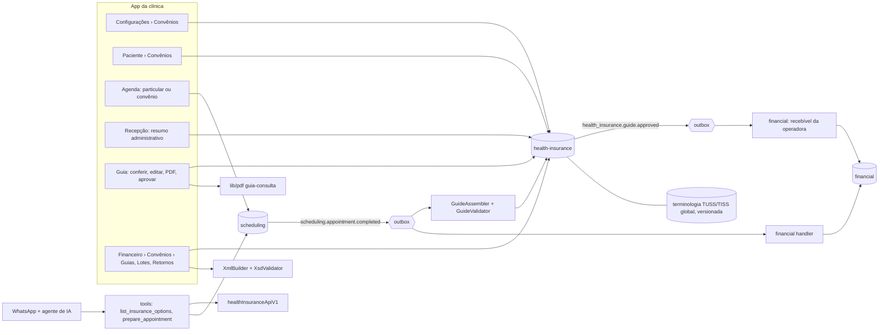

# QORO_TISS_MASTER_PLAN — Convênios e Guias TISS

> **Fonte única de verdade** do módulo Qoro Convênios — Guias TISS Inteligentes.
> Qualquer agente ou pessoa que assumir este trabalho começa pela seção
> [ESTADO ATUAL DA IMPLEMENTAÇÃO](#estado-atual-da-implementação) e segue o
> [Protocolo de Retomada](#protocolo-de-retomada). Não confie só no status escrito:
> confira o repositório e as evidências.

| Campo | Valor |
| --- | --- |
| Repositório | `joaomarcos-techia/Project_OS` |
| Worktree | `C:/dev/Qoro_convenios_tiss_20261110` |
| Branch | `feat/convenios-tiss-20261110` (criada de `origin/main` em `5620a098`) |
| Criado em | 10/11/2026 |
| Versão TISS de referência | Padrão TISS **setembro/2026**; Componente de Comunicação **4.03.00** |
| Terminologia de referência | TUSS **202609** |

**Legenda usada no documento**

- **[VERIFICADO]**: lido no código, no banco de dados de schema ou em fonte oficial, com caminho citado.
- **[HIPÓTESE]**: inferência ainda não comprovada; precisa de verificação antes de virar decisão.
- **[DECISÃO PENDENTE]**: exige aprovação humana antes de implementar.

---

## ESTADO ATUAL DA IMPLEMENTAÇÃO

> Seção permanente. Atualize a cada tarefa concluída, bloqueada ou interrompida.

| Campo | Valor |
| --- | --- |
| Data da última atualização | 10/11/2026 |
| Fase atual | **F0 — Preparação** |
| Tarefa em andamento | nenhuma (aguardando aprovação humana do plano) |
| Última tarefa concluída | T0.3 — Documento mestre escrito |
| Progresso do MVP | **3 de 58 tarefas do MVP concluídas (5%)**. Critério: tarefa só conta com evidência registrada no [Registro de execução](#m-registro-de-execução). |
| Testes aprovados | nenhum teste do módulo existe ainda |
| Testes pendentes | todos os da [seção G](#g-estratégia-de-testes) |
| Bloqueios ativos | **B1** aprovação do plano e das decisões D1–D12; **B2** plano comercial que libera o módulo (D8); **B3** nova dependência de validação XSD (D7); **B4** ordem de merge com o PR #53 (migrations 0136–0142) |
| Decisões técnicas tomadas | ver [L.1 Registro de decisões](#l1-registro-de-decisões); nenhuma aprovada ainda |
| Arquivos alterados | só este documento |
| Próxima ação exata | O fundador aprova (ou ajusta) as decisões D1–D12 da seção L.1. Depois disso, executar **T0.4** (rever base e numeração de migrations) e **T0.5** (ADR-067). |

---

## Protocolo de Retomada

Toda sessão nova, de qualquer agente, executa nesta ordem antes de mexer em código:

1. Ler este documento inteiro, com atenção a ESTADO ATUAL, [L. Decisões, bloqueios e riscos](#l-decisões-bloqueios-e-riscos) e o fim do [Registro de execução](#m-registro-de-execução).
2. Conferir o repositório real:
   ```bash
   git -C C:/dev/Qoro_convenios_tiss_20261110 --literal-pathspecs status --short
   git -C C:/dev/Qoro_convenios_tiss_20261110 --literal-pathspecs log --oneline -15
   git -C C:/dev/Qoro_convenios_tiss_20261110 --literal-pathspecs fetch -q origin
   git -C C:/dev/Qoro_convenios_tiss_20261110 --literal-pathspecs log --oneline -5 origin/main
   ```
3. Para cada tarefa marcada **Concluído**, abrir a evidência registrada e confirmar que o código ainda está lá (arquivo existe, teste existe e passa). Se não bater, rebaixar a tarefa para **Em execução** e registrar a divergência no Registro de execução.
4. Identificar a última tarefa **comprovadamente** concluída e os bloqueios ativos.
5. Conferir se as decisões da seção L.1 continuam aprovadas. Decisão pendente bloqueia as tarefas que dependem dela.
6. Conferir a numeração de migrations antes de criar qualquer uma (ver [E.5](#e5-executar-alterações-com-segurança)).
7. Escolher a próxima tarefa disponível pela regra de [E.3](#e3-identificar-a-próxima-tarefa).
8. Atualizar ESTADO ATUAL com "Tarefa em andamento" antes de começar.

---

## A. Visão geral e contexto

### A.1 Problema comercial

Clínicas que atendem por plano de saúde precisam faturar as consultas às operadoras no Padrão TISS da ANS. Sem isso, a clínica digita a guia em outro sistema ou no portal de cada operadora, o que gera retrabalho, glosas por erro de digitação e perda de receita. O Qoro já cobre agenda, atendimento, prontuário, financeiro e cobrança ao paciente pelo Asaas. Falta o caminho do convênio.

### A.2 Objetivos do módulo

1. A clínica cadastra as operadoras, planos, credenciamentos e valores com que trabalha.
2. O paciente guarda os dados da carteirinha uma vez, com histórico.
3. O agendamento distingue **particular** de **convênio** sem quebrar o fluxo particular.
4. A recepção vê e completa as pendências administrativas sem bloquear o atendimento clínico.
5. Ao encerrar uma consulta por convênio, o Qoro prepara a Guia de Consulta sozinho, de forma idempotente.
6. O financeiro confere, aprova, agrupa em lotes, exporta o XML validado e registra retorno, glosa e pagamento.
7. O financeiro distingue recebível do paciente e recebível da operadora, sem cobrança Asaas indevida.

**Princípio do produto:** o médico atende, o Qoro organiza os dados, a recepção confere as pendências e o financeiro fatura. A guia é consequência do atendimento, não outro formulário.

### A.3 Escopo completo (três fases)

| Fase | Conteúdo |
| --- | --- |
| **Fase 1 — MVP** | cadastro de convênios e planos; credenciamento por profissional; convênio no cadastro do paciente; particular ou convênio no agendamento (recepção e WhatsApp); conferência administrativa no check-in; mapeamento de procedimentos TUSS; geração automática da **Guia de Consulta**; visualização, edição controlada e PDF no modelo oficial; listagem de guias e pendências; exportação de XML em lotes validado contra o XSD oficial; recebível da operadora; registro manual de protocolo, retorno, glosa e pagamento; auditoria, testes e controle de acesso. |
| Fase 2 | Guia SP/SADT; exames, terapias e procedimentos; solicitação e autorização; vários procedimentos por guia; outros tipos de atendimento; relatórios de produção; glosa completa e recurso de glosa. |
| Fase 3 | integração real com operadoras que ofereçam interface (webservices TISS); elegibilidade eletrônica; autorização eletrônica; transmissão de lotes; recebimento de demonstrativos; conciliação automática; painéis de glosa e rentabilidade. |

### A.4 Fora do MVP (explicitamente excluído)

- Guias SP/SADT, honorários, resumo de internação, odontologia e anexos.
- Qualquer chamada a webservice de operadora, elegibilidade eletrônica ou transmissão automática.
- Assinatura digital ICP-Brasil da guia ou da mensagem (o campo é opcional no XSD; ver C.9).
- Biometria e identificação eletrônica do beneficiário (`tipoIdent`, `identificadorBeneficiario`).
- Conciliação automática de demonstrativos de pagamento.
- Qualquer simulação apresentada como integração real.

### A.5 Resultados esperados

- Consulta por convênio encerrada vira guia "pronta para conferência" ou "com pendências" em até **2 minutos** no caso normal. Esse é o alvo; a medição está na tarefa T11.5. Base: o cron do outbox roda a cada minuto, conforme `vercel.json` [VERIFICADO].
- O médico não digita nenhum dado administrativo para a guia existir.
- O XML exportado passa no XSD oficial 4.03.00.
- Nenhum paciente recebe cobrança Asaas pelo valor cheio de uma consulta de convênio.

### A.6 Premissas e restrições

- Reaproveitar a stack, os contextos, os chokepoints de mutação, a outbox, a auditoria, a criptografia e o design system existentes (ver B).
- Migrations só aditivas, salvo aprovação explícita. Nada roda em produção sem autorização.
- Escrita em banco só no ambiente DEV/Preview. Produção nunca recebe dado de teste.
- CID nunca é pré-requisito nem é copiado do prontuário para a guia.
- Versão TISS, versão da terminologia e códigos TUSS ficam em dados versionados, não em constantes espalhadas.
- Clínicas sem convênio e atendimentos particulares continuam idênticos.

### A.7 Definição objetiva de sucesso

O MVP está pronto quando todos os critérios da [seção K](#k-definition-of-done) estiverem satisfeitos com evidência registrada. Os 15 critérios de aceite do pedido original estão mapeados para tarefas e testes na [seção H](#h-resultados-mensuráveis-e-critérios-de-sucesso).

---

## B. Auditoria real do projeto

Auditoria feita em 10/11/2026 sobre `origin/main` em `5620a098`.

### B.1 Stack [VERIFICADO em `package.json`]

| Item | Versão/uso |
| --- | --- |
| Runtime | Node 22.x, pnpm 11.17.0 |
| Web | Next.js 15.5.28 (App Router, Server Actions), React 19.2.6 |
| Banco | PostgreSQL no Supabase; `drizzle-orm` 0.45.2 + `postgres` 3.4.5 (`prepare: false`) |
| Auth | Supabase Auth (`@supabase/ssr` 0.10.3, `@supabase/supabase-js` 2.106.2) |
| Validação | `zod` ^4.6.6 |
| PDF | `@react-pdf/renderer` 4.5.1 (`src/lib/pdf`) |
| UI | Tailwind v4, Radix (dialog, popover, tabs, tooltip, switch, checkbox, dropdown), `lucide-react` |
| Observabilidade | Sentry (`@sentry/nextjs`), métricas próprias em `src/lib/observability` |
| Rate limit | Upstash (`@upstash/ratelimit`) |
| Testes | Vitest 2.1.x + happy-dom, Playwright, `@testing-library/react` |
| Arquitetura | `eslint-plugin-boundaries`, `madge`, scripts `arch:*` |
| IA | agente de WhatsApp com Gemini (`src/contexts/ai-agent`); o modelo e o estado do PR #28 precisam ser conferidos antes da fase F9 |

### B.2 Organização [VERIFICADO]

- `src/contexts/<contexto>`: bounded contexts com `schema.ts`, `index.ts`/`api.ts` públicos, `internal/` privado, `events.ts`, `actions.ts`, `queries.ts` e README. Contextos atuais: `ai-agent`, `billing`, `clinical`, `feedback`, `financial`, `identity`, `messaging`, `onboarding`, `patient`, `payments`, `platform-admin`, `scheduling` e `tenancy`.
- `src/lib`: infraestrutura sem dependência de contexto (`db`, `audit`, `outbox`, `crypto`, `pdf`, `auth`, `idempotency`, `storage`, `platform-settings` e outros).
- `src/app/(app)/(shell)/…`: telas autenticadas da clínica. As configurações ficam em `configuracoes/*`, com navegação em `configuracoes/settings-navigation.ts`.
- `drizzle/migrations/NNNN_*.sql` + `meta/_journal.json`: migrations append-only.
- Documentação canônica em `docs/` (`CONVENTIONS.md`, `architecture/context-map.md`, `database/schema.md`, `domains/*`, `adr/*` até ADR-066).

### B.3 Banco, multi-tenancy e acesso [VERIFICADO em `docs/database/schema.md`, `src/lib/db`]

- Toda tabela tenant-scoped tem `clinic_id`, RLS `ENABLE` + `FORCE` e policy. O runtime usa `withTenant(clinicId, fn, actorUserId?)`: transação no pool runtime, `SET LOCAL ROLE authenticated` e GUCs `app.current_clinic`/`app.current_user`.
- Pools: `db` (runtime, `NOBYPASSRLS` em produção), `dbAdmin` (plataforma, BYPASSRLS) e `dbWorker` (jobs). Não trocar um pelo outro por conveniência.
- Valores monetários: `numeric(12,2)`; cálculo de domínio em centavos.
- Migrations: `origin/main` vai de `0000` a `0135`. **O PR #53 (billing) traz `0136`–`0142`** e a branch de UI carrega `0136` (herdada do billing). **Próximo número livre seguro: `0143`**, a reconferir no momento da criação (T0.4).
- Regra da casa: uma sessão por checkout; conferir `ls drizzle/migrations` e `meta/_journal.json` antes de numerar; commitar com caminhos explícitos (`docs/CONVENTIONS.md`).

### B.4 Autenticação e autorização [VERIFICADO]

- Papéis (`role_enum`): `owner`, `gestor`, `doctor`, `attendant`, `financial` e `super_admin` (`src/contexts/identity/schema.ts`).
- Catálogo de permissões em `src/lib/auth/permissions.ts`. Relevantes aqui: `view:agenda`, `edit:agenda`, `manage:procedures`, `view:patient`, `edit:patient`, `view:prontuario`, `view:financial`, `manage:financial`, `operate:caixa`, `manage:settings`, `manage:agent`, `view:consultorio` e `view:audit`.
- A resolução efetiva usa a view `effective_permissions_v` (migration `0133`), que soma o bundle do papel (`role_permissions`) e overrides por usuário só nos planos com permissões granulares. Permissão nova exige seed, bundles e incremento de `claims_version` (script `bump-role-claims`; ADR-009).
- Mutação nova usa os chokepoints existentes: `idempotentMutation` (idempotência + auditoria na mesma transação) é o padrão; `auditedMutation` é exceção (`src/lib/audit/mutation.ts`).

### B.5 Entidades existentes que o módulo reaproveita [VERIFICADO]

| Entidade | Onde | O que interessa |
| --- | --- | --- |
| `clinics` | `src/contexts/tenancy/schema.ts` | `cnpj_encrypted` (cifrado; **não normalizado nem validado**), `cnes` (nullable), `endereco`, `telefone`, `timezone` |
| `profiles` | `src/contexts/identity/schema.ts` | `nome`, `crm`, `crm_uf`, `especialidade`, `role`. **Não há conselho além de CRM nem CBO.** |
| `patients` | `src/contexts/patient/schema.ts` | `nome`, `cpf_encrypted`/`cpf_hash`, `data_nascimento`. Não existe nome social. |
| `procedures` | `src/contexts/scheduling/schema.ts` | catálogo da clínica: `codigo` (texto livre), `descricao`, `valor_padrao`, `duracao_padrao_min` |
| `appointments` | idem | `doctor_id`, `patient_id`, `procedure_id`, `status`, `valor`, snapshots imutáveis (`snapshot_procedure_*`, `snapshot_doctor_nome`, `snapshot_doctor_crm`), `deposit_status`, `faturamento_pendente`, `pricing_policy_mode`, `commercial_*` |
| `appointment_corrections`, `appointment_state_log` | idem | trilha de correção e de estados |
| `lancamentos` | `src/contexts/financial/schema.ts` | `tipo` receber/pagar, `valor`, `valor_pago`, `status`, `patient_id`, `appointment_id`, `payment_method` → `payment_methods`. **UNIQUE parcial `lancamentos_appointment_uniq`: no máximo um lançamento por atendimento.** CHECK `lancamentos_auto_origin_chk`: lançamento `auto` precisa de `appointment_id` ou de origem do Payments. |
| `payment_methods` | idem | catálogo global; `convenio` existe desde a migration `0079` (segundo `docs/domains/scheduling-financial.md`) |
| `faturamento_pendencias` | idem | banner de pendência do Caixa |
| `prontuarios`/`prontuario_versions` | `src/contexts/clinical/schema.ts` | prontuário versionado e cifrado (ADR-044). `cid` é **opcional** nos tipos clínicos (`src/contexts/clinical/types.ts`). |
| `ai_clinic_config.convenios` | `src/contexts/ai-agent/config-types.ts` | lista de **nomes** em texto livre, até 40, usada pela tool `provide_clinic_info` para responder se a clínica aceita um convênio |

### B.6 Fluxos atuais relevantes [VERIFICADO]

**Agenda.** Estados: `agendado → confirmado → chegou → em_atendimento → atendido`, mais `cancelado` e `faltou` (`docs/domains/scheduling-financial.md`). A criação passa por `createAppointmentCore` (`src/contexts/scheduling/internal/appointment-core.ts`), com entrada validada por `CreateAppointmentSchema` (`src/contexts/scheduling/types.ts`).

**Encerramento.** Ao concluir o atendimento, o Scheduling publica `scheduling.appointment.completed`. O payload (`AppointmentCompletedSchema` em `src/contexts/scheduling/events.ts`) leva `appointmentId`, `clinicId`, `doctorId`, `patientId`, `procedureId`, `unitId`, `valor`, `snapshotProcedureName`, `snapshotDoctorNome` e `scheduledAt`.

**Financeiro automático.** O handler `src/contexts/financial/internal/handlers/appointment-completed.ts` cria **um recebível do paciente pelo valor cheio**, idempotente pelo UNIQUE de `appointment_id`. Também abate créditos (sinal pago), cria o snapshot de repasse (`createProfessionalPayoutSnapshot`) e publica `financial.lancamento.created`.

**Reconciliação.** O cron `/api/cron/financial-reconcile` (a cada 15 min) procura atendimentos `atendido` sem lançamento e abre `faturamento_pendencias`.

**Cobrança ao paciente.**

- **Sinal no agendamento:** `src/contexts/scheduling/deposit-candidates.ts` e `src/contexts/payments/policy.ts`.
- **Saldo após o atendimento:** `src/contexts/payments/internal/remainder-charge.ts` gera link Asaas do saldo em aberto do atendimento, calculado por `financialApiV1.getAppointmentBalance`.
- **Régua de cobrança:** `src/contexts/financial/dunning-candidates.ts` pega **todo recebível vencido com `patient_id`**.

**Consequência direta:** se uma consulta de convênio seguir o fluxo atual, o paciente vira devedor do valor cheio, recebe link Asaas do saldo e entra na régua de cobrança. O módulo precisa desviar isso (ver C.11 e T8.1).

**Agente de IA.** As tools de agendamento ficam em `src/contexts/ai-agent/tools`: `list_slots`, `prepare_appointment` (booking consolidado), `confirm_pending_action`, `provide_clinic_info`, `provide_procedure_price`, `request_human_handoff` e outras. Hoje convênio aparece só como lista de nomes.

**PDF.** Renderizadores puros em `src/lib/pdf` e rotas autenticadas em `src/app/(app)/_lib/clinical-pdf-route.ts` e `src/app/(app)/(shell)/relatorios/pdf/route.ts`. Regras: runtime Node, RBAC, rate limit, `Cache-Control: no-store` e nome de arquivo do servidor (ADR-059).

**Criptografia.** `src/lib/crypto` expõe `encryptForTenant`, `decryptForTenant`, `hashForLookup` e normalizadores. Ponto único de decifragem.

**Crons.** Ver `vercel.json`: outbox a cada minuto; `financial-reconcile`, `payments-deposit` e `proactive-*` a cada 15 min.

**Desligamento de plataforma.** `src/lib/platform-settings` (por exemplo `isProactiveEnabled`). Será reaproveitado para um interruptor do módulo.

### B.7 O que já existe de convênio [VERIFICADO]

| Peça | Estado |
| --- | --- |
| `payment_methods.convenio` | forma de pagamento manual no Financeiro/Caixa; não tem operadora, carteirinha, glosa nem repasse (comentário de `e2e/production-convenio-payment-a.spec.ts`) |
| `ai_clinic_config.convenios` | nomes livres para a IA responder; não filtra por profissional nem por plano |
| Consentimento LGPD | a ficha do paciente já descreve o envio de dados a convênios (`pacientes/[id]/page.tsx`) |
| Worktree `C:/dev/ClinicaOS_V2_ai_convenios` | `main` antiga (`93da840f`), **sem trabalho pendente**, ancestral da `origin/main` |

Não existe cadastro de operadora, plano, carteirinha, credenciamento, TUSS, guia, lote nem glosa.

### B.8 Arquivos que serão modificados [VERIFICADO quanto à existência; o impacto exato se confirma em cada tarefa]

- **Scheduling:** `schema.ts` (coluna `billing_mode`), `types.ts` (entrada de agendamento), `events.ts` (`billingMode` aditivo no payload de conclusão), `internal/appointment-core.ts`, `deposit-candidates.ts`, `actions.ts`.
- **Financial:** `schema.ts` (vínculo com a guia), `internal/handlers/appointment-completed.ts`, `api.ts`/`queries.ts` (saldo), `dunning-candidates.ts` (só confirmar o filtro).
- **Rota:** `src/app/api/cron/financial-reconcile/route.ts`.
- **Payments:** `internal/remainder-charge.ts` e `policy.ts` (só guardas).
- **AI agent:** `tools/prepare-appointment.ts`, `tools/provide-clinic-info.ts`, `tools/registry.ts`, `prompts/system.ts` e a tool nova.
- **Identity/auth:** `src/lib/auth/permissions.ts`, mais migration de permissões e bundles.
- **Patient:** só leitura pela API pública; a ficha ganha a aba de convênio (UI).
- **UI:** `configuracoes/settings-navigation.ts`, `agenda/new-appointment-drawer.tsx`, a ficha do paciente e `financeiro/*`.
- **PDF:** `src/lib/pdf/guia-consulta.tsx` (novo) e `src/lib/pdf/index.ts`.
- **Arquitetura:** `eslint.config.mjs` (boundary do contexto novo) e os snapshots de `docs/architecture/*`.
- **Segurança:** `scripts/security/inventory-lib.ts` (superfícies novas).
- **Documentação:** `docs/domains/*`, `docs/database/schema.md`, `docs/roadmap/known-limitations.md` e o ADR novo.

### B.9 Incompatibilidades e riscos encontrados na auditoria

1. **Um lançamento por atendimento** (UNIQUE `appointment_id`) não comporta paciente e operadora no mesmo atendimento. Resolução proposta em C.11 (D3).
2. **Cobrança automática ao paciente** (saldo, régua e sinal) dispararia em consulta de convênio. Precisa de guardas (T4.5, T8.1).
3. **Repasse ao profissional** usa o valor bruto na conclusão (`createProfessionalPayoutSnapshot`); a regra `net` depende de recebimento. Recebimento de operadora chega semanas depois. Investigação em T8.3 [HIPÓTESE de impacto].
4. **Dados obrigatórios da guia que o Qoro não tem:**
   - CBO do profissional e código do conselho (o Qoro só guarda CRM);
   - UF no código da tabela 59 (o Qoro guarda sigla);
   - código do prestador na operadora;
   - CNES, que é nullable no Qoro e na guia tem a regra "9999999".
   Viram pendências claras, nunca invenção.
5. **CNPJ da clínica não é normalizado nem validado** (comentário em `tenancy/schema.ts`). O XSD 4.03.00 exige `[A-Z0-9]{12}[0-9]{2}` (CNPJ alfanumérico). A normalização precisa existir antes de usar o CNPJ na guia.
6. **Numeração de migrations** disputada com o PR #53 (0136–0142).
7. **Branch de UI** (`ui/refactor-qoro-20261108`) muda o visual global sem estar mergeada. As telas novas devem usar só os primitivos compartilhados (`src/components/ui`, `components/shared`) para herdar o redesign sem retrabalho.
8. **Agente de IA** com Gemini: o PR #28 (hotfix de assinatura do Gemini 3) está aberto. Conferir o estado antes de F9.

---

## B.10 Referência regulatória verificada

Fontes baixadas em 10/11/2026 do site da ANS e conferidas localmente. As cópias de trabalho ficam fora do repositório (scratchpad). A tarefa T0.6 traz para o repositório só os XSDs e um manifesto.

| Componente | Versão | Arquivo oficial | SHA-256 |
| --- | --- | --- | --- |
| Página da competência | Setembro/2026 (publicação 30/09/2026; vigência 01/10/2026; implantação até 31/12/2026, segundo a página de histórico) | `…/padrao-tiss-setembro-2026` | — |
| Organizacional | 202609 | `PadroTISS_ComponenteOrganizacional_202609.pdf` | `fc973a683f772143d3355604e6e0566491756c49c657e1b12b0b33564d63d2d3` |
| Conteúdo e Estrutura | 202511 | `PadroTISS_ComponentedeContedoeEstrutura_202511.zip` | `6a720ed27da8397fef584e30d794aa56f18906d253ccdf460c30b1019a3a4d3b` |
| Comunicação (XSD/WSDL) | **4.03.00** e monitoramento 1.06.00 | `PadroTISSComunicao_202511.zip` | `db8640e1c3b87085892f54f838bfcea9934439ff365798c8428559f88c13d62d` |
| Representação de Conceitos (TUSS) | 202609 | `Padrao_TISS_Representacao_de_Conceitos_em_Saude_202609.zip` | `7f3d7a9794a8929fddd6f13af26dd9496087bf8b8670f275bd7ecd9a2f64172d` |

URL base: `https://www.gov.br/ans/pt-br/assuntos/prestadores/padrao-para-troca-de-informacao-de-saude-suplementar-2013-tiss/`. O arquivo TUSS vem de `https://www.ans.gov.br/arquivos/extras/tiss/`.

**Fatos confirmados nas fontes oficiais:**

1. **CID vedado.** Componente Organizacional 202609, item 28: "Fica vedada a exigência por parte das operadoras […] do preenchimento do Código Internacional de Doenças - CID nas guias […]". O item 271 restringe os campos de CID às guias de Resumo de Internação. **A Guia de Consulta 4.03.00 não tem campo de CID** (`ctm_consultaGuia`).
2. **Uso da Guia de Consulta** (item 62.1): cobrança de consultas eletivas, sem vínculo com outras guias.
3. **Estrutura XML** (`tissGuiasV4_03_00.xsd`, `ctm_consultaGuia`):
   - `cabecalhoConsulta`: `registroANS` (6 dígitos) e `numeroGuiaPrestador` (até 20);
   - `numeroGuiaOperadora`?, `ausenciaCodValidacao`? e `codValidacao`?;
   - `dadosBeneficiario`: `numeroCarteira` (até 20), `atendimentoRN` (S/N), `tipoIdent`? e `identificadorBeneficiario`?;
   - `contratadoExecutante`: **um** entre `codigoPrestadorNaOperadora` (até 14), `cpfContratado` e `cnpjContratado`, mais `CNES` (7);
   - `profissionalExecutante`: `nomeProfissional`?, `conselhoProfissional`, `numeroConselhoProfissional`, `UF` e `CBOS`;
   - `indicacaoAcidente`;
   - `dadosAtendimento`: `coberturaEspecial`?, `regimeAtendimento`, `saudeOcupacional`?, `dataAtendimento`, `tipoConsulta` e `procedimento` (`codigoTabela`, `codigoProcedimento` até 10, `valorProcedimento` decimal 10,2);
   - `observacao`? (500) e `assinaturaDigitalGuia`?.

   **O nome e o CNS do beneficiário foram retirados na 4.00.00.**
4. **Lote** (`ctm_guiaLote`): `numeroLote` (até 12) e `guiasTISS` com **um único tipo de guia e no máximo 100 guias**.
5. **Mensagem** (`tissV4_03_00.xsd`, `mensagemTISS`):
   - `cabecalho`, com `tipoTransacao=ENVIO_LOTE_GUIAS`, `sequencialTransacao` (até 12), data, hora, `origem/identificacaoPrestador`, `destino/registroANS` e `Padrao` (enum contém `4.03.00`);
   - `prestadorParaOperadora/loteGuias`;
   - `epilogo/hash`;
   - `ds:Signature`?.
6. **Hash do epílogo** (Organizacional, p. 49): MD5 em hexadecimal da concatenação literal do conteúdo das tags, sem nomes de elementos nem atributos, em **ISO-8859-1**.
7. **Domínios usados na Guia de Consulta**, conferidos no XSD e nas planilhas TUSS 202609:

   | Campo | Tabela | Valores |
   | --- | --- | --- |
   | Conselho | 26 | `06` = CRM |
   | UF | 59 | código numérico, por exemplo `35` = SP |
   | CBO | 24 | 172 códigos no XSD, por exemplo `225133` médico psiquiatra, `225125` médico clínico |
   | Indicação de acidente | 36 | `0` trabalho, `1` trânsito, `2` outros, `9` não acidente |
   | Tipo de consulta | 52 | `1` primeira, `2` retorno, `3` pré-natal, `4` por encaminhamento |
   | Regime de atendimento | 76 | `01` ambulatorial, `02` domiciliar, `03` internação, `04` pronto-socorro, `05` telessaúde |
   | Tabela de referência | 87 | `22` = procedimentos e eventos em saúde |
   | Ausência de código de validação | 74 | — |
   | Cobertura especial | 75 | — |
   | Saúde ocupacional | 77 | — |
   | Tipo de identificação | 72 | — |

8. **Consulta em consultório:** TUSS 22 `10101012` "Consulta em consultório (no horário normal ou preestabelecido)", com vigência registrada na planilha. A tabela 22 tem cerca de 5.960 termos com datas de início e fim de vigência.
9. **Regras de preenchimento** (planilha Conteúdo e Estrutura 202511, aba `loteGuias`, Guia de Consulta):
   - CNES obrigatório; "Caso o prestador ainda não possua o código do CNES preencher o campo com 9999999".
   - Nome do profissional obrigatório quando o contratado é pessoa jurídica.
   - Valor obrigatório; zero quando não puder ser definido previamente por contrato.
   - `numeroGuiaOperadora` só se a operadora atribuir número próprio.
   - Código de validação só quando operadora e prestador o usam.
   - **A Guia de Consulta não tem campos de senha nem de autorização**; eles existem na SP/SADT.
10. **Modelo impresso** (PDF do Conteúdo e Estrutura, p. 469–473): campos numerados de 1 a 29. Inclui alguns que o XML não tem:
    - 5 Validade da carteira: só na contingência em papel com autorização prévia;
    - 7 Nome do beneficiário: obrigatório no papel;
    - 10 Nome do contratado: obrigatório;
    - 24 Assinatura do profissional;
    - 25 Assinatura do beneficiário ou responsável: obrigatória;
    - 26 Nome social;
    - 27 Cobertura especial, 28 Regime e 29 Saúde ocupacional.
11. **CNPJ alfanumérico:** `st_CNPJ` = `[A-Z0-9]{12}[0-9]{2}` (IN RFB 2.229).

**Diferença entre os conceitos:**

- **TISS** é o padrão de troca: mensagens, guias e regras.
- **TUSS** é a terminologia: códigos de procedimentos e tabelas de domínio.
- **CID** é diagnóstico clínico. Fica só no prontuário e nunca alimenta a Guia de Consulta.

---

## C. Arquitetura proposta

### C.1 Novo bounded context

**`src/contexts/health-insurance`** (nome na UI: "Convênios"). É dono de operadoras, planos, credenciamento, perfil TISS do profissional, contratos de procedimento, carteirinhas, cobertura por atendimento, autorizações informadas, guias, lotes, retornos, glosas e terminologia. Segue o padrão dos demais: `schema.ts`, `index.ts`/`api.ts`, `internal/`, `events.ts` e README. A alternativa seria espalhar tabelas por `patient`, `scheduling` e `financial`. Foi descartada porque o ciclo da guia é um domínio próprio, e o mapa de contextos já trata faturamento SaaS (`billing`) e cobrança ao paciente (`payments`) como contextos separados.

**O que fica nos contextos existentes, por ownership:**

- `scheduling`: só `appointments.billing_mode`, porque agenda, sinal e conclusão precisam ler sem atravessar contexto.
- `financial`: os recebíveis (`lancamentos`) e a ligação opaca com a guia.
- `payments`: só guardas.

### C.2 Diagrama lógico



### C.3 Fluxo completo dos dados

1. **Configuração.** O gestor cadastra a operadora (registro ANS, identificação do prestador na operadora), os planos, os profissionais habilitados por plano, o perfil TISS de cada profissional (conselho, número, UF e CBO) e os procedimentos aceitos. Cada procedimento é ligado ao `procedures` do Qoro, com tabela 22, código TUSS, valor contratado, vigência, exigência de autorização e coparticipação.
2. **Paciente.** A recepção vincula uma ou mais carteirinhas: operadora, plano, número cifrado, validade, titular ou dependente, e preferencial.
3. **Agendamento.** Forma de atendimento particular ou convênio.
   - **Convênio:** a lista mostra só as operadoras e planos ativos que aceitam aquele profissional e procedimento, e pré-seleciona a carteirinha preferencial.
   - O valor do agendamento é o valor contratado vigente.
   - **Sem sinal.** A cobertura do atendimento é gravada no `health-insurance`, com as pendências.
4. **Recepção.** O resumo administrativo mostra a situação (dados incompletos, pendente de autorização, autorização informada ou conferido). A recepção completa os dados sem bloquear o atendimento.
5. **Atendimento.** O médico usa o prontuário como hoje, sem campo novo obrigatório.
6. **Conclusão.** O Scheduling publica `scheduling.appointment.completed` com `billingMode`. Dois handlers reagem, cada um no seu contexto:
   - **`health-insurance`:** monta o snapshot, valida e cria a guia (idempotente por atendimento), que fica "pronta para conferência" ou "com pendências".
   - **`financial`:** se for convênio, **não** cria o recebível cheio do paciente. Cria só a coparticipação, quando houver, conforme D5.
7. **Conferência.** A recepção ou o financeiro conferem, corrigem campos administrativos autorizados e aprovam para faturamento. A aprovação publica `health_insurance.guide.approved`, e o financeiro cria o **recebível da operadora** ligado à guia (D3/D4).
8. **Lote.** O financeiro agrupa as guias aprovadas: mesma operadora, mesmo tipo e mesma versão, até 100. O XML é gerado em ISO-8859-1 com o hash MD5, **validado no XSD** e guardado. "Exportado" não significa "enviado".
9. **Retorno.** O financeiro registra à mão o protocolo, a data de envio, o retorno, as glosas (por guia, com código e valor) e o pagamento. O recebível da operadora recebe as baixas e as glosas pelo caminho aprovado em D3.

### C.4 Responsabilidades dos serviços

| Serviço | Natureza | Responsabilidade |
| --- | --- | --- |
| `InsurerCatalogService` | domínio + mutações | operadoras, planos, credenciamento, perfil TISS, contratos de procedimento, dados do prestador |
| `MembershipService` | domínio + mutações | carteirinhas do paciente (cifra, hash, últimos 4, preferencial, histórico) |
| `CoverageService` | domínio + mutações | cobertura por atendimento, elegibilidade **cadastral** (não da operadora), pendências e estados administrativos, autorização informada |
| `EligibilityFilter` | puro | dado profissional, procedimento e data, lista operadoras e planos aceitos e o contrato vigente |
| `GuideAssembler` | puro | monta o snapshot administrativo da Guia de Consulta a partir das fontes; nunca lê o prontuário |
| `GuideValidator` | puro | regras estruturais (tamanho, domínio, obrigatoriedade) e semânticas (vigência TUSS, CNES/9999999, contratado PF ou PJ), devolvendo pendências com explicação |
| `GuideLifecycle` | domínio + mutações | máquina de estados, edição controlada, substituição, cancelamento e histórico |
| `GuideNumbering` | domínio | número da guia no prestador e do lote, por clínica, com contador sob lock de linha |
| `GuidePdfRenderer` | puro (`src/lib/pdf`) | modelo oficial da Guia de Consulta, campos 1–29 |
| `TissXmlBuilder` | puro | `mensagemTISS/loteGuias`, ordem do XSD, ISO-8859-1, hash MD5 |
| `TissXsdValidator` | infraestrutura | valida o XML contra os XSDs 4.03.00 versionados no repositório |
| `BatchService` | domínio + mutações | montar, exportar, registrar envio, protocolo, retorno, glosa e pagamento |
| `TerminologyCatalog` | leitura | termos TUSS e domínios por versão, com vigência |
| Handlers de outbox | assíncrono | `appointment.completed` → guia; `guide.approved` → recebível; correção, cancelamento e reabertura → reprocessamento seguro |

### C.5 Entidades e relacionamentos (proposta para aprovação)

As tabelas globais não têm `clinic_id` e são só leitura para `authenticated`. As demais são tenant-scoped, com RLS `ENABLE`+`FORCE`, policy por `app.current_clinic` e índices liderados por `clinic_id` e pelas FKs.

| Tabela | Escopo | Campos principais | Observações |
| --- | --- | --- | --- |
| `tiss_terminology_versions` | global | `id`, `version` (`202609`), `source_url`, `source_sha256`, `imported_at` | uma linha por pacote TUSS importado |
| `tiss_terms` | global | `version_id`, `table_code` (`22`, `24`, `26`, `36`, `52`, `59`, `72`, `74`, `75`, `76`, `77`, `87`, `38`…), `code`, `term`, `starts_on`, `ends_on`, `implantation_ends_on` | UNIQUE (`version_id`, `table_code`, `code`); importada por script, nunca por constante |
| `tiss_schema_versions` | global | `version` (`4.03.00`), `xsd_manifest_sha256`, `active` | versões de comunicação suportadas pelo código |
| `hi_clinic_settings` | tenant | `enabled`, `provider_kind` (PJ/PF), `contractor_name`, `cnes_override` | 1 por clínica; liga o módulo |
| `hi_counters` | tenant | `kind` (`guide`, `batch`, `transaction`), `next_value` | UPDATE … RETURNING sob lock de linha |
| `hi_insurers` | tenant | `name`, `ans_registry` (6 dígitos), `status`, `provider_id_kind` (`operator_code`/`cnpj`/`cpf`), `provider_id_value`, `tiss_version`, `uses_validation_code`, `billing_settings` (jsonb validado) | UNIQUE (`clinic_id`, `ans_registry`) |
| `hi_plans` | tenant | `insurer_id`, `name`, `operator_code`, `status`, `requires_authorization` | |
| `hi_professional_profiles` | tenant | `professional_id` (opaco → `profiles`), `council_code` (T26), `council_number`, `council_uf_code` (T59), `cbo_code` (T24) | defaults sugeridos a partir de `profiles.crm`/`crm_uf`, sempre confirmados por pessoa |
| `hi_credentials` | tenant | `insurer_id`, `plan_id` (nulo = todos os planos), `professional_id`, `operator_code_pf`, `starts_on`, `ends_on`, `status` | "não presumir que todos aceitam todos" |
| `hi_procedure_contracts` | tenant | `insurer_id`, `plan_id`?, `procedure_id` (opaco → `procedures`), `tuss_table` (`22`), `tuss_code`, `contract_value`, `requires_authorization`, `copay_kind` (none/fixed/percent), `copay_value`, `starts_on`, `ends_on` | **append-only por vigência**; alteração cria linha nova |
| `hi_memberships` | tenant | `patient_id` (opaco), `insurer_id`, `plan_id`, `card_number_encrypted`, `card_number_hash`, `card_last4`, `valid_until`, `holder_kind` (titular/dependente), `holder_name_encrypted`?, `is_preferred`, `status`, `replaced_by_id` | UNIQUE parcial: um preferencial ativo por paciente; desativar em vez de apagar |
| `hi_appointment_coverages` | tenant | `appointment_id` (UNIQUE), `insurer_id`, `plan_id`, `membership_id`, `contract_id`, `admin_status`, `pending_items` (jsonb), `reviewed_by`, `reviewed_at` | a cobertura escolhida no agendamento |
| `hi_authorizations` | tenant | `coverage_id`, `kind` (`informed_manual`), `number`, `password`, `authorized_on`, `valid_until`, `notes` | nunca "confirmada pela operadora" no MVP |
| `hi_guides` | tenant | `appointment_id`, `guide_type` (`consulta`), `number` (≤20), `status`, `revision`, `replaces_guide_id`, `tiss_version`, `terminology_version`, `snapshot_encrypted`, `snapshot_hash`, `validation` (jsonb sem PII), `amount`, `approved_at`/`by` | UNIQUE (`clinic_id`, `number`); UNIQUE parcial (`clinic_id`, `appointment_id`, `guide_type`) onde `status NOT IN ('cancelada','substituida')` |
| `hi_guide_events` | tenant | `guide_id`, `type`, `from_status`, `to_status`, `changed_fields` (nomes, sem valores sensíveis), `actor_id`, `at` | histórico e rastreabilidade |
| `hi_batches` | tenant | `insurer_id`, `number` (≤12), `guide_type`, `tiss_version`, `status`, `xml_storage_path`, `xml_sha256`, `epilogue_hash`, `exported_at`, `sent_at`, `protocol_number` | UNIQUE (`clinic_id`, `insurer_id`, `number`) |
| `hi_batch_guides` | tenant | `batch_id`, `guide_id` | UNIQUE parcial: guia em no máximo um lote ativo |
| `hi_guide_outcomes` | tenant | `guide_id`, `kind` (`glosa`/`pagamento`/`ajuste`), `amount`, `gloss_code` (T38), `occurred_on`, `notes` | append-only |

**Fora do contexto novo:**

| Mudança | Contexto | Natureza |
| --- | --- | --- |
| `appointments.billing_mode` (`particular`/`convenio`, default `particular`) | scheduling | aditiva |
| `AppointmentCompletedSchema.billingMode` | scheduling | evento aditivo e opcional, porque eventos antigos não o têm |
| `lancamentos.tiss_guide_id`, `lancamentos.health_insurer_id` (opacos, sem FK cross-context) + UNIQUE parcial em `tiss_guide_id` + ajuste do CHECK `lancamentos_auto_origin_chk` | financial | **troca de constraint: exige aprovação (D3)** |

### C.6 APIs e contratos

**Server Actions**, todas com `idempotentMutation`, permissão checada no backend e auditoria:

- operadoras e planos: criar, editar, ativar e desativar;
- credenciamento, perfil TISS e contratos;
- carteirinhas: vincular, editar (cria nova versão), desativar e tornar preferencial;
- cobertura: definir no agendamento, trocar de modalidade, completar dados e registrar autorização informada;
- guia: conferir, editar campo autorizado, aprovar, cancelar e substituir;
- lote: montar, exportar, registrar envio e protocolo, retorno, glosa e pagamento.

**`healthInsuranceApiV1`** (API interna pública, padrão M14), lida pelas tools da IA e pelo Scheduling:

- `listAcceptedInsurers({ doctorId, procedureId, on })`
- `getPreferredMembership(patientId)`
- `getCoverageSummary(appointmentId)`
- `quoteContractValue(...)`

**Rotas:**

- PDF da guia: `GET /financeiro/convenios/guias/[id]/pdf`, runtime Node, `no-store`, rate limit e RBAC.
- XML do lote: `GET …/lotes/[id]/xml`, download autenticado sem cache.

**Eventos novos** (Zod, versionados e registrados no registry, conforme ADR-015):

- `health_insurance.guide.prepared`
- `health_insurance.guide.approved`
- `health_insurance.guide.cancelled`
- `health_insurance.batch.exported`
- `health_insurance.outcome.recorded`

Nenhum payload leva PII: só ids e valores.

### C.7 Eventos e gatilhos

| Gatilho | Reação |
| --- | --- |
| `scheduling.appointment.completed` com `billingMode=convenio` | criar guia (handler idempotente pelo UNIQUE parcial) |
| `scheduling.appointment.completed` com `billingMode=particular` ou ausente | nada no `health-insurance`; o financeiro segue como hoje |
| `scheduling.appointment.corrected` / reabertura | se houver guia não exportada: substituir (nova revisão) ou marcar pendência; se já exportada: pendência "guia exportada precisa de substituição manual" |
| `scheduling.appointment.cancelled` antes de atender | cobertura vira inativa; nenhuma guia |
| `health_insurance.guide.approved` | financial cria o recebível da operadora (idempotente por `tiss_guide_id`) |
| `health_insurance.guide.cancelled` | financial cancela o recebível da operadora ainda sem baixa; com baixa, abre pendência |
| Cron `financial-reconcile` | passa a ignorar convênio sem coparticipação; abre pendência "convênio atendido sem guia" quando a guia não nasceu |

### C.8 Máquina de estados

**Guia:**

```text
                ┌──────────────── editar/corrigir ───────────────┐
                ▼                                                │
 (criada) ─▶ com_pendencias ⇄ pronta_para_conferencia ─▶ conferida ─▶ aprovada_para_faturamento
                                                                        │
                                       ┌────────────────────────────────┘
                                       ▼
                                    em_lote ─▶ exportada ─▶ enviada* ─▶ retorno_registrado ─▶ paga | paga_parcial | glosada
 qualquer estado antes de "enviada" ─▶ cancelada
 qualquer estado ─▶ substituida (quando uma revisão nova a substitui)
```

`enviada` só existe com registro manual de envio, com data e quem registrou, e protocolo quando houver. **Nunca é automático.**

Rótulos na UI: "Pendente", "Pronta para conferência", "Conferida", "Aprovada", "No lote", "XML exportado", "Enviada (registro manual)", "Paga", "Paga parcialmente", "Glosada", "Cancelada" e "Substituída".

**Cobertura do atendimento** (requisito da recepção): `dados_incompletos` → `pendente_autorizacao` → `autorizacao_informada` → `conferido`. Estados independentes do status clínico. Nenhum deles bloqueia `chegou → em_atendimento → atendido`.

### C.9 Versionamento TISS

- A versão de comunicação suportada vem de `tiss_schema_versions`. O código implementa a 4.03.00. Os XSDs ficam versionados em `src/contexts/health-insurance/tiss/schemas/4.03.00/`, com `MANIFEST.json` (SHA-256 de cada arquivo e do zip oficial).
- A versão da terminologia fica em `tiss_terminology_versions`. Atualizar é: baixar o pacote da ANS, rodar o script de import e registrar o SHA.
- Cada guia grava `tiss_version` e `terminology_version` usadas na emissão. Guia antiga nunca é recalculada por mudança de versão; reemissão é substituição explícita.
- Uma versão nova de comunicação (por exemplo 4.04.00) entra como builder novo, ao lado do atual, com testes de XSD próprios. A operadora define qual versão aceita (`hi_insurers.tiss_version`).
- Assinatura digital (`ds:Signature`) fica fora do MVP. O campo é opcional no XSD.

### C.10 Isolamento por clínica

RLS em todas as tabelas novas, com o padrão `clinic_id = current_setting('app.current_clinic')` do projeto. Toda leitura e escrita passa por `withTenant`. Ids opacos cross-context são sempre resolvidos dentro do mesmo tenant. Os testes de isolamento entram em `scripts/security/tenant-isolation.ts` (T10.1). As tabelas globais de terminologia têm só SELECT para `authenticated`.

### C.11 Integração financeira (proposta, D3/D4/D5)

**Recebível do paciente:** continua no máximo um por atendimento (UNIQUE atual mantido).

- Particular: igual a hoje.
- Convênio com coparticipação: o recebível do paciente tem o valor da coparticipação.
- Convênio sem coparticipação: não existe recebível do paciente.

**Recebível da operadora:**

- `lancamentos` com `tipo='receber'`, `patient_id = NULL`, `appointment_id = NULL`, `tiss_guide_id` e `health_insurer_id` preenchidos, `payment_method='convenio'`, `created_via='auto'`.
- Criado quando a guia é **aprovada para faturamento**.
- Por não ter `appointment_id` nem `patient_id`, não entra no saldo do atendimento (link Asaas), nem na régua de cobrança, nem no UNIQUE atual.
- Exige estender o CHECK `lancamentos_auto_origin_chk` para aceitar `tiss_guide_id` como origem. **Isso troca uma constraint e precisa de aprovação.**

**Glosa e pagamento:**

- Pagamento: baixa no ledger existente (`payment_transactions`, `kind='payment'`).
- Glosa: duas opções [DECISÃO PENDENTE D3b].
  - (a) Novo `kind='write_off'` no ledger, append-only, que reduz o saldo sem fingir pagamento.
  - (b) Glosa registrada só no `health-insurance`, com o saldo da operadora calculado lá.

  Recomendação: **(a)**, porque mantém o Caixa e os relatórios financeiros como fonte única do saldo.

**Outros pontos:**

- Indicadores por guia e por operadora: valor previsto (contrato no agendamento), faturado (guia aprovada), glosado, recebido, saldo e data de pagamento.
- Repasse ao profissional: comportamento atual mantido até a investigação T8.3. Nenhuma mudança sem decisão.

### C.12 Idempotência

| Operação | Garantia |
| --- | --- |
| Criar guia | UNIQUE parcial (`clinic_id`, `appointment_id`, `guide_type`) para guias vivas + handler com `onConflictDoNothing` + chave da outbox `guide-prepare:<eventId>` |
| Número da guia | contador com `UPDATE … RETURNING` na mesma transação da guia; buraco na numeração por rollback é aceitável e documentado |
| Recebível da operadora | UNIQUE parcial em `lancamentos.tiss_guide_id` |
| Lote | montagem idempotente por chave de idempotência da action; uma guia só fica em um lote ativo |
| Substituição | só por ação explícita; a anterior vira `substituida` e a nova aponta `replaces_guide_id` |
| Actions | `idempotentMutation` com chave do cliente |

### C.13 Tratamento de erros

- **Erro de negócio** (dado faltante): vira pendência legível. Nunca exceção que trava o worker.
- **Erro transitório** (banco, timeout): retentável pela outbox. O reconcile cobre a perda.
- **Erro de contrato** (`clinicId` divergente, payload inválido): `PoisonPillError`, como os handlers atuais.
- **XML inválido no XSD:** exportação recusada com a lista de erros do validador. Nunca exporta "quase válido".
- **Caractere fora de ISO-8859-1:** recusado com indicação do campo. Nunca substituído em silêncio.

### C.14 Auditoria e rastreabilidade

- Toda mutação audita pelos chokepoints existentes.
- `hi_guide_events` registra cada transição e os nomes dos campos alterados, sem valores sensíveis.
- O snapshot da guia é cifrado com `encryptForTenant`, com hash para detectar alteração.
- XML exportado: SHA-256 e hash do epílogo gravados no lote. O arquivo fica em armazenamento privado.
- Logs, métricas e eventos nunca levam carteirinha, nome ou CPF.

---

## D. Plano de implementação

**Formato de cada tarefa:** ID · Objetivo · Contexto · Dependências · Arquivos · Procedimento · Critério de aceite · Testes · Resultado esperado · Evidência · Status.

**Status possíveis:** Pendente / Em execução / Bloqueado / Concluído. Tarefa só vira **Concluído** com evidência no Registro de execução.

**Total de tarefas do MVP: 58** (F0 a F11). As fases F12 e F13 ficam fora da conta.

### F0 — Preparação

**T0.1 · Auditoria do código**
- **Objetivo:** levantar a arquitetura real.
- **Contexto:** pré-requisito do plano.
- **Dependências:** —
- **Arquivos:** seção B.
- **Procedimento:** leitura do código e da documentação.
- **Critério de aceite:** seção B escrita com caminhos citados.
- **Testes:** n/a.
- **Resultado esperado:** mapa de impactos.
- **Evidência:** seção B; Registro de execução 10/11.
- **Status:** **Concluído**.

**T0.2 · Verificação regulatória**
- **Objetivo:** confirmar versão, XSD, regras e TUSS.
- **Contexto:** exigência de conformidade.
- **Dependências:** —
- **Arquivos:** seção B.10.
- **Procedimento:** download das fontes oficiais; extração do XSD, da planilha e do PDF; SHA-256.
- **Critério de aceite:** fatos com fonte e hash.
- **Testes:** n/a.
- **Resultado esperado:** base regulatória.
- **Evidência:** tabela de SHA-256 em B.10.
- **Status:** **Concluído**.

**T0.3 · Documento mestre**
- **Objetivo:** este arquivo.
- **Contexto:** pedido explícito (§19).
- **Dependências:** T0.1, T0.2.
- **Arquivos:** `QORO_TISS_MASTER_PLAN.md`.
- **Procedimento:** —
- **Critério de aceite:** seções A–M presentes.
- **Testes:** revisão humana.
- **Resultado esperado:** SSOT.
- **Evidência:** arquivo no worktree.
- **Status:** **Concluído**.

**T0.4 · Base e numeração**
- **Objetivo:** fixar a base da branch e o primeiro número de migration.
- **Contexto:** PR #53 ocupa 0136–0142; a UI ainda não foi mergeada.
- **Dependências:** D1 aprovada.
- **Arquivos:** —
- **Procedimento:**
  1. `git fetch`.
  2. Listar o último número em `origin/main` e nos PRs abertos.
  3. Se a #53 já tiver entrado, rebase na `main`.
  4. Registrar o primeiro número livre.
- **Critério de aceite:** número registrado em ESTADO ATUAL e sem colisão em nenhuma branch remota.
- **Testes:** comando de listagem.
- **Resultado esperado:** zero colisão.
- **Evidência:** saída do comando no Registro.
- **Status:** Bloqueado (B1, B4).

**T0.5 · ADR-067 "Convênios e TISS"**
- **Objetivo:** registrar as decisões transversais (contexto novo, vínculo financeiro, versionamento).
- **Contexto:** `docs/CONVENTIONS.md` pede ADR para decisão duradoura.
- **Dependências:** D1–D12 aprovadas.
- **Arquivos:** `docs/adr/067-convenios-e-tiss.md`, `docs/adr/README.md`.
- **Procedimento:** escrever o ADR a partir de L.1.
- **Critério de aceite:** ADR aprovado.
- **Testes:** links válidos.
- **Resultado esperado:** decisão rastreável.
- **Evidência:** commit.
- **Status:** Bloqueado (B1).

**T0.6 · XSDs no repositório**
- **Objetivo:** versionar os XSDs 4.03.00 oficiais com manifesto.
- **Contexto:** validação reproduzível.
- **Dependências:** D7.
- **Arquivos:** `src/contexts/health-insurance/tiss/schemas/4.03.00/*.xsd`, `MANIFEST.json`.
- **Procedimento:**
  1. Copiar do zip oficial (SHA em B.10) só os `.xsd` necessários: `tissV4_03_00`, `tissGuias`, `tissComplexTypes`, `tissSimpleTypes`, `xmldsig-core-schema` e `tissAssinaturaDigital`.
  2. Gerar o manifesto.
- **Critério de aceite:** SHA de cada arquivo confere com o zip.
- **Testes:** teste que recalcula o manifesto.
- **Resultado esperado:** schemas íntegros.
- **Evidência:** saída do teste.
- **Status:** Pendente.

**T0.7 · Pipeline de terminologia**
- **Objetivo:** importar TUSS e domínios de forma versionada.
- **Contexto:** nada de constante espalhada.
- **Dependências:** T1.2.
- **Arquivos:** `scripts/tiss/import-terminology.ts`, `data/tiss/terminologia/202609/*.json` (normalizado) com `MANIFEST.json`.
- **Procedimento:**
  1. Ler a planilha oficial.
  2. Normalizar código, termo e as três datas (serial Excel → ISO).
  3. Gravar o JSON e o manifesto.
  4. Carregar no banco DEV por script idempotente.
- **Critério de aceite:**
  - tabela 22 com o mesmo número de linhas da planilha (cerca de 5.960);
  - tabelas 24, 26, 36, 52, 59, 72, 74, 75, 76, 77, 87 e 38 presentes;
  - reimport sem duplicar.
- **Testes:** unitários do parser; teste de contagem; reimport.
- **Resultado esperado:** catálogo consultável.
- **Evidência:** contagens no Registro.
- **Status:** Pendente.

### F1 — Fundação de dados

Todas as tarefas desta fase dependem de T0.4 e D1–D3.

**T1.1 · Contexto `health-insurance`**
- **Objetivo:** esqueleto do bounded context.
- **Contexto:** C.1.
- **Dependências:** D2.
- **Arquivos:**
  - `src/contexts/health-insurance/{README.md,index.ts,api.ts,schema.ts,errors.ts,events.ts,types.ts}`;
  - `eslint.config.mjs`;
  - `docs/architecture/context-map.md`.
- **Procedimento:** seguir o padrão de `financial`/`payments`; registrar o elemento no boundaries.
- **Critério de aceite:** `arch:check` e `lint` verdes; import de `internal` de fora bloqueado.
- **Testes:** `arch:check`, `lint`.
- **Resultado esperado:** contexto isolado.
- **Evidência:** saída dos gates.
- **Status:** Pendente.

**T1.2 · Migration de catálogo global**
- **Objetivo:** `tiss_terminology_versions`, `tiss_terms`, `tiss_schema_versions`.
- **Contexto:** C.5/C.9.
- **Dependências:** T1.1.
- **Arquivos:** `drizzle/migrations/0143_tiss_catalog.sql` (número a confirmar), `schema.ts`, `meta`.
- **Procedimento:** tabelas, índices, RLS (SELECT para `authenticated`, escrita só admin), `_schema_version`.
- **Critério de aceite:** `check:migrations` e `arch:db-check` verdes; aplicada no DEV; sem DML de terminologia.
- **Testes:** gates + teste de grants.
- **Resultado esperado:** catálogo vazio pronto.
- **Evidência:** saída + consulta read-only no DEV.
- **Status:** Pendente.

**T1.3 · Migration de convênios da clínica**
- **Objetivo:** criar `hi_clinic_settings`, `hi_counters`, `hi_insurers`, `hi_plans`, `hi_professional_profiles`, `hi_credentials` e `hi_procedure_contracts`.
- **Contexto:** seção 4 do pedido.
- **Dependências:** T1.2.
- **Arquivos:** `0144_*.sql`, `schema.ts`.
- **Procedimento:**
  1. Criar as tabelas com RLS FORCE, policies, grants, índices liderados e CHECKs (registro ANS com 6 dígitos, valores ≥ 0, vigência coerente).
  2. Deixar os contratos append-only, sem UPDATE de valor.
- **Critério de aceite:** gates verdes; isolamento provado (T10.1).
- **Testes:** migrations; tenant isolation.
- **Resultado esperado:** cadastro persistível.
- **Evidência:** saída.
- **Status:** Pendente.

**T1.4 · Migration de carteirinhas**
- **Objetivo:** `hi_memberships`.
- **Contexto:** seção 5 do pedido.
- **Dependências:** T1.3.
- **Arquivos:** `0145_*.sql`.
- **Procedimento:** número cifrado, hash, últimos 4, UNIQUE parcial de preferencial ativo, histórico por `replaced_by_id`.
- **Critério de aceite:** gates verdes; nenhum número em claro no banco.
- **Testes:** teste de cifra; consulta no DEV mostra só o cifrado.
- **Resultado esperado:** carteirinha protegida.
- **Evidência:** saída.
- **Status:** Pendente.

**T1.5 · Modalidade no agendamento**
- **Objetivo:** criar `appointments.billing_mode`, `hi_appointment_coverages` e `hi_authorizations`.
- **Contexto:** seções 6 e 8 do pedido.
- **Dependências:** T1.3, T1.4.
- **Arquivos:** `0146_*.sql`, `scheduling/schema.ts`, `health-insurance/schema.ts`.
- **Procedimento:**
  1. Coluna `billing_mode` aditiva com default `particular` e CHECK.
  2. Conferir que o trigger de snapshot imutável do `appointments` não bloqueia a coluna nova.
  3. Criar as tabelas de cobertura e autorização.
- **Critério de aceite:** agendamentos existentes continuam `particular`; gates verdes.
- **Testes:** migrations; teste do trigger.
- **Resultado esperado:** modalidade persistível.
- **Evidência:** saída.
- **Status:** Pendente.

**T1.6 · Guias e lotes**
- **Objetivo:** criar `hi_guides`, `hi_guide_events`, `hi_batches`, `hi_batch_guides` e `hi_guide_outcomes`.
- **Contexto:** seções 10 e 11 do pedido.
- **Dependências:** T1.5.
- **Arquivos:** `0147_*.sql`.
- **Procedimento:** UNIQUEs de idempotência (C.12), CHECK de estados e índices por status e operadora.
- **Critério de aceite:** gates verdes.
- **Testes:** migrations; teste de UNIQUE.
- **Resultado esperado:** guia persistível.
- **Evidência:** saída.
- **Status:** Pendente.

**T1.7 · Vínculo financeiro**
- **Objetivo:** `lancamentos.tiss_guide_id` e `health_insurer_id`, UNIQUE parcial e ajuste do CHECK `lancamentos_auto_origin_chk`.
- **Contexto:** C.11.
- **Dependências:** D3 aprovada (troca de constraint).
- **Arquivos:** `0148_*.sql`, `financial/schema.ts`.
- **Procedimento:**
  1. ADD COLUMN nullable.
  2. Criar o CHECK novo `NOT VALID` e depois `VALIDATE`.
  3. Remover o antigo na mesma migration.
  4. Documentar o rollback.
- **Critério de aceite:** `check:migrations` com aprovação registrada; lançamentos atuais continuam válidos.
- **Testes:** testes de migration do financeiro (padrão `*-migration.test.ts`).
- **Resultado esperado:** recebível da operadora possível.
- **Evidência:** saída.
- **Status:** Bloqueado (D3).

**T1.8 · Permissões**
- **Objetivo:** criar `view:convenios`, `manage:convenios`, `operate:convenios`, `view:faturamento_convenio` e `manage:faturamento_convenio`.
- **Contexto:** seção 13 do pedido.
- **Dependências:** D8.
- **Arquivos:** `0149_*.sql`, `src/lib/auth/permissions.ts`, script de claims.
- **Procedimento:**
  1. Seed das permissões.
  2. Bundles conforme a matriz de I.2.
  3. Incrementar `claims_version`.
- **Critério de aceite:** a matriz de I.2 bate no `effective_permissions_v` do DEV.
- **Testes:** teste da matriz; `security:inventory`.
- **Resultado esperado:** RBAC no backend.
- **Evidência:** saída.
- **Status:** Pendente.

**T1.9 · Inventário de segurança**
- **Objetivo:** registrar as superfícies novas (actions, rotas PDF e XML).
- **Contexto:** gate de CI.
- **Dependências:** T2–T7 conforme forem nascendo.
- **Arquivos:** `scripts/security/inventory-lib.ts`, inventário gerado.
- **Procedimento:** guardas declaradas por superfície.
- **Critério de aceite:** `security:inventory --check` verde.
- **Testes:** gate.
- **Resultado esperado:** inventário fiel.
- **Evidência:** saída.
- **Status:** Pendente.

### F2 — Cadastro de convênios (Configurações)

**T2.1 · Operadoras e planos**
- **Objetivo:** CRUD com ativar e desativar.
- **Contexto:** seção 4 do pedido.
- **Dependências:** T1.3, T1.8.
- **Arquivos:** `health-insurance/actions.ts`, `internal/insurers.ts`, `types.ts`.
- **Procedimento:**
  1. Validar com Zod (registro ANS com 6 dígitos; código do prestador até 14; CPF ou CNPJ conforme o tipo).
  2. Desativar em vez de excluir quando houver uso.
- **Critério de aceite:** CRUD auditado; sem acesso cross-tenant; desativada some das listas de agendamento.
- **Testes:** unitários de validação; integração com o banco DEV.
- **Resultado esperado:** operadoras gerenciáveis.
- **Evidência:** testes.
- **Status:** Pendente.

**T2.2 · Credenciamento e perfil TISS**
- **Objetivo:** profissional × operadora × plano, com vigência; conselho, número, UF e CBO.
- **Contexto:** "não presumir que todos aceitam todos".
- **Dependências:** T2.1.
- **Arquivos:** `internal/credentials.ts`, `internal/professional-profile.ts`.
- **Procedimento:**
  1. Sugerir conselho `06` e UF a partir de `profiles.crm_uf`, sempre com confirmação humana.
  2. CBO escolhido da tabela 24.
- **Critério de aceite:** profissional sem perfil TISS gera pendência na guia, não erro.
- **Testes:** unitários do `EligibilityFilter`.
- **Resultado esperado:** credenciamento real.
- **Evidência:** testes.
- **Status:** Pendente.

**T2.3 · Contratos de procedimento**
- **Objetivo:** `procedures` do Qoro × operadora/plano → tabela 22 + código TUSS + valor + autorização + coparticipação + vigência.
- **Contexto:** seção 4 do pedido.
- **Dependências:** T0.7, T2.1.
- **Arquivos:** `internal/procedure-contracts.ts`.
- **Procedimento:**
  1. Buscar o TUSS na terminologia vigente.
  2. Rejeitar código fora de vigência.
  3. Criar versão nova por alteração.
- **Critério de aceite:** código inexistente rejeitado; histórico preservado.
- **Testes:** unitários de vigência.
- **Resultado esperado:** valores negociados.
- **Evidência:** testes.
- **Status:** Pendente.

**T2.4 · Dados do prestador**
- **Objetivo:** PF ou PJ, nome do contratado, CNES (ou 9999999) e identificação por operadora.
- **Contexto:** campos 9–11 e regras de B.10.
- **Dependências:** T2.1; normalização do CNPJ (ver risco R5).
- **Arquivos:** `internal/clinic-settings.ts`.
- **Procedimento:** ler `clinics.cnes` e o CNPJ decifrado; normalizar o CNPJ alfanumérico; preencher 9999999 só quando a clínica declarar que não tem CNES.
- **Critério de aceite:** CNPJ inválido vira pendência.
- **Testes:** unitários de normalização (inclui o alfanumérico).
- **Resultado esperado:** prestador correto.
- **Evidência:** testes.
- **Status:** Pendente.

**T2.5 · Tela Configurações › Convênios**
- **Objetivo:** lista, detalhe e formulários em gavetas curtas, com termos explicados.
- **Contexto:** seção 15 do pedido.
- **Dependências:** T2.1–T2.4.
- **Arquivos:** `src/app/(app)/(shell)/configuracoes/convenios/*`, `settings-navigation.ts`.
- **Procedimento:** usar os primitivos de `src/components/ui`; categoria "Gestão".
- **Critério de aceite:** funciona em 375, 768, 1024 e 1440; sem rolagem lateral; só aparece com `view:convenios`.
- **Testes:** testes de componente; e2e na Preview.
- **Resultado esperado:** gestor configura sozinho.
- **Evidência:** capturas e e2e.
- **Status:** Pendente.

### F3 — Paciente

**T3.1 · Carteirinhas**
- **Objetivo:** vincular, editar (nova versão), desativar e tornar preferencial.
- **Contexto:** seção 5 do pedido.
- **Dependências:** T1.4, T2.1.
- **Arquivos:** `internal/memberships.ts`, `actions.ts`.
- **Procedimento:** cifrar o número; hash para busca; últimos 4 para exibir; manter a versão antiga ligada às guias.
- **Critério de aceite:** editar não muda guia antiga; um preferencial ativo por paciente.
- **Testes:** unitários e integração.
- **Resultado esperado:** dados reutilizáveis.
- **Evidência:** testes.
- **Status:** Pendente.

**T3.2 · Aba "Convênios" na ficha**
- **Objetivo:** listar e editar.
- **Contexto:** seção 5 do pedido.
- **Dependências:** T3.1.
- **Arquivos:** `src/app/(app)/(shell)/pacientes/[id]/*`.
- **Procedimento:** número mascarado (últimos 4); completo só para quem tem `operate:convenios`, com auditoria de visualização.
- **Critério de aceite:** médico sem permissão não vê o número completo.
- **Testes:** componente; e2e.
- **Resultado esperado:** recepção cadastra uma vez.
- **Evidência:** capturas.
- **Status:** Pendente.

### F4 — Agendamento

**T4.1 · Modalidade no agendamento**
- **Objetivo:** `billingMode` na entrada; cobertura gravada na mesma unidade de trabalho.
- **Contexto:** seção 6 do pedido.
- **Dependências:** T1.5, T2.2, T2.3, T3.1.
- **Arquivos:**
  - `scheduling/types.ts`, `internal/appointment-core.ts`, `actions.ts`;
  - `healthInsuranceApiV1`.
- **Procedimento:**
  1. Particular: nada muda.
  2. Convênio: o `EligibilityFilter` define as opções e o valor contratado.
  3. Recusar convênio ou plano não aceito por aquele profissional e procedimento.
  4. Gravar a cobertura com pendências.
- **Critério de aceite:**
  - particular idêntico (regressão);
  - convênio grava `billing_mode`, cobertura e valor do contrato;
  - combinação não aceita é recusada no backend.
- **Testes:** unitários e integração; regressão do agendamento particular.
- **Resultado esperado:** modalidade salva.
- **Evidência:** testes.
- **Status:** Pendente.

**T4.2 · Valor e política comercial**
- **Objetivo:** o valor do convênio vem do contrato; política `absorb_fees`; sem método comercial.
- **Contexto:** CHECK `appointments_commercial_price_snapshot_chk`.
- **Dependências:** T4.1.
- **Arquivos:** `appointment-core.ts`.
- **Procedimento:** snapshot do valor contratado e do nome do procedimento.
- **Critério de aceite:** CHECK satisfeito.
- **Testes:** unitários.
- **Resultado esperado:** valor previsto correto.
- **Evidência:** testes.
- **Status:** Pendente.

**T4.3 · Troca de modalidade**
- **Objetivo:** permitir trocar até `chegou`. Depois disso, só pelo fluxo de correção.
- **Contexto:** "permitir alterar até o momento adequado".
- **Dependências:** T4.1.
- **Arquivos:** `scheduling/actions.ts`, `health-insurance/internal/coverage.ts`.
- **Procedimento:** registrar a troca no histórico; desfazer a cobertura com segurança.
- **Critério de aceite:** troca após `atendido` recusada com orientação.
- **Testes:** unitários de estado.
- **Resultado esperado:** histórico coerente.
- **Evidência:** testes.
- **Status:** Pendente.

**T4.4 · Tela de agendamento**
- **Objetivo:** controle "Forma de atendimento" e pendências visíveis.
- **Contexto:** seção 6 do pedido.
- **Dependências:** T4.1.
- **Arquivos:** `agenda/new-appointment-drawer.tsx` e afins.
- **Procedimento:**
  1. Particular continua como padrão.
  2. Convênio mostra as opções filtradas e a carteirinha preferencial.
  3. Alertas de "carteirinha não cadastrada" e "autorização necessária".
- **Critério de aceite:** recepção agenda os dois tipos; nada muda para clínica sem convênio.
- **Testes:** componente; e2e.
- **Resultado esperado:** fluxo simples.
- **Evidência:** capturas e e2e.
- **Status:** Pendente.

**T4.5 · Guardas de cobrança ao paciente**
- **Objetivo:** sem sinal, sem link do saldo cheio e sem régua para convênio.
- **Contexto:** B.6 e B.9.
- **Dependências:** T4.1, T8.1.
- **Arquivos:**
  - `scheduling/deposit-candidates.ts`;
  - `payments/policy.ts` e `internal/remainder-charge.ts`;
  - `financial/dunning-candidates.ts`.
- **Procedimento:** filtrar por `billing_mode = 'particular'` onde se decide cobrar; o recebível da operadora não tem paciente.
- **Critério de aceite:**
  - consulta de convênio não gera hold de sinal nem link Asaas do valor cheio;
  - particular inalterado.
- **Testes:** regressão de sinal e saldo; testes novos de convênio.
- **Resultado esperado:** zero cobrança indevida.
- **Evidência:** testes.
- **Status:** Pendente.

### F5 — Recepção e check-in

**T5.1 · Estados administrativos**
- **Objetivo:** `dados_incompletos`, `pendente_autorizacao`, `autorizacao_informada`, `conferido`; autorização manual.
- **Contexto:** seção 8 do pedido.
- **Dependências:** T1.5, T4.1.
- **Arquivos:** `internal/coverage.ts`, `actions.ts`.
- **Procedimento:**
  1. Recalcular as pendências a cada mudança.
  2. Gravar a autorização como "informada" com quem registrou.
  3. Não tocar o status clínico.
- **Critério de aceite:** nenhuma pendência bloqueia `chegou → em_atendimento → atendido`.
- **Testes:** unitários; integração com o consultório.
- **Resultado esperado:** recepção completa sem travar.
- **Evidência:** testes.
- **Status:** Pendente.

**T5.2 · Resumo administrativo**
- **Objetivo:** cartão na agenda e no consultório.
- **Contexto:** seção 8 do pedido.
- **Dependências:** T5.1.
- **Arquivos:** telas da agenda e do consultório.
- **Procedimento:** mostrar modalidade, operadora, plano, carteirinha mascarada, profissional, procedimento, autorização e pendências.
- **Critério de aceite:** apresentação conforme o perfil.
- **Testes:** componente; e2e.
- **Resultado esperado:** visão clara.
- **Evidência:** capturas.
- **Status:** Pendente.

### F6 — Guia de Consulta

**T6.1 · Numeração**
- **Objetivo:** número da guia no prestador (até 20) por clínica.
- **Contexto:** campo 2.
- **Dependências:** T1.3, T1.6.
- **Arquivos:** `internal/numbering.ts`.
- **Procedimento:** `UPDATE hi_counters … RETURNING` na mesma transação.
- **Critério de aceite:** 100 chamadas concorrentes geram números únicos.
- **Testes:** teste de concorrência no DEV.
- **Resultado esperado:** sem duplicata.
- **Evidência:** saída.
- **Status:** Pendente.

**T6.2 · `GuideAssembler`**
- **Objetivo:** snapshot completo a partir das fontes.
- **Contexto:** seção 9 do pedido, "não redigitar".
- **Dependências:** T2.x, T3.1, T4.1.
- **Arquivos:** `internal/guide-assembler.ts`.
- **Procedimento:**
  1. Juntar cobertura, carteirinha, operadora, credenciamento, perfil TISS, prestador e contrato vigente na data do atendimento.
  2. **Nunca** ler o prontuário nem o CID.
  3. Valores padrão:
     - tipo de consulta `1`, ou `2` quando houver retorno contratual (D11);
     - regime `01`;
     - indicação de acidente `9`.
- **Critério de aceite:** função pura; teste prova a ausência de CID.
- **Testes:** unitários com fixtures.
- **Resultado esperado:** dados preenchidos.
- **Evidência:** testes.
- **Status:** Pendente.

**T6.3 · `GuideValidator`**
- **Objetivo:** regras estruturais e semânticas com mensagens claras.
- **Contexto:** B.10 itens 3, 7 e 9.
- **Dependências:** T6.2, T0.7.
- **Arquivos:** `internal/guide-validator.ts`.
- **Procedimento:**
  1. Tabelas de regras: tamanho, domínio, obrigatoriedade, vigência TUSS, CNES/9999999, PF/PJ, ISO-8859-1.
  2. Cada pendência sai com código, campo, explicação curta e quem resolve.
- **Critério de aceite:** cada regra tem teste positivo e negativo; CID ausente nunca gera pendência.
- **Testes:** unitários (matriz).
- **Resultado esperado:** pendências úteis.
- **Evidência:** testes.
- **Status:** Pendente.

**T6.4 · Handler de conclusão**
- **Objetivo:** consulta de convênio encerrada vira guia.
- **Contexto:** seção 10 do pedido, itens 1–8.
- **Dependências:** T6.1–T6.3; `billingMode` no evento.
- **Arquivos:** `health-insurance/internal/handlers/appointment-completed.ts`, `scheduling/events.ts`.
- **Procedimento:**
  1. Ler `billingMode`.
  2. Montar, validar e inserir com `onConflictDoNothing`.
  3. Status `pronta_para_conferencia` ou `com_pendencias`.
  4. Publicar `guide.prepared`.
  5. Estender o reconcile para "convênio sem guia".
- **Critério de aceite:**
  - reentrega do evento não duplica;
  - particular não cria guia;
  - falha transitória é retentada.
- **Testes:** unitários do handler; integração com a outbox no DEV; reprocessamento.
- **Resultado esperado:** guia automática.
- **Evidência:** testes e consulta.
- **Status:** Pendente.

**T6.5 · Ciclo de vida da guia**
- **Objetivo:** estados (C.8), edição controlada, aprovação, cancelamento, substituição e histórico.
- **Contexto:** seção 10, "Interface".
- **Dependências:** T6.4.
- **Arquivos:** `internal/guide-lifecycle.ts`, `actions.ts`.
- **Procedimento:**
  1. Definir a lista de campos editáveis por permissão.
  2. Edição gera evento com os nomes dos campos.
  3. Depois de exportada, só por substituição.
- **Critério de aceite:** transições inválidas recusadas; "enviada" só com registro manual.
- **Testes:** unitários da máquina de estados.
- **Resultado esperado:** rastreabilidade.
- **Evidência:** testes.
- **Status:** Pendente.

**T6.6 · PDF no modelo oficial**
- **Objetivo:** Guia de Consulta, campos 1–29 numerados como no Conteúdo e Estrutura 202511.
- **Contexto:** "não PDF genérico".
- **Dependências:** T6.2.
- **Arquivos:** `src/lib/pdf/guia-consulta.tsx`, rota autenticada.
- **Procedimento:**
  1. Reproduzir a disposição do modelo (p. 469 do PDF oficial).
  2. Campos 24 e 25 com espaço para assinatura física.
  3. Nome do beneficiário (7) decifrado só na renderização.
- **Critério de aceite:** comparação visual lado a lado com o modelo oficial registrada; teste extrai o texto do PDF e acha os 29 rótulos.
- **Testes:** `pdfjs-dist` (já é devDependency) no teste; captura.
- **Resultado esperado:** PDF conferível e imprimível.
- **Evidência:** imagem lado a lado e teste.
- **Status:** Pendente.

**T6.7 · Tela da guia**
- **Objetivo:** visualizar, conferir, editar, ver inconsistências, PDF, aprovar e histórico.
- **Contexto:** seção 10 do pedido.
- **Dependências:** T6.5, T6.6.
- **Arquivos:** `src/app/(app)/(shell)/financeiro/convenios/guias/[id]/*`.
- **Procedimento:** pendências no topo, com explicação e link para onde resolver.
- **Critério de aceite:** recepção e financeiro conseguem; médico só vê as guias dos próprios atendimentos.
- **Testes:** componente; e2e.
- **Resultado esperado:** conferência simples.
- **Evidência:** capturas.
- **Status:** Pendente.

### F7 — Faturamento e XML

**T7.1 · `TissXmlBuilder`**
- **Objetivo:** `mensagemTISS` com `loteGuias` e `guiaConsulta` na ordem do XSD.
- **Contexto:** B.10 itens 4–6.
- **Dependências:** T6.2, T0.6.
- **Arquivos:** `internal/tiss/xml-builder.ts`.
- **Procedimento:**
  1. Serializador próprio, sem dependência, com escape de XML.
  2. Codificação ISO-8859-1 (`Buffer` latin1).
  3. Hash MD5 do conteúdo em ordem de documento.
- **Critério de aceite:** hash recalculado de forma independente bate; caractere fora de latin1 recusado.
- **Testes:** unitários (golden files).
- **Resultado esperado:** XML determinístico.
- **Evidência:** testes.
- **Status:** Pendente.

**T7.2 · `TissXsdValidator`**
- **Objetivo:** validar contra o XSD 4.03.00.
- **Contexto:** seção 11 do pedido.
- **Dependências:** D7, T0.6.
- **Arquivos:** `internal/tiss/xsd-validator.ts`.
- **Procedimento:** biblioteca aprovada em D7; carregar os XSDs do manifesto.
- **Critério de aceite:**
  - 100% dos XMLs de teste válidos passam;
  - 100% dos inválidos (um por regra) falham com mensagem.
- **Testes:** matriz de golden files.
- **Resultado esperado:** validação real.
- **Evidência:** relatório da matriz.
- **Status:** Bloqueado (D7).

**T7.3 · Lotes**
- **Objetivo:** montar (mesma operadora, tipo e versão, até 100), numerar, exportar e guardar.
- **Contexto:** seção 11 do pedido.
- **Dependências:** T7.1, T7.2, T6.5.
- **Arquivos:** `internal/batches.ts`, rota do XML.
- **Procedimento:**
  1. Exportar só se o XSD aprovar.
  2. Guardar o XML em armazenamento privado com SHA.
  3. Status "XML exportado", nunca "enviado".
- **Critério de aceite:** lote com 101 guias recusado; guia em dois lotes ativos recusada.
- **Testes:** unitários e integração.
- **Resultado esperado:** lote exportável.
- **Evidência:** testes e arquivo.
- **Status:** Pendente.

**T7.4 · Registro manual de retorno**
- **Objetivo:** envio, protocolo, retorno, glosas (tabela 38) e pagamentos.
- **Contexto:** seção 11 do pedido.
- **Dependências:** T7.3, T8.2.
- **Arquivos:** `internal/outcomes.ts`.
- **Procedimento:** append-only; cada registro com autor e data.
- **Critério de aceite:** totais coerentes (faturado = recebido + glosado + saldo).
- **Testes:** unitários.
- **Resultado esperado:** acompanhamento.
- **Evidência:** testes.
- **Status:** Pendente.

**T7.5 · Telas do financeiro**
- **Objetivo:** Financeiro › Convênios › Guias (filtros: operadora, profissional, período, status), Lotes e Retornos.
- **Contexto:** seção 11 do pedido.
- **Dependências:** T7.3, T7.4.
- **Arquivos:** `src/app/(app)/(shell)/financeiro/convenios/*`.
- **Procedimento:** listas paginadas; seleção em massa das prontas para faturar.
- **Critério de aceite:** funciona no celular; filtros no servidor.
- **Testes:** componente; e2e.
- **Resultado esperado:** financeiro opera.
- **Evidência:** capturas.
- **Status:** Pendente.

### F8 — Financeiro existente

**T8.1 · Desvio no handler de conclusão**
- **Objetivo:** convênio sem recebível cheio do paciente; coparticipação conforme D5; reconcile coerente.
- **Contexto:** B.6 e B.9.
- **Dependências:** D3, D5; `billingMode` no evento.
- **Arquivos:** `financial/internal/handlers/appointment-completed.ts`, `api/cron/financial-reconcile/route.ts`.
- **Procedimento:**
  1. Ramo explícito por `billingMode`; ausência significa `particular`.
  2. O reconcile não abre pendência para convênio sem coparticipação.
- **Critério de aceite:** testes atuais do handler continuam verdes; testes novos cobrem convênio.
- **Testes:** `appointment-completed.test.ts`; testes do reconcile.
- **Resultado esperado:** sem dívida falsa.
- **Evidência:** testes.
- **Status:** Bloqueado (D3, D5).

**T8.2 · Recebível da operadora**
- **Objetivo:** criar na aprovação; baixas e glosas.
- **Contexto:** C.11.
- **Dependências:** T1.7, T6.5.
- **Arquivos:** `financial/internal/handlers/guide-approved.ts`.
- **Procedimento:**
  1. Idempotente por `tiss_guide_id`.
  2. Cancelar se a guia for cancelada sem baixa.
  3. Glosa conforme D3b.
- **Critério de aceite:** previsto, faturado, glosado, recebido e saldo corretos em teste.
- **Testes:** unitários e integração.
- **Resultado esperado:** recebível da operadora.
- **Evidência:** testes.
- **Status:** Bloqueado (D3).

**T8.3 · Repasse**
- **Objetivo:** entender o efeito de convênio no repasse (gross/net).
- **Contexto:** B.9 item 3.
- **Dependências:** —
- **Arquivos:** `financial/internal/professional-payout.ts`.
- **Procedimento:** leitura e teste do comportamento atual; proposta registrada como decisão.
- **Critério de aceite:** decisão escrita e aprovada.
- **Testes:** testes de caracterização.
- **Resultado esperado:** sem mudança silenciosa.
- **Evidência:** decisão.
- **Status:** Pendente.

**T8.4 · Indicadores**
- **Objetivo:** previsto, faturado, glosado, recebido, saldo e data de pagamento por guia e por operadora.
- **Contexto:** seção 12 do pedido.
- **Dependências:** T8.2, T7.4.
- **Arquivos:** queries e tela de T7.5.
- **Procedimento:** queries no servidor.
- **Critério de aceite:** somatórios conferem com os lançamentos.
- **Testes:** unitários de query.
- **Resultado esperado:** visão financeira.
- **Evidência:** testes.
- **Status:** Pendente.

### F9 — Agendamento por WhatsApp

**T9.1 · Tool `list_insurance_options` + `prepare_appointment`**
- **Objetivo:** perguntar particular ou convênio; listar só convênios cadastrados e aceitos; seguir o fluxo atual.
- **Contexto:** seção 7 do pedido.
- **Dependências:** T4.1; estado do PR #28.
- **Arquivos:** `ai-agent/tools/*`, `prompts/system.ts`, `registry.ts`.
- **Procedimento:**
  1. Dados reais pela `healthInsuranceApiV1`.
  2. Sem elegibilidade, sem dado clínico.
  3. Handoff em dúvida de cobertura ou autorização.
  4. Fallback para `ai_clinic_config.convenios` só se a clínica não usa o módulo (D12).
- **Critério de aceite:** a tool nunca devolve operadora que não esteja cadastrada; a resposta nunca afirma cobertura.
- **Testes:** unitários das tools; guardas.
- **Resultado esperado:** IA coerente.
- **Evidência:** testes.
- **Status:** Pendente.

**T9.2 · Jornadas**
- **Objetivo:** roteiros de conversa (particular, convênio, convênio não aceito, dúvida de cobertura).
- **Contexto:** "não quebrar agendamentos particulares".
- **Dependências:** T9.1.
- **Arquivos:** padrão de `scripts/smoke-agent-journeys.ts`.
- **Procedimento:** roteiros determinísticos com modelo simulado no CI; validação ao vivo só na Preview e com autorização.
- **Critério de aceite:** jornadas particulares atuais intactas.
- **Testes:** smoke.
- **Resultado esperado:** sem regressão.
- **Evidência:** saída.
- **Status:** Pendente.

### F10 — Segurança, auditoria e LGPD

**T10.1 · Isolamento entre clínicas**
- **Objetivo:** provar o isolamento de todas as tabelas `hi_*`.
- **Contexto:** seção 13 do pedido.
- **Dependências:** F1.
- **Arquivos:** `scripts/security/tenant-isolation.ts`.
- **Procedimento:** dois tenants no DEV; leitura e escrita cruzadas.
- **Critério de aceite:** zero linhas cruzadas.
- **Testes:** `security:tenant`.
- **Resultado esperado:** isolamento provado.
- **Evidência:** saída.
- **Status:** Pendente.

**T10.2 · Matriz de permissões**
- **Objetivo:** cada action e rota testada por papel (I.2).
- **Contexto:** seção 13 do pedido.
- **Dependências:** T1.8.
- **Arquivos:** testes de actions.
- **Procedimento:** chamar como cada papel e esperar recusa no backend.
- **Critério de aceite:** financeiro não lê anamnese; médico não vê guia de outro médico.
- **Testes:** unitários e integração.
- **Resultado esperado:** RBAC correto.
- **Evidência:** testes.
- **Status:** Pendente.

**T10.3 · LGPD**
- **Objetivo:** exportação, anonimização e retenção das carteirinhas e guias.
- **Contexto:** finalidade limitada.
- **Dependências:** F3, F6.
- **Arquivos:** fluxos LGPD do `patient` (via API).
- **Procedimento:**
  1. Incluir os dados de convênio no export do paciente.
  2. Anonimizar a carteirinha no hard delete.
  3. Manter a guia faturada pelo prazo legal, com o titular anonimizado [HIPÓTESE jurídica a validar].
- **Critério de aceite:** decisão de retenção aprovada.
- **Testes:** testes LGPD.
- **Resultado esperado:** conformidade.
- **Evidência:** testes e decisão.
- **Status:** Pendente.

**T10.4 · Auditoria**
- **Objetivo:** toda mutação nova auditada; visualização do número completo da carteirinha auditada.
- **Contexto:** seção 13 do pedido.
- **Dependências:** F2–F7.
- **Arquivos:** —
- **Procedimento:** conferir pelo inventário e por testes.
- **Critério de aceite:** 100% das actions com auditoria.
- **Testes:** inventário.
- **Resultado esperado:** rastreabilidade.
- **Evidência:** saída.
- **Status:** Pendente.

**T10.5 · Interruptor do módulo**
- **Objetivo:** `hi_clinic_settings.enabled` por clínica e interruptor de plataforma.
- **Contexto:** J.
- **Dependências:** T1.3.
- **Arquivos:** `src/lib/platform-settings`.
- **Procedimento:**
  1. Desligado: UI oculta, agendamento só particular.
  2. Guias existentes continuam legíveis.
- **Critério de aceite:** desligar não perde dado.
- **Testes:** unitários.
- **Resultado esperado:** rollback rápido.
- **Evidência:** testes.
- **Status:** Pendente.

### F11 — Validação final do MVP

**T11.1 · E2E na Preview**
- **Objetivo:** cenários de G.3 com a conta de teste autorizada.
- **Contexto:** seção 17 do pedido.
- **Dependências:** F2–F9.
- **Arquivos:** `e2e/convenios-*.spec.ts` (nunca `production-*`).
- **Procedimento:** Preview e banco DEV.
- **Critério de aceite:** todos verdes.
- **Testes:** Playwright.
- **Resultado esperado:** fluxo ponta a ponta.
- **Evidência:** relatório e capturas.
- **Status:** Pendente.

**T11.2 · Matriz regulatória**
- **Objetivo:** G.4 completa.
- **Contexto:** seção 19.5 do pedido.
- **Dependências:** T7.2.
- **Arquivos:** relatório no Registro.
- **Procedimento:** —
- **Critério de aceite:** 100% conforme H.
- **Testes:** —
- **Resultado esperado:** evidência de conformidade estrutural.
- **Evidência:** relatório.
- **Status:** Pendente.

**T11.3 · Gates completos**
- **Objetivo:** todos os gates de `docs/development/testing.md`.
- **Contexto:** regressão.
- **Dependências:** tudo.
- **Arquivos:** —
- **Procedimento:** ver E.7.
- **Critério de aceite:** todos verdes, ou falhas preexistentes provadas na base.
- **Testes:** —
- **Resultado esperado:** sem regressão.
- **Evidência:** saídas.
- **Status:** Pendente.

**T11.4 · Documentação**
- **Objetivo:** atualizar `docs/domains/*`, `docs/database/schema.md`, `known-limitations.md`, a central de ajuda e o ADR.
- **Contexto:** fonte canônica.
- **Dependências:** tudo.
- **Arquivos:** —
- **Procedimento:** —
- **Critério de aceite:** links válidos.
- **Testes:** —
- **Resultado esperado:** docs fiéis.
- **Evidência:** diff.
- **Status:** Pendente.

**T11.5 · Medição de desempenho**
- **Objetivo:** tempo da conclusão até a guia, geração de PDF e geração e validação de XML com 100 guias.
- **Contexto:** H.2.
- **Dependências:** T6.4, T7.3.
- **Arquivos:** script de medição.
- **Procedimento:** medir na Preview.
- **Critério de aceite:** alvos de H.2 cumpridos ou desvio registrado.
- **Testes:** —
- **Resultado esperado:** números reais.
- **Evidência:** relatório.
- **Status:** Pendente.

**T11.6 · Homologação com operadora**
- **Objetivo:** aceitar um lote real em ambiente da operadora.
- **Contexto:** XSD válido não significa aceito.
- **Dependências:** clínica piloto e operadora.
- **Arquivos:** —
- **Procedimento:** só com autorização e dados reais da clínica.
- **Critério de aceite:** protocolo de aceite registrado.
- **Testes:** —
- **Resultado esperado:** validação externa.
- **Evidência:** protocolo.
- **Status:** Bloqueado (externo).

**Contagem do MVP:**

| Fase | Tarefas | Quantidade |
| --- | --- | ---: |
| F0 | T0.1–T0.7 | 7 |
| F1 | T1.1–T1.9 | 9 |
| F2 | T2.1–T2.5 | 5 |
| F3 | T3.1–T3.2 | 2 |
| F4 | T4.1–T4.5 | 5 |
| F5 | T5.1–T5.2 | 2 |
| F6 | T6.1–T6.7 | 7 |
| F7 | T7.1–T7.5 | 5 |
| F8 | T8.1–T8.4 | 4 |
| F9 | T9.1–T9.2 | 2 |
| F10 | T10.1–T10.5 | 5 |
| F11 | T11.1–T11.6 | 6 |
| | **Tarefas listadas** | **59** |

Das 59, **T11.6** depende de terceiro e conta à parte. **Base do percentual: 58 tarefas.**

### F12 — Fase 2 (fora do MVP; detalhar só depois do MVP validado)

F12.1 Guia SP/SADT (XSD `ctm_sp-sadtGuia`) · F12.2 Solicitação e autorização · F12.3 Vários procedimentos por guia · F12.4 Outros tipos de atendimento e regras · F12.5 Relatórios de produção · F12.6 Glosa completa e recurso de glosa.

**Status de todas:** Pendente (fora do MVP).

### F13 — Fase 3 (fora do MVP)

F13.1 Webservices TISS por operadora (WSDLs do pacote 4.03.00) · F13.2 Elegibilidade · F13.3 Autorização eletrônica · F13.4 Transmissão de lotes · F13.5 Demonstrativos · F13.6 Conciliação automática · F13.7 Painéis.

**Só com operadora real, credenciais e contrato.** Nada simulado.

---

## E. Harness de desenvolvimento

Específico deste repositório. Cada item diz o que fazer, não boas práticas genéricas.

### E.1 Carregar o contexto

1. Ler este documento, em especial ESTADO ATUAL e L.
2. Ler `docs/CONVENTIONS.md`, `docs/architecture/context-map.md`, `docs/database/schema.md` e `docs/domains/scheduling-financial.md`.
3. Ler o README do contexto envolvido (`src/contexts/<ctx>/README.md`).
4. Ler a memória persistente do projeto, quando houver. Ela traz restrições operacionais: escrita só em Preview, nunca `production-*`, cuidado com `pnpm` em worktree.

### E.2 O que ler antes de cada tarefa

| Tarefa toca em | Leia antes |
| --- | --- |
| migration | as 3 últimas migrations, `meta/_journal.json`, `scripts/check-migration-safety.ts`, `docs/runbooks/migrations.md` |
| `appointments` | `scheduling/schema.ts`, `internal/appointment-core.ts`, `state-machine.ts`, triggers da migration de snapshot |
| financeiro | `financial/schema.ts`, `internal/handlers/appointment-completed.ts`, ADR-051, `docs/specs/politica-financeira-camadas.md` |
| cobrança ao paciente | `payments/policy.ts`, `internal/remainder-charge.ts`, `scheduling/deposit-candidates.ts`, ADR-049 |
| action nova | `src/lib/audit/mutation.ts`, `src/lib/idempotency`, um action vizinho do mesmo contexto |
| PDF | `src/lib/pdf/README.md`, `app/(app)/_lib/clinical-pdf-route.ts`, ADR-059 |
| IA | `ai-agent/README.md`, `tools/prepare-appointment.ts`, `tools/registry.ts`, ADR-048 |
| TISS/XML | seção B.10 e o XSD em `src/contexts/health-insurance/tiss/schemas/4.03.00` |

### E.3 Identificar a próxima tarefa

A próxima tarefa é a de **menor ID** com status Pendente cujas dependências estão todas **Concluído** e cujas decisões estão aprovadas. Se não houver nenhuma, a próxima ação é resolver o bloqueio mais antigo da seção L.2.

### E.4 Verificar dependências

Para cada dependência listada:

1. confira o status no documento;
2. confira a evidência (arquivo e teste existem; rode o teste da dependência);
3. se a evidência falhar, a dependência volta a **Em execução** e a tarefa atual fica **Bloqueado**.

### E.5 Executar alterações com segurança

- **Worktree próprio** (`C:/dev/Qoro_convenios_tiss_20261110`). Nunca a `main`, nem o checkout `C:/dev/ClinicaOS_V2` (snapshot com alterações locais), nem worktrees de outros agentes.
- **Dependências:** este worktree não tem `node_modules`.
  - Para rodar ferramentas, crie a junction `node_modules → C:\dev\ClinicaOS_V2\node_modules`.
  - **Remova a junction só com `cmd /c rmdir node_modules`.** `rm -rf` desce e apaga o `node_modules` compartilhado.
- **Nunca rode `pnpm <script>` neste worktree:** ele tenta purgar o `node_modules` compartilhado. Use `npx <bin>` ou `node`/`tsx` direto, por exemplo `npx vitest run <arquivo>`, `npx tsc --noEmit`, `npx eslint <arquivos>`.
- **Migration:**
  1. `git fetch`.
  2. `git ls-tree --name-only origin/main drizzle/migrations/` e o mesmo nas branches abertas (comando do Registro de 10/11).
  3. Usar o próximo número livre global.
  4. Append-only. Nada de DROP ou troca de constraint sem decisão aprovada.
- **Banco:** só DEV/Preview (`pqhkirrszzpwezdaqrai`). Produção (`shlcbxawrxuaebazuiue`) é proibida para escrita, migration e seed sem autorização explícita. Leitura de produção só com `BEGIN READ ONLY`, nunca `SET SESSION` (pooler em modo transação).
- **Git:**
  - `git --literal-pathspecs` sempre;
  - commit com caminhos explícitos (`git commit -- <arquivos>` ou `add` só dos arquivos da tarefa);
  - nunca `add -A` com os `.webm` de evidência apagados no disco;
  - sem force push; sem merge de PR.
- **Credenciais:** nunca impressas. O bypass da Vercel só vai para a origem da Preview.

### E.6 Validar cada mudança

Gate mínimo por tarefa, cada comando com o código de saída próprio. Não encadeie com pipe, porque o pipe esconde a falha.

```bash
npx prettier --check <arquivos alterados>
npx eslint <arquivos alterados>
npx tsc --noEmit
npx vitest run <testes da tarefa>
```

Tarefa com migration acrescenta `npx tsx scripts/check-migration-safety.ts` e `npx tsx scripts/arch-db-check.ts`.

Tarefa com tela acrescenta capturas em 375, 768, 1024 e 1440 na Preview, sem rolagem lateral nem erro de console.

### E.7 Executar os testes

- **Focados:** `npx vitest run <caminho>`.
- **Suíte completa antes de cada PR:** `npx vitest run` (cerca de 5 min na máquina atual).
- **E2E:**
  - contra a Preview, com `E2E_AUTH_REUSE=1` e a conta de UI autorizada;
  - nunca specs `production-*`;
  - nunca em paralelo com outra automação logada.
- **Gates de CI:** `docs/development/testing.md` (`arch:check`, `arch:graphs --check`, `arch:db-check`, `check:migrations`, `check:observability`, `check:registry:strict`, `test:coverage`, `build`, `security:inventory`).

### E.8 Identificar regressões

- Antes de alterar arquivo existente, rode os testes vizinhos e guarde o resultado (linha de base).
- Fluxos críticos que nunca podem mudar sem teste novo provando a intenção:
  - agendamento particular;
  - sinal;
  - recebível do paciente;
  - link do saldo;
  - régua de cobrança;
  - reconcile;
  - jornadas da IA.
- Falha que já existia na base é provada rodando o mesmo teste em `origin/main` e registrada como preexistente.

### E.9 Registrar evidências

No Registro de execução: data, tarefa, arquivos, comandos com o resultado resumido (contagens de testes, saída dos gates), capturas (caminho) e hash de commit. **Sem segredo, sem PII, sem dado de paciente real.**

### E.10 Atualizar o progresso

Ao terminar ou bloquear:

1. status da tarefa;
2. ESTADO ATUAL (fase, última concluída, percentual = concluídas ÷ 58, bloqueios, próxima ação);
3. entrada no Registro.

### E.11 Retomar uma implementação interrompida

Siga o Protocolo de Retomada. Se o Registro mostrar uma tarefa "Em execução" sem conclusão:

1. veja o `git status` e o diff;
2. rode os testes da tarefa;
3. decida entre continuar e reverter só o que é seu, nunca arquivos de outra frente.

### E.12 Quando parar por risco técnico

Pare e registre o bloqueio quando:

- a tarefa exigir mudar constraint, DROP ou dado existente;
- surgir efeito em cobrança real ao paciente;
- um teste do financeiro ou do Payments quebrar sem explicação;
- houver dúvida regulatória sem fonte oficial;
- for preciso tocar produção;
- uma dependência nova for necessária;
- houver conflito com a branch de billing ou de UI.

### E.13 Falhas, bloqueios e inconsistências

- Falha de teste: diagnosticar a causa raiz; não desabilitar o teste; não usar `--no-verify`.
- Inconsistência entre documento e código: o código manda; o documento é corrigido com nota no Registro.
- Bloqueio: entrada em L.2 com dono, o que destrava e a data.

### E.14 O que exige aprovação humana

- Decisões D1–D12.
- Nova dependência npm.
- Migration que troca constraint, apaga ou altera dado existente.
- Qualquer escrita em produção, deploy de produção, merge de PR.
- Mudança de comportamento financeiro além do desenhado em C.11.
- Mudança de preço, plano ou permissão fora da matriz I.2.
- Uso de credenciais de super admin.
- Contato com operadora real.

### E.15 Nunca declarar pronto sem prova

- Tarefa só vira Concluído com evidência que outro agente consiga reproduzir: comando, resultado e arquivo.
- "Compila" não é evidência de funcionalidade.
- Conformidade TISS só com a matriz XSD (T7.2/T11.2).
- "Aceito pela operadora" só com protocolo real (T11.6).

---

## F. Ciclo obrigatório de execução

`ANALISAR → PLANEJAR → IMPLEMENTAR → TESTAR → VALIDAR → REGISTRAR → AVANÇAR`

| Etapa | Neste projeto significa |
| --- | --- |
| ANALISAR | E.1, E.2 e E.4; ler os arquivos da tarefa; rodar a linha de base dos testes vizinhos |
| PLANEJAR | escrever no Registro o que vai mudar, os riscos e como validar; conferir se cai em E.14 |
| IMPLEMENTAR | só os arquivos da tarefa; padrões existentes (`withTenant`, `idempotentMutation`, outbox, `encryptForTenant`) |
| TESTAR | gate de E.6 mais os testes da tarefa; regressão de E.8 |
| VALIDAR | comparar com o critério de aceite e as regras de B.10 |
| REGISTRAR | E.9 e E.10 |
| AVANÇAR | E.3; nunca com bloqueio aberto na própria tarefa |

---

## G. Estratégia de testes

Formato de registro de cada cenário: **entrada · pré-condições · passos · esperado · obtido · evidência**. "Obtido" e "evidência" ficam vazios até a execução; preencher só com resultado real.

### G.1 Unitários (Vitest)

| ID | Alvo | Cenários mínimos |
| --- | --- | --- |
| U1 | `EligibilityFilter` | profissional credenciado, não credenciado, plano específico × todos, credenciamento vencido, contrato fora de vigência |
| U2 | contratos TUSS | código inexistente, fora de vigência, valor negativo, nova versão preserva a antiga |
| U3 | `GuideAssembler` | snapshot completo; **ausência de CID mesmo com CID no prontuário de entrada**; contratado PF e PJ; CNES nulo com e sem declaração |
| U4 | `GuideValidator` | uma regra por teste, positivo e negativo; mensagens com campo e explicação |
| U5 | valores | centavos; coparticipação fixa e percentual; arredondamento; valor zero contratual |
| U6 | máquina de estados | todas as transições válidas e inválidas; "enviada" só com registro manual |
| U7 | numeração | formato e limite de 20 e 12 caracteres |
| U8 | `TissXmlBuilder` | golden files; escape; ordem; ISO-8859-1; hash MD5 recalculado de forma independente |
| U9 | carteirinha | cifra, hash, últimos 4, preferencial único |
| U10 | handlers | idempotência por evento; `billingMode` ausente = particular |

### G.2 Integração (banco DEV, outbox real)

Agendamento com convênio; vínculo com o paciente; conclusão gera guia; PDF gerado pela rota; XML do lote validado; criação de lote; recebível da operadora criado na aprovação; reconcile coerente.

### G.3 Ponta a ponta (Playwright na Preview)

| ID | Cenário | Esperado |
| --- | --- | --- |
| E1 | atendimento particular completo | igual a hoje: recebível do paciente, sem guia |
| E2 | atendimento por convênio completo | guia "pronta para conferência", PDF, aprovação, lote, XML válido, recebível da operadora; paciente sem cobrança |
| E3 | convênio não aceito pelo profissional | opção não aparece; backend recusa a submissão forjada |
| E4 | carteirinha incompleta | agenda; guia nasce "com pendências" |
| E5 | autorização pendente | atendimento não bloqueado; pendência visível |
| E6 | guia com dados faltantes (sem CBO) | pendência "CBO do profissional" com link para resolver |
| E7 | correção de guia | edição auditada; depois de exportada, só substituição |
| E8 | geração duplicada (reentrega do evento) | uma guia só |
| E9 | reprocessamento após falha | guia criada após retentativa; sem duplicata |

### G.4 Regulatórios

| ID | Verificação | Critério |
| --- | --- | --- |
| R1 | XMLs válidos (variações PF/PJ, CNES real e 9999999, tipos de consulta 1–4, regimes 01–05) | 100% aprovados no XSD 4.03.00 |
| R2 | XMLs inválidos, um por regra (carteira com 21 caracteres, registro ANS com 5, UF fora do domínio, 101 guias, sem CNES, valor com 3 casas) | 100% rejeitados |
| R3 | hash do epílogo | igual a uma implementação independente |
| R4 | domínios | todos os códigos usados existem na terminologia 202609 vigente na data |
| R5 | modelo impresso | 29 campos presentes e na disposição do modelo oficial (comparação visual) |
| R6 | CID | nenhum caminho gera ou exige CID; teste de busca no código (`cid`) no `health-insurance` |
| R7 | lote | um tipo de guia por lote; até 100 |

### G.5 Segurança

Isolamento por tenant (T10.1); matriz de permissões (T10.2); IDOR com troca de id em actions e rotas de PDF e XML; financeiro sem acesso a anamnese; logs sem PII (teste de sanitização); auditoria presente; `security:inventory`.

### G.6 Regressão

Suítes atuais de scheduling, financial, payments e ai-agent verdes; jornadas da IA; agendamento particular, sinal, saldo, régua e reconcile com testes de caracterização escritos **antes** das mudanças de F4/F8.

---

## H. Resultados mensuráveis e critérios de sucesso

### H.1 Critérios de aceite do pedido → prova

| # | Critério | Tarefa | Teste |
| --- | --- | --- | --- |
| 1 | clínica cadastra convênios | T2.1, T2.5 | U2, E2 |
| 2 | profissional com convênios e planos habilitados | T2.2 | U1, E3 |
| 3 | recepção agenda particular ou convênio | T4.1, T4.4 | E1, E2 |
| 4 | dados do plano reutilizados | T3.1, T4.1 | E2 |
| 5 | particular continua normal | T4.5, T8.1 | E1, G.6 |
| 6 | conclusão gera rascunho sem duplicar | T6.4 | E8, E9, U10 |
| 7 | preenchimento automático | T6.2 | U3, E2 |
| 8 | ausentes viram pendências claras | T6.3 | U4, E4, E6 |
| 9 | guia conferida e em PDF no layout aplicável | T6.6, T6.7 | R5 |
| 10 | XML exportado conforme o padrão | T7.1–T7.3 | R1–R3, R7 |
| 11 | financeiro distingue paciente × operadora | T8.1, T8.2 | E2, U5 |
| 12 | sem acesso a outra clínica | T10.1 | G.5 |
| 13 | alteração posterior não muda guia emitida | T3.1, T6.2 | U3, U9 |
| 14 | nenhum CID exigido | T6.2, T6.3 | R6, U3 |
| 15 | testes cobrem fluxos, validações e segurança | F10, F11 | G inteira |

### H.2 Metas

| Indicador | Alvo | Justificativa |
| --- | --- | --- |
| Guias de aceite com vínculo correto (atendimento, paciente, profissional, clínica) | 100% | invariante de modelo |
| Duplicatas em reprocessamento | 0 | UNIQUE + handler |
| Acesso entre clínicas | 0 | RLS |
| XML válido aprovado / inválido rejeitado | 100% / 100% | R1/R2 |
| Guia marcada como enviada sem registro manual | 0 | máquina de estados |
| CID exigido | 0 | regra ANS |
| Tempo da conclusão até a guia (p95, caso normal) | ≤ 2 min | outbox a cada minuto (`vercel.json`); medir em T11.5 |
| PDF da guia | ≤ 2 s por guia | a medir em T11.5 contra os PDFs clínicos atuais |
| XML de lote com 100 guias, gerado e validado | ≤ 5 s | a medir; função Vercel com `maxDuration` 60 s |
| Cliques extras do médico | 0 | princípio do produto |
| Agendamento por convênio pela recepção com carteirinha cadastrada | ≤ 3 interações a mais que o particular | a validar com a recepção (usabilidade) |

---

## I. Governança

### I.1 Regras

Valem as regras do §19.8 do pedido, mais o harness de E.12–E.15. Resumo do que o agente **não** faz sem aprovação:

- marcar tarefa sem validação;
- inventar teste ou resultado;
- afirmar conformidade sem matriz XSD;
- usar mock em produção;
- esconder erro;
- remover funcionalidade;
- migration destrutiva;
- produção;
- dado crítico sem backup e rollback;
- decisão sem registro;
- mudança fora do escopo sem justificativa;
- avançar com bloqueio regulatório ou de segurança.

### I.2 Matriz de permissões proposta (D8)

| Permissão | owner | gestor | attendant | financial | doctor |
| --- | :-: | :-: | :-: | :-: | :-: |
| `view:convenios` (ler configuração e cobertura) | ✔ | ✔ | ✔ | ✔ | ✔ (só o necessário ao próprio atendimento) |
| `manage:convenios` (operadoras, planos, credenciamento, contratos) | ✔ | ✔ | — | — | — |
| `operate:convenios` (carteirinha, cobertura, autorização informada, conferir guia) | ✔ | ✔ | ✔ | — | — |
| `view:faturamento_convenio` (guias, lotes, valores, glosas) | ✔ | ✔ | — | ✔ | guias dos próprios atendimentos |
| `manage:faturamento_convenio` (aprovar, lotes, XML, retornos) | ✔ | ✔ | — | ✔ | — |

O financeiro **não** ganha `view:prontuario`. O escopo "próprios atendimentos" do médico é filtro no backend, não só na tela.

---

## J. Publicação e rollback

### J.1 Migrations

São 7 migrations (0143–0149, números a confirmar), todas aditivas exceto a troca do CHECK em T1.7. Ordem: catálogo → convênios → carteirinhas → modalidade → guias → financeiro → permissões. Cada uma é compatível com o código anterior, porque colunas novas têm default ou aceitam nulo, e o código antigo ignora as tabelas novas.

### J.2 Compatibilidade

Agendamentos existentes ficam `particular`. Eventos antigos sem `billingMode` são tratados como particular. Clínica sem `hi_clinic_settings.enabled` não vê nada novo.

### J.3 Interruptores

- `hi_clinic_settings.enabled`, por clínica.
- Interruptor de plataforma em `platform-settings`.

Desligado: UI oculta, agendamento só particular, handlers de guia não criam guia nova. As guias existentes continuam legíveis para faturar o que já foi atendido.

### J.4 Homologação

Preview com banco DEV e a conta de teste. Piloto com uma clínica real só depois do MVP validado, com autorização do fundador (T11.6).

### J.5 Antes de publicar

Gates de E.7; matriz G.4; E2E G.3; backup de produção pelo script oficial; migrations revisadas; janela definida. O deploy de produção é decisão do fundador.

### J.6 Monitoramento

Métricas novas, nomes a registrar em `check:observability`:

- guias criadas por status;
- pendências por tipo;
- tempo da conclusão até a guia;
- falhas de handler;
- XMLs rejeitados no XSD.

Alertas: falha de handler de guia e convênio atendido sem guia após 30 min.

### J.7 Rollback

| Alteração | Reversível como |
| --- | --- |
| código | revert do deploy; dados novos ficam inertes |
| tabelas novas | podem ficar (sem uso) ou ser removidas por migration nova aprovada; nunca reescrever migration aplicada |
| `appointments.billing_mode` | coluna fica; código antigo ignora |
| CHECK de `lancamentos` (T1.7) | só por migration nova, depois de conferir que não há recebível de operadora; exige aprovação |
| recebíveis de operadora já criados | **exigem recuperação de dados**: cancelar por estorno auditado, nunca DELETE |
| guias e XML exportados | documentos fiscais e de faturamento: não apagar; cancelar ou substituir |

### J.8 Mudança de versão TISS

Guias antigas mantêm `tiss_version`. Lote só agrupa guias da mesma versão. A versão nova entra como builder e XSD novos, com testes próprios.

### J.9 Recuperação de falha

- Handler parado: o reconcile abre a pendência "convênio sem guia" e a reentrega cria a guia.
- XML perdido: regenerar a partir do snapshot cifrado da guia; o hash precisa bater com o registrado.

---

## K. Definition of Done

O módulo só é declarado pronto quando:

1. todos os requisitos do MVP (A.3) estão implementados;
2. os 15 critérios (H.1) têm evidência;
3. G.1–G.6 foram executados e aprovados;
4. os fluxos existentes estão intactos (G.6);
5. segurança e isolamento estão validados (T10.1–T10.4);
6. o PDF foi conferido (R5);
7. os XMLs passam no XSD (R1–R3, R7);
8. pendências e limitações estão documentadas (L.3 e `known-limitations.md`);
9. este documento reflete o código;
10. há evidência suficiente para auditoria e homologação.

Aprovação técnica não é homologação de produção nem aceite por todas as operadoras (T11.6).

---

## L. Decisões, bloqueios e riscos

### L.1 Registro de decisões

| ID | Decisão proposta | Alternativa | Status |
| --- | --- | --- | --- |
| D1 | Branch a partir de `origin/main`; migrations a partir de **0143**; rebase depois que a #53 entrar; telas só com primitivos compartilhados para herdar o redesign | basear na branch de UI (traz billing não revisado) | **Pendente** |
| D2 | Contexto novo `health-insurance` (UI "Convênios") | espalhar nas tabelas de `patient`, `scheduling` e `financial` | **Pendente** |
| D3 | Recebível da operadora em `lancamentos` ligado à **guia** (`tiss_guide_id`), sem `appointment_id` nem `patient_id`; trocar o CHECK `lancamentos_auto_origin_chk` | trocar o UNIQUE por (`appointment_id`, pagador), o que mexe no saldo do Payments e em todo `onConflict` atual | **Pendente** (troca de constraint) |
| D3b | Glosa como lançamento `write_off` append-only no ledger | glosa só no `health-insurance` | **Pendente** |
| D4 | Recebível da operadora nasce na **aprovação para faturamento** | na conclusão do atendimento | **Pendente** |
| D5 | Coparticipação no MVP: o valor fica no contrato e vira recebível do paciente na conclusão (com link Asaas só da coparticipação, se a clínica cobrar pelo Qoro) | só registrar, sem recebível | **Pendente** |
| D6 | Terminologia em tabelas globais importadas por script a partir da planilha oficial, com SHA | constantes ou JSON lidos em tempo de execução | **Pendente** |
| D7 | Validação XSD com `xmllint-wasm` 5.3.0 (MIT, libxml2 em WASM, sem build nativo; publicado em 05/08/2026) | `libxmljs2` (nativo, problema em Windows e Vercel) ou validador próprio (não é validação real) | **Pendente** (dependência nova) |
| D8 | Permissões e matriz de I.2; **quais planos comerciais liberam o módulo** | — | **Pendente** (produto) |
| D9 | Número da carteirinha cifrado (`encryptForTenant`) + hash + últimos 4 | texto puro | **Pendente** |
| D10 | Snapshot da guia cifrado, com hash de integridade | snapshot em claro | **Pendente** |
| D11 | Valores padrão da Guia de Consulta: regime `01`, acidente `9`, tipo de consulta `1`, ou `2` para retorno dentro da regra contratual, sempre editáveis antes da aprovação | exigir escolha manual em toda guia | **Pendente** |
| D12 | `ai_clinic_config.convenios` (texto livre) continua só como fallback de clínica que não usa o módulo; com o módulo ligado, a IA usa só o cadastro estruturado | migrar e apagar o campo | **Pendente** |

### L.2 Bloqueios

| ID | Bloqueio | Dono | Destrava quando |
| --- | --- | --- | --- |
| B1 | aprovação do plano e de D1–D12 | fundador | decisões marcadas como aprovadas aqui |
| B2 | planos comerciais com Convênios (D8) | fundador | decisão de produto |
| B3 | dependência nova para XSD (D7) | fundador | aprovação |
| B4 | ordem de merge com o PR #53 (0136–0142) e a branch de UI | fundador | merge ou decisão de ordem |
| B5 | homologação com operadora real (T11.6) | fundador e clínica piloto | piloto definido |
| B6 | retenção legal de guias e carteirinhas (T10.3) | fundador e jurídico | orientação |

### L.3 Riscos

| ID | Risco | Prob. | Impacto | Mitigação |
| --- | --- | :-: | :-: | --- |
| R1 | cobrança Asaas indevida ao paciente de convênio | média | alto | T4.5 + T8.1 com testes de caracterização antes |
| R2 | quebra do invariante "1 lançamento por atendimento" | baixa (com D3) | alto | recebível da operadora ligado à guia |
| R3 | XML válido no XSD mas recusado pela operadora | média | médio | registro manual de retorno; homologação T11.6; mensagens claras |
| R4 | dados obrigatórios ausentes (CBO, código na operadora, CNES) | alta | médio | pendências claras e configuração guiada |
| R5 | CNPJ não normalizado | alta | médio | normalizar antes de usar (T2.4) |
| R6 | colisão de migrations com o billing | média | alto | T0.4 e numeração a partir de 0143 |
| R7 | conflito visual com a branch de UI | alta | baixo | primitivos compartilhados |
| R8 | IA prometer cobertura | média | alto | tool só com dados cadastrados; guardas; handoff |
| R9 | repasse calculado sobre valor ainda não recebido | média | médio | T8.3 antes de mudar |
| R10 | terminologia desatualizada | média | médio | vigência por termo; import a cada competência |
| R11 | caractere fora de ISO-8859-1 em nome | média | baixo | validação explícita por campo |
| R12 | `xmllint-wasm` pesado no bundle | baixa | baixo | carregar só na rota de exportação (runtime Node) |

---

## M. Registro de execução

> Append-only. Mais recente no fim.

### 10/11/2026 — F0: auditoria, verificação regulatória e plano

- **Tarefas:** T0.1, T0.2 e T0.3, as três concluídas.
- **Branch e worktree criados:** `git worktree add -b feat/convenios-tiss-20261110 C:/dev/Qoro_convenios_tiss_20261110 origin/main` (HEAD `5620a098`).
- **Numeração conferida:** a busca pelo maior número de migration em cada branch remota deu `origin/feat/billing-abacatepay-20261107` = **0142**, `origin/ui/refactor-qoro-20261108` = 0136 e `origin/main` = 0135.
- **Worktree `C:/dev/ClinicaOS_V2_ai_convenios`:** em `93da840f` (ancestral da main) e sem alterações próprias, exceto os 4 `.webm` apagados que aparecem em todos os checkouts.
- **Fontes da ANS:** baixadas e conferidas, com SHA-256 em B.10.
  - XSD 4.03.00 extraído; tipos `ctm_consultaGuia`, `ct_guiaCabecalho`, `ct_beneficiarioDados`, `ct_contratadoDados`, `ct_contratadoProfissionalDados`, `ctm_consultaAtendimento`, `ctm_guiaLote` e `mensagemTISS` lidos.
  - Domínios contados no XSD.
  - Organizacional 202609: itens 28, 62.1 e 271 e a regra do hash (p. 49).
  - Planilha 202511, aba `loteGuias`: regras da Guia de Consulta.
  - Modelo impresso: p. 469–473.
  - TUSS 202609: tabela 22 (`10101012`) e tabelas 24, 26, 36, 52, 59, 76 e 87.
- **Candidato a validador XSD consultado:** `npm view xmllint-wasm` → 5.3.0, MIT, modificado em 05/08/2026. Nada instalado.
- **Nenhum código, migration ou dado alterado.** Nenhuma escrita em banco.
- **Próxima ação:** aprovação humana de D1–D12.
