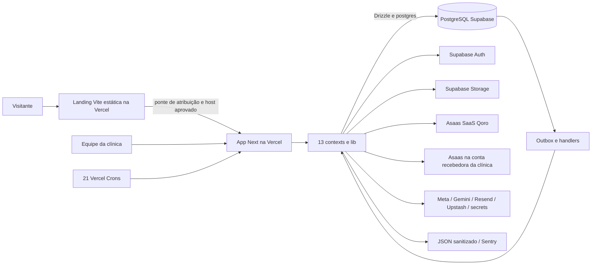
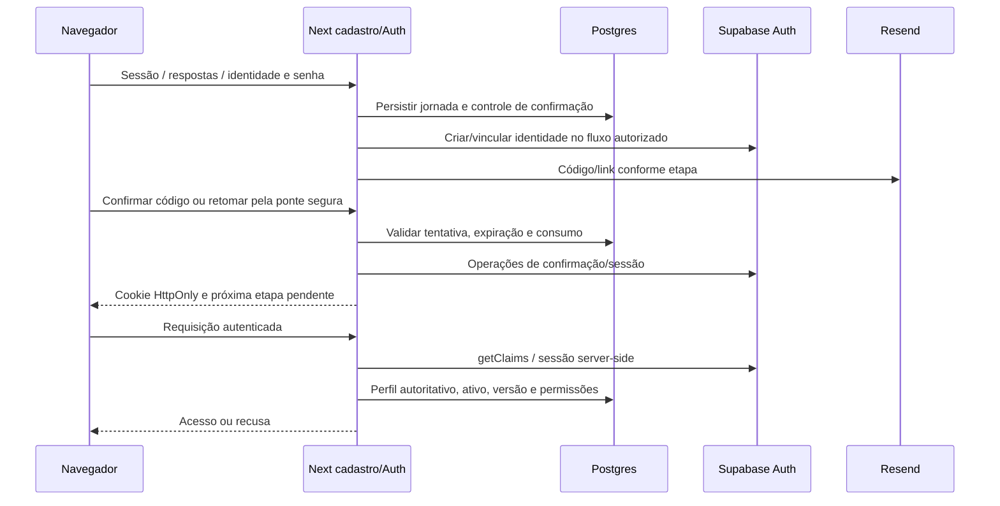
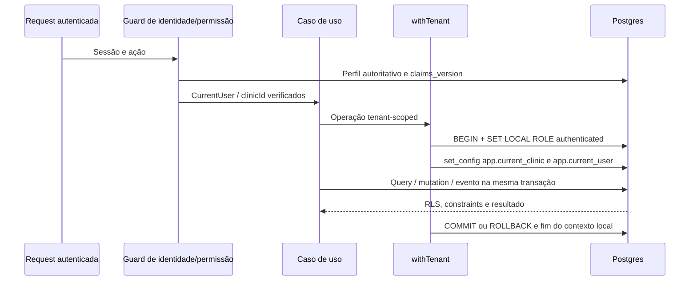
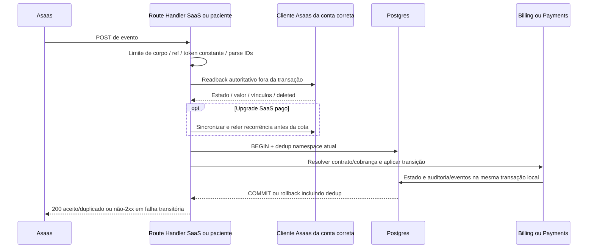
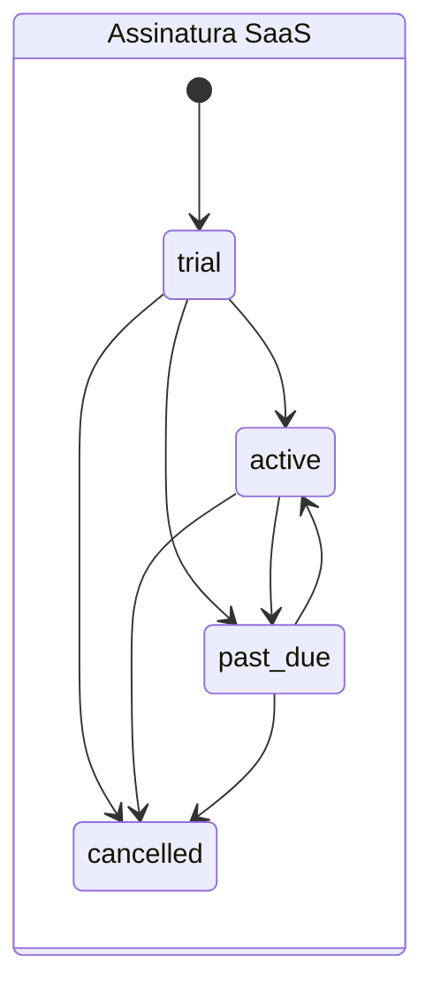
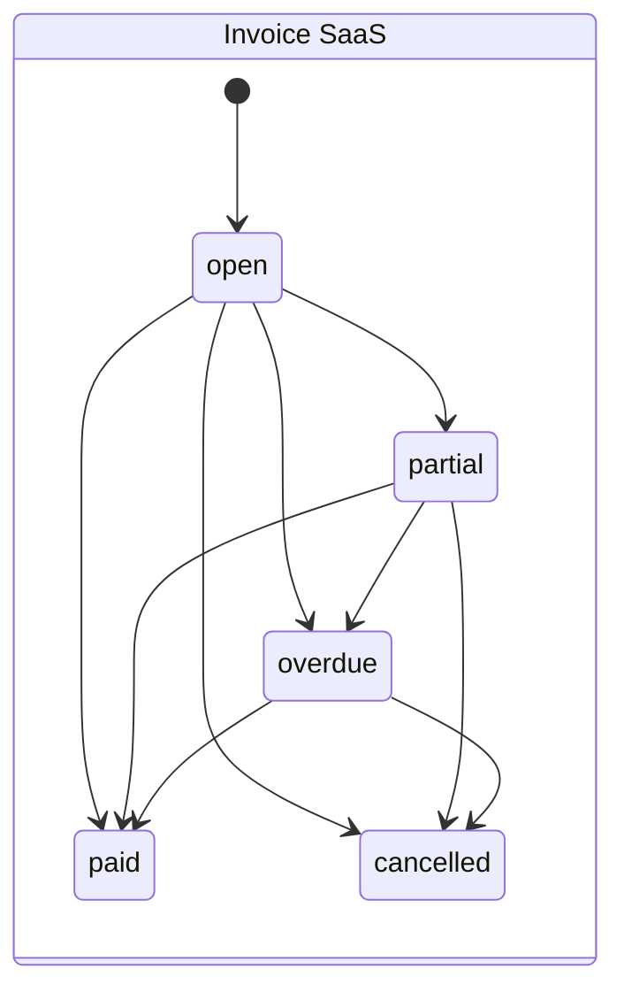
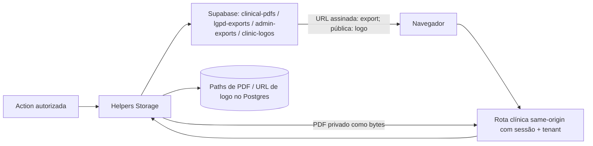

# Diagramas atuais

Todos os diagramas desta página são sínteses de código observado, fontes [E01–E25](01-contexto-atual.md). Arestas completas por import/evento estão nos artefatos gerados [dependency-graph](dependency-graph.mmd), [event-flow](event-flow.mmd) e [context-map](context-map.mmd).

## Sistema

## Identidade e continuidade

Não representa senha gravada no banco de negócio nem um segundo login obrigatório. Sequências variam entre cadastro, retomada e legado; E07 contém a implementação específica.

## Leitura e escrita tenant

Admin e worker são caminhos distintos allowlisted, não usuários tenant com privilégio irrestrito.

## Webhook financeiro atual

Não há inbox bruta assíncrona universal: processed_webhooks registra dedup/processamento local; outbox publica efeitos. Introduzir inbox seria decisão posterior, não correção automática.

## Estados atuais

`cancelled` é terminal na transição genérica. Reativação é operação auditada própria após confirmação do provedor. Plano, ciclo, quota e acesso são dimensões adicionais; não estão codificados nesse diagrama simplificado.

`paid` não regride por evento atrasado; refund é registrado fora desse estado. Restauração autoritativa de cobrança removida usa seam específico. Pagamento de paciente tem estados próprios (`pending`, `paid`, `expired`, `cancelled`, `refunded`, `failed`) e risco separado. `CONFIRMED` pode quitar obrigação sem significar saldo liquidado no banco.

## Arquivos

Os quatro buckets são os helpers identificados; não representam inventário atual de todos os buckets remotos. O quinto bucket de marca aparece em templates e em evidência histórica.
