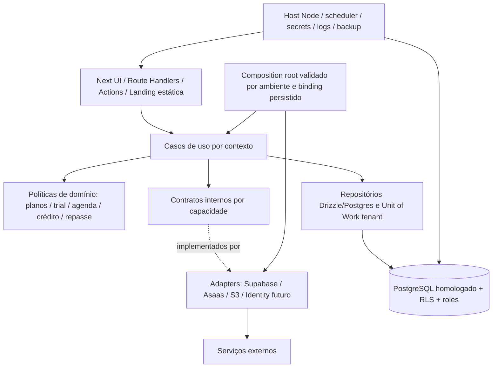
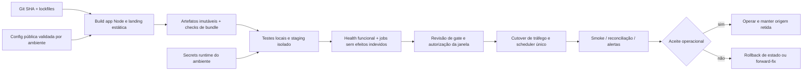

# Arquitetura proposta

**DECISÃO — não implementada.** Evoluir o monólito modular. Não criar microserviços, ORM genérico ou substituir Next/React. Reutilizar autorização, RLS, máquinas de estados, outbox e crypto existentes. A camada de aplicação depende de contratos próprios; adaptadores implementam esses contratos e são selecionados no ponto de composição.

As setas representam dependência lógica; domínio não importa adapter. A infraestrutura compõe as implementações. Manter regras de ESLint: contracts compartilhados em lib, contexts importam lib; exceções entre contexts existentes não se multiplicam para acomodar providers.

## Fronteiras

1. **Identidade:** provar sujeito, sessão, MFA e credencial. **Autorização:** decidir papel, clínica, grants, versão e ativo a partir do banco Qoro. Trocar Auth não transfere essa decisão ao novo SDK.
2. **Persistência:** PostgreSQL continua uma escolha deliberada. RLS, constraints, locks e transações são parte do modelo; troca de engine fica fora do programa.
3. **Arquivos:** referências lógicas bucket/chave/versão e acesso classificado. Acesso clínico continua por servidor autorizado. URLs temporárias são saídas de adapter, nunca chave primária de domínio.
4. **Billing SaaS:** contrato comercial, preço imutável/legado, trial, quota, acesso e mudança de plano pertencem ao Qoro. Gateway mantém recorrência e pagamentos externos; identidade do gateway fica persistida por contrato.
5. **Payments paciente:** binding da conta recebedora e histórico por clínica. Gateway SaaS e gateway paciente podem migrar em momentos diferentes.
6. **Jobs:** manter handlers/outbox transacionais; scheduler apenas dispara. Uma geração ativa de scheduler por ambiente e gates por rota; não criar JobScheduler para cada handler.
7. **Host:** deployment context e allowlist explícitos, com criptografia e segredos do próprio ambiente. Manter Next como dependência assumida; portabilidade de host não significa qualquer edge runtime.

## O que não abstrair agora

- React, Next routing, HTTP Request/Response e Drizzle não precisam de wrappers só para mudar o operador de hosting/Postgres.
- Não criar UserRepository que duplique todo o SDK Auth; começar por casos de uso reais e sessão verificada.
- Não criar gateway universal prometendo Pix, cartão, boleto, split e mandato onde o segundo provedor não os suporta.
- Não introduzir Kafka, Kubernetes, Terraform ou outro produto como requisito sem necessidade/ambiente aprovados.
- Extrair o contrato PaymentProvider existente é primeiro passo; a independência só vem após remover semântica Asaas de seus consumidores e provar outro adapter.

## Comparação de estratégias

| Estratégia                                    | Ganho                            | Limite / custo                                                             | Recomendação                                  |
| --------------------------------------------- | -------------------------------- | -------------------------------------------------------------------------- | --------------------------------------------- |
| Só trocar nomes de env                        | Baixo                            | Não muda schema, auth, jobs nem semântica financeira                       | Insuficiente                                  |
| Wrappers para todos os SDKs de uma vez        | Médio potencial                  | Alto risco de refatoração e falsa portabilidade                            | Evitar                                        |
| Strangler por capacidade e testes de contrato | Ganho verificável por etapa      | Exige convivência e disciplina                                             | Recomendada                                   |
| Supabase self-hosted intermediário            | Troca o operador e preserva APIs | Ainda usa Auth/Storage/roles Supabase; operação vira responsabilidade Qoro | Contingência, não gate de independência total |
| Reescrita completa / troca simultânea         | Teórico                          | Dificulta causalidade e rollback, aumenta risco financeiro                 | Rejeitada para a primeira execução            |

## Ordem recomendada

Proteção e configuração → prova de hosting → Storage → fronteiras financeiras e coexistência → identidade → Postgres genérico → ensaio combinado. A construção dos contratos pode ser paralela; cutovers de identidade e banco dependem de uma prova conjunta de autorização. A primeira entrega útil é rodar app e landing fora da Vercel mantendo os demais provedores de DEV.

## Pipeline de deploy proposto

Build verde não substitui health de runtime. Alterar configuração pública incorporada no bundle exige rebuild; segredo runtime não deve entrar no artefato. Uma promoção de imagem entre ambientes só é suportada depois de decidir e provar a estratégia de configuração pública.
