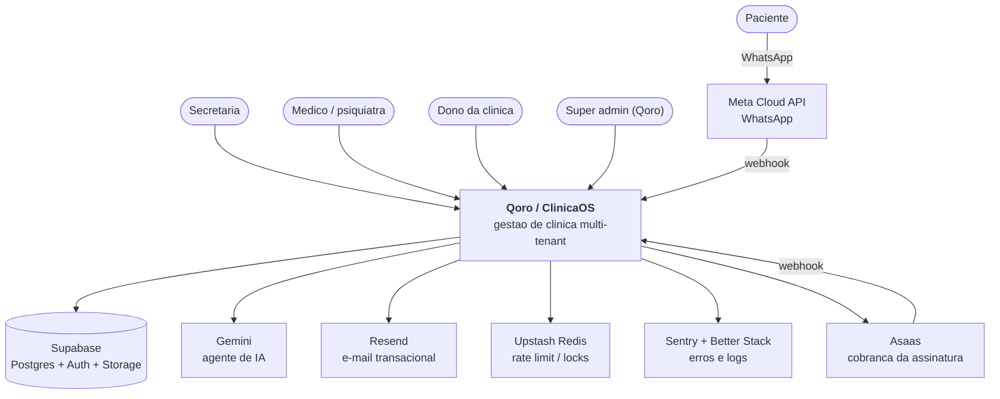
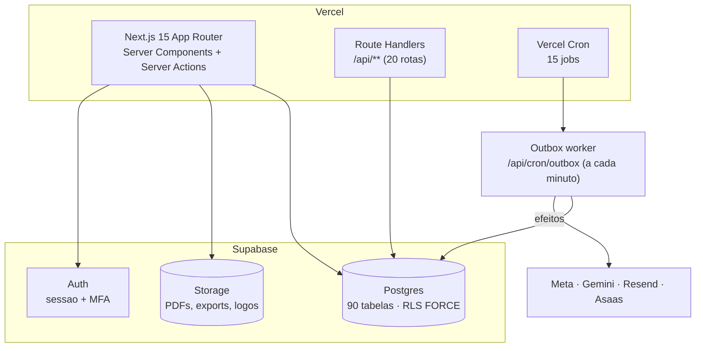

## Status

Canonical — visão estrutural do sistema. Produzido na **Camada -1** do [plano qorov2](https://github.com/joaomarcos-techia/Project_OS/blob/af677c00cfb9a4faa8474ddbf1d69d489d8c8849/docs/qorov2.md).

## Source of Truth

`src/contexts/*`, `src/lib/*`, `src/app/*`, `vercel.json`, `eslint.config.mjs`. Os grafos ao lado
(`dependency-graph.mmd`, `event-flow.mmd`, `context-map.mmd`, `arch-metrics.json`) são **gerados** por
`pnpm arch:graphs` — este documento explica o que eles significam; eles é que dizem o estado atual.

## Inventário medido

| Dimensão | Valor | Como conferir |
| --- | --- | --- |
| Bounded contexts | 12 | `src/contexts/*` |
| Elementos no grafo (context/lib/app/component) | 52 | `arch-metrics.json` |
| Arestas de import entre elementos | 264 | `arch-metrics.json` |
| Ciclos de dependência | 0 | `pnpm arch:graphs` |
| Eventos de domínio registrados | 57 | `registerEventSchema` |
| Eventos com consumidor | 14 | `event-flow.mmd` |
| Handlers de outbox | 13 arquivos | `internal/handlers/*` |
| Tabelas | 90 | `pgTable(` |
| Migrations | 80 | `drizzle/migrations/*.sql` |
| Crons | 15 | `vercel.json` |
| Webhooks de entrada | 2 (Asaas, Meta) | `src/app/api/webhooks/*` |
| Rotas de API · arquivos com Server Action | 20 · 55 | `route.ts` · `'use server'` |
| Testes | 201 arquivos | `vitest` |

## Nível 1 — Contexto



O paciente **não tem login**: fala com a clínica pelo WhatsApp, e o agente de IA responde
(ADR-048 · ADR-022). Toda escrita nasce de um usuário autenticado ou de um webhook validado.

## Nível 2 — Containers



**Regra estrutural:** mutação de domínio escreve estado **e** enfileira evento na mesma transação
(`lib/outbox`). O efeito assíncrono desse evento acontece depois, no worker.
Fluxos síncronos de contratação e prova de identidade têm integração própria;
não deduza desta regra que toda chamada externa passa pela outbox.

## Nível 3 — Componentes

Os contextos e como se ligam estão em **[`context-map.mmd`](https://github.com/joaomarcos-techia/Project_OS/blob/af677c00cfb9a4faa8474ddbf1d69d489d8c8849/docs/architecture/context-map.mmd)** (gerado). O texto de
ownership de cada um está em **[`context-map.md`](/architecture/context-map)**.

## Como ler os grafos gerados

| Arquivo | Eixo | Use quando |
| --- | --- | --- |
| [`dependency-graph.mmd`](https://github.com/joaomarcos-techia/Project_OS/blob/af677c00cfb9a4faa8474ddbf1d69d489d8c8849/docs/architecture/dependency-graph.mmd) | import, agregado por elemento | quer saber quem compila junto com quem |
| [`event-flow.mmd`](https://github.com/joaomarcos-techia/Project_OS/blob/af677c00cfb9a4faa8474ddbf1d69d489d8c8849/docs/architecture/event-flow.mmd) | evento a evento (produtor → evento → consumidor) | quer rastrear o caminho assíncrono de um fato |
| [`context-map.mmd`](https://github.com/joaomarcos-techia/Project_OS/blob/af677c00cfb9a4faa8474ddbf1d69d489d8c8849/docs/architecture/context-map.mmd) | context a context | quer a visão de acoplamento em uma tela |
| `arch-metrics.json` | fan-in/fan-out + ciclos | quer comparar acoplamento entre camadas (§11) |

Traço cheio no `context-map.mmd` = acoplamento **assíncrono** (evento). Traço pontilhado =
acoplamento **síncrono** por import do barrel público do vizinho.

### As duas formas legítimas de um context falar com outro

1. **Evento (outbox)** — para efeito/escrita. É o caminho padrão.
2. **Import do barrel público** (`schedulingApiV1`, `patientApiV1`, `messagingApiV1`, `financialApiV1`)
   — para **leitura** de estado. O `eslint-plugin-boundaries` bloqueia `context → context` por padrão;
   cada leitura autorizada carrega um `eslint-disable boundaries/element-types` **com justificativa
   obrigatória na mesma linha**. Há **53** dessas exceções hoje, cobrindo 57 imports: **46** apontam
   para o barrel público (`@/contexts/<nome>`), **10** para o `schema` do vizinho (refs de FK —
   `tenantIdRef`, `profiles`, `patients`; ver D35 nos schemas) e **nenhuma** para `internal/*`.

Ou seja: "cross-context só por evento" vale para **escrita**. Leitura tem um segundo caminho, versionado
e explícito. Quem for criar context novo deve usar os dois mecanismos existentes, não um terceiro.

### Por que `lib:db` aparece dependendo dos contexts

`src/lib/db/schema/index.ts` é o **barrel** que reexporta o schema e o `events.ts` de cada context — é
ele que popula o catálogo de eventos onde quer que `publishEvent` rode (ver `lib/outbox/catalog.ts`).
Isso cria arestas `lib:db → context:*` que **parecem** inversão de camada e não são: é o ponto de
composição do schema, por design. Não "consertar".

## Regeneração

```
pnpm arch:graphs           # regenera os quatro artefatos
pnpm arch:graphs --check   # falha se o disco divergir do código
```

Modelo lockfile: mudou o acoplamento, regenere e **commite o diff no mesmo PR**. É esse diff que a
revisão lê para decidir se o acoplamento novo era intencional.

## Riscos conhecidos

Em [`risks.md`](/architecture/risks).
