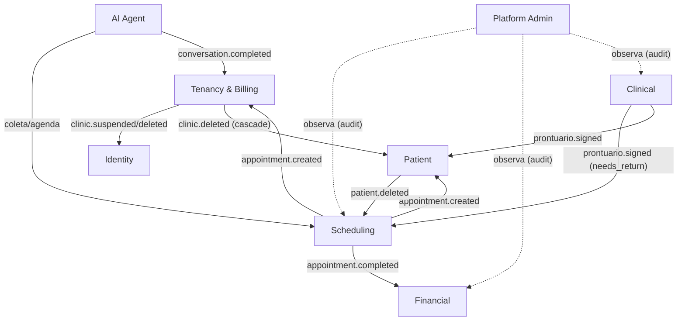

# Context Map — Bounded Contexts

> **Status:** Ativo · **Owner:** João Marcos (Qoro) · **Última revisão:** 2026-07-01 · **Próxima revisão:** 2027-01-01
>
> ↩︎ Volta para o [índice mestre](../README.md).

Mapa de leitura rápida dos **8 bounded contexts** e de como eles conversam. A fonte canônica é [VisãoGeral §2.1, §2.7 e §4](../VisãoGeral.md) e os ADRs [001](../adr/001-bounded-contexts.md) (contexts), [003](../adr/003-outbox-pattern.md)/[011](../adr/011-outbox-audit-idempotency-patterns.md) (outbox) e [015](../adr/015-event-versioning.md) (versionamento de evento). Este doc destila; ele **não** substitui aquelas fontes.

---

## Regra de ouro

🔒 Contextos **não** fazem JOIN cross-context nem se importam diretamente. Comunicam por **eventos no outbox** (assíncrono) ou **API interna explícita** via `@/contexts/<X>` (síncrono, só `api.ts`/`events.ts`). Isso é o que evita o "efeito hidra" do v1. Ver [CONVENTIONS.md](../CONVENTIONS.md) (matriz de imports) e ADR-001.

---

## Os 8 contextos

| # | Contexto | Dono de… | Camada |
|---|---|---|---|
| 1 | **Identity** | auth, usuários, roles, permissions, claims JWT | C3 |
| 2 | **Tenancy & Billing** | clínicas, planos, assinatura, mensalidade (Asaas), MRR/churn | C2 / C13 |
| 3 | **Patient** | pacientes, contato, consentimentos LGPD, dados clínicos persistentes | C5 |
| 4 | **Scheduling** | agenda, slots, agendamentos, procedimentos, state machine | C6 |
| 5 | **Clinical** | prontuário, prescrições, documentos/PDF, consultório | C7 / C8 |
| 6 | **Financial** | lançamentos, caixa, pagamentos do paciente, fornecedores | C9 |
| 7 | **AI Agent** | conversas WhatsApp, intents, memória, orçamento IA | C10–C12 |
| 8 | **Platform Admin** | audit events, export PDF, ações super_admin, métricas | C15 |

Cada um vive em [`src/contexts/<nome>/`](../../src/contexts/) com `README.md` descrevendo sua responsabilidade.

---

## Fluxo de eventos (o "quem depende de quem")

> Todos os contextos escrevem em `audit_events` (Platform Admin observa). Todo evento passa pelo **outbox** transacional — nunca chamada direta.

### Principais arestas (canônico: VisãoGeral §4)

| Emissor | Evento | Consumidor | Efeito |
|---|---|---|---|
| Scheduling | `scheduling.appointment.completed` | **Financial** | Cria lançamento ("nenhum atendimento sem faturamento") |
| Scheduling | `scheduling.appointment.created` | Tenancy, Patient | Incrementa `usage_metrics`; atualiza `last_appointment_at` |
| Clinical | `clinical.prontuario.signed` (+`needs_return`) | Scheduling, Patient | Cria task de follow-up; atualiza `last_visit_at` |
| AI Agent | `ai_agent.conversation.completed` | Tenancy | Incrementa `usage_metrics` de IA |
| Tenancy | `tenancy.clinic.suspended` / `.deleted` | Identity, Patient | Revoga sessions; hard-delete cascateado (LGPD) |
| Patient | `patient.deleted` | Scheduling | Cancela agendamentos futuros |

Nomes exatos e payloads dos eventos: VisãoGeral §4 por contexto + [contracts/events/billing.md](../contracts/events/billing.md). Versionamento: [ADR-015](../adr/015-event-versioning.md).

---

## Planos arquiteturais (mesmo deploy)

- **Data Plane** (`app.qoro.dev`, rotas `(app)/`) — operação das clínicas.
- **Control Plane** (`admin.qoro.dev`, rotas `(admin)/`) — operação da Qoro (Platform Admin).

Separação é **lógica** (RLS + rotas + role `super_admin`), não física. Ver VisãoGeral §2.4 e [ADR-008](../adr/008-identity-patterns.md).

---

## Veja também

- [VisãoGeral.md](../VisãoGeral.md) — §2 (filosofia) e §4 (cada contexto em detalhe).
- [adr/001-bounded-contexts.md](../adr/001-bounded-contexts.md) — a decisão de isolar por domínio.
- [adr/003-outbox-pattern.md](../adr/003-outbox-pattern.md) · [adr/011-...](../adr/011-outbox-audit-idempotency-patterns.md) — como os eventos trafegam.
- [CONVENTIONS.md](../CONVENTIONS.md) — matriz de imports (enforcement).
- [README.md](../README.md) — índice mestre.
