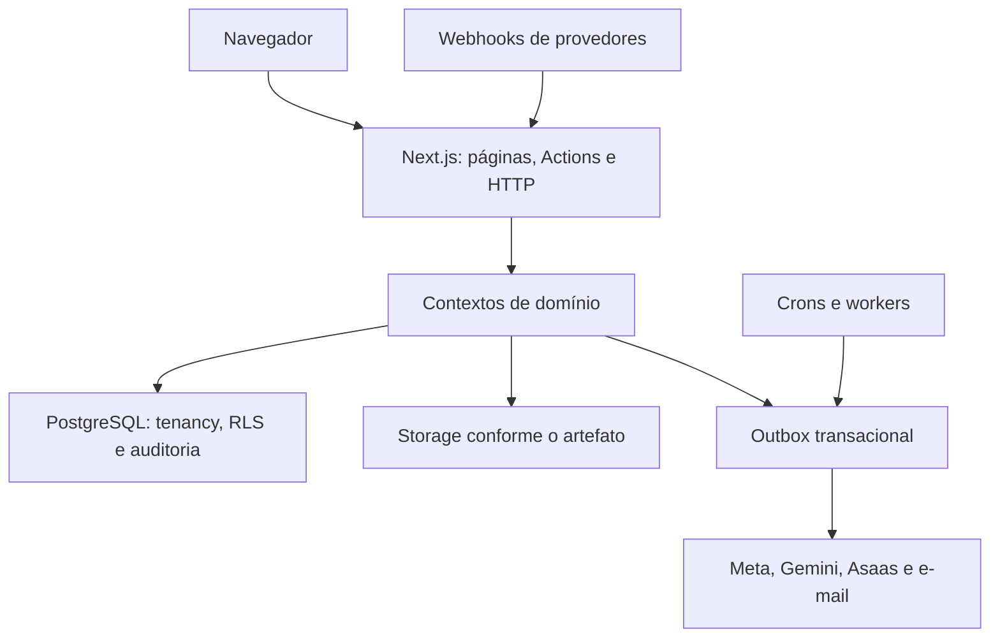

## Visão do sistema

O Qoro é uma aplicação full-stack Next.js. O deploy atende o shell da clínica,
o super-admin, endpoints públicos controlados, webhooks e jobs. Regras de domínio
ficam em `src/contexts`; infraestrutura usa Supabase/PostgreSQL, Storage e Redis.

O diagrama mostra responsabilidades, não permissão para importar internals nem
prova de configuração ou saúde de provedores.

## Camadas

| Camada | Responsabilidade |
| --- | --- |
| `src/app` | Páginas, layouts, Actions e Route Handlers |
| `src/contexts` | Regras, estados, persistência e contratos públicos dos 13 domínios |
| `src/lib` | Primitivas de Auth, DB, crypto, Storage, outbox e observabilidade |
| `drizzle/migrations` | Schema, constraints, grants e RLS versionados |
| `scripts` e `e2e` | Operações explícitas, verificações, fixtures e jornadas de navegador |

Veja o [mapa de contextos](/architecture/context-map), o [banco](/database/schema),
o [backend](/backend/http-jobs-outbox) e o [frontend](/frontend/routes-and-access).

## Fronteiras

- Contextos expõem contratos por barrels e eventos; `internal/` não é API pública.
- `withTenant` define clínica, usuário e role na mesma transação usada pelas queries.
- Autorização no servidor e RLS são complementares. Middleware não é a autoridade final.
- Pools de runtime, administração e worker têm responsabilidades diferentes.
- Negócio e evento são gravados na mesma transação quando exigem consistência.
- LLM e chamadas lentas a provedores não ficam dentro de transações longas.
- Resultado de rede incerto exige reconciliação; retry cego não é idempotência.

## Fluxos principais

### Usuário da clínica

Sessão em cookies HttpOnly → identidade/profile autoritativo → role, permissões,
claims e modo de acesso → validação → transação tenant → auditoria/eventos.
Ser dono, ter CRM, possuir um plano e ter uma permissão são verificações diferentes.

### Contratação da Qoro

O [cadastro autônomo](/onboarding/signup) mantém a intenção antes do tenant,
com prova de e-mail e senha preservada. O servidor resolve preço e termos, abre
checkout hospedado e reconcilia o provedor antes de provisionar. O
[convite](/onboarding/invitations) continua com contrato próprio.

### WhatsApp e IA

Webhook Meta validado → persistência/quarentena e evento → agente → consulta ou
ferramenta permitida → efeito de domínio e mensagem outbound. Resposta gerada,
aceite da Meta e entrega são fatos distintos. Handoff, coexistência e devolução
ao agente respeitam estado e motivo persistidos.

### Dinheiro do paciente

`payments` mantém o instrumento e fatos do provedor; `financial` mantém obrigação
e conciliação; `billing` cobra a Qoro. Veja a
[política financeira](/domains/financial-policy).

### Processamento assíncrono

O worker reserva eventos, valida contratos, executa handlers e finaliza
condicionalmente. Locks, deduplicação, retries e estados terminais protegem o
efeito de negócio contra cliques, webhooks e reprocessamentos repetidos.

## Limites da descrição

Provider placeholder não é failover funcional. Código de uma modalidade não
comprova ativação comercial. Teste local não comprova entrega externa. Consulte
[limitações](/roadmap/known-limitations) e [evidências](/quality/index).
