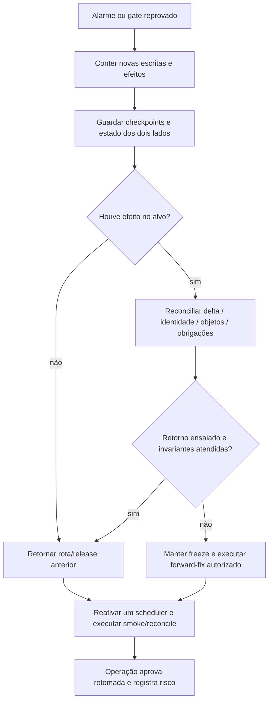

# Retorno seguro

Procedimento operacional: [provider-rollback](../runbooks/provider-rollback.md). **Trocar commit ou DNS não desfaz dados, identidade, mensagens ou pagamentos.**

## Matriz de reversibilidade

| Mudança                               | Último ponto seguro                      | Retorno possível                                               | Quando exige forward-fix / reconciliação                                                              |
| ------------------------------------- | ---------------------------------------- | -------------------------------------------------------------- | ----------------------------------------------------------------------------------------------------- |
| Imagem/host sem efeito novo           | Release anterior saudável                | Roteamento de tráfego e configuração equivalentes              | Actions/cookies/caches incompatíveis ou novo scheduler já atuou                                       |
| Schema expand-only                    | Antigo código continua suportado         | Reverter aplicação mantendo colunas/índices extras             | Migration contract/remove ou leitores incompatíveis; não aplicar DOWN destrutivo                      |
| PostgreSQL após escrita no destino    | Checkpoint final e log de delta          | Reverse sync ensaiado + freeze + validação                     | Delta incompleto, dados sensíveis conflitantes, constraints divergentes                               |
| Storage após upload/delete            | Manifesto e tombstones conhecidos        | Reconciliar bytes/versions/delete antes de mudar leitor/writer | Fonte perdeu alterações; não restaurar objeto legitimamente removido                                  |
| Identidade após senha/reset/revogação | Subjects/bindings e epochs reconciliados | Voltar issuer/cohort com política de reauth                    | Senhas/MFA/sessões divergentes; não ressuscitar credencial revogada                                   |
| Novo pagamento/recorrência            | Operação ainda não criada externamente   | Parar novas originações                                        | Efeito já existe: obrigação continua no gateway que a criou; não cancelar/refund sem regra autorizada |
| Webhook/inbox/outbox                  | Envelope/lease/checkpoint persistidos    | Retomar consumidor compatível, dedup por namespace             | Efeito externo foi aceito e DB falhou; readback obrigatório                                           |

## Invariantes de retorno

Um writer autoritativo por domínio; um scheduler ativo; eventos e snapshots nunca descartados para "zerar" teste; dados pós-corte contabilizados; perfis/claims/ACL equivalentes; contratos antigos sem repricing; zero cobrança/benefício duplicado. Registros de run ID e provedor/conta devem continuar permitindo reconciliar retornos tardios.

Tempo de retorno é **PENDENTE de medição**; metas propostas não são SLA. Não realizar restauração física sobre origem ativa para resolver divergência pontual. Selecionar recuperação de registro/serviço em ambiente isolado com autorização e preservar logs de escritas posteriores.
