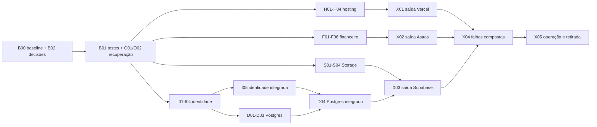

# Cronograma, caminho crítico e custos

**Estimativa de engenharia, não compromisso comercial.** O [backlog](03-roadmap-mestre.md) soma **81–150 dias de engenharia focada**, antes de contingência/espera externa. Premissas: reuso das suites atuais, equipe familiarizada com Next/Postgres, escopo sem nova regra financeira, alvos com capacidades adequadas e ambientes sintéticos disponíveis. Confiança baixa a média até fechar B00/B02 e escolher os provedores.

## Marcos e paralelismo

Financeiro pode desenvolver contrato/Sandbox em paralelo a Storage/hosting depois de G1/G2. Identidade e Postgres precisam coordenar FKs/roles e não têm cutovers independentes seguros por default. O03 é gate transversal contra reintroduzir imports; O04 mede capacidade antes de X01. Diagrama é de entregas; dependências exatas por tarefa estão em tarefas.json.

## Planejamento de calendário

| Cenário                                 | Equipe / premissas                                                                                      | Faixa de planejamento                                       |
| --------------------------------------- | ------------------------------------------------------------------------------------------------------- | ----------------------------------------------------------- |
| Spike inicial de hosting                | Um engenheiro, alvo local/teste já disponível; não inclui homologação completa nem produção             | 5–10 dias focados; reestimar após provar startup/jobs/URLs  |
| Programa completo otimista              | Dois engenheiros experientes + apoio QA/SRE/segurança, alvos compatíveis e aprovações rápidas           | 10–14 semanas, alto paralelismo e poucas incompatibilidades |
| Programa completo provável              | Mesma capacidade parcial, compatibilidade Auth/financeiro precisa ajustes                               | 16–24 semanas                                               |
| Programa pessimista                     | Credenciais/mandatos não importáveis, RLS/volumes e integrações exigem adaptação, suporte externo lento | 28–40+ semanas ou escopo reduzido por decisão               |
| Um engenheiro como capacidade principal | Pouco paralelismo; 81–150 dias mais ~20% de contingência                                                | Aproximadamente 20–36 semanas, além de espera externa       |

Essas faixas são estimativas condicionais derivadas do backlog e paralelismo, não experiência medida de uma migração deste projeto. O caminho crítico provável é B00/B02/B01 → I01/I02/I03/I04/I05 + D01/D02/D03/D04 → X03 → X04 → X05. Gateway secundário sem capacidade necessária pode se tornar caminho crítico e exigir decisão de escopo, não código que finja suporte.

## Marcos de aprovação

G1 arquitetura/capabilities; G0 operacional tratamento de dados/destino e risco; alvos/custos antes de contratar; migrations/contratos públicos e CI antes de implementação afetada; piloto não produtivo; relatório dos exercícios; janela real por fornecedor; retenção e desativação final. Autorização antiga de produção não cobre nova saída de fornecedor.

## Custo e valor

Não foram consultadas faturas, plano atual, volume, egress ou preços de alvos. **Economia não calculada.** Comparar custo atual auditado com: engenharia/QA, hospedagem CPU/memória/PDF, DB/IO/backups/HA, auth/usuários/MFA/e-mails, Storage+egress, observabilidade, scheduler, suporte/on-call, período duplicado, taxas/KYC/risco financeiro e contingência. `self-hosted` não significa sem custo de operação. Nenhuma contratação ou aumento de custo integra esta análise.

Recomendação de investimento: aprovar primeiro um ciclo curto de H01/H02/H03 com dados sintéticos para reduzir incerteza; decidir próximo ciclo a partir do resultado. Não financiar antecipadamente o programa inteiro só para ter nomes neutros de env. Cada marco deve entregar uma saída demonstrável ou redução de risco mensurável.
