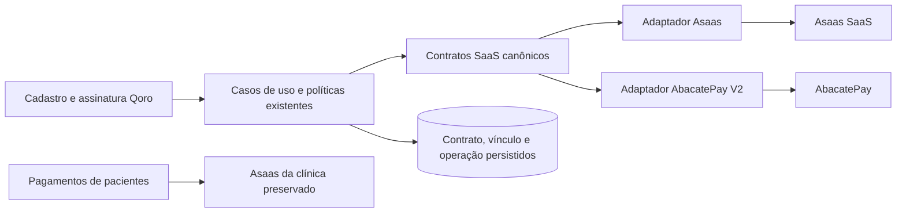
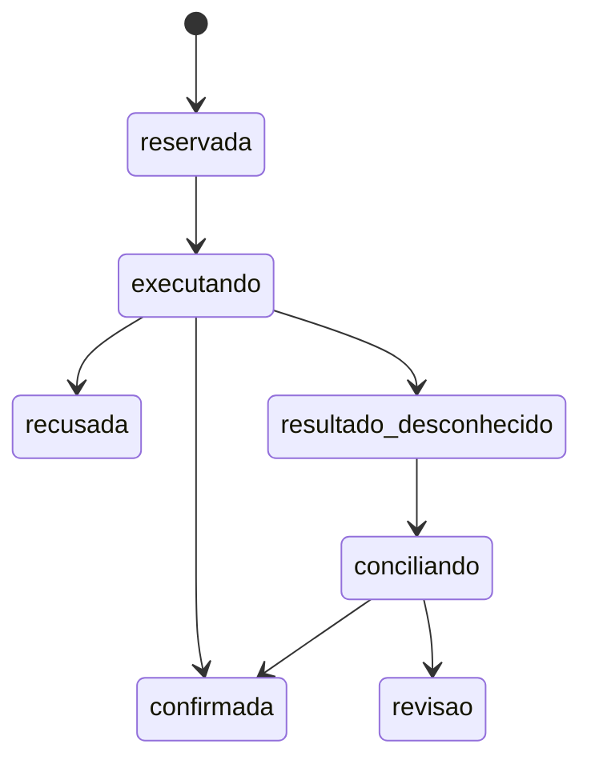
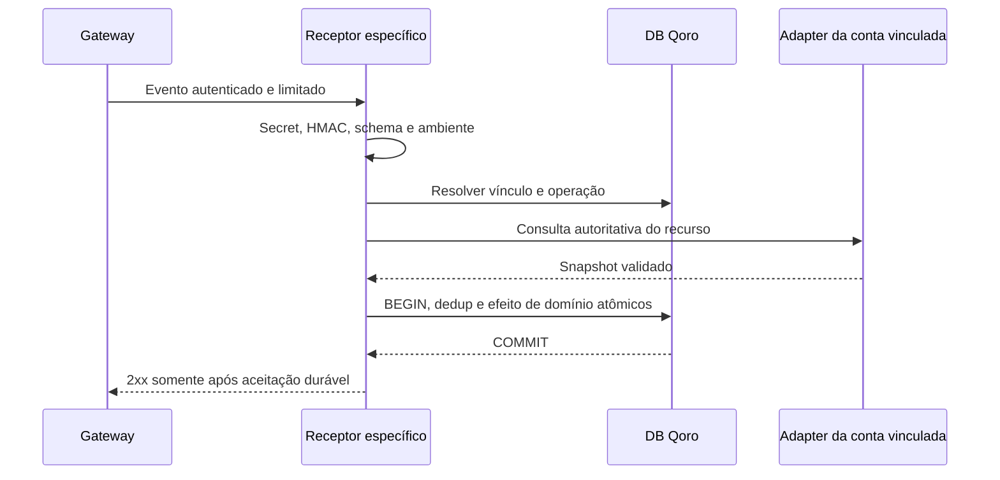

# Migração financeira Asaas → AbacatePay — plano mestre

Atualizado em 07/11/2026. **Implementação local incremental autorizada; produção e cutover não autorizados.** Este documento precede qualquer alteração de código desta execução e será atualizado com os resultados. Não substitui os gates do [plano geral](../README.md).

**Continuação em 08/11:** os resultados iniciais abaixo são históricos. A [subentrega seguinte](CONTINUACAO-2026-11-07.md) acrescentou comandos Sandbox protegidos, checkout sintético ainda pendente, journal/inbox candidatos e prova PostgreSQL local. O founder aprovou **trial no Qoro e checkout ao final** e depois definiu as [cotas de avaliação e integrações após pagamento](../../specs/trial-interface-e-cotas-2026-11.md). Essas decisões não autorizam ativação de gateway, migration remota ou mudança dos contratos existentes. AbacatePay ainda não compõe a jornada pública.

## 1. Escopo, procedência e segurança

- Migrar somente **assinatura da clínica à Qoro**. Cobranças de pacientes, conta recebedora e repasses continuam fora da migração.
- Supabase, Vercel, preços, trial, descontos e direitos legados permanecem preservados.
- Worktree de implementação: `C:/dev/Qoro_billing_abacatepay_20261107`, branch `feat/billing-abacatepay-20261107`.
- Base e main remota conferidas: `534995b0a41d3b856fa0310e9e4359245a44589a`. Landing auditada: `deb670bbf3dd5c3e5ba521318f052d312f0193bb`; sem alteração prevista enquanto não houver contratação candidata homologada.
- Plano anterior preservado em sua origem. Foram copiados 29 documentos não secretos para este worktree; [manifesto SHA-256](../plano-preservado-20261107.json). Não foram copiados `.env`, credenciais, dados, backups ou sessões. Dependências reutilizadas por junction após igualdade do lockfile; Node 22.16.0 e pnpm 11.17.0.
- Credencial `ABACATEPAY_API_KEY` consultada apenas para chamadas servidor-servidor autorizadas. Arquivo original não alterado, valor não registrado. Não usar chave de API como secret de webhook.
- Não houve migration, escrita em banco remoto, publicação, alteração de contrato ou envio externo de mensagens.
- D01–D12 anteriores continuam propostas onde não forem abrangidas expressamente pelo novo escopo. A prioridade financeira substitui a ordem sugerida de hosting, sem autorizar aquelas outras frentes.

## 2. Fontes e nível de prova

### Código atual

As referências abaixo são relativas à raiz do repositório e foram conferidas no SHA base. O [inventário original](../../architecture/01-contexto-atual.md) identifica E01–E25; [inventario-codigo.json](../inventario-codigo.json) contém imports e nomes de configuração, sem valores.

| Fronteira                     | Arquivos, funções e persistência                                                                                                          | Comportamento que precisa ser preservado                                                                                                                            |
| ----------------------------- | ----------------------------------------------------------------------------------------------------------------------------------------- | ------------------------------------------------------------------------------------------------------------------------------------------------------------------- |
| Transporte Asaas              | `src/lib/payments/asaas/index.ts`: `PaymentProvider`, `createAsaasClient`, `asaasProvider`                                                | GET com retry limitado; comando remoto sem retry cego; erros sanitizados; clientes globais e por clínica são diferentes                                             |
| Catálogo, contrato e direitos | `src/contexts/billing/schema.ts`, `api.ts`, `proposed-offer.ts`                                                                           | UUID interno, `price_id`, preço histórico e campanha; 1 médico Consultório, 2–5 Clínica; até 3 administrativos; adicional R$147/médico; anual novo fechado por flag |
| Trial                         | `src/contexts/onboarding/internal/signup-trial.ts`: `resolveSignupTrialTerms`                                                             | 14 dias desde Auth na oferta nova; prazo imutável; Asaas recebe dia UTC posterior para não cobrar antes; checkout tardio requer pagamento                           |
| Contratação                   | `signup-hosted-checkout.ts`, `signup-checkout.ts`, `signup-billing.ts`, `signup-provision.ts`, `saga.ts` em onboarding/internal           | Reserva e recuperação por referência; checkout hospedado não prova assinatura paga; provisionamento retomável, compensação com limites                              |
| Confirmação                   | `src/app/api/webhooks/asaas/route.ts`; `billing/internal/subscriptions.ts`, `subscription-webhook-events.ts`                              | Token, limite do corpo, GET autoritativo, transação de dedup/estado/evento; confirmação ≠ liquidação                                                                |
| Upgrade/adicional             | `billing/internal/plan-changes.ts`, `plan-change-payment.ts`, `plan-change-provider-sync.ts`                                              | Rateio local; pagamento e novo valor recorrente remotamente confirmados antes da maior cota; nenhuma assinatura paralela                                            |
| Downgrade/ciclo               | `plan-changes.ts`, `billing-cycle-provider-sync.ts`, `billing-period.ts`                                                                  | Data efetiva no vencimento; verificar ocupação de assentos e parcelas existentes; mensal↔anual tem regras próprias                                                  |
| Cancelamento e retorno        | `billing/internal/subscriptions.ts`, `cancellation-charges.ts`, `annual-prepay.ts`, `state-machine.ts`                                    | Cancelamento genérico terminal; reativação auditada; varrer todas as cobranças; cancelar renovação anual preserva acesso contratado sem estorno automático          |
| Atraso/acesso                 | `billing/internal/dunning.ts`, `access.ts`, `src/lib/tenant-access/`                                                                      | Atraso e carência locais; somente leitura após estágio 15 e bloqueio de escrita após 30; status financeiro não substitui autorização                                |
| Reconciliação/jobs            | `src/app/api/cron/billing-reconcile/route.ts`, `billing-dunning/route.ts`; `src/lib/outbox/`                                              | Provider lido antes de aplicar efeito; cron autenticado, locks/leases, reprocessamento rastreável                                                                   |
| UI e APIs                     | `src/app/(app)/(shell)/configuracoes/assinatura/`, `src/app/api/signup/checkout/route.ts`, `src/app/api/signup/plan/route.ts`, onboarding | Preço resolvido no servidor, permissão fresca, tenant; UI ainda depende de capacidades Asaas                                                                        |
| Pagamento paciente preservado | `src/contexts/payments/`, `src/app/api/webhooks/asaas/patient/[ref]/route.ts`, `src/lib/payments/account-*.ts`                            | Credencial por clínica; sinal/saldo, estorno e risco separados. Não redirecionar pelo default SaaS                                                                  |

Tabelas relevantes: `plans`, `prices`, `plan_limits`, `plan_seat_limits`, `billing_customers`, `subscriptions`, `subscription_change_requests`, `subscription_history`, `checkout_sessions`, `tenant_provisioning`, `processed_webhooks`, `invoices`, `invoice_items`, `payment_attempts`, `annual_prepayments`, `billing_events`, `billing_reconciliation_runs` e jornadas de onboarding. A listagem de nomes é documental; schema e migrations são a autoridade. Campos `asaas_*` e dedup atual ainda não são multigateway. Não backfillar silenciosamente.

### Documentação oficial consultada

Snapshot da documentação pública: `AbacatePay/documentation`, commit `b221a381d3363ab3eb384134ff4567e60c001225`. API priorizada: **V2**, `https://api.abacatepay.com/v2`. Não misturar V1.

- [Referência de assinaturas](https://docs.abacatepay.com/pages/subscriptions/reference), [criação](https://docs.abacatepay.com/pages/subscriptions/create), [mudança](https://docs.abacatepay.com/pages/subscriptions/change-plan), [cancelamento](https://docs.abacatepay.com/pages/subscriptions/cancel).
- [Produtos](https://docs.abacatepay.com/pages/products/create), [clientes](https://docs.abacatepay.com/pages/client/create), [ambiente](https://docs.abacatepay.com/pages/devmode), [autenticação](https://docs.abacatepay.com/pages/authentication).
- [Segurança de webhook](https://docs.abacatepay.com/pages/webhooks/security), [eventos de assinatura](https://docs.abacatepay.com/pages/webhooks/events/subscriptions).
- [OpenAPI V2 no SHA consultado](https://github.com/AbacatePay/documentation/blob/b221a381d3363ab3eb384134ff4567e60c001225/openapi.yaml).
- [Asaas: assinaturas](https://docs.asaas.com/docs/assinaturas), [webhooks](https://docs.asaas.com/docs/sobre-os-webhooks).

Documentação indica capacidade; não demonstra habilitação da conta nem funcionamento da integração Qoro. Há divergências entre a referência, OpenAPI e marketing; registrá-las abaixo em vez de assumir a variante mais favorável.

## 3. Preflight real da credencial

Em 07/11 foram consultados seis endpoints V2, com timeout e sem seguir redirects. Depois, três leituras foram repetidas pelo cliente implementado; nove GETs no total, zero mutações:

| Consulta                            | Resultado                                | Prova de Dev mode                    |
| ----------------------------------- | ---------------------------------------- | ------------------------------------ |
| `GET /stores/get`                   | HTTP200, `success=true`                  | Nenhum `devMode` no objeto retornado |
| `GET /products/list`                | HTTP200, lista vazia, paginação presente | Sem recurso para verificar `devMode` |
| `GET /subscriptions/checkouts/list` | HTTP200, lista vazia, paginação presente | Sem recurso para verificar `devMode` |
| `GET /customers/list`               | HTTP200, lista vazia, paginação presente | Sem recurso para verificar `devMode` |
| `GET /subscriptions/list`           | HTTP200, lista vazia, paginação presente | Sem recurso para verificar `devMode` |
| `GET /webhooks/list`                | HTTP200, lista vazia, paginação presente | Sem recurso para verificar `devMode` |

**Resultado inicial: autenticação PASS; ambiente de teste BLOCKED.** O prefixo citado no blog não foi reconhecido; isso não provou produção. Nome da variável, declaração do operador e lista vazia não substituíram a comprovação exigida. Não foi feito POST para descobrir o ambiente.

**Resultado atual: autenticação e Sandbox PASS.** Em 07/11, o titular criou manualmente o produto sintético `prod_yFBfdSA5twXU3hLREy1YkJtW` no painel Sandbox. Cinco GETs adicionais pelo cliente implementado confirmaram a identidade do recurso, **`devMode=true`**, BRL, 100 centavos, sem ciclo/trial e zero checkouts de assinatura. Total desta execução: **14 GETs, zero mutações pela engenharia**. A chave não foi alterada nem exposta; a loja foi registrada somente por hash na [evidência da atestação](SANDBOX-ATTESTATION-2026-11-07.json). O produto avulso foi mantido como testemunho e não precisa ser recriado. Isso resolve o bloqueio de ambiente, sem conceder PASS às jornadas financeiras ou ao G1.

## 4. Matriz Asaas × AbacatePay e lacunas de compatibilidade

| Capacidade         | Qoro/Asaas atual                                          | V2 documentada / diferença                                             | Tratamento necessário / impacto / prova pendente                                                                                                            |
| ------------------ | --------------------------------------------------------- | ---------------------------------------------------------------------- | ----------------------------------------------------------------------------------------------------------------------------------------------------------- |
| Cliente            | Nome/documento/e-mail vinculados à jornada                | `/customers/create`, e-mail obrigatório; unicidade por documento       | Preservar IDs internos e conta; não deduplicar por e-mail; Sandbox NOT RUN                                                                                  |
| Assinatura         | Assinatura remota e checkout distintos                    | `/subscriptions/create` cria `bill_*`; `subs_*` só existe após adesão  | Distinguir os dois IDs; nunca ativar por retorno do checkout; NOT RUN                                                                                       |
| Recorrência/ciclos | Mensal/anual; primeiro vencimento definido                | Ciclo do produto; cinco frequências documentadas                       | Mapear somente mensal/anual usados; não abrir venda anual; NOT RUN                                                                                          |
| Trial absoluto     | Auth.created_at+14 dias                                   | Produto `trialDays` 1–90, relativo à adesão                            | **BLOCKED:** sem campo documentado para data absoluta no checkout; produto com dias restantes não preserva deadline se checkout demora. Não reiniciar trial |
| Cartão             | Recorrência e cadastro conforme fluxo atual               | `CARD`, tokenização no checkout                                        | Capacidade da conta e fluxo zero-charge no trial precisam prova; NOT RUN                                                                                    |
| Pix                | Cobrança recorrente Asaas não equivale a mandato          | Docs anunciam Pix Automático (`PIX`)                                   | Sem equivalência automática; mandato/limites precisam homologação; NOT RUN                                                                                  |
| Boleto             | Adapter suporta; oferta depende do fluxo                  | Assinatura documenta CARD/PIX                                          | **BLOCKED** para migrar contrato boleto sem decisão/consentimento                                                                                           |
| Alterar plano      | Atualizar recorrência e confirmar preço                   | `/subscriptions/change-plan`: `PENDING`, mesmo ciclo                   | `PENDING` não é novo preço aplicado. OpenAPI aceita `items`, referência diz um produto; validar divergência                                                 |
| Upgrade            | Proporcional agora + recorrência confirmada antes da cota | Preço novo só no próximo ciclo                                         | **BLOCKED** para equivalência direta; requer saga de proporcional+alteração agendada verificável, sem mudar direito silenciosamente                         |
| Downgrade          | Agendado para vencimento, cota elegível                   | Mudança pendente substituível até aplicação                            | Consultar/identificar pendência e conservar acesso atual; NOT RUN                                                                                           |
| Médicos extras     | Variante de preço/cota, +R$147/mês                        | Produto/quantidade, não assento Qoro                                   | Modelar preço integral por variante; nunca multiplicar toda a mensalidade pelo número de médicos; NOT RUN                                                   |
| Cancelamento       | Data/accesso local + cobranças tratadas                   | Cancelamento API imediato; portal cita fim do ciclo                    | Distinguir parar renovação de revogar acesso; política de cobranças abertas precisa prova; NOT RUN                                                          |
| Inadimplência      | Estágios locais/carência; não auto-inventar dívida        | Retry padrão 3, intervalo 1 dia, cancelamento automático               | **PARTIAL documental:** alinhar cancelamento remoto e política local sem ampliar/reduzir acesso; NOT RUN                                                    |
| Reativação         | Operação explícita Asaas auditada                         | Nenhum endpoint de reativação localizado                               | **BLOCKED:** não criar outra recorrência como se fosse reativação                                                                                           |
| Reembolso          | Estado separado, readback terminal                        | Endpoints por checkout/tipo; restrições por recurso                    | Não confundir pedido com conclusão; operação na origem; NOT RUN                                                                                             |
| Chargeback         | Risco e histórico próprios                                | Conferir eventos/recurso autoritativo V2                               | Não mapear erro de rede para chargeback; NOT RUN                                                                                                            |
| Webhook            | Token constante+GET+dedup transacional                    | `webhookSecret` na query + HMAC-SHA256 com chave pública               | Os dois são necessários; HMAC público sozinho não autentica origem; sanitizar query/logs; NOT RUN real                                                      |
| Conciliação        | GETs de pagamento/assinatura e listagens                  | GET/list separados para bill/subs; cursor                              | Consumir todas as páginas, detectar cursor repetido e limite; não inferir período ausente; NOT RUN                                                          |
| Portabilidade      | IDs/cartões/obrigações na origem                          | Nenhuma prova de importar tokens/mandatos Asaas                        | Contratos antigos permanecem Asaas, não reemitir cobrança paga/aberta; NOT RUN                                                                              |
| Idempotência       | Reserva local/referências, sem retry cego                 | Não localizada garantia geral de Idempotency-Key para criar assinatura | `externalId` não será tratado como chave idempotente sem prova; timeout → resultado desconhecido                                                            |
| Isolamento         | Tenant/conta vinculados no banco                          | Um checkout pode gerar várias assinaturas                              | Validar cliente/contrato/conta e bloquear duplicata por operação; nunca ligar só pelo checkout                                                              |

**G1 NO-GO para contratação real candidata** até resolver trial, upgrade, período/lookup e reativação. É permitido preparar contratos e parsers independentes localmente; isso não atravessa o gate de ativação. Não solicitar mudança de preço nem trial para ocultar uma incompatibilidade técnica.

## 5. Arquitetura de destino e etapas de composição

Regras e acesso permanecem no domínio. Adapter não importa contexts. A implementação começará por leitura tipada, capacidades e autenticação de eventos, sem mudar a composição ativa. Novos contratos usam centavos inteiros/BRL; o dinheiro antigo no banco continua numeric(12,2).

### Modelo canônico proposto

- Contrato: UUID Qoro + versão/plano/preço/ciclo/trial/período/acesso preservados.
- Vínculo externo: provedor, ambiente, conta, tipo de recurso e ID. Identidade de cliente, checkout, assinatura, cobrança e evento são distintas.
- Assinatura externa: estado canônico mais estado original; um `ACTIVE` remoto não prova pagamento nem período de acesso.
- Pagamento: obrigação, liquidação, estorno e contestação separados; `unknown` explícito onde API não dá a informação.
- Operação: reservada → executando → confirmada / recusada / resultado desconhecido → reconciliada. Nenhum failover financeiro automático.

### Coexistência e configuração

Asaas continua seleção ativa. A chave AbacatePay não muda roteamento. Não adicionar flag que redirecione contratos legados. Binding persistido é requisito antes de permitir qualquer novo contrato remoto pelo outro gateway. No cancelamento/refund/readback usar sempre origem. API key servidor; secret webhook próprio; ambiente esperado explícito. Nenhum endpoint público AbacatePay deve responder sucesso sem persistência/efeito.

## 6. Plano rastreável de execução

### Continuação autorizada — comandos isolados e ensaio de catálogo/checkout

O titular autorizou continuar segundo este plano após a comprovação de Sandbox. Próxima subentrega: executor de comandos com reserva persistida antes do POST, resultado desconhecido sem retry automático, adapter **exclusivamente Sandbox** e harness local com journal exclusivo. O transporte validado será compartilhado entre leitura e escrita; nenhum consumidor ativo, ambiente remoto, migration, preço ou direito será alterado.

Fixture proposta antes da criação: runID `qoro-v2-capability-20261107`; produto sintético BRL/100 centavos/MONTHLY/trial de 14 dias; checkout só CARD, quantidade 1, referência do runID, sem cliente/dados pessoais/callback de produção. O trial nativo relativo é objeto de homologação, não a política aprovada do Qoro. O produto avulso de prova de ambiente não será modificado. Nenhum pagamento será presumido pelo retorno do checkout.

Dados iniciais: zero checkouts de assinatura nas leituras anteriores. Antes de cada POST, comprovar mesma loja e `devMode=true` no produto de testemunho; reservar operação em journal local sem segredo. Resultado esperado: produto e checkout retornam IDs distintos, modo de teste e vínculo/valor corretos; consultar novamente para confirmar. Nenhuma assinatura, benefício, cobrança real ou recurso de outra origem poderá ser alterado. Em timeout/falha de persistência, preservar a fixture e não reenviar POST.

Limpeza: fixtures identificadas ficam retidas para homologação; não apagar checkout que possa ter gerado assinatura. Antes de futura remoção, listar assinaturas por checkout, reconciliar qualquer resultado ambíguo e obter a autorização destrutiva aplicável. A liberação do fluxo Qoro permanece bloqueada pelo G1; a decisão sobre postergar o checkout ao fim do trial foi consultada separadamente e não está presumida.

**Decisão posterior do titular nesta continuação:** “Trial no Qoro; checkout ao final”. A jornada candidata poderá provisionar o trial local com o marco Auth imutável, solicitar checkout recorrente somente após o prazo e exigir confirmação financeira para acesso pós-trial. O produto recorrente Qoro não terá `trialDays` nativo: isso evitará reiniciar a avaliação. Preparar a política e testar a fronteira exata; não alterar o fluxo Asaas existente nem considerar a jornada integral implementada só por essa política. A fixture com trial nativo descrita acima continua apenas um ensaio de capacidade do fornecedor, sem representar a oferta futura.

**Ajuste da fixture antes de qualquer POST:** a decisão de trial local torna desnecessário criar um trial nativo agora. O único produto/checkout deste ensaio terá **MONTHLY, 100 centavos e nenhum `trialDays`**. Isso testa o checkout que será usado depois do prazo controlado pelo Qoro. Nenhum pagamento será concluído pelo harness. As duas operações terão IDs UUID estáveis e journal no perfil local, para que reexecutar o script não crie outro produto/checkout.

Cada tarefa possui uma ficha abaixo e vincula as tarefas do roadmap geral sem renumerá-las. `NOT RUN` não é aprovação.

| ID  | Objetivo / anterior → desejado                                  | Arquivos / implementação prevista                                                                                 | Dependências / riscos                              | Teste, aceite e rollback                                                       | Estado inicial                                         |
| --- | --------------------------------------------------------------- | ----------------------------------------------------------------------------------------------------------------- | -------------------------------------------------- | ------------------------------------------------------------------------------ | ------------------------------------------------------ |
| E00 | Reconciliar baseline/escopo → inventário financeiro verificável | Este documento, manifesto, inventário de imports/tabelas/jobs                                                     | B00/B02; preservar trabalho existente              | SHA e paths reais; rollback apenas docs novos                                  | PARTIAL, 07/11                                         |
| E01 | Capacidade presumida → matriz baseada em V2                     | Matriz acima, evidência de API sem PII                                                                            | F05; docs divergentes                              | GET seguro + contrato; não fazer POST sem ambiente                             | PARTIAL, 07/11; G1 bloqueado                           |
| E02 | Preservar Asaas antes de trocar contratos                       | Suites billing/onboarding/Asaas/webhook/reconcile                                                                 | B01; mocks não são prova externa                   | Baseline 397/397 e regressão combinada 495/495; sem alteração de comportamento | PASS local; 07/11; G2 integrado não concedido          |
| E03 | Iniciar porta pequena de leitura/capacidades                    | `src/lib/payments/saas/contracts.ts`, `asaas-reader.ts`, `readers.contract.test.ts`                               | F01; estados/centavos/tenant                       | Porta comum, snapshots sem concessão de acesso, namespace e vínculo; 37 testes | PARTIAL; 07/11; consumidores atuais não migrados       |
| E04 | Cliente V2 seguro e parser de leitura                           | `src/lib/payments/abacatepay/reader.ts`, `reader.test.ts`, `scripts/abacatepay-readonly-check.ts`, `.env.example` | F05/F04; timeouts, modo não comprovado             | 45 testes de transporte/validação/paginação; três GET reais pelo código novo   | PARTIAL; 07/11; somente leitura, zero comandos         |
| E05 | Preparar validação de webhook → persistência durável futura     | `src/lib/payments/abacatepay/webhook.ts`, `webhook.test.ts`; receptor/inbox somente após schema revisado          | F02/F03/O01; segredo query/log/replay              | 18 testes: secret+HMAC+versão+ambiente e minimização; sem 2xx fictício         | PARTIAL; 07/11; parser sem rota, persistência ou dedup |
| E06 | Ciclo integral equivalente                                      | Billing/onboarding, operações e bindings aditivos                                                                 | F01–F04/E01/E05; cota indevida                     | DB local+Sandbox+UI; congelar nova origem se divergência                       | BLOCKED por G1                                         |
| E07 | Homologar API real e E2E                                        | Harness com runID/fixtures/cleanup e webhook identificados                                                        | X02; Dev mode comprovado                           | Recursos/estados/DB/UI e ausência de recorrência residual                      | PARTIAL; ambiente PASS; ciclo financeiro ainda NOT RUN |
| E08 | Roteamento imutável por contrato                                | Schema binding/evento/operação, selectors e reconciliação                                                         | F03/F06; colisão entre contas                      | N/N-1, tenant, Asaas antigo+novo; sem mudar gateway de obrigação               | NOT RUN                                                |
| E09 | Ensaiar retorno sem duplicar obrigação                          | Runbook e fault injection                                                                                         | F04/F06/X02; efeito externo não reversível por Git | Pausar originação, readback, retomar sem POST duplicado                        | NOT RUN                                                |
| E10 | Preparar ativação revisável                                     | Checklist abaixo e `DESBLOQUEIO-SANDBOX.md`                                                                       | E00–E09; sem autorização de cutover                | GO somente com aceite; nenhum deploy nesta rodada                              | PARTIAL documental; NO-GO para ativação                |

Campos de execução de cada ficha: implementação realizada, arquivos, evidência, data e resultado constam no diário e na tabela. Bloqueio acima só encerra a etapa dependente, não as independentes. Preços, cota, período e direitos não serão migrados até equivalência comprovada. Rollback desta subentrega: retirar somente os quatro módulos novos, seus três testes, script e comentário no `.env.example`; nenhuma composição ativa ou schema precisará ser revertido, pois não foram alterados.

### Relação com as 35 tarefas anteriores

Ativas neste escopo: B00, B01, B02, F01, F02, F03, F04, F05, F06, O01, O02, O03 no recorte financeiro, X02, X05 no recorte financeiro. Não marcar essas tarefas inteiras PASS por uma subentrega.

Adiadas: H01, H02, H03, H04, S01, S02, S03, S04, I01, I02, I03, I04, I05, D01, D02, D03, D04, O04, X01, X03, X04. Continuam documentadas no roadmap, sem exclusão nem renumeração. Testes compartilhados podem proteger regressões, mas não justificam migrar os outros serviços.

## 7. Matriz de cenários, evidência e gates

Usar todos os casos F01–F24 da [matriz original](../07-matriz-edge-cases.md). A01–A19/D01–D16/H01–H13/C01–C07 não foram homologados nesta migração; registrar NA apenas por motivo de escopo, nunca como PASS. C04/C07 continuam obrigatórios no financeiro.

| Caso | Pré-condição / ação                                      | Esperado e efeitos proibidos                                           | Teste / resultado inicial           |
| ---- | -------------------------------------------------------- | ---------------------------------------------------------------------- | ----------------------------------- |
| M01  | Recurso remoto válido / GET                              | Snapshot correto, sem escrita ou benefício                             | Contrato reader; NOT RUN            |
| M02  | Ambiente não comprovado / comando                        | Bloqueio antes da rede; nenhum cliente/cobrança                        | Guard; NOT RUN                      |
| M03  | Valor fracionário, negativo ou inseguro / parse          | Rejeição explícita; nunca arredondar silenciosamente                   | Parser; NOT RUN                     |
| M04  | Estado/meio/ciclo novo / parse                           | Unknown preservado; não criar acesso pago                              | Mapper; NOT RUN                     |
| M05  | Timeout, 429, 5xx / chamada                              | Erro seguro e operação ambígua identificada; sem POST automático       | HTTP; NOT RUN                       |
| M06  | JSON inválido ou objeto incompatível                     | Recusa segura, sem corpo secreto em log/erro                           | HTTP/schema; NOT RUN                |
| M07  | ID divergente ou tenant/conta diferente                  | Recusar vínculo; nenhuma atualização cruzada                           | Reader+DB futura; NOT RUN           |
| M08  | Webhook secret errado com HMAC válido                    | Recusar; HMAC com chave pública não autentica remetente                | Segurança; NOT RUN                  |
| M09  | Corpo adulterado, assinatura inválida ou modo divergente | Recusar sem efeito                                                     | Segurança; NOT RUN                  |
| M10  | Duplicata/replay/ordem inversa/evento antes de create    | Uma aceitação durável e um efeito; não reativar cancelado              | DB/evento; NOT RUN                  |
| M11  | Falha DB ou interrupção depois da reserva                | Resposta retryável, evento retomável; não alegar sucesso               | Integração; NOT RUN                 |
| M12  | Trial iniciado antes do checkout                         | Preservar fim exato original; nenhuma extensão gratuita ou antecipação | G1 BLOCKED                          |
| M13  | Upgrade pago, mudança remota PENDING                     | Sem assumir preço aplicado; saga/cota dependem de regra validada       | G1 BLOCKED                          |
| M14  | Contrato Asaas antigo/default novo                       | Operação/refund/evento seguem binding original                         | Coexistência; NOT RUN               |
| M15  | Timeout após POST / retry ou outro gateway               | Consultar antes de repetir; nenhuma segunda recorrência                | Fault injection; NOT RUN            |
| M16  | Cancelado recebe renovação atrasada                      | Histórico preservado, não reativar automaticamente                     | Máquina atual+novo gateway; NOT RUN |
| M17  | Checkout único pago por clientes diferentes              | Recurso não identifica sozinho titular/contrato                        | DB/customer binding; NOT RUN        |
| M18  | Falha e rollback de código com obrigação externa         | Obrigação continua na origem; reconciliar antes de criar outra         | Drill; NOT RUN                      |

Para cada execução registrar runID/SHA, fixture identificada, dados iniciais sintéticos, estímulo, esperado, observado no DB/provider, efeitos permitidos/proibidos, resultado e limpeza. Qualquer fixture com pagamento possível permanece preservada até encerramento/reconciliação; não limpar por timeout do teste.

### Decisões de avanço

- **G0:** inventário e baseline local; não equivale ao G0 operacional de produção com dados.
- **G1:** NO-GO por incompatibilidades documentadas, até homologação/decisão específica.
- **G2:** caracterização local PASS: 397 testes existentes. Não substitui API/DB/E2E.
- **G3:** PARTIAL: porta de leitura e dois adapters com testes; domínio atual ainda usa Asaas e não foi redirecionado.
- **G4:** PARTIAL apenas de preparação; autenticação/readbacks de listas reais funcionam, não houve comando financeiro homologado.
- **G5:** PARTIAL apenas de parser autenticado; sem rota/aceitação durável ou dedup novo.
- **G6–G9:** NOT RUN; nenhuma persistência, jornada completa, coexistência ou rollback financeiro pode receber PASS a partir de mocks.

### Resultado dos cenários locais M01–M18

M01: PASS para os readers e snapshots sintéticos, PARTIAL para API real (produto sintético consultado com `devMode=true`; assinatura real ainda não criada). M02: PASS do harness somente leitura, que não possui métodos de comando e não declara Sandbox quando as listas estão vazias; guard de escrita futura NOT RUN. M03–M06: PASS unitário. M07: PARTIAL, IDs/cliente e conta AbacatePay verificados em teste; RLS e bindings DB multigateway NOT RUN. M08–M09: PASS unitário do parser, entrega real NOT RUN. M10–M11: NOT RUN no novo gateway; replay do parser somente conserva ID, não deduplica. M12–M13: BLOCKED por G1. M14–M18: NOT RUN integrados; unicidade de chaves em teste não prova persistência nem coexistência.

O cliente Asaas injetado no seam precisa já estar associado à credencial correta no ponto de composição. Esse seam não verifica remotamente a identidade de uma conta Asaas a partir de nome/e-mail e não recebe tenant de entrada externa. Sua inclusão não homologa o roteamento financeiro multi-tenant.

## 8. Cutover e rollback futuros

Antes de novas vendas: conta/métodos aprovados; trial e upgrade resolvidos sem mudança comercial implícita; binding+dedup+operações persistidos; backend e UI coerentes; webhook HTTPS estável autenticado; testes financeiros, segurança, DB/tenant e E2E; monitoramento; fixtures reconciliadas; autorização de schema/Preview e depois produção.

### Checklist antes de qualquer autorização de produção

- [ ] Resolver as incompatibilidades G1 sem reiniciar trial nem antecipar cobrança.
- [ ] Provar Dev mode por recurso autenticado e homologar métodos/capacidades da conta.
- [ ] Implementar contratos de comando e recuperar resultado desconhecido, sem fallback cego.
- [ ] Revisar migration expand-only de binding/operation/event; autorizar e provar aplicação em destino sintético, N/N-1 e concorrência antes de DEV remoto.
- [ ] Receptor AbacatePay separado, limites, secret/HMAC, minimização e persistência antes de 2xx; dedup por provedor/conta/evento.
- [ ] Verificar preço, cliente, contrato, moeda, período e ambiente por leitura autoritativa, inclusive evento precoce/tardio/repetido.
- [ ] Homologar cadastro/trial, proporcional, assentos, downgrade, cancelamento, inadimplência e reconciliação em DB+Sandbox+UI.
- [ ] Testar falhas de API/DB, repetição, cancelamento concorrente e rollback; nenhum contrato com duas recorrências pagáveis.
- [ ] Manter clientes antigos e descontos no Asaas, bem como refunds/disputas/eventos da origem.
- [ ] Preparar conta e segredos próprios de produção somente quando necessários e expressamente autorizados; não reutilizar chave de teste.
- [ ] Conferir landing/app/checkout, monitoramento/alerta de operação ambígua e responsável financeiro.
- [ ] Obter autorização específica de migration remota, publicação/piloto e cutover. Nenhuma dessas autorizações foi dada para produção nesta execução.

### Questões técnicas que exigem comprovação da AbacatePay

Não enviadas a terceiros. Confirmar por contrato/API ou suporte antes de depender delas:

1. Há configuração V2 de **primeira cobrança em data/hora absoluta**, sem começar novos 14 dias na adesão? `trialDays` inteiro relativo ao checkout não atende sozinho ao contrato atual.
2. Como consultar autoritativamente uma mudança `subu_*` pendente, com assinatura, produto/quantidade, valor e data efetiva? `PENDING` na resposta do POST não pode ser tratado como recorrência já alterada; um segundo POST pode sobrescrevê-la.
3. Qual GET comprova o próximo vencimento e o período já pago da recorrência? A definição `Subscription` consultada não promete esse campo; não inferir por `createdAt` ou `ACTIVE`.
4. Como recuperar todos os resultados de uma criação por `externalId` sem assumir unicidade? O GET por filtro pode retornar apenas a assinatura mais recente, e um checkout pode gerar várias assinaturas.
5. Existe reativação da mesma assinatura cancelada? Se não houver, desenhar recontratação separada com confirmação de encerramento e consentimento, sem fingir equivalência.

Enquanto isso, a opção segura é manter a contratação Qoro no Asaas e continuar a homologação isolada. Adiar a compra até o fim do trial ou reiniciar o trial no checkout mudaria a jornada/regra atual e exigiria aprovação comercial; não foi implementado.

Durante piloto autorizado, contrato antigo fica Asaas. Não habilitar fallback de criação. Pausar somente novas originações da AbacatePay se houver divergência de valor, período, ambiente, conta, duplicidade ou perda de evento. Continuar a receber/conciliar os eventos das obrigações já criadas. Flags de cadastro/anual não são freeze universal.

Rollback de código sem efeito externo: retornar composição Asaas compatível com schema expandido. Com efeito externo: preservar binding e obrigação, obter snapshot nos dois provedores e reconciliar; não apagar/cancelar/refundar automaticamente para "limpar". Nenhum DOWN destrutivo nem restore de backup antigo sobre produção ativa. [Runbook geral](../../runbooks/provider-rollback.md).

## 9. Diário de engenharia

### 07/11 — início, antes de código

- Leitura do plano e documentação oficial; main remota continua no SHA auditado.
- Worktree original e pacote documental preservados. Nova branch isolada criada.
- Preflight GET: três HTTP200; chave disponível e válida; nenhuma prova API de `devMode` e nenhum POST executado.
- Baseline financeiro iniciado: billing, trial, checkout, saga, adapter Asaas, webhook e reconcile.
- Próxima etapa segura: testes e contratos/adapters locais sem efeito remoto; resolver bloqueio de ambiente antes de ensaio Sandbox e compatibilidade antes de alterar jornada ativa.

### 07/11 — implementação e verificações locais

- Quatro módulos de produção novos e isolados: contrato canônico de leitura; seam Asaas; cliente V2 read-only com validação/paginação; parser de notificação autenticada. Nenhum consumidor/rota ativa modificado.
- API V2 fixa em HTTPS, GET com Bearer somente servidor, sem redirect, sem cache, timeout explícito, limite de bytes, envelope `success`, IDs, conta/cliente, moeda e ambiente validados. Nenhum retry automático nem método POST/DELETE/PUT no cliente novo.
- Campos não prometidos pelo GET (próximo vencimento/frequência) ficam ausentes/unknown; nenhum benefício é liberado por `ACTIVE`. Parser retorna IDs e não replica nome, documento, e-mail, status financeiro ou valores da notificação.
- 397/397 testes existentes em 25 arquivos: PASS, exit0, 24,30s. Comando: `vitest run src/contexts/billing src/contexts/onboarding/internal/signup-trial.test.ts src/contexts/onboarding/internal/signup-hosted-checkout.test.ts src/contexts/onboarding/internal/signup-checkout.test.ts src/contexts/onboarding/internal/saga.test.ts src/lib/payments/asaas/index.test.ts src/app/api/webhooks/asaas/route.test.ts src/app/api/cron/billing-reconcile/route.test.ts` pelo binário local.
- Primeira execução nova: 96 PASS/2 FAIL por asserção de propriedade `cause: undefined`, quando o erro correto nem possui `cause`. Corrigida a asserção para exigir ausência de `cause`, mensagem segura e ausência do dado sensível sintético. Nenhuma validação retirada; 98/98 passaram depois.
- Regressão combinada: 495/495, 28 arquivos, zero skips, exit0. Relatório local `dist/billing-abacatepay-tests.json`. Em seguida, revisão adicionou rejeição de secret composto só de espaços e de moeda divergente em checkout; suíte nova final **100/100 em 3 arquivos**, exit0, `dist/billing-abacatepay-contracts.json`. Os 397 testes existentes não dependem desses módulos novos e não tiveram código modificado.
- TypeScript completo via `node_modules/.bin/tsc.cmd --noEmit`: PASS. ESLint completo via `node_modules/.bin/eslint.cmd .`: PASS. Formatação dos arquivos novos: PASS. A tentativa de `pnpm typecheck` iniciou verificação automática de instalação e foi bloqueada por ausência de TTY; não foi autorizado purge/reinstalação do node_modules compartilhado. Usado o mesmo compilador do script diretamente.
- Script real `tsx --conditions=react-server scripts/abacatepay-readonly-check.ts --env-file C:/dev/ClinicaOS_V2/.env.local`: autenticação PASS; Sandbox BLOCKED por zero recursos, saída não zero intencional, zero mutações. Sem corpo bruto, key, conta, saldos ou dados pessoais no resultado.
- Build isolado sem `.env` real foi iniciado em paralelo e interrompido de forma controlada devido à pressão de RAM (menos de 300MB livres) e atualização de arquivos novos. Foi encerrada somente a árvore de processo verificada deste build; nenhum processo de outro projeto. A repetição serial usa o script existente com ambiente sintético e será registrada abaixo após terminar. Não classificar o ensaio interrompido como build aprovado nem como bug de produto.
- Não executados: DB multigateway, novo webhook entregue, checkout/pagamento AbacatePay, E2E, migration, Preview, CI remota ou publicação.
- Ação humana específica preparada em [desbloqueio Sandbox](DESBLOQUEIO-SANDBOX.md), com fixture de produto avulso antes de qualquer criação. Não é pedido de nova chave nem de pagamento.

### 07/11 — conclusão do build isolado

- Reexecução serial `tsx scripts/security/local-build.ts`, usando somente configuração sintética e sem carregar `.env` real: **PASS, exit0**. Next 15.5.28 compilou, verificou lint/tipos, gerou 47/47 páginas estáticas e concluiu traces. A compilação otimizada informou 5,0min; esse número não é o tempo total de todo o processo.
- SHA-256 dos quatro módulos novos de produção coincide entre source e cópia efetivamente compilada. A alteração posterior foi somente um teste adicional de moeda divergente, executado na suíte nova final; nenhum módulo de produção mudou depois da cópia.
- Avisos preexistentes: import de `withSentryConfig` deprecated na versão instalada e serialização de strings grandes no cache webpack. Não foram introduzidos por estes adapters e não foram tratados com refatoração fora do escopo.
- Pacote documental: 29 arquivos anteriores com hashes preservados; 3 Markdown próprios, 10 links locais e 3 diagramas Mermaid analisados sem erro. A verificação local não encontrou a chave real AbacatePay nos novos arquivos de código/documentação/template. [Evidência sanitizada](EVIDENCIAS-2026-11-07.json).
- Matriz detalhada dos F01–F24 e casos compostos aplicáveis em [cenários e testes](MATRIZ-CENARIOS-E-TESTES.md).
- Conferência final após o último teste: TypeScript completo novamente PASS; bundle do navegador **195 arquivos, zero achados**; guarda arquitetural de DB **1.668 arquivos, zero achados**. Nenhuma dessas verificações acessou ou alterou dados reais.
- Git final: branch local `feat/billing-abacatepay-20261107`, base inalterada `534995b0`; alterações ainda sem commit/push/PR. O único arquivo rastreado anterior modificado é `.env.example`, com quatro linhas de comentário/configuração vazia. Demais arquivos são novos, incluindo cópias documentais identificadas no manifesto. O worktree principal e o plano original foram preservados.

### 07/11 — Sandbox comprovado por recurso criado pelo titular

- Produto informado: `prod_yFBfdSA5twXU3hLREy1YkJtW`. O preflight original terminou exit0: autenticação PASS, Sandbox PASS, um produto e zero checkouts de assinatura; três GETs.
- Leitura adicional de loja/produto para evidência mínima: dois GETs, exit0; `devMode=true`, `price=100`, `currency=BRL`, `cycle=null`, `trialDays=null`. Fixture avulsa corresponde ao esperado. [Registro sanitizado](SANDBOX-ATTESTATION-2026-11-07.json), observado às 22h24 de Brasília.
- O ID da loja foi convertido em SHA-256; nenhuma resposta bruta, saldo, API key, nome de cliente ou dado médico foi gravado. Arquivo de ambiente não alterado.
- Total acumulado: 14 GETs, zero mutações pela engenharia. O produto foi criado manualmente pelo titular; mantido para a próxima homologação. Nenhum cliente, checkout, assinatura, cobrança, webhook ou vínculo de banco criado.
- O bloqueio de ambiente foi removido de E07; G1 e os testes financeiros continuam pendentes, sem retirada de critérios de aceite. Não repetir suites locais/build, pois nenhum código da aplicação foi modificado nesta continuação. Atualização documental validada por formatação, referências locais e revisão do conteúdo.

## 10. Revisão adversarial e próxima entrega

1. **Asaas ainda aparece no domínio?** Sim. Consumidores ativos, schema, webhooks e jobs atuais não foram trocados. O contrato novo é uma primeira fronteira de leitura, não o desacoplamento inteiro.
2. **Tipos proprietários vazam para o contrato novo?** O DTO externo é traduzido pelo adapter. Strings originais ficam em `rawStatus/rawCycle/rawMethod` para diagnóstico, separadas dos estados canônicos; não decidem direitos.
3. **Existe paridade funcional?** Ainda não: trial absoluto, ajuste de recorrência, período/lookup e reativação continuam pendentes. Nenhum retorno de comando foi simulado como se existisse no fornecedor.
4. **Pode haver dupla cobrança nova causada por este código?** O cliente implementado só faz GET e não participa da composição ativa. Isso não prova que a futura integração de comandos estará livre de duplicidade.
5. **Webhook já concede direitos/deduplica?** Não. Só autentica e extrai IDs em função isolada; não há receptor nem sucesso HTTP inventado. Idempotência durável nova permanece pendente.
6. **Há coexistência/rollback homologados?** Não. Namespace e readers têm prova unitária; binding persistido, sagas e exercício com os dois gateways ainda precisam implementação/DB/Sandbox.
7. **Isolamento/segredos?** Leituras validam vínculo de cliente e, na AbacatePay, conta; isso não substitui autorização tenant/RLS. Nenhuma credencial foi copiada para produção ou para o worktree novo.
8. **O que já é substituível?** Apenas o contrato novo de leitura de assinatura possui dois implementadores. O restante não está sendo apresentado como portável.
9. **O que impede ativação?** G1 sem equivalência financeira, comandos/persistência/receptor e E2E ainda ausentes. O ambiente Sandbox já foi comprovado; não continua sendo bloqueio. Não existe GO de produção.
10. **Próxima etapa segura:** fechar o desenho de trial/upgrade e ampliar a homologação das capacidades V2 com fixture e limpeza antes de implementar sagas/binding aditivo. Mudança comercial ou migration remota depende da aprovação específica aplicável. Não repetir a criação do produto nem solicitar novamente a chave.

## 11. Estado de entrega

Migração ainda **não concluída**. Asaas continua atendendo todos os contratos ativos. AbacatePay ainda não participa de cadastro, cobrança ou acesso. Supabase/Vercel/landing e dados reais permanecem intactos. Gates não executados permanecem NOT RUN; diferenças documentadas não são bugs automaticamente confirmados no Qoro. Evidências adicionais serão registradas aqui ao concluir cada subentrega.
